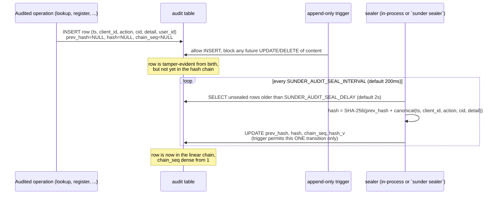

# Audit Chain

An operator needs to know that every register, lookup, erase, consent and
OTI-verify against their org's data is recorded in a log that a
database-level attacker cannot silently edit - and needs to understand what
trade-off they are accepting to get that at production throughput.

## Mechanism

Every audit row hashes over the previous row's hash plus its own canonical
content (`prev_hash`, timestamp, client, action, CID, detail JSON). Since
sealing is decoupled from the write (P4.1), a row's hash does not have to
exist at insert time - only its content does, and the append-only trigger
locks that content down immediately.



## Sealing modes: async vs sync

`SUNDER_AUDIT_SEALING` picks how a row gets its hash. Both modes hash the
same canonical bytes and read the chain head the same way, so a chain built
partly in each mode still verifies as one unbroken chain - only WHEN the
chain is built changes, never the content.

- **`async` (default).** The INSERT takes no lock; a background sealer
  chains settled rows in batches. This removes `audit.AppendTx`'s
  instance-wide `pg_advisory_xact_lock`, which was measured as the whole
  throughput ceiling: ~460 audited ops/sec flat past 4 concurrent clients on
  a 12-core server, independent of hardware or data size (`docs/THREAT-MODEL.md`,
  "Audit chain: the cost of linearity"). With the lock removed, the same
  26.8M-contact scale test measured lookup throughput going from a ~420 rps
  plateau to 1,773 rps at c=32 and still climbing at c=64 (`benchmark/README.md`).
  The cost: a row exists unsealed - protected against edits by the trigger,
  but not yet chained - for roughly `SUNDER_AUDIT_SEAL_DELAY` +
  `SUNDER_AUDIT_SEAL_INTERVAL` (2.2s at defaults). A DBA-level attacker who
  can also defeat the append-only trigger has that window, instead of one
  row, to delete evidence without breaking a hash.
- **`sync`.** The chain lock is held inside the same transaction as the
  operation; the row is born sealed. Zero sealing window, at the serialized
  ~300-460 rps ceiling. Mode changes are restart-only: switching a
  multi-replica deployment to sync requires stopping all replicas first, and
  the server drains any unsealed backlog before opening its listeners.

Choosing between them is a per-deployment call, not a default to leave
unexamined - see `docs/CONFIG.md` ("Audit sealing (P4.1)") before changing
it either way.

## Read buckets vs chained reads

Lookups and attribute reads are the highest-volume audited events, and the
audit log is never pruned, so how reads are recorded (`SUNDER_AUDIT_READS`)
is its own trade-off:

- **`bucketed` (default).** Reads UPSERT into hourly buckets keyed
  `(client_id, user_id, cid, action, hour)` instead of one chained row per
  event. A closer (running in the server, or in `sunder sealer` when
  `SUNDER_AUDIT_SEAL_EXTERNAL=true`) turns each finished hour into ONE
  chained row carrying a digest over that hour's buckets. Tamper evidence
  for reads therefore holds at hour granularity: the OPEN bucket for the
  current hour can have its count inflated or `last_seen` moved without
  breaking any digest (the trigger still blocks count decreases, key
  changes and deletes), while a SEALED bucket is digest-checked and any
  edit is caught by `verify-audit`. Mutations - register, erase, consent,
  OTI verify - are always chained per event in both modes; only reads
  aggregate.
- **`chained`.** Every read is its own chained row, per-event tamper
  evidence, the pre-P4.2 behaviour.

What bucketing buys: audit growth drops by the repeat-access factor, and the
log stores less about operator behaviour - an access log is itself personal
data about the employees making the queries.

## `user_id` attribution

A client system can attribute a read to the operator inside it: the
`user_id` field on the lookup body, or `X-Sunder-User-Id` on GET routes
(body wins if both are sent). Validated to `[A-Za-z0-9._@:-]`, 1-64 chars,
with a 400 on anything else - never silently dropped.

```bash
curl -s https://sunder.example.org/v1/lookup \
  -H "Authorization: Bearer $CLIENT_TOKEN" \
  -H "Content-Type: application/json" \
  -d '{"email": "ana@example.com", "user_id": "agent-7"}'
# GET routes carry it as a header instead:
curl -s https://sunder.example.org/v1/contacts/CID123/attributes/email \
  -H "Authorization: Bearer $CLIENT_TOKEN" \
  -H "X-Sunder-User-Id: agent-9"
```

`user_id` is stored as a real queryable column and as a bucket key, and
returned in the Article 15 access trail. **It IS part of the hashed tuple**
for every row sealed since migration 0033 - `canonical()` includes it when
the row's `hash_v >= 2`, and every new row seals under v2. Editing it
therefore breaks verification at that position.

Rows sealed BEFORE that migration keep the v1 tuple permanently (a sealed
chain cannot retroactively cover a new field), and for those the append-only
trigger alone pins the value. Flipping a row's `hash_v` cannot hide an edit:
the stored hash matches only the tuple it was computed over, and recomputing
it breaks the `prev_hash` linkage the external anchor pins.

It remains CLIENT-ASSERTED and unverifiable by design: Sunder records what
the client claims, it does not verify it. The chain proves the claim was not
altered after the fact, not that it was true.

## Security notes

- The chain does NOT prove what a verifier concluded. `docs/THREAT-MODEL.md`'s
  audit content boundary (P2.3) means only the operation, actor, pseudonym
  and requested predicates are recorded (`predicates_asked: ["birthdate
  age_gte 18"]`), never the boolean result or any attribute value. This is
  an accountability record, not a derived-data warehouse, and it is the one
  store designed to survive erasure.
- The sealing window does NOT allow silent editing of row content at any
  point - the append-only trigger permits exactly one transition (filling
  the three seal columns) and nothing else, ever, in either mode.
- `user_id` does NOT get verified, and Sunder does not pretend otherwise.
  It upgrades an Article 15 answer from "which system accessed this" to
  "which operator the system claims accessed this" - a lying client system
  could already lie in its own logs, so this changes nothing about the
  trust boundary, only what's queryable on Sunder's side.
- Bucketed reads do NOT give per-event tamper evidence for the open hour.
  Deployments that need per-event proof for every read, not just sealed
  hours, must set `SUNDER_AUDIT_READS=chained` - bucketing is an explicit
  trade of read-level tamper granularity for storage and operator-privacy
  gains, not a free lunch.

## The action vocabulary

`action` is a closed set, not free text. Every value the server can write is
registered in `internal/audit/actions.go` with a one-line meaning, and two
guards keep the registry honest: one fails the build when the code writes an
action nobody registered, the other when the registry describes an action
nothing writes. So "what can this column contain?" has an answer that cannot
go stale between releases.

That matters most for anyone writing a SIEM rule or a retention policy
against the trail: a typo used to produce a new action silently, and a filter
matching the old spelling went quiet rather than red.

### Lookups: one action or three

By default every lookup - exact e-mail, phonetic name match, partial phone
suffix - records as `lookup`. Setting

```
SUNDER_AUDIT_LOOKUP_ACTIONS=split
```

separates them into `lookup`, `lookup.fuzzy` and `lookup.suffix`.

It is worth doing under bucketed reads, where the per-event detail carrying
`by` is dropped before the hour is sealed - the action is then the only field
that reaches the auditor, and the three forms have visibly different
enumeration profiles. `lookup.fuzzy` means the phonetic branch actually
widened that query, not merely that phonetic search is enabled somewhere in
the config.

Two things to know before enabling:

- **Consumers must move to the prefix.** Anything filtering
  `action = 'lookup'` will stop seeing fuzzy and suffix searches. Use
  `action LIKE 'lookup%'`, or enumerate `audit.LookupActions`. The set is
  closed and guarded, so a prefix match cannot miss a form added later.
- **It costs bucket rows.** Buckets key on
  `(client_id, user_id, cid, action, hour)`. The worst case is one client
  using all three forms within one hour, whose misses all share the empty
  cid: measured at **3.00x** the rows (2 becomes 6). A deployment whose
  clients use a single form sees no increase at all.
