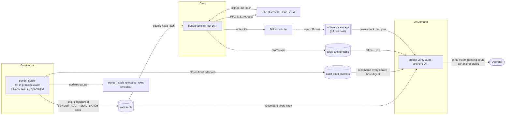

# Audit Operations

An operator needs the day-to-day commands to check the audit chain is
intact, keep the sealer running so unsealed rows don't pile up, and anchor
the chain externally so even a DBA-level attacker can't rewrite history
without it showing.

## Mechanism

`sunder verify-audit`, `sunder sealer` and `sunder anchor` are three
separate CLI subcommands that operate on the same `audit` and
`audit_anchor` tables - the sealer keeps the chain moving, `anchor` stamps
the current head with an external, un-editable timestamp, and
`verify-audit` recomputes everything and cross-checks it against exported
anchor files.



## Steps

### 1. Run the sealer

If `SUNDER_AUDIT_SEAL_EXTERNAL=false` (default), the API process seals
in-process and this step is unnecessary. Set it to `true` for privilege
separation - an API role with INSERT-only on `audit`, and a sealer role
that may only UPDATE `prev_hash`/`hash`/`chain_seq`:

```bash
sunder sealer
# output: sealer: interval 200ms, delay 2s, batch 5000, reads bucketed
```

For a one-shot drain (cron, or before switching to `sync`):

```bash
sunder sealer -once
# output: sealed 1303 row(s), closed 4 finished bucket hour(s)
```

`sync` mode needs no sealer at all - `sunder sealer` refuses to start
("SUNDER_AUDIT_SEALING=sync seals at insert; a sealer process has nothing
to do").

### 2. Anchor the chain head

Run on a schedule (cron), pointed at storage the sealer/API host cannot
reach:

```bash
sunder anchor -out /mnt/write-once/sunder-anchors
# output:
# anchored chain head 8f3a91c02b7e4d1f...
#   TSA: https://freetsa.org/tsr
#   stamped at: 2026-08-26T09:14:02Z
#   exported: /mnt/write-once/sunder-anchors/8f3a91c02b7e4d1f....tsr
```

`-out` defaults to `SUNDER_ANCHOR_DIR`. Without it (or with it unset), the
token is stored only in the database and the command warns: "token stored
only in the database - a database-level attacker can delete it." The whole
point of anchoring is defeated if the `.tsr` files never leave the host the
audit table lives on - sync the export directory to write-once storage off
that host as a separate step (rsync, object-lock bucket replication, tape,
whatever your org already trusts for that property).

### 3. Verify

```bash
sunder verify-audit -anchors /mnt/write-once/sunder-anchors
# output:
# audit chain: intact (sealing mode async, 12 unsealed rows pending)
# read buckets: intact (read mode bucketed, 1 finished hours awaiting close)
# anchor #1 8f3a91c02b7e4d1f... (2026-08-26T09:14:02Z) in-chain; token: OK; file: OK
```

`verify-audit` always does three things, in order: recomputes the whole
hash chain and fails with the exact break position on any mismatch;
recomputes every sealed hour's read-bucket digest; and, if any anchors
exist, cross-checks each one's stored root against the chain, verifies the
RFC 3161 token offline against a CA bundle, and - when `-anchors` is given
- compares the stored token bytes against the exported `.tsr` file. Any
anchor missing from the database, not found in the chain, with an invalid
token, or mismatching its exported file makes the command exit non-zero.

No SDK equivalent - these are host-side CLI operations run by whoever
operates the instance, not by API clients.

## The unsealed-rows gauge

`sunder_audit_unsealed_rows` is a Prometheus-style gauge (last-write-wins,
not cumulative) exposed on `/metrics`. It is set to the live pending count
after every sealer pass, and pinned to `0` at startup under `sync` mode
(where sealing happens at insert, so nothing is ever pending).

```bash
curl -s -H "Authorization: Bearer $SUNDER_METRICS_TOKEN" \
  https://sunder.example.org/metrics | grep sunder_audit_unsealed_rows
# sunder_audit_unsealed_rows 7
```

Alert on this gauge growing without bound, not on any single non-zero
reading - under async mode, some pending rows are the expected steady
state between sealer ticks. A stalled sealer (process crashed, blocked on
the DB role's missing UPDATE grant, etc.) is the incident this gauge exists
to catch: the sealing window grows unbounded while it's down. `SUNDER_METRICS_TOKEN`
gates `/metrics` because per-client counters reveal client IDs and activity.

## Security notes

- `verify-audit` does NOT treat a nonzero pending count as a break - pending
  rows are still protected by the append-only trigger and seal on the next
  pass. Only a missing `chain_seq`, a `prev_hash` mismatch, or (under
  `sync`, which drains before serving) a nonzero pending count fails.
- `sunder anchor` does NOT protect anything by itself if the export never
  leaves the host. An anchor kept only in the database is circular: whoever
  can rewrite the audit table can delete the anchor row too. The `.tsr`
  export plus off-host sync is the actual control - `verify-audit -anchors
  <dir>` is what makes a deleted anchor row or rewritten history provably
  detectable instead of merely "supposed to be."
- The sealer role (`SUNDER_AUDIT_SEAL_EXTERNAL=true`) does NOT get INSERT
  on `audit`, and the API role does NOT get UPDATE on the seal columns. A
  compromised API can insert false entries but never seal them itself or
  forge a hash over its own rows; a compromised sealer can chain rows but
  not fabricate new ones. Neither role alone produces a row that both lies
  and is validly sealed.
- `sunder anchor` does NOT vouch for unsealed rows - it anchors only the
  sealed head, so an anchor never certifies content the chain can't yet
  prove belongs to it.
