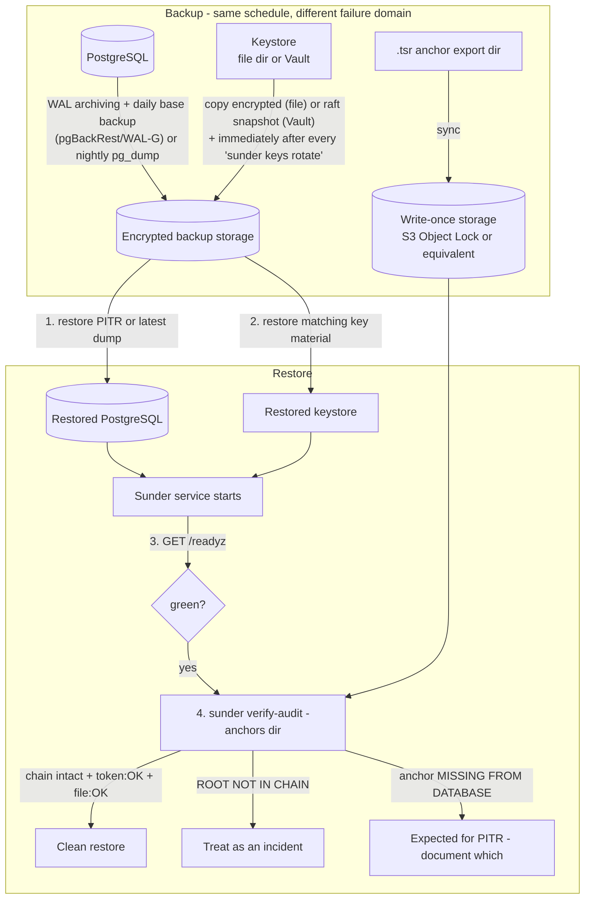

# Backup and Disaster Recovery

You need to back up Sunder and prove, on restore, that what came back is
both complete and legible - not a database full of tokens that no longer
match any key.



## The one rule

**The database and the key material are one unit.** Back them up
together, restore them together. A DB backup without the matching keys is
a pile of ciphertext; keys without the DB are useless. The strict keystore
makes a mismatch loud - missing-key errors - never silent.

| State | Where | Loss means |
|---|---|---|
| PostgreSQL | persons, tokens, cids+blobs, clients, consents, audit chain, anchors, keys metadata | everything |
| Key material | keystore (file dir or Vault) | tokens unmatchable, PII undecryptable - data loss even with a perfect DB backup |
| Exported anchors | `.tsr` files (anchor dir / write-once storage) | tamper evidence against a DB-level attacker |

## Back it up

```sh
# 1. PostgreSQL: continuous WAL archiving + daily base backup, encrypted at rest
pgbackrest --stanza=sunder backup
# or, at minimum, nightly:
pg_dump -Fc sunder | gpg --encrypt -r backups@example.org > sunder-$(date +%F).dump.gpg

# 2. Keys - file keystore: copy the (tiny) key directory, encrypted, on the
#    same schedule AND immediately after every rotation
sunder keys rotate -kind hmac-email
tar czf - /etc/sunder/keystore | gpg --encrypt -r backups@example.org > keystore-$(date +%F).tgz.gpg
# Vault keystore: snapshot on the same schedule as the DB
vault operator raft snapshot save vault-$(date +%F).snap

# 3. Anchors: sync the export directory to write-once storage - this copy
#    is the whole point, it must live where a database attacker cannot reach
sunder anchor -out /var/sunder/anchors
aws s3 sync /var/sunder/anchors s3://org-anchors-worm/sunder/ --sse aws:kms
```

Keep backups in a different failure domain than the primary.

## Restore it

```sh
# 1. Restore PostgreSQL (PITR to the desired point, or the latest dump)
pgbackrest --stanza=sunder restore --type=time --target="2026-08-22 03:00:00"

# 2. Restore the matching key material - same or later rotation state.
#    Keys are only ever added, never changed: a NEWER keystore is always
#    safe, an older one is not.

# 3. Start the service, then confirm readiness
curl -s -o /dev/null -w "%{http_code}\n" https://sunder.internal:8443/readyz
# expect 200. The startup bootstrap only *ensures* keys for versions listed
# in the restored `keys` table - if it mints a key that should have
# existed, you restored the wrong keystore: stop, see below.

# 4. Verify integrity
sunder verify-audit -anchors /var/sunder/anchors
```

Read the `verify-audit` output:

- `chain intact` + anchors `token: OK; file: OK` - clean restore.
- Anchor `MISSING FROM DATABASE` - you restored to a point before that
  anchor existed. Expected for PITR; document which anchors are affected.
- `ROOT NOT IN CHAIN` - the restored data diverges from anchored history.
  Treat as an incident, not just a bad restore.

**5. Spot-check one contact end to end**: lookup -> attribute read -> OTI
issue/verify, exactly as a real client would.

## Keystore mismatch symptoms

- Lookups return `404` for contacts that exist - HMAC keys don't match the
  stored tokens. Restore the correct keystore; as a last resort re-register
  contacts from source systems (dedup makes this idempotent), but PII
  blobs under a lost pii-kek are gone for good.
- `pii decrypt` errors on attribute reads - wrong or missing pii-kek
  version.

## RPO / RTO

- **RPO** = WAL archiving interval (minutes) for the DB; zero for keys -
  they change only at rotation, an operator action.
- **RTO** = PostgreSQL restore time plus one `readyz`. The service itself
  is stateless. Rehearse the restore quarterly - an unrehearsed runbook is
  a wish, not a plan.

## Security notes

- **Erased persons stay erased, on purpose.** `dsr.erase` deletes tokens
  and wipes blobs in the same transaction, so any restore newer than the
  erasure keeps it erased. Restoring to a point BEFORE an erasure
  resurrects that data - your retention/erasure obligations apply to
  backups too. Set backup expiry accordingly and re-run erasures executed
  after your restore point (the `erasures` table lists them).
- **Anchors deliberately live outside the database's own backup.** The
  `.tsr` export is synced to write-once storage precisely so that an
  attacker who compromises both the running DB and its ordinary backup
  still cannot rewrite anchored history - anchors kept only inside the
  database would be circular and defeat nobody privileged.
- **A DB restore without keys does not fail loudly on its own** - the
  strict, no-mint keystore is what turns a silent mismatch into visible
  `404`s and decrypt errors at step 3/4 above, rather than a service that
  starts, looks healthy, and quietly returns garbage.
