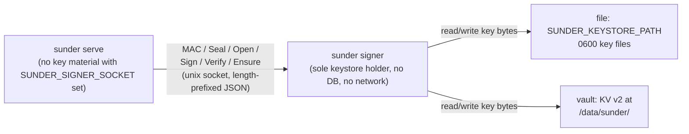

# Keys and Keystores

You need to decide where Sunder's key material lives, which process is
allowed to touch it, and what each key kind actually protects, before you
put a real deployment behind it.

## The mechanism



Without `SUNDER_SIGNER_SOCKET` set, `sunder serve` talks to the keystore
directly (`LocalEngine`) - simpler, but a compromised API process can read
key bytes from its own memory. With the socket set, `sunder serve` never
imports a keystore driver at all; it speaks the six-operation `crypto.Engine`
protocol to a separate `sunder signer` process, which is the only thing that
opens `file` or `vault`.

## Key kinds

Every deployment has five key kinds, each versioned independently
(`<kind>/v<N>`):

| Kind | Used for |
|---|---|
| `hmac-email` | Search tokens for email lookup |
| `hmac-phone` | Search tokens for phone lookup (and phone-suffix tokens when `SUNDER_SEARCH_PHONE_SUFFIX=true`) |
| `hmac-name` | Search tokens for name narrowing (and phonetic tokens when `SUNDER_SEARCH_FUZZY_NAME=true`) |
| `pii-kek` | AEAD key encrypting the per-scope attribute blobs on `cids` |
| `oti-sign` | Ed25519 seed signing PASETO v4.public one-time identifiers |

## Steps

### 1. Choose a keystore driver

```sh
# Development / single-node pilot: raw key files under a directory
export SUNDER_KEYSTORE=file
export SUNDER_KEYSTORE_PATH=./keystore

# Production: HashiCorp Vault, KV v2
export SUNDER_KEYSTORE=vault
export SUNDER_VAULT_ADDR=https://vault.internal:8200
export SUNDER_VAULT_TOKEN=$(cat /run/secrets/vault-token)
export SUNDER_VAULT_MOUNT=secret   # KV v2 mount point, default "secret"
```

`pkcs11` is accepted by `SUNDER_KEYSTORE` but is a stub today - it returns
"pkcs11 driver not implemented yet" for every call, pending the first
compliance-driven demand for HSM-backed material.

### 2. Bootstrap key material

First run (or after adding a deployment) mints every kind's `v1`:

```sh
sunder bootstrap -id admin -scope admin -purposes admin
```

`bootstrap` calls `KeyRing.EnsureAll`, the only path (besides `keys rotate`)
that is allowed to mint key bytes - `Key()` itself is strict and errors
on anything missing rather than silently generating a replacement, so a
lost key surfaces as an error, not as quietly-different data.

### 3. Split the signer out (recommended for production)

```sh
# Signer container/pod: opens the keystore, needs no DB, no network
sunder signer -socket /var/run/sunder/signer.sock

# API process: point it at the signer instead of a local keystore
export SUNDER_SIGNER_SOCKET=/var/run/sunder/signer.sock
sunder serve
```

SDK equivalent: none - this is a deployment topology choice, not something
callers of the HTTP API ever see or configure.

Deploy with Helm's `signer.enabled=true` (sidecar + in-memory `emptyDir`
socket volume) or `deploy/docker-compose.signer.yml` for a local
demonstration.

### 4. List what exists

```sh
sunder keys list
```

Prints `key_id`, `status` (`ACTIVE` / `RETIRING` / `RETIRED`) and
`created_at` for every key row, oldest kind first.

## Security notes

- The signer deliberately does **not** expose an operation that returns raw
  key bytes across the socket - the protocol is six fixed operations
  (`mac`, `seal`, `open`, `sign`, `verify`, `ensure`), so a compromised API
  process gains a cryptographic oracle, not the keys themselves.
- The signer deliberately does **not** fall back to local key access if the
  socket is unreachable - a dead or stopped signer fails every crypto path
  closed. There is no degraded mode where the API quietly starts holding
  keys again.
- The `file` driver deliberately does **not** auto-regenerate a key it
  can't find. `Key()` treats a missing file as fatal ("run
  bootstrap/rotation"); only `Ensure()`, called explicitly at bootstrap or
  rotation, is allowed to create material. This stops key loss (a wiped
  volume, a bad restore) from silently masquerading as a fresh install.
- The `vault` driver deliberately writes with `cas=0` (create-only) rather
  than upsert - two processes racing to bootstrap the same key name cannot
  overwrite each other's material; the loser's write fails and it re-reads
  the winner's key instead.
