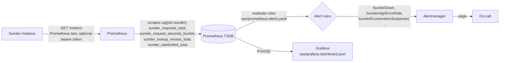

# Monitoring and Alerts

You want to know Sunder is up, fast, and not being probed for
enumeration - and have on-call paged before a client complaint tells you
first.



## Wire it up

**1. Point Prometheus at the instance.** The alert rules match on
`job="sunder"`, so the scrape job must be named that:

```yaml
scrape_configs:
  - job_name: sunder
    metrics_path: /metrics
    scheme: https
    bearer_token: "$SUNDER_METRICS_TOKEN"   # only if SUNDER_METRICS_TOKEN is set
    static_configs:
      - targets: ["sunder.internal:8443"]
```

**2. Sanity-check the endpoint directly:**

```sh
curl -s https://sunder.internal:8443/metrics \
  -H "Authorization: Bearer $SUNDER_METRICS_TOKEN" | head -20
```

There is no SDK call for this - `/metrics`, `/healthz` and `/readyz` are
plain HTTP endpoints for Prometheus and the kubelet, not client
integration.

**3. Load the alert rules.** `ops/prometheus-alerts.yaml` is a raw
`groups:` file; validate it, then either reference it via `rule_files` in
`prometheus.yml` or wrap its `groups` in a `PrometheusRule` CR if you run
the Prometheus Operator:

```sh
promtool check rules ops/prometheus-alerts.yaml
```

**4. Import the dashboard.** Grafana -> Dashboards -> New -> Import ->
upload `ops/grafana-dashboard.json`, pointed at the same Prometheus data
source. Panels: *Request rate by handler*, *p99 latency by handler*
(target: verify < 10ms, lookup/attr < 15ms, issue < 20ms), *5xx error
rate*, *Lookup misses by client (enumeration signal)*, *Rate-limited
requests by client*, *Auth failures (401) / min*, *Requests / s (total)*,
*Consent / DSR / OTI denials (403,409,410) by code*, *Audit chain: unsealed
rows (THE ALARM)*, *Erasure notifications stuck (SENDING) / abandoned
(FAILED)*, *Key material minted at runtime*, *Rate-limit backend failures
(Redis)*.

## What each alarm means

| Alert | Severity | Fires when | What it means, operationally |
|---|---|---|---|
| `SunderDown` | critical | `up{job="sunder"}==0` for 2m | No scrape for 2 minutes. Lookups, OTI handoffs and registrations are failing org-wide. |
| `SunderHighErrorRate` | critical | 5xx rate over 2% for 5m | Check database connectivity and service logs; audit appends failing shows up here first (operations fail closed). |
| `SunderLookupLatencyHigh` | warning | `POST /v1/lookup` p99 over 15ms for 10m | Above the 15ms design target. Check PostgreSQL load, index bloat on `person_tokens`, and connection-pool saturation. |
| `SunderOTIVerifyLatencyHigh` | warning | `POST /v1/oti/verify` p99 over 10ms for 10m | Above the 10ms design target. The verify hot path is a single CAS update; sustained latency means database contention. |
| `SunderEnumerationSuspected` | critical | over 100 lookup misses for one client in 10m | Possible enumeration attack. Review the audit trail for that client and consider suspending its credential. |
| `SunderRateLimitedSpike` | warning | over 500 rate-limited requests for one client in 10m | Either a runaway integration or an abuse attempt; check with the owning team before raising the limit. |
| `SunderAuthFailureSpike` | warning | over 200 `401`s org-wide in 10m | Possible credential stuffing against the API, or a client with a rotated-out credential still deployed. |
| `SunderAuditSealerStalled` | critical | `sunder_audit_unsealed_rows` over 1000 for 10m | The gauge THREAT-MODEL calls "the alarm". Rows outside the chain carry no hash, so `verify-audit` cannot cover them and an anchor does not attest them. Under `SUNDER_AUDIT_SEAL_EXTERNAL` check that `sunder sealer` is running and can reach the database - including that its role still holds `UPDATE (prev_hash, hash, chain_seq, hash_v)`. |
| `SunderAuditSealerStopped` | critical | the backlog has not decreased for 15m | The companion to the threshold rule: a stalled sealer with a LOW backlog never trips a threshold. This one catches it. |
| `SunderErasureEventsStranded` | critical | `sunder_erasure_events_sending` over 0 for 30m | Article 19 notifications claimed by a worker and never settled. The worker reaps its own stale claims every sweep, so a persistent value means delivery is making no progress. `sunder dsr events`; `sunder dsr requeue -all` once no worker is running. |
| `SunderErasureEventsFailed` | critical | `sunder_erasure_events_failed` over 0 | A scope's webhook exhausted its attempts. That scope still holds the person's records and has NOT been told to delete them. |
| `SunderKeystoreMintedKeys` | critical | `sunder_keystore_minted_total` over 0 | Key material was created at runtime. `sunder bootstrap` is the only legitimate source, and it is not `serve`: the keystore volume is lost, unmounted or misconfigured. **Stop the replica** and restore the correct keystore before writing anything further (`docs/RUNBOOK-BACKUP-DR.md`). |
| `SunderErasureCascadeStalled` | critical | `sunder_erasure_cascade_oldest_seconds` over 1h for 10m | People named by a cascading erasure are still not erased. The background sweep retries every `SUNDER_DELIVER_INTERVAL`, so a persistent value means a child cannot be erased at all - look for `pending cascade did not finish` in the log and find the `erasure_id` in `erasure_cascade`. The count alone (`sunder_erasure_cascade_pending`) cannot distinguish a large cascade in progress from a stopped one; the AGE can. These are people the organisation committed to forgetting. |
| `SunderKEKSealBudgetHigh` | warning | `sunder_kek_seals_total{version=...}` over 2^29 for 15m | Half the per-process AES-256-GCM seal budget is spent on that key version. Random 96-bit nonces have a birthday bound (NIST SP 800-38D: 2^32 invocations per key), so this is the signal to rotate on usage rather than on incident: `sunder keys rotate -kind pii-kek`, or migrate to `SUNDER_PII_ALG=xchacha20poly1305`, whose 192-bit nonces have no practical bound ([algorithm migration runbook](../admin/rotation-and-rekey.md)). The gauge is **per-process and resets on restart**, so it under-counts a key's lifetime use - treat it as a floor. |
| `SunderRateLimitBackendFailing` | warning | any increase in `sunder_ratelimit_backend_failures_total` over 10m | Redis is unreachable, so rate-limit windows are no longer shared across replicas. With `SUNDER_REDIS_FAIL_CLOSED=false` (the default) the limiter fails **open** - the per-client limits are not being enforced while this fires; with `true` lookups are being rejected instead. |

The dashboard's *Consent / DSR / OTI denials (403,409,410) by code* panel
has no matching alert rule in `ops/prometheus-alerts.yaml` - it is
visualized but nothing pages on it today. If a spike there matters to your
compliance posture, add a rule; do not assume it is already covered.

## Security notes

- `/metrics` is **unauthenticated by default**. Per-client counters
  (misses, rate-limited count, 401 count) reveal client ids and activity
  patterns, so set `SUNDER_METRICS_TOKEN` and still restrict the endpoint
  at the network layer - the bearer token is a second layer, not a
  replacement for network policy.
- Every alert fires on **aggregate, per-client counters** - `sunder
  _lookup_misses_total{client=...}`, `sunder_ratelimited_total{client=...}`,
  request counts by status code. None of it carries attribute values or
  lookup keys, matching the audit chain's own rule of recording actions,
  not PII: the alert can tell you *which client* and *how often*, never
  *who was looked up*.
- `SunderEnumerationSuspected` does **not** auto-suspend the client. The
  annotation says "review... consider suspending its credential" -
  deliberately a human decision. Sunder enforces the fixed rate limit;
  it does not throttle or ban adaptively on its own.
