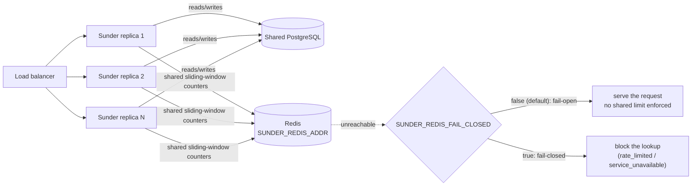
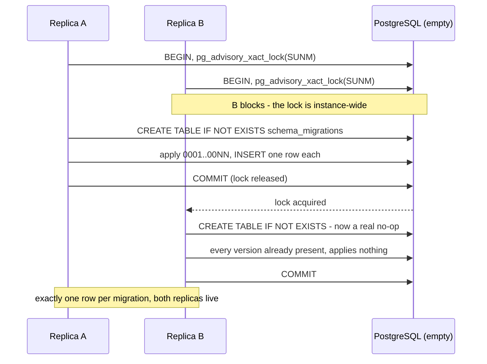
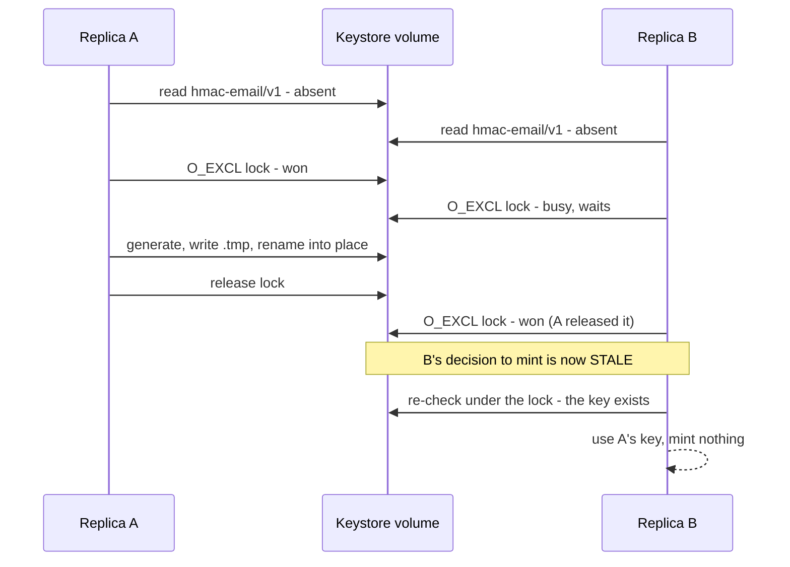
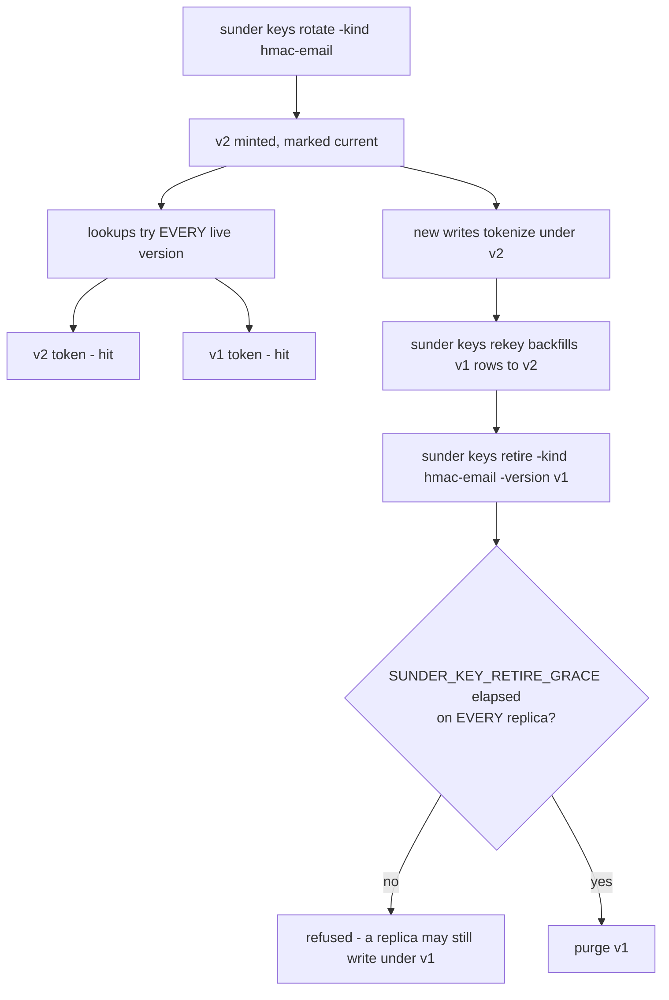
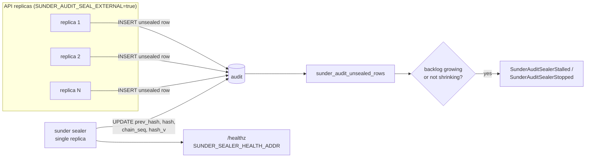

# Multi-Replica Deployments

You want to run more than one Sunder instance behind a load balancer
without each replica quietly enforcing its own private rate limit, and
without an unnoticed Redis outage silently changing what "rate limited"
means.



## Set it up

**1. Run stateless replicas.** Sunder itself holds no state - point every
replica at the same PostgreSQL and scale by adding replicas behind the
load balancer.

!!! danger "Two settings make a replica NOT stateless"

    - **`SUNDER_KEYSTORE=file`** keeps key material in a per-process
      directory. The Helm chart refuses it outright for this reason; use
      `vault` (or the signer split).
    - **`SUNDER_FILES_STORAGE=local`** keeps file **ciphertext** in a
      per-process directory (`SUNDER_FILES_DIR`) while its metadata and
      wrapped DEK live in the shared database. A download routed to a
      replica that does not hold the object answers **200 with the recorded
      `Content-Length` and an empty body** - it is not an error the caller
      can detect except by counting bytes. `sunder retention run` on one
      replica also garbage-collects only that replica's objects.
      `local` is single-instance only; **`s3` is the multi-replica driver.**
      Both are logged as a startup warning.

**2. Share rate-limit windows across replicas.** Unset, each replica
counts in memory: with a naive round-robin load balancer, a per-client
limit meant to be N requests/min becomes effectively N × replica-count.
Point every replica at the same Redis to make the limit real again:

```sh
export SUNDER_REDIS_ADDR=redis.internal:6379
export SUNDER_REDIS_PASSWORD=$(cat /run/secrets/redis-password)   # optional
```

**3. Decide the failure mode for when Redis itself goes down:**

```sh
# default: false - availability wins, requests proceed unlimited during the outage
export SUNDER_REDIS_FAIL_CLOSED=false

# strict: true - lookups are blocked while Redis is unreachable
export SUNDER_REDIS_FAIL_CLOSED=true
```

**4. Confirm the shared limit is real** by driving one client over its
per-minute cap through the load balancer VIP (not a single replica) and
watching for `429`:

```sh
for i in $(seq 1 200); do
  curl -s -o /dev/null -w "%{http_code}\n" \
    -X POST https://sunder-lb.internal/v1/lookup \
    -H "Authorization: Bearer $CLIENT_ID.$CLIENT_SECRET" \
    -H "Content-Type: application/json" \
    -d '{"email":"filip@example.com"}'
done | sort | uniq -c
```

Expect a mix of `200`/`404` until the client crosses its limit, then
`429` with body `{"error":"rate_limited"}` - and the same limit regardless
of which replica happened to answer. There is no SDK call for this check;
it is exercising the ordinary lookup call under load, and every SDK's
lookup method surfaces `429` as its `RateLimited` error the same way.

## Scenarios a fleet meets that a single instance never does

Four situations behave differently with more than one replica, and the
difference is invisible in a single-instance test. Each is exercised by
`ops/coldboot-scenarios.sh`, which boots from nothing every time - a stack
restarted onto existing data cannot reproduce any of them.

### 1. Cold boot: two processes, empty database

The first `up` of a new deployment is the only moment where two processes
migrate a schemaless database at the same time. Sunder serializes migrations
with an advisory lock; the subtlety is that the bookkeeping table must be
created INSIDE that lock, because `CREATE TABLE IF NOT EXISTS` is not atomic
- the existence check and the creation are separate steps.



Before the table moved inside the lock, both replicas passed the not-exists
check and the loser died with `duplicate key value violates unique
constraint "pg_type_typname_nsp_index"` - a table creates its row type too.
On Kubernetes that is a crash loop on the very first deployment, and it
never reproduces once the database has a schema.

**What an operator sees when it goes wrong:** one pod `Running`, the other in
`CrashLoopBackOff` with a `pg_type` duplicate-key error, and a partially
migrated database. **Recovery:** scale to one replica, let it finish, scale
back up.

### 2. A replica joins and shares the keystore

Two replicas on one keystore volume must agree on key BYTES, not merely both
"have a key". The file driver elects a single generator with `O_EXCL`; the
elected process must then re-check whether the key already exists, because
its decision to mint was made before it held the lock.



Skip that re-check and B mints over A's key. Every search token A wrote is
then unmatchable and every blob sealed under it is unreadable, while both
replicas report healthy: `/healthz` 200, and lookups simply return 404. The
observable invariant is the one the scenario asserts - a contact registered
through A resolves through B.

!!! danger "The file keystore is not the multi-replica answer"
    It needs a `ReadWriteMany` volume and it is single-writer by design. On
    Kubernetes use `keystore.type: vault`; the chart defaults to it. The
    scenario above exists because a shared-volume deployment is *possible*,
    not because it is recommended.

### 3. Key rotation while traffic runs

Rotation mints the next version and new writes pick it up immediately.
Reads must keep working under the old version throughout - there is no
window where a lookup misses because its token was written under a version
that is no longer current.



The grace period is the multi-replica part. `KeyRing` caches key material per
process, so a replica can still be writing under v1 for as long as its cache
is stale. The purge is one-shot: a replica writing v1 tokens after it leaves
rows nothing will ever match or delete. Set `tunables.keyRetireGrace` above
the worst-case cache staleness across the whole fleet, and never set it to
`0` with more than one replica.

### 4. Sealing across a fleet

Under `async` (the default) each replica seals the rows it can see, and the
chain stays linear because `chain_seq` is assigned under a lock. The
hardened arrangement moves sealing out of the API entirely.



With the API role holding `INSERT` but no `UPDATE` on `audit`, a compromised
API replica cannot seal or forge hashes over its own rows. The sealer's own
`/healthz` answers 200 only while its last SUCCESSFUL pass is recent - it
logs-and-continues on error by design, so without that probe a sealer that
lost its `UPDATE` grant stays `Running` and `Ready` forever while the backlog
grows.

**Sealing mode changes are the one operation that needs the whole fleet
stopped**, and only in one direction - see below.

## Other multi-replica behavior worth knowing

Audit sealing mode (`SUNDER_AUDIT_SEALING`) also has a multi-replica rule:
switching a fleet from `async` to `sync` requires stopping ALL replicas
first. A lingering `async` replica whose transaction commits after the new
instance's startup drain leaves that row outside the chain until the next
drain - `sunder verify-audit` will fail visibly on exactly this state. The
reverse direction, `sync -> async`, needs nothing special.

## Security notes

- **Fail-open is the default, deliberately.** `SUNDER_REDIS_FAIL_CLOSED`
  defaults to `false`: when Redis is unreachable, lookups keep serving
  rather than the fleet going down. This is an explicit availability
  trade-off, not an oversight - set it to `true` only where an
  under-enforced rate limit during a Redis outage is worse than blocking
  lookups.
- **The privacy portal does not get this choice.** Regardless of
  `SUNDER_REDIS_FAIL_CLOSED`, the citizen-facing portal's rate limiter
  always fails **closed** if Redis is unreachable - a portal outage that
  degrades into "no rate limit" would expose the mail-sending route to
  enumeration and mail-bombing, which the API's own trade-off is not
  allowed to inherit.
- **Redis is rate-limit state only, never identity or credential state.**
  Losing Redis entirely (data flush, failover) resets counters, not
  authorization - a client still needs a valid bearer credential (or mTLS
  certificate) on every request, with or without Redis, and Redis holds no
  PII: only per-client sliding-window counters.
- **Sharing Redis does not make replicas share anything else.** Keys,
  audit chain state, and the database connection are each their own
  concern; a shared rate limiter does not imply a shared cache of lookups
  or attributes - every request still resolves against PostgreSQL.
