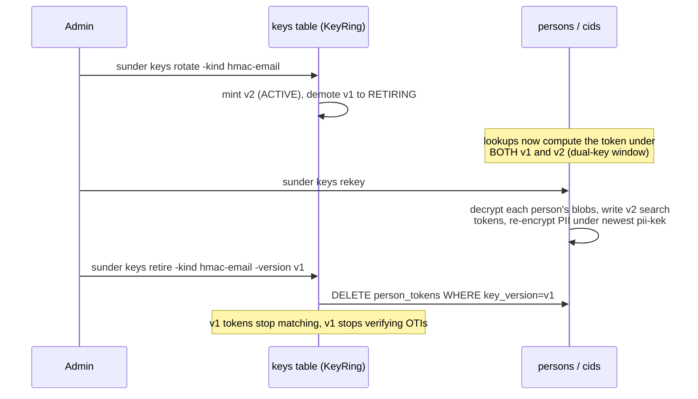

# Rotation and Rekey

You need to replace a key - on schedule, after a suspected leak, or as part
of an algorithm migration - without breaking lookups or attribute reads for
data written under the old one.

## The mechanism



Between rotate and retire, every kind is in the **dual-key lookup window**:
`KeyRing.Versions` returns every `ACTIVE` and `RETIRING` version for a
kind, newest first, and lookup computes the search token under each one
until it finds a match. This is what lets rotation happen with zero
downtime - a row token-derived under v1 keeps matching until it is
re-keyed or v1 is retired.

## Steps

### 1. Rotate

```sh
sunder keys rotate -kind hmac-email
# rotated hmac-email to v2 (previous versions RETIRING; old tokens keep matching, rows re-key on touch)
# running servers pick up the change within 30s (keyring cache TTL)
```

Valid `-kind` values: `hmac-email`, `hmac-phone`, `hmac-name`, `pii-kek`,
`oti-sign`. Rotate mints the new version's key bytes first, then commits the
metadata row that makes it `ACTIVE` and demotes the previous `ACTIVE` to
`RETIRING` - key material always exists before anything can reference it.

Rows re-key "on touch" (any register/lookup/share that writes a token or
blob writes it under the newest version) - but a contact nobody touches
again stays on the old version forever. That is what `rekey` is for.

### 2. Complete the rotation with `keys rekey`

```sh
sunder keys rekey -reencrypt-pii=true -batch 500
# rekey sweep: 41203 person(s), 3 token(s) written, 41118 blob(s) re-encrypted, 0 blob(s) undecryptable
# old versions can now be retired: sunder keys retire -kind <kind> -version <v>
```

This is a batch sweep over every non-erased person (id order, `-batch` per
page): it decrypts each person's per-scope attribute blobs, derives fresh
search tokens for every identifier it finds under the *newest* ACTIVE
version of each HMAC kind, and (unless `-reencrypt-pii=false`) re-encrypts
the blob under the newest `pii-kek` if its stored key version or algorithm
is stale. It is idempotent and resumable - rerun until the counts read
zero. A contact whose blobs were already wiped by retention has no
recoverable identifiers; its old-version tokens simply die when you retire
that version.

**`keys rekey` is also the backfill path for derived search tokens.**
Turning on `SUNDER_SEARCH_FUZZY_NAME` or `SUNDER_SEARCH_PHONE_SUFFIX` on an
existing dataset does nothing for contacts registered before the flag was
set - those derived tokens (`name_phonetic`, `phone_suffix`) only get
written going forward, or by rerunning the same sweep:

```sh
export SUNDER_SEARCH_FUZZY_NAME=true
sunder keys rekey
```

The sweep re-derives phonetic codes / suffixes from the names and phones it
already decrypted and inserts the missing token rows
(`ON CONFLICT DO NOTHING`), so this is the single command for both "finish
a key rotation" and "backfill a newly enabled search feature."

### How long it actually takes

"Run `sunder keys rekey`" is one line to type and, on a large dataset, a
**maintenance window to plan**. These numbers are measured, not estimated -
26,872,537 contacts, 34 GB, 12-core server, PostgreSQL 16 tuned per
[Postgres Sizing](../install/postgres-sizing.md):

| Operation | Measured |
|---|---|
| Sweep throughput | **~424 persons/sec** |
| Full pass over 26.9M persons | **~17.6 hours** |
| Backfilling `phone_suffix` + `name_phonetic` from scratch | the same pass; ~140M token rows |
| Applying the v0.4 → v0.5 migrations on that dataset | 0.63 s |
| Restart-to-`/readyz` after those migrations | 1.5 s |

Scale it linearly: roughly **40 minutes per million contacts**. Under a
million, it is a coffee break. Over ten, it is an overnight job.

Two things follow, and both matter more than the number:

- **Do not start a full sweep in business hours on a large dataset.** It
  holds pool connections for its duration and competes with live traffic.
- **The sweep reports progress every 30 seconds** and resumes where it
  stopped, so interrupting it is safe and cheap:

```
INFO rekey sweep starting live_persons=26872537 batch=500
INFO rekey sweep progress persons_this_run=254000 persons_total=254000 tokens_written=1270000 persons_per_sec=424 eta=17h20m0s
^C
$ sunder keys rekey            # later, in the next window
INFO rekey sweep resuming from_person=3f2a... already_covered=254000
```

A resume point is only honoured for **identical work**: rotate another key,
flip a derived-search flag, or rerun with `-reencrypt-pii` after a run
without it, and the sweep correctly starts from the beginning, because
persons before the old resume point now have work again.

`SUNDER_REKEY_BATCH` (default 500) sets how many persons a page covers and
how many persons' tokens go into one `INSERT`. Lower it to be gentler on a
loaded database; `1` restores per-token writes, which on this dataset
measured **87 hours** instead of 17.6 - the difference is round-trip
latency, not database throughput.

### 3. Verify, then retire the old version

```sh
sunder keys list
# hmac-email/v1              RETIRING  2026-01-04T09:00:00Z
# hmac-email/v2              ACTIVE    2026-08-20T11:12:03Z

sunder keys retire -kind hmac-email -version v1
# retired hmac-email/v1 - it no longer matches lookups nor verifies tokens
# (for hmac kinds: rows still stored under this version stop matching; re-key first)
```

Retire only accepts a `RETIRING` version (rotate first) and refuses the
current `ACTIVE` version outright. For `hmac-*` kinds it also deletes every
`person_tokens` row still stored under that version in the same
transaction - so retiring before a full `rekey` sweep permanently drops
lookup-ability for any contact that was never re-keyed. Check `keys list`
and the sweep's `token(s) written` count before retiring.

SDK equivalent: none - CLI-only, operator-run maintenance, deliberately
separate from the request-serving API surface.

## Algorithm migration

`SUNDER_PII_ALG` (`aes256gcm` default, or `xchacha20poly1305`) only governs
what *new writes* use - reads always follow the algorithm stored per-blob
(`cids.pii_alg`), so old and new algorithms coexist with no downtime. The
same `keys rekey` sweep converts the backlog, because it re-encrypts a blob
whenever its stored key version *or* algorithm is stale:

```sh
sunder keys rotate -kind pii-kek          # mint pii-kek/v2 first - don't reuse
                                           # key material across algorithms
export SUNDER_PII_ALG=xchacha20poly1305   # restart replicas (rolling is fine)
sunder keys rekey -batch 500              # converts the backlog; rerun until
                                           # "0 blob(s) re-encrypted"
```

Verify **every** pii-kek-sealed store, not just `cids` - `value_tokens`,
`person_record_keys`, `cid_blob_versions` and `portal_outbox` hold sealed
data too, and checking `cids` alone reports a completed migration while the
value vault and the record key that wraps every file DEK are still on the old
algorithm:

```sql
SELECT 'cids' AS store, COALESCE(pii_alg,'(null)') AS alg, count(*)
  FROM cids WHERE pii_encrypted IS NOT NULL GROUP BY 2
UNION ALL SELECT 'cid_blob_versions', alg, count(*) FROM cid_blob_versions GROUP BY 2
UNION ALL SELECT 'value_tokens', alg, count(*) FROM value_tokens GROUP BY 2
UNION ALL SELECT 'person_record_keys', alg, count(*) FROM person_record_keys GROUP BY 2
UNION ALL SELECT 'portal_outbox', alg, count(*) FROM portal_outbox GROUP BY 2
ORDER BY 1, 2;
```
Full procedure, including the associated-data binding that makes a hostile
`pii_alg` downgrade in the database fail authentication rather than decrypt
under the wrong cipher: `docs/RUNBOOK-ALG-MIGRATION.md`.

## Security notes

- Retirement deliberately does **not** leave old tokens lying around
  "just in case" - it deletes `person_tokens` rows under the retired
  version in the same transaction that flips its status, removing material
  derived from a possibly-leaked key rather than merely disabling it.
- Rotation deliberately does **not** let you skip straight to retiring the
  version you just replaced - `Retire` only accepts a `RETIRING` version,
  so a leaked key still requires one explicit `rotate` before it can be
  cut off, and the newest `ACTIVE` version can never be retired out from
  under live traffic.
- The rekey sweep deliberately does **not** treat a blob it cannot decrypt
  as fatal - it counts it under `blob(s) undecryptable` and continues, so
  one corrupted or already-erased row cannot stall the sweep for every
  other contact.
- The keyring cache deliberately does **not** refresh instantly on every
  request - a 30s TTL means a rotation takes up to 30s to reach running
  replicas, and an unknown-kid verification miss forces at most one reload
  per 5s (`InvalidateThrottled`), so a flood of tokens signed by an
  already-retired key cannot be used to hammer the keys table.

## Rotation latency vs a retirement window

Both are the same 30-second `KeyRing` cache TTL, and they are not the same
risk.

- After **`keys rotate`**, a replica may keep writing under the previous
  ACTIVE version for up to 30s. Benign: both versions are live, and every
  lookup matches across all live versions.
- After **`keys retire`**, a replica may keep ACCEPTING the retired version
  for up to 30s. If you are retiring because the key LEAKED, that is an
  incident-response window - restart the fleet to cut it off immediately
  rather than waiting the cache out.

`keys retire` refuses a version that became `RETIRING` less than
`SUNDER_KEY_RETIRE_GRACE` (default 60s) ago, for the opposite direction of
the same problem: a replica still WRITING under the old version after the
retirement's one-shot purge has run leaves search-token rows nothing will
ever delete or match again. `-force` overrides it when you know no other
replica is running.
