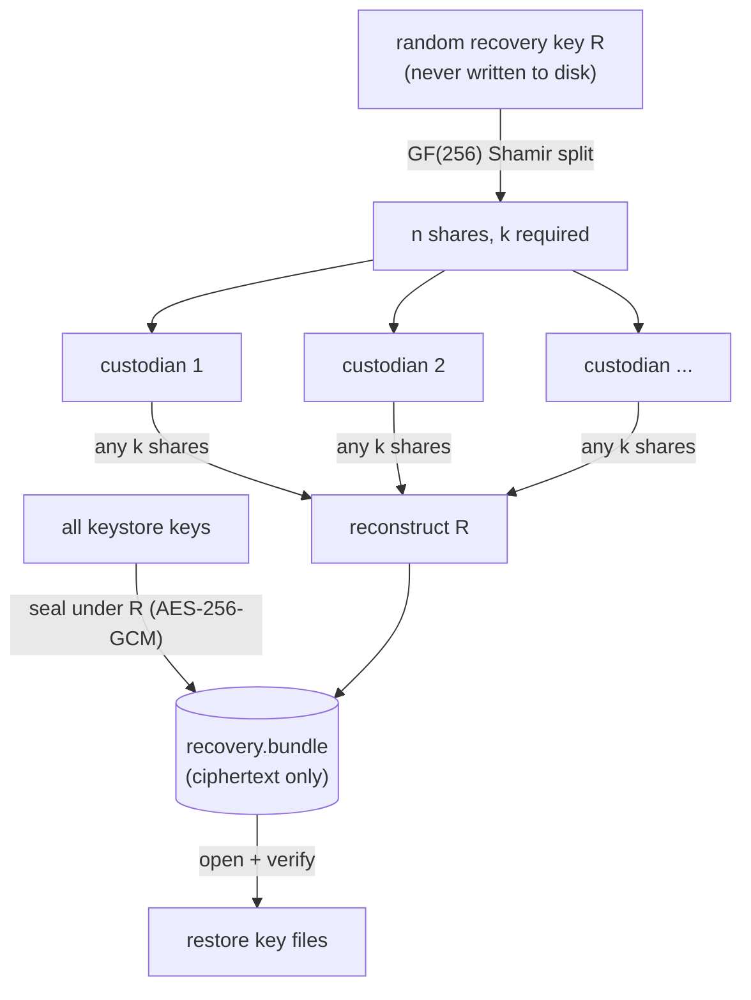

# Shamir Recovery Shares

If the file keystore is lost - a wiped disk, a corrupted volume - every
encrypted blob and every pseudonym becomes unreadable. F9 gives the file
keystore a break-glass recovery: the keystore is sealed under a random
recovery key that is split into `k`-of-`n` shares handed to separate
custodians, and never itself written to disk. Any `k` custodians can
reconstruct it and restore the keystore; fewer cannot.

!!! note "File keystore only"
    Shamir recovery is for the `file` keystore driver. The Vault driver
    delegates recovery to Vault's own unseal/recovery mechanism, so these
    commands refuse to run against it.

## How it works



The recovery key and the shares are never stored. `recovery.bundle` holds
only AEAD ciphertext, so it is safe to back up alongside your database
dumps. Reconstruction verifies both the Shamir checksum and the GCM tag
before touching the keystore, so a wrong or incomplete share set fails
closed and never overwrites good keys with garbage.

## Initialize (issue shares once)

```bash
sunder keys shamir-init -n 5 -k 3
# Recovery bundle written for N keys. 3-of-5 shares (store each with a
# DIFFERENT custodian, OFFLINE):
#   share 1/5: <hex>
#   share 2/5: <hex>
#   ...
# These shares are shown ONCE and cannot be recovered.
```

!!! warning "Five shares in one vault is 1-of-1 in a costume"
    The threshold only protects you if the shares live apart. Give each
    share to a separate custodian, offline. The shares are printed exactly
    once and cannot be regenerated - only re-issued from scratch with a new
    `shamir-init`, which invalidates the old bundle.

## Recover after a loss

```bash
# Provide k shares on the flag, or omit -shares to paste them interactively.
sunder keys shamir-recover -shares "<hex1>,<hex2>,<hex3>"
# Recovered and restored N keys.
```

Fewer than `k` shares, or a corrupted share, fails with a clear error and
changes nothing on disk.

## The annual custodian drill

```bash
sunder keys shamir-rotate -shares "<hex1>,<hex2>,<hex3>"
# Recovery bundle re-sealed over N keys under the existing shares.
```

`shamir-rotate` reassembles the same recovery key from `k` shares and
re-seals the *current* keystore under it - picking up any keys added since
`shamir-init` (rotations, new kinds) without changing what the custodians
hold. Run it periodically: it both refreshes the bundle and proves the
custodians can still assemble their shares before a real emergency.

## Security notes

- The recovery key is a transient in-memory buffer; it is never persisted,
  logged, or sent anywhere.
- The GF(256) Shamir implementation is stdlib-only (no new dependencies)
  and validated against a published test vector.
- Recovery is separate from operational key [rotation and rekey](rotation-and-rekey.md):
  rotation changes which key encrypts new data; Shamir protects against
  losing the keystore that holds all of them.
- `recovery.bundle` is ciphertext; possessing it without `k` shares reveals
  nothing.
