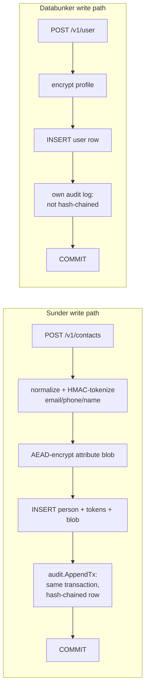

# Databunker

You are deciding whether to run Sunder or [Databunker](https://databunker.org) as the pseudonymous-identity layer in front of your PII store, and you want the honest trade-offs, not a sales sheet.

Both systems solve the same core problem: keep PII out of application databases, hand callers an opaque token instead, and audit who touched what. They diverge on how much they do per request and how that audit is structured - which is exactly what the mechanism below shows.



Sunder's extra steps (keyed-HMAC tokens per identifier, a hash-chained audit row in the same transaction) are what the benchmark below is measuring the cost of - and the throughput numbers show that cost is more than paid for.

## What Databunker has that Sunder does not

- **A demo SQLite backend** for zero-dependency evaluation. Sunder requires PostgreSQL from the start.
- **A single self-contained binary with a built-in admin UI.** Sunder ships an API plus a `sunder` CLI; there is no bundled admin UI in this repo.
- **A "Pro" edition** with published AWS benchmark numbers or additional features - not publicly runnable, so it is not part of the head-to-head below.
- **Full-record reads.** A Databunker read returns the whole stored profile in one call. Sunder returns exactly one purpose-checked attribute per call, by design (see Security notes).

## What Sunder has that Databunker does not

- **A hash-chained, tamper-evident audit log**, written in the same transaction as the operation it records (`sync` mode) or sealed within a couple of seconds (`async` mode, the default) - see `docs/CONFIG.md` ("Audit sealing"). Databunker's own audit log is not hash-chained.
- **Keyed-HMAC search tokens per identifier per live key version**, so lookups never compare or store plaintext PII, and key rotation keeps old tokens matchable during the rotation window.
- **Purpose- and consent-gated field reads.** Every `attributes.read` call requires a `purpose` in the caller's allowed set and is denied if the data subject withdrew consent for that purpose (`consent_denied`, distinct from `purpose_not_allowed`).
- **Per-client scoping.** A client can only ever reference CIDs in its own scope; a CID from another scope is indistinguishable from a nonexistent one (404), which is what makes cross-system enumeration impossible even with a valid credential.
- **A supported bulk-import path** (`sunder import`) that computes the same tokens and blobs as the API but skips per-request overhead entirely - see [Bulk Import](../migrations/bulk-import.md).

## The measured head-to-head

All numbers are from `benchmark/README.md`, produced by `benchmark/bench.go` - one Go harness, same PostgreSQL 16, same machine, both systems in Docker. Quote ratios, conditions attached; do not lift a number out of its row.

### Idle laptop, pre-Phase-2 build (2026-08-22)

n=5000 per operation, 16 concurrent clients, zero errors both sides:

| Operation | Sunder | Databunker (OSS) | Advantage |
|---|---|---|---|
| write | 2,173 rps, p50 6.95 ms, p99 11.9 ms | 1,091 rps, p50 13.7 ms, p99 38.9 ms | +99%, p99 3.3x lower |
| lookup | 2,837 rps, p50 5.38 ms, p99 9.4 ms | 1,885 rps, p50 8.13 ms, p99 20.9 ms | +50%, p99 2.2x lower |
| read | 2,843 rps, p50 5.41 ms, p99 8.4 ms | 1,811 rps, p50 8.12 ms, p99 23.9 ms | +57%, p99 2.8x lower |

### Laptop under real desktop load, pass-4 build (2026-08-23)

Same harness, machine load average ~4-8 this time (not idle) - five interleaved rounds plus one clean 5,000-request pass, zero errors in the clean pass:

| Operation | Sunder | Databunker | Advantage |
|---|---|---|---|
| write | 2,729 rps, p50 5.62 ms, p99 9.77 ms | 1,295 rps, p50 12.09 ms, p99 26.29 ms | +111%, p99 2.7x lower |
| lookup | 3,439 rps, p50 4.53 ms, p99 6.25 ms | 2,032 rps, p50 7.18 ms, p99 20.02 ms | +69%, p99 3.2x lower |
| read | 3,443 rps, p50 4.51 ms, p99 5.64 ms | 2,139 rps, p50 6.45 ms, p99 19.33 ms | +61%, p99 3.4x lower |

Two Databunker measurements in that run's round 5 (lookup 328 rps, read no result) were discarded as a failed run rather than averaged in - noted here because dropping them silently would flatter the comparison.

### Server, 12-core / 47 GB, before the audit-chain fix (2026-08-24)

**This is the condition you must not skip.** On this server, Sunder's write throughput plateaued at ~460 rps regardless of concurrency, because the audit hash chain held a database-wide advisory lock across every commit; Databunker kept climbing and overtook Sunder past c=32:

| Concurrency | Sunder (write) | Databunker (write) |
|---|---|---|
| 1 | 131 rps | 92 rps |
| 4 | 451 rps | 270 rps |
| 16 | 468 rps | 443 rps |
| 32 | 459 rps | 463 rps |

Per-request Sunder was still faster at every point (+43% at c=1, +67% at c=4), but total throughput told the opposite story at high concurrency. This was a real, measured regression under load - not a bug in the benchmark.

### Server, after `SUNDER_AUDIT_SEALING=async` (P4.1, 2026-08-25) and bucketed reads (P4.2, 2026-08-26)

Same server, 26.8M-contact dataset, Sunder deliberately handicapped (answering over a dense 20M+ keyspace against Databunker's own ~10k set, and still doing more per request):

| operation | Sunder | Databunker | delta |
|---|---:|---:|---:|
| lookup c=8 | 1,589.1 rps | 716.5 rps | 2.2x |
| lookup c=32 | 2,746.7 rps | 884.5 rps | 3.1x |
| lookup c=64 | 2,466.9 rps | 599.7 rps | 4.1x |
| read c=16 | 1,568.9 rps | 723.4 rps | 2.2x |
| write c=8 | 377.7 rps | 277.8 rps | +36% |
| write c=32 | 1,014.3 rps | 503.3 rps | 2.0x |

p99 is 2-4x lower throughout, and the gap widens with concurrency instead of narrowing - the inverse of the pre-fix run. See `docs/CONFIG.md` ("Audit sealing", "Audit read events") for what `async` and `bucketed` trade away to get here: a few seconds of sealing latency and hour-granularity tamper evidence on reads, never on mutations.

### Known asymmetries (methodology, not spin)

| | Sunder | Databunker OSS |
|---|---|---|
| Read returns | one attribute (field-level, purpose-checked) | full record |
| Audit per op | hash-chained, same-transaction, globally ordered | own audit (not hash-chained) |
| Search index | keyed HMAC per identifier per live key version | hash index |
| Edition | open-source (= the product) | open-source (Pro not publicly runnable) |

## Reproduce it yourself

```sh
docker compose -f deploy/docker-compose.yml up --build -d
CRED=$(docker compose -f deploy/docker-compose.yml exec sunder /sunder client create \
  -id bench -name Bench -scope crm \
  -actions contacts.register,lookup,attributes.read -purposes benchmark -rate 10000000 | tail -1)

go run ./benchmark -target sunder -base http://localhost:8080 -cred "$CRED" -op write -n 5000 -c 16 -seed round1
```

Full setup (including standing up Databunker on its own PostgreSQL) is in `benchmark/README.md`.

## Security notes

- Sunder's read path deliberately returns **one field, purpose-checked, per call** - never a full record like Databunker's read. A caller that wants five fields makes five audited calls, each checked against its own allowed purposes; there is no single call that dumps a person's whole profile to a client credential.
- There is deliberately **no bulk HTTP API** for either registration or reads. High-volume ingestion goes through `sunder import`, which needs database and keystore access (operator level), not an API credential - see [Bulk Import](../migrations/bulk-import.md) for why.
- The benchmark numbers above are not a substitute for your own measurement on your own hardware and dataset size: the pre-P4.1 server run shows throughput characteristics can invert past a concurrency threshold that a laptop never reaches. Reproduce on your target deployment shape before sizing a production instance.
