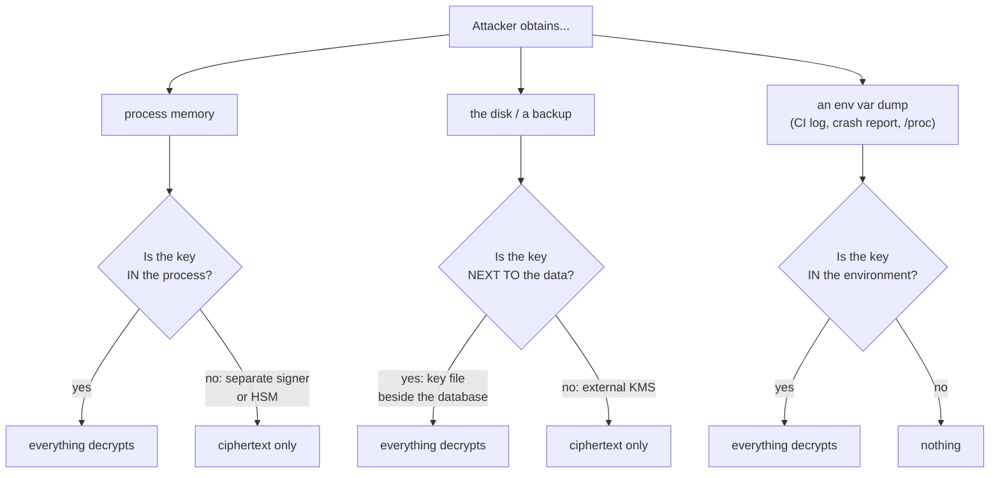

# Key Protection

Every claim on this page is about **where the key material lives and who can
read it** - not about which product has more features. Everything Sunder
protects is derived from a small set of keys, so this is the property that
decides what an attacker gets from a compromised process, a stolen disk, or
a leaked backup.

## The question that actually matters

An identity vault has one irreducible secret: the key that opens the
attribute blobs and computes the search tokens. Everything else is
downstream of it. So the useful question is not "is the data encrypted" -
it always is - but:

> **After an attacker reads the memory of the running process, or walks off
> with the disk, or restores your backup somewhere else, what do they have?**



## Side by side

| | Databunker CE | Sunder today |
|---|---|---|
| Where the master key comes from | `DATABUNKER_MASTERKEY` environment variable, or the config file | a keystore driver: `file` (dev) or `vault` (production) |
| Key in the service process's memory | **yes, always** | yes by default; **no** with `SUNDER_SIGNER_SOCKET` |
| External KMS support | no | **yes** - HashiCorp Vault, KV v2 |
| Key material isolated from the API process | no | **yes** - all cryptography runs in a separate `sunder signer` process over a Unix socket; the API container needs no keystore configuration and holds no key bytes |
| Secrets accepted on the command line | yes (`-masterkey`) | **refused** - the CLI takes secrets from a file or the environment and warns loudly on the deprecated flag paths |
| Key versioning | single master key | **versioned per kind** (`pii-kek/v3`, `hmac-email/v2`), with `ACTIVE` / `RETIRING` states |
| Key rotation | no first-class rotation | `keys rotate` mints the next version; reads keep working under the old one |
| Re-encrypting existing data after rotation | not applicable | `keys rekey` converts the backlog, resumable, with a measured duration |
| Destroying an old key | not applicable | `keys retire`, which **refuses** while any store still references the version |
| Split-custody recovery | no | **yes** - Shamir shares (`shamir-init`), so no single custodian can restore the vault alone |
| PKCS#11 / HSM | **no** | **no** - see below |

## Neither product supports an HSM, and that is worth being precise about

Sunder accepts `SUNDER_KEYSTORE=pkcs11` in configuration and then **refuses
to start**:

```
keystore bootstrap: keystore: pkcs11 driver not implemented yet
```

Failing at startup is the deliberate part: a deployment configured that way
never serves a request, rather than reporting healthy and erroring on
everything. The full reasoning - including why it cannot simply be
"finished" - is on the [Keys and Keystores](../admin/keys-and-keystores.md)
page.

**What to use instead, and why it is usually the right answer anyway:**

If the concern is *"the service process must never hold key material"*, that
is exactly what `SUNDER_SIGNER_SOCKET` provides today. Cryptography moves to
a separate process; the API container gets no keystore configuration, no
Vault token, and no key bytes. It costs one more container, has no vendor
lock-in, and closes the same hole an HSM closes for the memory-disclosure
case.

An HSM answers a different question - **can the key be extracted at all,
even by an administrator with root** - and that question is usually asked by
a regulation naming FIPS 140-2/3 or a qualified electronic seal, not by a
threat model. If a tender names one of those, an HSM is a requirement rather
than a design choice, and it is tracked as planned work.

## What a compromise gets you

The honest comparison, per scenario:

| Attacker capability | Databunker CE | Sunder (`vault` + signer) |
|---|---|---|
| reads the API process's memory | master key -> **all data** | no key material in that process -> **ciphertext only** |
| steals the database disk or a backup | key is elsewhere in both -> ciphertext | ciphertext; and per-scope blobs stay separately keyed |
| dumps environment variables from CI, `/proc`, a crash report | `DATABUNKER_MASTERKEY` -> **all data** | nothing: the key lives in Vault, fetched at runtime |
| gains root on the host | **all data** | **all data** - a software keystore cannot survive root, which is the honest limit and the actual argument for an HSM |
| compromises one client's credential | that client's scope | that client's scope only - other scopes' blobs are encrypted under different derived material |

The last two rows matter more than the marketing ones. **Root on the host
defeats every software keystore**, Sunder's included; the separate signer
process raises the cost and narrows the window, it does not eliminate the
class. Anyone claiming otherwise for a software product is selling
something.

## Security notes

- **Vault is not magic.** `SUNDER_VAULT_TOKEN` is itself a secret, and a
  process that can read from Vault can read the keys. What it buys is that
  the key is not on the same disk as the data, is centrally revocable, and
  leaves an access trail in Vault's own audit log.
- **The signer process is a boundary, not a vault.** It holds key material
  in ITS memory. An attacker who compromises the signer gets the keys; one
  who compromises only the API does not. That is a real reduction in blast
  radius and an honest description of its size.
- **Key retirement is genuinely destructive.** `keys retire` refuses while
  any store still references a version precisely because there is no undo -
  and with Shamir recovery the bundle is the only path back. With an HSM
  there would be no path back at all.
- **These figures describe Databunker Community Edition**, read from its
  public documentation and from the work behind
  [migrating from Databunker](../migrations/from-databunker.md). Their Pro
  edition is not publicly runnable, so nothing here is a claim about it.
