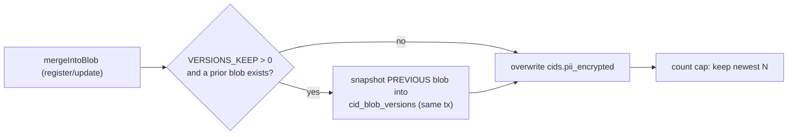

# Attribute Versioning

By default Sunder keeps only the current attribute blob for each scoped
pseudonym - a correction overwrites the previous value and it is gone. F6
lets you optionally keep a bounded history, so a mistaken update can be
inspected or rolled back, while treating that history as exactly what it is:
the same personal data, one generation older.

## Off by default, and why



!!! warning "History extends the storage-limitation clock"
    Keeping superseded values is a real GDPR tension - it is why comparable
    products gate versioning behind a paid tier. Sunder keeps it **off by
    default** (`SUNDER_VERSIONS_KEEP=0`); an upgrade never silently starts
    retaining old values. Turn it on only where a documented business need
    outweighs holding data longer, and set a TTL.

The snapshot happens inside the same transaction as the overwrite, guarded
by the row lock, so history can never miss a generation nor record one that
did not land.

## Enable it

```bash
SUNDER_VERSIONS_KEEP=5          # keep the 5 most recent prior versions per cid (0 = off, max 1000)
SUNDER_VERSIONS_TTL=2160h       # also prune anything older than 90 days
```

## Read history

```bash
# Metadata: which versions exist, who wrote each, when.
curl "$SUNDER_URL/v1/contacts/$CID/versions" -H "Authorization: Bearer $CRED"
# -> {"versions":[{"version_no":3,"written_by":"crm","written_at":"..."}, ...]}

# One attribute from one version - purpose required.
curl "$SUNDER_URL/v1/contacts/$CID/versions/3/attributes/tier?purpose=support" \
  -H "Authorization: Bearer $CRED"
# -> {"value":"gold"}
```

Both endpoints need the `attributes.history` action. Reading a historical
value is gated exactly like a live attribute read - purpose checked against
the caller's allowed purposes, consent checked, the F3 attribute allowlist
applied, scope and tombstone enforced - and audited before the value is
released. Old data is still the person's data.

## Security notes

- History is deleted with the person on erasure, in the same transaction
  as the rest of their data.
- `SUNDER_VERSIONS_TTL` prunes old versions via `sunder retention run`;
  the count cap (`SUNDER_VERSIONS_KEEP`) bounds how many survive per cid
  regardless.
- The version author (`written_by`) is the real client id that made the
  change, so history is attributable independently of the audit chain.
- A narrowed credential (see the F3 attribute allowlist in the
  [configuration reference](../install/configuration.md)) cannot read a
  historical attribute it is not allowed to read live.

Versioning pairs naturally with the [audit chain](../admin/audit-chain.md):
the chain proves *that* a change happened and by whom; versioning lets you
see *what the value was* before it.
