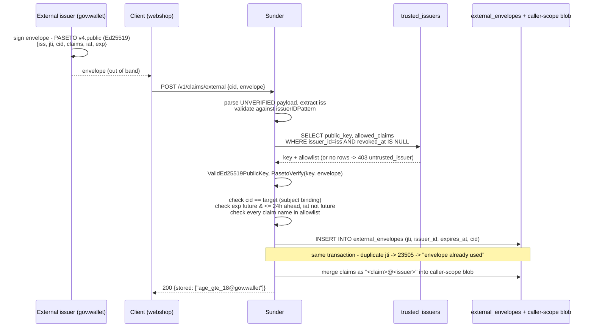

# External Issuers

An org sometimes needs to accept a claim asserted by an outside trusted
party - a government wallet, a KYC provider - about a person it already
has a pseudonym for, without letting that party forge claims for someone
else, replay an old assertion, or silently overwrite what a different
issuer already asserted. External-issuer federation registers each such
party's public key and an explicit claim allowlist, then verifies every
envelope against both before it touches storage.

## Mechanism



## Steps

1. **Register the issuer once**, with an explicit claim allowlist:

   ```bash
   sunder issuer add -id gov.wallet \
     -pubkey a1b2c3...  \
     -claims age_gte_18,residency_country
   ```

   `-claims` is deny-by-default: an issuer added without it may assert
   nothing; `*` grants everything. The key is rejected at registration if
   it is a small-order Ed25519 point, before it can ever be used to forge
   a signature.

2. **The issuer signs an envelope** for one specific `cid` (out of band -
   Sunder never holds the issuer's private key):

   ```json
   {
     "iss": "gov.wallet",
     "jti": "env-9f2c7a10",
     "cid": "CID-a1b2c3d4",
     "claims": {"age_gte_18": "true"},
     "iat": "2026-08-23T10:00:00Z",
     "exp": "2026-08-23T14:00:00Z"
   }
   ```

3. **The client submits it** to the CID it belongs to:

   ```bash
   curl -sX POST https://sunder.internal/v1/claims/external \
     -H "Authorization: Bearer $WEBSHOP_CLIENT_TOKEN" \
     -H "Content-Type: application/json" \
     -d '{"cid": "CID-a1b2c3d4", "envelope": "v4.public.eyJpc3Mi..."}'
   ```

   `200 {"stored": ["age_gte_18@gov.wallet"]}`

   SDK equivalent: `client.Claims.AcceptExternal(ctx, cid, envelope)`.

4. **Read it back** like any other attribute, using the namespaced name:

   ```bash
   curl -s "https://sunder.internal/v1/contacts/CID-a1b2c3d4/attributes/age_gte_18@gov.wallet?purpose=age_check" \
     -H "Authorization: Bearer $WEBSHOP_CLIENT_TOKEN"
   ```

## Provenance namespacing

Every stored attribute name is `<claim>@<issuer>`, e.g. `age_gte_18@gov.wallet`.
Claim names are restricted to `^[a-zA-Z0-9_.-]{1,64}$` - the pattern
explicitly excludes `@`, so a claim named `age_gte_18@gov.wallet` (embedding
a fake issuer suffix) can never be submitted and used to impersonate a
different issuer's provenance tag once stored.

## Security notes

- **Anti-replay is transactional, not best-effort.** The envelope's `jti`
  is inserted into `external_envelopes` in the *same transaction* as the
  claim merge; a duplicate `jti` fails the unique constraint and the whole
  call is rejected with `envelope already used` - there is no window where
  a replayed envelope could be merged and the replay only detected after.
- **Subject binding cannot be bypassed.** The envelope's signed `cid` must
  equal the target `cid` in the request; an envelope issued for one person
  can never be attached to another, even by a party that controls the
  submitting client.
- **The unverified payload is validated before it touches anything
  trusted.** The issuer id is checked against `issuerIDPattern` before it
  is used in a query or written to an audit entry - unbounded
  attacker-chosen bytes there would otherwise mean both audit inflation and
  contention on the audit chain's advisory lock.
- **Deny-by-default allowlist, enforced server-side.** An issuer registered
  with no `-claims` may assert nothing; the envelope's own claim set is
  irrelevant if it is not a subset of what the registry allows - a
  compromised or careless issuer cannot expand its own grant by simply
  signing a bigger envelope.
- **Bounded envelope lifetime (24h max).** Prevents an issuer from
  pre-staging envelopes that live for years, which would make the replay
  table unprunable; every insert writes an explicit `expires_at`, never a
  column default.
- **A failed signature check against a *registered* issuer is audited as a
  forgery attempt** (`claims.external.rejected`, `reason: bad_signature`),
  distinct from an unknown-issuer rejection - it is a monitoring signal,
  not noise.
- **What this deliberately does NOT do:** it is not OpenID4VP or full EUDI
  wallet federation - no presentation exchange, no selective disclosure
  inside the envelope itself, no revocation checking beyond `revoked_at` on
  the issuer row. It is the pragmatic pre-EUDI integration surface; the
  full protocol stays a design document (`docs/DESIGN-EUDI-GATEWAY.md`)
  until the wallet ecosystem stabilizes.
