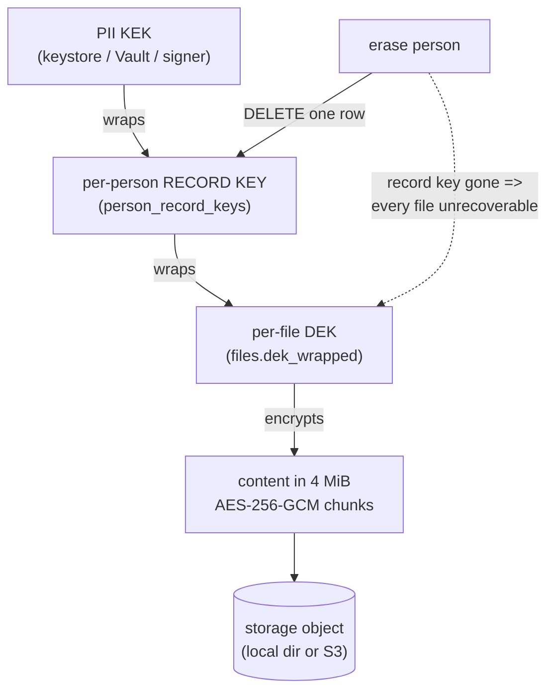

# File Vault

A person record sometimes needs an attached document - a signed mandate, an
ID scan, a contract PDF. F5 stores those encrypted, one key per person, so
that erasing the person makes every one of their files unrecoverable at the
instant the erasure commits, with no storage round trip on the erasure
path. The storage backend (local disk or any S3-compatible bucket) only
ever sees ciphertext.

## The key chain and crypto-shredding



The record key is the whole point: it exists only so erasure can destroy
one database row and instantly orphan the ciphertext of every file below
it. The retention sweep garbage-collects the dead objects later; nothing
waits on object storage during erasure. Each 4 MiB chunk carries its index
in the AEAD associated data, so chunks cannot be reordered, dropped, or
transplanted between files without the decrypt failing, and the file DEK is
bound to both the file id and its cid.

## Enable it

The vault is off unless a storage driver is configured - files are a new
data class, and an upgrade must not silently start accepting them.

```bash
# Local disk (keeps the zero-dependency posture for demos):
SUNDER_FILES_STORAGE=local
SUNDER_FILES_DIR=/var/lib/sunder/files
SUNDER_FILES_MAX_MB=25

# Or any S3-compatible bucket (AWS, MinIO, R2):
SUNDER_FILES_STORAGE=s3
SUNDER_FILES_S3_ENDPOINT=https://s3.eu-central-1.amazonaws.com
SUNDER_FILES_S3_BUCKET=sunder-files
SUNDER_FILES_S3_REGION=eu-central-1
SUNDER_FILES_S3_ACCESS_KEY=...
SUNDER_FILES_S3_SECRET_KEY=...
# SUNDER_FILES_S3_PATH_STYLE=true   # MinIO
```

!!! note "S3 without an SDK"
    The S3 driver is hand-rolled over `net/http` with AWS Signature V4, so
    Sunder keeps its zero-new-dependency posture. Because a single PUT
    buffers to hash the payload, `SUNDER_FILES_MAX_MB` is capped at 256 on
    the S3 driver.

## Upload, list, download, delete

```bash
# Upload a multipart "file" part; optional hard expiry.
curl -X POST "$SUNDER_URL/v1/contacts/$CID/files" \
  -H "Authorization: Bearer $CRED" \
  -H "X-Sunder-File-Expiry: 2027-01-01T00:00:00Z" \
  -F "file=@mandate.pdf"                                   # action files.write

curl "$SUNDER_URL/v1/contacts/$CID/files" -H "Authorization: Bearer $CRED"   # metadata only

curl "$SUNDER_URL/v1/files/$FILE_ID?purpose=support" \
  -H "Authorization: Bearer $CRED" -o mandate.pdf         # action files.read

curl -X DELETE "$SUNDER_URL/v1/files/$FILE_ID" -H "Authorization: Bearer $CRED"
```

A download is purpose- and consent-checked exactly like an attribute read,
and audited before the first byte leaves. The handler validates everything
(permission, purpose, scope, consent, and a body-size cap on upload) before
writing any response, so a failure can never substitute content - only
truncate, and a truncated object is detected against the recorded size and
reported as an error, never as a successful short read.

## Security notes

- Erasing a person (`POST /v1/dsr/erase`) shreds the record key in the same
  transaction, marks the files for GC, and the files stop downloading
  immediately - see [rights and consent](../gdpr/rights-and-consent.md).
- An expired file (via `X-Sunder-File-Expiry`) is a read-time miss, not
  merely a GC candidate.
- Uploads are size-capped and authorized before any bytes are spooled, so
  an unauthorized or oversized request cannot fill the host's temp disk.
- `sunder keys rekey -reencrypt-pii` re-wraps every per-person record key
  under the newest KEK, so [retiring a leaked KEK](../admin/rotation-and-rekey.md)
  covers files too. For file-keystore custody, see
  [Shamir recovery](../admin/shamir-recovery.md).
- Uploads, deletes and the record-key path are rate-limited per client.

The storage driver is deliberately dumb: give it a compromised bucket and
an attacker still holds only AEAD ciphertext with no key.
