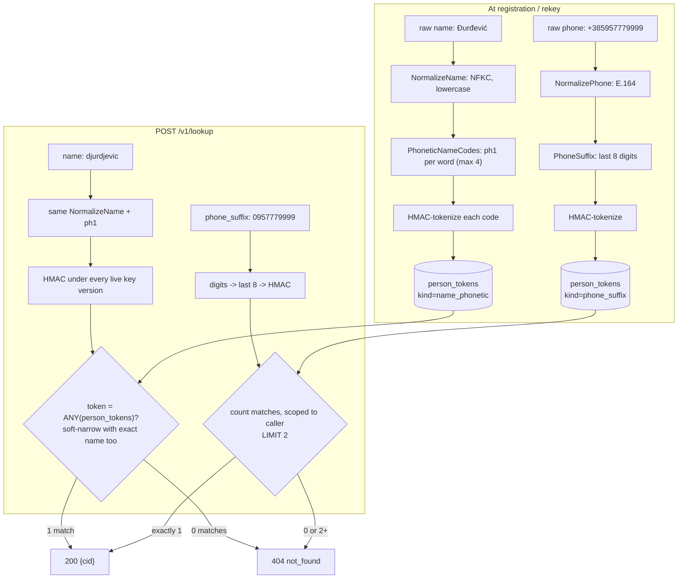

# Fuzzy and Partial Search

A CRM operator often has only an imperfect handle on a person: a name typed
in a different spelling than it was registered under (`Đurđević` vs
`Djurdjevic` vs `Durdevic`), or just the last few digits of a phone number
read off caller ID. Exact HMAC lookup cannot match either case - it needs
the identifier byte-for-byte. F1 (phonetic name codes) and F2 (phone
suffix) add narrowing keys that tolerate both, while keeping every
guarantee of the exact path: still only keyed HMACs stored, still
narrowing-only, still bulk-deny on ambiguity.

## Mechanism



Registration and lookup run the *same* `NormalizeName` + `ph1` reduction, so
a name only matches at lookup time if it reduces to the same code a stored
spelling already reduced to - the fuzziness is entirely the many-to-one
reduction, never a similarity score computed at query time.

## Steps

1. **Enable the feature(s)** - both default off:

   ```bash
   SUNDER_SEARCH_FUZZY_NAME=true
   SUNDER_SEARCH_PHONE_SUFFIX=true
   ```

2. **Backfill existing rows.** The derived tokens don't exist for contacts
   registered before the flag flipped - the encrypted blob is the only
   source of truth, so a sweep must decrypt and re-derive:

   ```bash
   sunder keys rekey -batch 500
   ```

3. **Fuzzy name lookup** (name never stands alone - pair it with email or
   phone):

   ```bash
   curl -sX POST https://sunder.internal/v1/lookup \
     -H "Authorization: Bearer $CRM_CLIENT_TOKEN" \
     -H "Content-Type: application/json" \
     -d '{"name": "ivana djurdjevic", "phone": "+385957779999"}'
   ```

4. **Partial phone lookup** (>= 8 digits, national or international
   spelling both work; cannot be combined with `email`/`phone` - use the
   full identifier for that):

   ```bash
   curl -sX POST https://sunder.internal/v1/lookup \
     -H "Authorization: Bearer $CRM_CLIENT_TOKEN" \
     -H "Content-Type: application/json" \
     -d '{"phone_suffix": "0957779999"}'
   ```

   `200 {"cid": "CID-..."}` on exactly one match, `404 not_found` on zero
   *or on two or more* - add `name` to disambiguate a colliding suffix.

   SDK equivalent: `client.Lookup(ctx, LookupInput{PhoneSuffix: "0957779999"})`.

## Why both default off

Each widens the search surface and adds token rows per contact - an upgrade
must never do that silently to an existing deployment. Measured cost with
both enabled on the 20M+-contact benchmark dataset (`benchmark/README.md`,
2026-08-26 run): the exact-email lookup path is untouched (2,196.2 rps at
c=8, 3,362.7 rps at c=32 - the fastest runs recorded), and the extra HMAC
plus index row per name word (max 4) and per phone at registration falls
inside the 378-1,014 rps run-to-run write band on this host - lost in
noise. The functional smoke test on that same run: a contact registered as
"Ivana Đurđević" / `+385957779999` resolves over HTTP by
`phone_suffix: "0957779999"` (national spelling) plus fuzzy
`name: "ivana djurdjevic"` (dj spelling) to the same CID.

## Security notes

- **Names remain narrowing-only, never a primary lookup key and never
  authentication.** `name` alone is rejected at 400 regardless of fuzzy
  matching; a phonetic hit only narrows a query that already has email,
  phone, or phone_suffix as its primary key.
- **Phone-suffix single-hit semantics hold even with fuzzy matching
  combined.** A multi-hit is a miss, never a list and never a count -
  bulk-deny for partial search works the same way it does for exact
  lookup: the caller learns nothing about *how many* people share a
  suffix.
- **Ambiguity is decided within the caller's scope only.** The `EXISTS`
  clause scoping candidate rows to `client.Scope` runs on every outcome
  (not just the ambiguous one), so a suffix that collides with someone
  visible only to a different scope neither blocks a hit that is
  unambiguous in the caller's own scope, nor - via that blocking - leaks
  that a colliding number exists somewhere else. No timing split between
  "no match" and "match hidden in another scope."
- **ph1 admits false positives on purpose; that is the point, and the
  bound on the damage.** It is a small, versioned, own-built reduction
  tuned for Croatian variance (diacritic stripping, đ/dj/d spellings,
  ije/je/e reflexes, vowel typos) rather than Double Metaphone, which is
  tuned for English and folds none of those. Because names are
  narrowing-only, a reduction admitting more false positives merely
  narrows a little less - it can never turn into a false *authentication*.
- **The database still stores only keyed HMACs of the derived values** -
  never a phonetic code or a phone suffix in plaintext, and never the
  original attribute. Enabling F1/F2 does not create a new plaintext
  surface, only new tokens under the same tokenization scheme.
- **A code version is part of the HMAC input domain.** `ph1` coexists with
  a future `ph2` under the same dual-key lookup window rotation already
  uses - upgrading the algorithm does not require a flag-day cutover.
