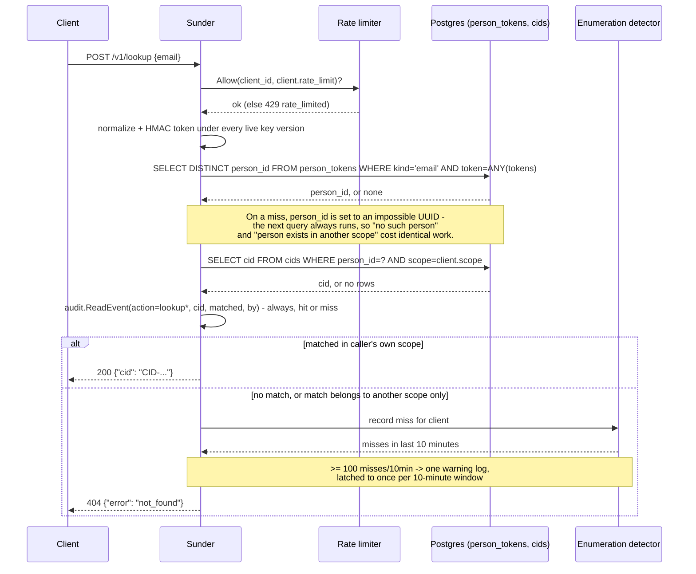

# Lookup vs. Authentication

A support agent or an integration needs to find "the contact with this
email" and get back a pseudonym to work with - but that match must never
be mistaken for proof that the caller is actually talking to that person.
Sunder enforces this as a doctrine: **`LOOKUP != AUTHENTICATION`**. A
lookup hit returns a CID; it never asserts identity. The lookup surface is
also, by nature, an enumeration target ("dial numbers and see what
exists"), so the mechanism is built around denying that a bulk search is
possible at all.

## Mechanism



The scope-ownership query runs on every request, matched or not - that is
what removes the timing channel that would otherwise let a client
distinguish "this person does not exist anywhere" from "this person
exists, just not in my scope."

## Steps

1. **Look a contact up by email** (the primary key combination):

   ```bash
   curl -sX POST https://sunder.internal/v1/lookup \
     -H "Authorization: Bearer $CRM_CLIENT_TOKEN" \
     -H "Content-Type: application/json" \
     -d '{"email": "ana@example.com"}'
   ```

   `200 {"cid": "CID-01J8ZK3V4WXYZ"}`

   SDK equivalent: `client.LookupByEmail(ctx, "ana@example.com")`.

2. **Narrow with a name alongside phone or email** - a name is never
   accepted alone (400 `validation`), because it is a narrowing key, not
   an identifier:

   ```bash
   curl -sX POST https://sunder.internal/v1/lookup \
     -H "Authorization: Bearer $CRM_CLIENT_TOKEN" \
     -H "Content-Type: application/json" \
     -d '{"name": "Ana Novak", "phone": "+385911234567"}'
   ```

3. **A miss returns the same shape as "exists elsewhere"** - both are
   `404 not_found`, with nothing in the body that distinguishes them:

   ```bash
   curl -si -X POST https://sunder.internal/v1/lookup \
     -H "Authorization: Bearer $CRM_CLIENT_TOKEN" \
     -H "Content-Type: application/json" \
     -d '{"email": "unknown@example.com"}'
   ```

   `HTTP/1.1 404` / `{"error": "not_found"}`

4. **A CID from a lookup hit is not proof of identity.** To actually act
   on behalf of a verified person across systems, the calling system that
   established identity issues an OTI and the receiving system verifies it
   (see [OTI Handoff](oti-handoff.md)) - lookup alone never crosses that
   line.

## Security notes

- **A hit is not authentication.** `LOOKUP != AUTHENTICATION` is
  enforced by what the response contains: a pseudonym, nothing else. It
  proves the identifier exists in the caller's scope, never that the
  current caller is the person behind it.
- **A scope cannot enumerate another scope's contacts.** A person who
  exists but has no CID in the caller's scope produces exactly the same
  `404 not_found` as a person who does not exist at all, with the same
  query cost - not "the identifier matches but you have no access."
- **Name alone can never search.** The name-token index only participates
  as a narrowing filter alongside email or phone, so it cannot become a
  mass-search vector on its own even though many people can share a name.
- **Bulk search is bounded, not just logged.** Every client has a
  per-minute rate limit (`429 rate_limited` beyond it), and every miss
  feeds a per-client sliding 10-minute counter; 100+ misses in that window
  triggers a latched warning (at most one per 10 minutes) rather than
  silent unlimited probing.
- **Partial phone-suffix search cannot become a list.** When
  `SUNDER_SEARCH_PHONE_SUFFIX` is enabled, an ambiguous suffix - two or
  more people matching within the caller's own scope - is treated as a
  miss, never as a set of candidates or even a count.
- **Every lookup is audited, hit or miss.** The audit chain records the
  client, the match kind (`by`), and whether it matched or was ambiguous -
  never the raw email or phone that was searched for.
