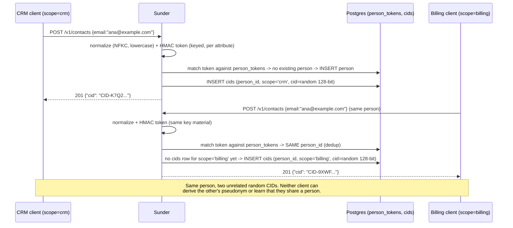

# Scoped Pseudonyms

Every internal system needs to key its own records on the same person -
without ending up on the same join key as every other system, so that one
leaked database can never be linked to another. Sunder's answer is the
CID: a random 128-bit pseudonym issued per `(person, scope)`, never derived
from PII, with nothing to reverse or brute-force. A scope is an internal
domain (crm, billing, analytics, …); each one gets its own unrelated
pseudonym for the same person, and only Sunder can map between them.

## Mechanism



Registration dedups on the search token (email first, then phone), never
on anything a scope's client could forge - the match happens server-side,
inside Sunder, against the keyed HMAC index. A scope only ever sees the
`cids` row for its own `scope` column.

## Steps

1. **Register the contact from the CRM's own credential:**

   ```bash
   curl -sX POST https://sunder.internal/v1/contacts \
     -H "Authorization: Bearer $CRM_CLIENT_TOKEN" \
     -H "Content-Type: application/json" \
     -d '{"email": "ana@example.com", "name": "Ana Novak"}'
   ```

   `201 {"cid": "CID-01J8ZK3V4WXYZ"}`

   SDK equivalent: `client.RegisterContact(ctx, sunder.RegisterInput{Email: "ana@example.com", Name: "Ana Novak"})`.

2. **Register (or dedup) the same person from Billing's credential** - a
   different scope, a different pseudonym:

   ```bash
   curl -sX POST https://sunder.internal/v1/contacts \
     -H "Authorization: Bearer $BILLING_CLIENT_TOKEN" \
     -H "Content-Type: application/json" \
     -d '{"email": "ana@example.com"}'
   ```

   `201 {"cid": "CID-9F2Q7VXTNP01"}` - a different string, for the same
   underlying person, because the caller's scope differs.

3. **Only a trusted integration client can cross the boundary itself**,
   via the explicitly linkage-capable `scopes.issue` action:

   ```bash
   curl -sX POST https://sunder.internal/v1/contacts/CID-01J8ZK3V4WXYZ/scopes \
     -H "Authorization: Bearer $INTEGRATION_CLIENT_TOKEN" \
     -H "Content-Type: application/json" \
     -d '{"scope": "billing"}'
   ```

   `200 {"cid": "CID-9F2Q7VXTNP01"}` - the caller now knows both
   pseudonyms belong to the same person. Grant this action sparingly; it
   exists for migration and integration tooling, not for regular
   cross-system handoff (see [OTI Handoff](oti-handoff.md)).

   SDK equivalent: `client.IssueScopedCID(ctx, cid, "billing")`.

## Security notes

- **A scope cannot compute or guess another scope's CID for the same
  person.** CIDs are random, not derived - there is no function from
  "crm's CID" to "billing's CID" to invert or attack.
- **Cross-scope linkage requires an explicit, audited grant.**
  `scopes.issue` is the only way for an ordinary client to learn two
  pseudonyms belong to the same person, and every call is logged with the
  requesting client, the CID and the target scope. Regular system-to-system
  handoff uses an OTI instead, where the verifier receives only its own
  scoped CID and the issuer's pseudonym never crosses the boundary.
- **Attributes never leak across the dedup boundary.** Attribute blobs are
  stored per `(person, scope)` and AAD-bound to the CID row, so
  re-registering an existing person from a new scope merges into *that
  scope's own* blob - it never exposes what another scope already stored.
- **Nothing to reverse.** Because the CID is random rather than a hash or
  encryption of the identifier, a stolen `cids` table yields no path back
  to an email or phone number - unlike a hashed national ID, which is
  vulnerable to a dictionary attack over a small identifier space.
- **No central instance to compromise.** Sunder is deliberately
  single-tenant, self-hosted per organization - there is no shared
  cross-company mapping service whose compromise would unlink every
  customer of every operator at once.
