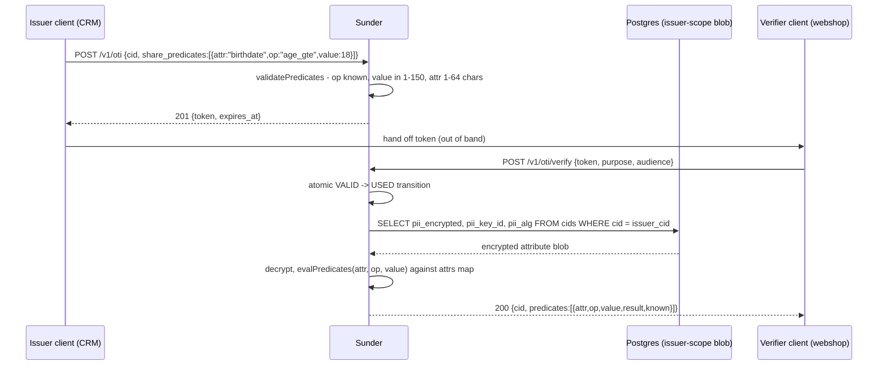

# Selective Disclosure

A verifier often needs the answer to one narrow question - "is this person
18 or older", "do we have a birthdate on file at all" - without ever
receiving the birthdate, or any other raw attribute, that answers it.
Predicate claims let an issuer authorize exactly that question at OTI issue
time, and Sunder evaluates it against its own encrypted data at verify
time, returning a boolean instead of a value.

## Mechanism



The verifier's own scoped CID is issued alongside the predicate results, but
the issuer's pseudonym and the decrypted attribute never leave Sunder - only
the `PredicateResult` booleans cross the scope boundary.

## Steps

1. **Issue a token carrying the predicate**, from the issuer's scope:

   ```bash
   curl -sX POST https://sunder.internal/v1/oti \
     -H "Authorization: Bearer $CRM_CLIENT_TOKEN" \
     -H "Content-Type: application/json" \
     -d '{
       "cid": "CID-a1b2c3d4",
       "purpose": "age_check",
       "audience": "webshop",
       "share_predicates": [{"attr": "birthdate", "op": "age_gte", "value": 18}]
     }'
   ```

   `201 {"token": "v4.public...", "expires_at": "2026-08-23T12:05:00Z"}`

   SDK equivalent: `client.OTI.Issue(ctx, cid, WithPredicates(AgeGTE("birthdate", 18)))`.

2. **Hand the token to the verifier** through whatever channel your
   integration already uses (redirect, header, message payload) - the token
   is a five-minute, single-use, single-audience bearer credential.

3. **Verify and consume it** from the webshop's scope:

   ```bash
   curl -sX POST https://sunder.internal/v1/oti/verify \
     -H "Authorization: Bearer $WEBSHOP_CLIENT_TOKEN" \
     -H "Content-Type: application/json" \
     -d '{"token": "v4.public...", "purpose": "age_check", "audience": "webshop"}'
   ```

   `200 {"cid": "CID-e5f6...", "shared": [], "predicates": [{"attr":"birthdate","op":"age_gte","value":18,"result":true,"known":true}]}`

   SDK equivalent: `client.OTI.Verify(ctx, token, purpose, audience)`.

## Supported ops and `Known` semantics

| Op | `value` | `Known` when... |
|---|---|---|
| `age_gte` | required, 1-150 | `false` when the attribute is absent or unparseable - "we do not know the birthdate" must never read as "under 18". Reads the attribute as `YYYY-MM-DD` or RFC 3339, compares full completed years at UTC. |
| `exists` | must be omitted | always `true` - the question IS whether the attribute is present, so its absence is itself the answer, not an unknown. |

`age_gte` with an omitted `value` used to silently mean threshold 0, which
is true for every parseable past date - a silent always-pass. It is now
rejected at issue time with a validation error instead.

## Security notes

- **The raw value never crosses the scope boundary.** Only `{result, known}`
  is returned; nothing is copied into the verifier's blob, unlike
  `share_attributes` on the same endpoint.
- **Unknown ops are rejected at issue time, not verify time.** A typo'd op
  fails loudly for the issuer immediately rather than silently producing
  `known:false` for every verification later.
- **At most 8 predicates per token** - bounded so a single OTI cannot be
  turned into an open-ended attribute-probing tool.
- **Predicate results are not written to the audit chain.** The chain
  records `predicates_asked` (what was requested) but not the boolean
  outcome - the audit content boundary deliberately stores no derived
  assertions about a person (see `docs/THREAT-MODEL.md`). This means the
  chain alone cannot tell you what a verifier concluded, only what it was
  authorized to ask and when.
- **Feb-29 birthdays normalize to Mar 1 in non-leap years** (Go's
  `AddDate` semantics) - leaplings attain an age one day "late" by this
  implementation's rule, which some jurisdictions define differently.
  Document the policy where it matters to your integration.
- **A predicate is not a certification.** `age_gte:true` states what
  Sunder's stored data implies, not that the data was ever verified against
  an ID document - it inherits whatever trust level the birthdate was
  registered under.
