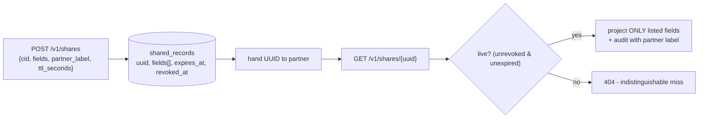
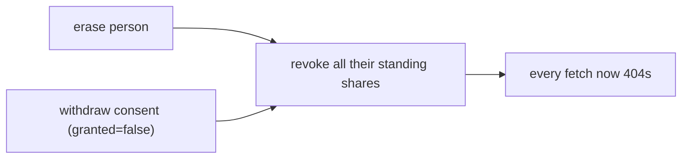

# Shared Records

Sometimes an external partner needs a narrow, time-limited view of a few
fields of one person - a delivery partner that needs a name and a phone for
48 hours, nothing more. F8 shared records give you an expiring, revocable
UUID that exposes only the listed fields, strictly narrower than a scoped
pseudonym in every dimension, and revoked automatically the moment the
person is erased or withdraws consent.

## What a share exposes



A share is created against a cid the caller can already resolve, and the F3
attribute allowlist applies - a credential narrowed to some attributes
cannot share the value of others. The fetch returns strictly the named
fields, nothing else, and every fetch (hit or miss) is audited with the
partner label so a leak is attributable.

## Create, fetch, revoke

```bash
curl -X POST "$SUNDER_URL/v1/shares" \
  -H "Authorization: Bearer $CRED" -H 'Content-Type: application/json' \
  -d '{"cid":"'$CID'","fields":["name","phone"],"partner_label":"acme-logistics","ttl_seconds":172800}'
# -> 201 {"uuid":"...","expires_at":"..."}                 # action shares.create

curl "$SUNDER_URL/v1/shares/$UUID" -H "Authorization: Bearer $PARTNER_CRED"
# -> {"fields":{"name":"...","phone":"..."}}

curl -X DELETE "$SUNDER_URL/v1/shares/$UUID" -H "Authorization: Bearer $CRED"   # manual revoke
```

`ttl_seconds` is bounded to at most 90 days, `partner_label` to 128
characters, and a share may carry at most 32 fields - a share is a handful
of fields for a partner, not a bulk export channel.

## Two consumption modes

```bash
# Default (stronger than a bare-UUID bearer): the fetch needs ANY valid
# client credential.  A missing credential is rejected by the auth layer.

# Opt in to credential-less fetch for cross-org partners who hold only the UUID:
SUNDER_SHARES_PUBLIC=true
```

!!! note "Default is authenticated"
    Unlike a plain UUID-as-bearer scheme, Sunder's default requires a valid
    client credential to fetch a share. `SUNDER_SHARES_PUBLIC=true` enables
    the credential-less mode for genuine cross-org cases - the UUID becomes
    the bearer - and only the `GET` route opens; create and revoke stay
    authenticated.

## Revoked by erasure and consent withdrawal



This is the improvement over an expire-only model: a share never outlives
the data it points at. Erasing the person, or setting any consent to
`granted=false`, revokes that person's standing shares in the same
transaction.

## Security notes

- Fetches are audited with the partner label; an expired or revoked share
  is an indistinguishable miss.
- Revoke is scope-enforced; a share belongs to the scope that created it.
- Long-expired shares are pruned by `sunder retention run`; the audit chain
  keeps the create/revoke/fetch record.
- Share creation is rate-limited per client.

Compared with an [OTI handoff](oti-handoff.md), a share is standing and
partner-facing (revocable, auditable by label) rather than a single
five-minute in-flow token; compared with [value tokens](value-tokenization.md),
a share exposes named person attributes rather than swapping one value.
