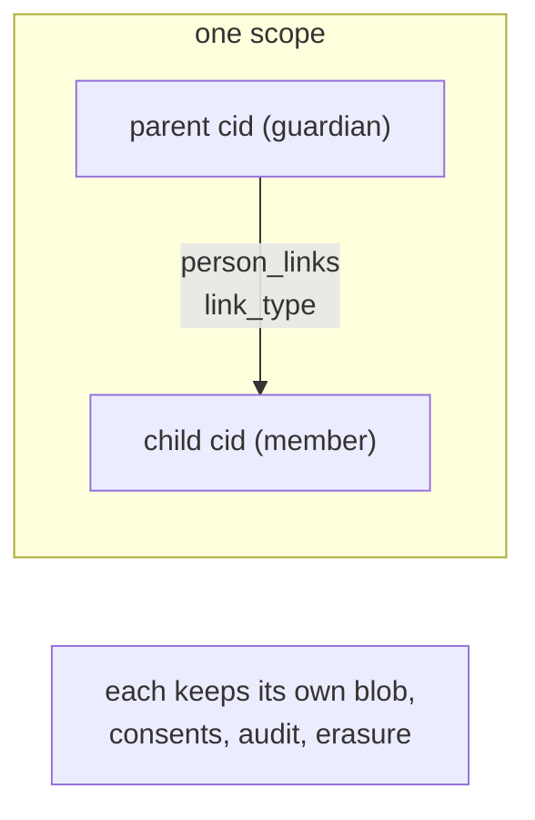
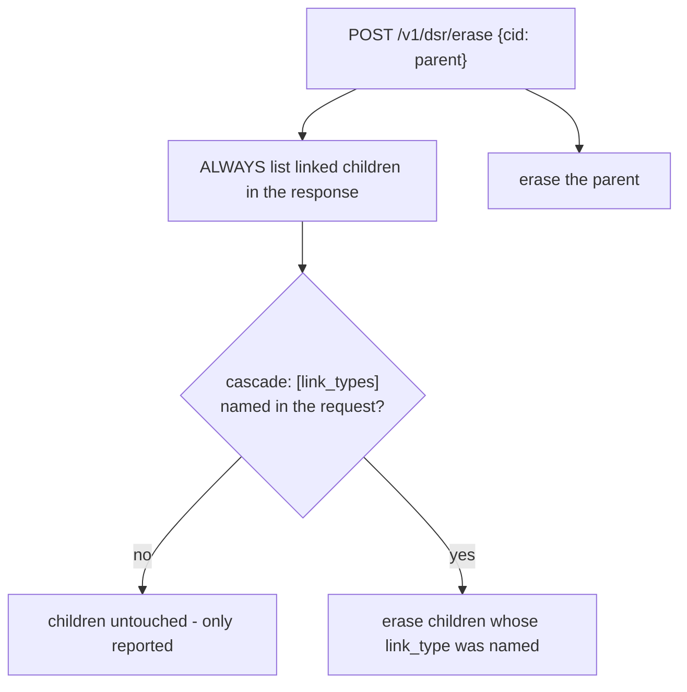

# Sub-Accounts (Person Links)

A guardian and a minor, an account holder and its members, an owner and a
device - relationships between people that one scope needs to record. F7
models these as links between two pseudonyms within a single scope's view.
A link is metadata about a relationship, never a merge: each person keeps
its own attribute blob, consents, audit trail, and erasure lifecycle.

## What a link is (and is not)



Both endpoints of a link must resolve in the caller's own scope, so a link
can never join persons across a scope boundary, and a foreign cid is an
indistinguishable `404` - no cross-scope oracle. `link_type` is one of
`guardian`, `member`, or `owner`.

## Link, list, unlink

```bash
curl -X POST "$SUNDER_URL/v1/links" \
  -H "Authorization: Bearer $CRED" -H 'Content-Type: application/json' \
  -d '{"parent_cid":"'$PARENT'","child_cid":"'$CHILD'","link_type":"guardian"}'

curl "$SUNDER_URL/v1/contacts/$PARENT/links" -H "Authorization: Bearer $CRED"
# -> {"links":[{"cid":"<child>","link_type":"guardian","role":"child"}, ...]}

curl -X DELETE "$SUNDER_URL/v1/links" \
  -H "Authorization: Bearer $CRED" -H 'Content-Type: application/json' \
  -d '{"parent_cid":"'$PARENT'","child_cid":"'$CHILD'"}'
```

All three need the `links.manage` action. `List` returns both directions -
a cid's children (where it is the parent) and its parents (where it is the
child), each tagged with its `role`. Re-linking an existing pair updates
the type; a person cannot be linked to itself.

## Erasure lists, but never silently cascades



```bash
# Default: the parent is erased, children are LISTED but not touched.
curl -X POST "$SUNDER_URL/v1/dsr/erase" -H "Authorization: Bearer $DPO" \
  -d '{"cid":"'$PARENT'"}'
# -> {"erasure_id":.., "scopes":.., "linked":[{"cid":..,"link_type":"guardian","cascaded":false}]}

# Opt in explicitly to cascade a link type:
curl -X POST "$SUNDER_URL/v1/dsr/erase" -H "Authorization: Bearer $DPO" \
  -d '{"cid":"'$PARENT'","cascade":["guardian"]}'
# -> linked[].cascaded = true for guardian children
```

!!! warning "Silent cascades delete a child's data by accident"
    Erasing a parent never erases a linked child unless the request
    explicitly names the child's `link_type` in `cascade`. The response
    always reports the linked children and whether each was cascaded, so an
    erasure record can prove a child's data was left intact.

## Security notes

- Links live in the caller's scope only; both endpoints are resolved
  through the same scope-checked path as every other cid operation.
- The cascade tolerates a child already erased in a prior request
  (reported as cascaded), and surfaces any real error rather than swallowing
  it.
- Link create/unlink are audited and rate-limited per client.

For the migration mapping from Databunker's tenants/groups/sub-accounts to
Sunder's per-org instances, scopes and person links, see
[migrating from Databunker](../migrations/from-databunker.md).
