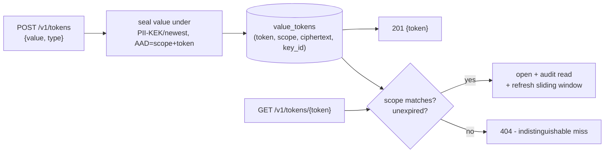

# Value Tokenization

Sometimes you do not want a full pseudonymous person record - you just want
to swap one sensitive value (an IBAN, a policy number, a card PAN) for an
opaque handle that a downstream system can store and hand back later, while
the real value stays encrypted in Sunder. F4 value tokens do exactly that:
a scope-bound, optionally expiring, optionally deduplicating token that only
its own tenant can redeem, with every read audited.

## Mechanism



A token is a random opaque handle (`VT-...` for strings; a Luhn-valid,
length-preserving, BIN-free digit string for cards). The ciphertext is
AEAD-bound to both the token and the scope that created it, so a stolen
token row cannot be re-pointed at another token or replayed in another
tenant - it simply fails to open.

## Create a token

```bash
curl -X POST "$SUNDER_URL/v1/tokens" \
  -H "Authorization: Bearer $CRED" -H 'Content-Type: application/json' \
  -d '{"value":"HR1210010051863000160"}'
# -> 201 {"token":"VT-6BQPRSMGARZJILBAUXDE"}
```

The client credential needs the `tokens.create` action. The value is capped
at 8 KB - this is a vault for identifiers and short secrets, not a blob
store (that is the [file vault](file-vault.md)).

### Card tokens preserve shape, not the BIN

```bash
curl -X POST "$SUNDER_URL/v1/tokens" \
  -H "Authorization: Bearer $CRED" -H 'Content-Type: application/json' \
  -d '{"type":"card","value":"4111 1111 1111 1111"}'
# -> 201 {"token":"5488...<16 Luhn-valid digits, no 411111 BIN>"}
```

!!! note "Why no BIN"
    A preserved Bank Identification Number leaks the issuer and geography,
    defeating the point of tokenizing. Card tokens keep the digit length and
    a valid Luhn check (so legacy validators accept them) but the BIN is
    random. A non-Luhn "card" value is refused.

### Dedup and expiry

```bash
# Same value returns the same token; a read refreshes the sliding window.
{"value":"HR12...","unique":true}
# Hard deadline and/or sliding TTL:
{"value":"...","expires_final":"2027-01-01T00:00:00Z","sliding_seconds":2592000}
```

The `unique` hash is bound to the scope AND the token type, so a string and
a card of the same digits never collide, and one tenant cannot probe
another's values. Expiry is decided by the database clock, so a skewed
application clock cannot make a token die early or linger.

## Redeem and delete

```bash
curl "$SUNDER_URL/v1/tokens/VT-6BQPRSMGARZJILBAUXDE" \
  -H "Authorization: Bearer $CRED"            # -> {"value":"HR12..."} (tokens.read)
curl -X DELETE "$SUNDER_URL/v1/tokens/VT-6BQPRSMGARZJILBAUXDE" \
  -H "Authorization: Bearer $CRED"            # tokens.delete
```

A redemption of an absent, foreign-scope, or expired token returns the same
`404` - the caller learns nothing about which. `tokens.delete` is a
separate action from `tokens.create` so a write-only integration cannot
destroy another integration's mappings in the shared scope.

## Bulk always requires an unlock token

```bash
# Mint a 60-second unlock token, then spend it on the bulk call.
UNLOCK=$(curl -sX POST "$SUNDER_URL/v1/admin/unlock" \
  -H "Authorization: Bearer $CRED" -d '{"purpose":"bulk-tokens"}' | jq -r .unlock_token)
curl -X POST "$SUNDER_URL/v1/tokens/bulk" \
  -H "Authorization: Bearer $CRED" -H "X-Sunder-Unlock: $UNLOCK" \
  -d '{"items":[{"value":"a"},{"value":"b"}]}'          # up to 1000 items
curl -X POST "$SUNDER_URL/v1/tokens/bulk/read" \
  -H "Authorization: Bearer $CRED" -H "X-Sunder-Unlock: $UNLOCK2" \
  -d '{"tokens":["VT-...","VT-..."]}'
```

!!! warning "Bulk is where quiet exfiltration lives"
    Bulk tokenize and bulk read ALWAYS require an unlock token with purpose
    `bulk-tokens`, regardless of `SUNDER_SEARCH_UNLOCK`. The unlock is spent
    only after the action and body checks pass, so a malformed or
    unauthorized request never burns one. A bulk create runs as a single
    transaction - a bad item rolls the whole batch back, so a migration
    never leaves sealed values behind that nobody holds a handle to.

## Security notes

- Every redemption is an audited read (bucketed by default); a miss is
  audited too, so probing is visible.
- Token creation, deletion and the unlock mint are rate-limited per client
  - each writes to the audit chain, and an unbounded caller could otherwise
  serialize the instance.
- Expired tokens are swept by `sunder retention run`; the audit chain keeps
  the create/read record independently.
- After a KEK rotation, `sunder keys rekey -reencrypt-pii` re-wraps every
  value token under the newest key, so [retiring a leaked key](../admin/rotation-and-rekey.md)
  actually protects tokenized values too.

See the [configuration reference](../install/configuration.md) for the full
list of knobs, and [selective disclosure](selective-disclosure.md) for the
full-person alternative when you need attributes, consent and DSR.
