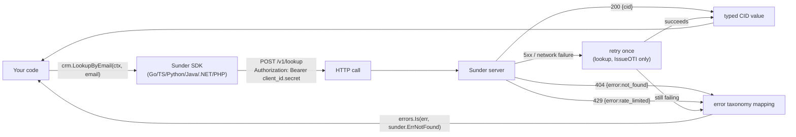

# SDKs and API

Six languages, one wire protocol - pick an SDK for the retry policy and
typed errors, or call the OpenAPI spec directly; either way the same HTTP
contract and the same error codes apply everywhere.

## Mechanism



`VerifyOTI` is never retried - the token is single-use, so a retry after
an ambiguous network failure could legitimately come back as
`token_used` and the SDK cannot tell whether the first attempt already
succeeded. A definite 4xx verdict and a cancelled context are never
retried on any call.

## Steps

1. **Pick the SDK for your stack and install it.** All six wrap the same
   surface of `/v1/*` - transport, bearer auth, timeouts, retries and error
   mapping, zero cryptography client-side. Since 0.5.0 that surface covers
   every client-facing route, not just the core identity calls:

   | Surface | SDK method | Wrapped |
   |---|---|---|
   | `POST /v1/contacts` | `RegisterContact` | yes |
   | `POST /v1/contacts/{cid}/scopes` | `IssueScopedCID` | yes |
   | `GET /v1/contacts/{cid}/attributes/{name}` | `GetAttribute` | yes |
   | `POST /v1/lookup` (email / phone / name) | `LookupBy*` | yes |
   | `POST /v1/oti`, `POST /v1/oti/verify` | `IssueOTI`, `VerifyOTI(Full)` | yes |
   | `POST /v1/consent`, `GET /v1/consent/{cid}` | `SetConsent`, `GetConsent` | yes |
   | `GET /v1/dsr/access`, `GET /v1/dsr/export` | `DSRAccess`, `DSRExport` | yes |
   | `POST /v1/dsr/erase` (incl. `cascade`) | `DSRErase` | yes |
   | `POST /v1/tokens`, `GET`/`DELETE /v1/tokens/{token}` | `Tokenize`, `Detokenize`, `DeleteToken` | yes |
   | `POST /v1/tokens/bulk`, `POST /v1/tokens/bulk/read` | `TokenizeBulk`, `DetokenizeBulk` | yes |
   | `POST`/`GET /v1/contacts/{cid}/files`, `GET`/`DELETE /v1/files/{id}` | `UploadFile`, `ListFiles`, `DownloadFile`, `DeleteFile` | yes |
   | `POST /v1/shares`, `GET`/`DELETE /v1/shares/{uuid}` | `CreateShare`, `FetchShare`, `RevokeShare` | yes |
   | `POST`/`DELETE /v1/links`, `GET /v1/contacts/{cid}/links` | `Link`, `Unlink`, `ListLinks` | yes |
   | `GET /v1/contacts/{cid}/versions[/{n}/attributes/{name}]` | `ListVersions`, `GetVersionAttribute` | yes |
   | `POST /v1/claims/external` | `StoreExternalClaim` | yes |
   | `POST /v1/admin/unlock` | `Unlock` | yes |
   | `GET /healthz`, `GET /readyz` | `Health`, `Ready` | yes |
   | `POST /v1/lookup` (`phone_suffix`) | - | **no** |
   | `GET /v1/admin/audit/chain`, `/verify`; the `/portal/api/*` routes | - | **no** |

   `user_id` is not a per-call argument: set it once on the client (Go
   `WithUserID`, TS `userId`, Python `user_id=`, PHP/Java/.NET constructor
   argument) and every call carries `X-Sunder-User-Id`.

   Everything not wrapped is plain JSON over HTTP; `api/openapi.yaml` is the
   contract for it, and the Postman collection below exercises it - including
   the routes the SDKs do wrap, so a shape can be checked by hand before it is
   wired into code.

   ```bash
   go get github.com/fvisic/sunder/sdks/go@latest        # Go 1.25+
   npm install @sunder-id/sunder                          # Node 18+
   pip install sunder-client                               # Python 3.10+
   ```

   ```xml
   <!-- Java 17+ (Maven) -->
   <dependency>
     <groupId>io.sunderid</groupId>
     <artifactId>sunder-client</artifactId>
     <version>0.5.0</version>
   </dependency>
   ```

   ```bash
   dotnet add package SunderId.Client                      # .NET 8.0
   composer require sunder-id/sunder-client                 # PHP 8.1+
   ```

2. **Configure from the environment** - every SDK defaults to `SUNDER_URL`
   and `SUNDER_CREDENTIAL` (`<client_id>.<secret>`, printed once by
   `sunder client create`):

   ```go
   crm, err := sunder.New("", "") // reads SUNDER_URL / SUNDER_CREDENTIAL
   ```

3. **Or call the HTTP API directly** - useful for languages without an
   SDK, or for scripting against the demo stack:

   ```bash
   curl -sX POST https://sunder.internal/v1/contacts \
     -H "Authorization: Bearer $SUNDER_CREDENTIAL" \
     -H "Content-Type: application/json" \
     -d '{"email": "filip@example.com", "name": "Filip Visic",
          "attributes": {"loyalty_tier": "gold"}}'
   ```

4. **Know which calls are never retried.** The rule is identical in all six
   SDKs and is not configurable: reads and idempotent creates retry once on a
   5xx or a network failure; anything that consumes a single-use credential or
   destroys data is attempted exactly once. That covers `VerifyOTI` (the token
   is single-use), `DSRErase`, `DeleteToken`, `DeleteFile`, `RevokeShare`,
   `Unlink`, and both bulk vault routes (they spend an unlock token). After an
   ambiguous network failure on one of those, reconciling is the caller's
   decision - a blind retry would report "already used" for a call that
   actually succeeded.

   Two more shared behaviours worth knowing before you write the branch:

   - `DSRErase` with no `cascade` sends **no `cascade` key at all**, not an
     empty list. Linked children come back listed and untouched; naming a link
     type is the only way to erase them.
   - `Tokenize` omits an unset `cid` rather than sending an empty one. A
     cid-bound token dies with the person's erasure; an unattributed one does
     not, so the binding is a deliberate argument, never a default.

5. **Match on the sentinel errors, not on HTTP status codes**, so a status
   code change in a future minor version does not silently break your
   branch logic:

   ```go
   _, err := erp.VerifyOTI(ctx, token, "create_order", "erp")
   switch {
   case errors.Is(err, sunder.ErrTokenUsed):
       // Already consumed - a replay, or your own retry.
   case errors.Is(err, sunder.ErrConsentDenied):
       // Withdrawn consent - distinct from ErrPurposeNotAllowed.
   case errors.Is(err, sunder.ErrCredentialExpired):
       // Correct secret, past its expiry: rotate it, do not retry.
   }
   ```

6. **Import the machine-readable contract** for codegen, contract tests
   or exploratory calls:

   - OpenAPI 3.1: `api/openapi.yaml` in the repository (also served at `/openapi.yaml` by every instance) - the
     source of truth for every request/response schema and error response.
   - Postman: `api/sunder.postman_collection.json` in the repository - 50
     requests across 13 folders, covering every `/v1` route an integration
     calls: the data-subject rights endpoints (including a cascading erasure),
     the value vault with its unlock-gated bulk routes, the file vault,
     cross-org shares, person links, attribute history, external claims and
     the admin audit reads. Set `baseUrl`, `credCrm`, `credErp`,
     `credNotifier` and - for the DSR and admin folders - `credDpo` and
     `credAdmin` as collection variables; the "Demo" folders are ordered flows
     runnable top-to-bottom with test scripts that pass `cid`/`token` between
     steps automatically.

## Error taxonomy

Identical across all six SDKs and identical to the raw JSON `{"error":
"<code>"}` shape. Note `unlock_required` in particular: it is a 403 that
means "entitled, but declare bulk/fuzzy intent first" (`POST
/v1/admin/unlock`, then `X-Sunder-Unlock`) - NOT "you lack the action". An
SDK that maps it to a generic forbidden leaves the caller unable to tell the
two apart.

| Sentinel | HTTP | Code |
|---|---|---|
| `ErrUnauthorized` | 401 | `unauthorized` |
| `ErrCredentialExpired` | 401 | `credential_expired` |
| `ErrForbidden` | 403 | `forbidden` |
| `ErrConsentDenied` | 403 | `consent_denied` |
| `ErrPurposeNotAllowed` | 403 | `purpose_not_allowed` |
| `ErrUnlockRequired` | 403 | `unlock_required` |
| `ErrAudienceMismatch` | 403 | `audience_mismatch` |
| `ErrNotFound` | 404 | `not_found` |
| `ErrValidation` | 400 | `validation` / `bad_json` |
| `ErrTokenInvalid` | 400 | `token_invalid` |
| `ErrTokenUsed` | 409 | `token_used` |
| `ErrTokenExpired` | 410 | `token_expired` |
| `ErrRateLimited` | 429 | `rate_limited` |
| `ErrServiceUnavailable` | 503 (or network failure, `Status` 0) | `service_unavailable` |
| `ErrBadResponse` | - | malformed/unexpected server response |

`credential_expired` means the secret itself is correct but past its
expiry - rotate with `sunder client rotate-secret`, do not retry.
`consent_denied` means the data subject withdrew consent for that
purpose; it is distinct from `purpose_not_allowed`, which is a missing
grant on the calling client, not a subject decision.

## Security notes

- **No SDK ships cryptography.** Every one is a thin transport client
  (stdlib HTTP + JSON where the language allows it); signing, hashing and
  encryption happen exclusively on the server, so there is no client-side
  key material to leak from an SDK dependency.
- **Credentials print exactly once.** `sunder client create` shows the
  secret at creation time only; only its hash is stored server-side, so a
  lost credential means issuing a new one, not recovering the old one.
- **`VerifyOTI` retries never happen automatically**, on purpose - an SDK
  that blindly retried a verify call could turn a successful handoff into
  a spurious `token_used` failure for the caller, or worse, mask an actual
  double-spend attempt. Reconciling an ambiguous verify failure is left to
  the caller, who has ticket/order context the SDK does not.
- **A definite 4xx is never retried.** Retrying a validation error or a
  purpose/audience mismatch cannot succeed and would only inflate
  rate-limit counters and audit volume for no benefit.
- **The error taxonomy is deliberately coarse on non-validation 4xx
  bodies.** Only `validation` responses carry a `detail` field - the rest
  stay generic to avoid turning error messages into an oracle for probing
  scope or purpose configuration.
