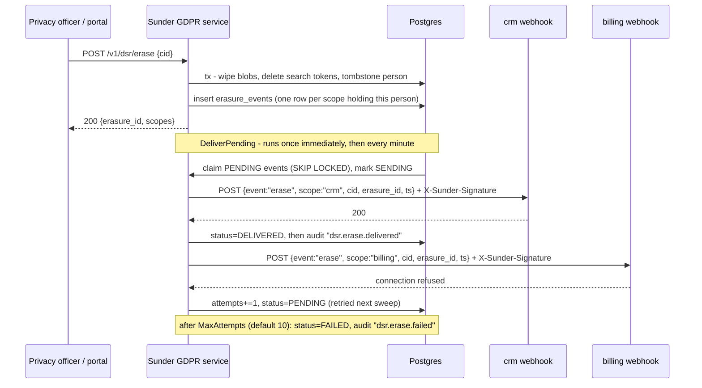

# Erasure Webhooks

A scope's own system (CRM, billing, support desk) needs to learn, reliably and verifiably, when a person it holds a pseudonym for must be forgotten - without keeping a live connection to Sunder or trusting a request it can't authenticate.

## Mechanism

Sunder is the only component that knows every scope holding a person, so an erasure fans out: one signed webhook event per scope, queued transactionally with the erasure itself and delivered by a worker that retries until a scope's endpoint acknowledges - or gives up and marks the event `FAILED`.

Delivery is a claim-then-send outbox: the worker moves its batch to `SENDING` and **commits that claim before any HTTP is attempted**, which is what stops two replicas delivering the same event. A claim that is never settled - the worker was killed, the process was cancelled, the acknowledging statement failed - is returned to `PENDING` by a reaper once it is older than `SUNDER_WORKER_CLAIM_TTL` (default 10m). The reaper runs at the top of every delivery sweep, from `sunder retention run`, and on demand via `sunder dsr requeue`.



## Steps

### 1. Register the scope's endpoint

```bash
sunder webhook set -scope crm -url https://crm.internal/hooks/sunder-erase
```

Each scope registers its own URL and gets its own secret; there is no shared secret across scopes.

### 2. Trigger an erasure

```bash
curl -X POST https://sunder.internal/v1/dsr/erase \
  -H "Authorization: Bearer privacy_officer.<secret>" \
  -H "Content-Type: application/json" \
  -d '{"cid": "CID-9F2A7VXTNP01"}'
```

```json
{"erasure_id": 4821, "scopes": 3}
```

One event is queued per scope that held a CID for this person; delivery is attempted immediately (best-effort) and retried by the periodic worker for anything still `PENDING`.

### 3. Verify the signature on receipt

The receiving endpoint gets:

```
POST /hooks/sunder-erase
Content-Type: application/json
X-Sunder-Signature: 7a1c...  (hex HMAC-SHA256 of the raw body, keyed with your scope's secret)

{"event":"erase","scope":"crm","cid":"CID-9F2A7VXTNP01","erasure_id":4821,"ts":"2026-08-23T10:15:00Z"}
```

Verify before acting on it:

```bash
echo -n "$RAW_BODY" | openssl dgst -sha256 -hmac "$SCOPE_WEBHOOK_SECRET" -hex
# compare against the X-Sunder-Signature header - reject on mismatch
```

No SDK ships a receiver helper for this - verification is a single stdlib HMAC-SHA256 call in any language, deliberately not something worth a dependency.

### 4. Check delivery status

```bash
sunder dsr events
```

Shows the queue by status - `PENDING`, `SENDING` (claimed by a worker, outcome not yet recorded), `DELIVERED`, `FAILED` (attempts cap reached). Every terminal transition is also written to the audit chain.

An event for a scope with **no registered webhook stays `PENDING`** and is
never claimed. A missing endpoint is a mutable configuration fact, not a
property of the message: burning it as terminal wrote off the Article 19
notification for every scope onboarded before its endpoint existed. Register
the webhook and the event delivers on the next sweep, with no attempts
charged for the wait. Each sweep logs one warning per blocked scope.
(`NO_WEBHOOK` remains a valid status for rows written before this change.)

Two gauges are exported for alerting, and `ops/prometheus-alerts.yaml` ships a rule for each:

| Metric | Meaning | Alert when |
|---|---|---|
| `sunder_erasure_events_sending` | events claimed but not settled | `> 0` for 30 minutes |
| `sunder_erasure_events_failed` | events abandoned at the attempts cap | `> 0` at all |

`SENDING` should always be transient. A count that does not fall back to zero means delivery is not making progress - the worker is dead, crash-looping, or every settle is failing. Recover with:

```bash
sunder dsr requeue          # claims older than SUNDER_WORKER_CLAIM_TTL
sunder dsr requeue -all     # every SENDING row - only when no worker is running
```

## Security notes

- **Redirects are never followed on delivery.** The HTTP client used for webhook POSTs treats every redirect as a stop condition. A compromised or hostile receiver cannot steer the signed payload at an internal address it doesn't otherwise control.
- **Delivery is bounded, not infinite.** Each POST times out after `SUNDER_WEBHOOK_TIMEOUT` (default 5s) and the queue gives up after `SUNDER_WEBHOOK_MAX_ATTEMPTS` (default 10) failed attempts, marking the event `FAILED` with an audited terminal transition. One dead endpoint cannot starve the whole delivery queue - but it also means delivery is not guaranteed forever; a scope must alert on `FAILED` rows **and** on the age of `SENDING` rows, not assume eventual success.
- **Delivery is at-least-once, and the receiver must be idempotent.** The claim commits before the POST and the acknowledgement is a separate transaction, so a POST that succeeded and whose acknowledgement failed is re-delivered after the claim lease expires. Key on `(scope, cid, erasure_id)`: a repeat of an `erasure_id` you have already actioned is a duplicate, not a second erasure.
- **The payload carries only `scope`, `cid`, `erasure_id`, `ts` - no PII, no other scope's data.** A receiver at one scope learns nothing about any other scope's relationship with the person beyond the pseudonym it already held.
- **A tombstoned person cannot be erased twice.** `erasePerson` checks `erased_at IS NOT NULL` under a row lock before doing anything; a second call on an already-erased person is rejected rather than re-queuing a duplicate round of webhook deliveries.
- **A scope without a registered webhook does not lose the event, and does not burn it either.** It stays `PENDING`, visible in `sunder dsr events` and in a per-sweep warning log, and delivers as soon as the endpoint is registered.
- **The `_portal` scope is reserved for the mailer, not a data scope's erasure webhook.** Registering an erasure endpoint under `_portal` or the mailer endpoint under a data scope is a configuration error the two surfaces don't detect for you - keep them registered under the correct scope names.
