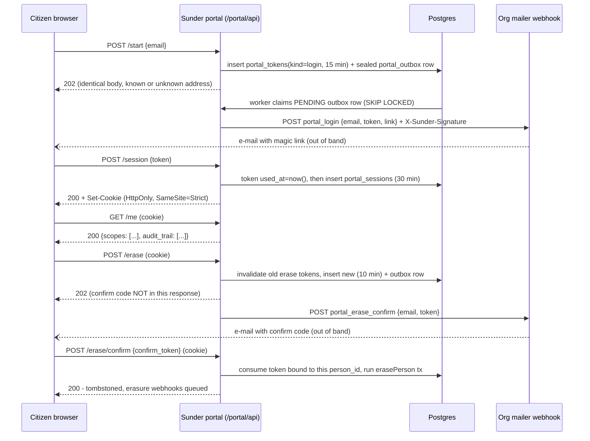

# Privacy Portal

A citizen wants to see everything the organization holds on them, flip a consent decision, or erase their own data - without a client credential and without filing a request through the privacy officer.

## Mechanism

The portal (`SUNDER_PORTAL_ENABLED`, off by default) authenticates with a magic link instead of a bearer credential: Sunder never sends the e-mail itself, it POSTs a signed event to the org's mailer webhook (reserved scope `_portal`) and a background worker drains the queue. Erasure needs a second, out-of-band confirmation so a stolen session cookie alone cannot forget a person.



## Steps

Set `SUNDER_PORTAL_ENABLED=true`, a mailer webhook, and (if the API listener runs mTLS) a separate `SUNDER_PORTAL_LISTEN` address:

```bash
sunder webhook set -scope _portal -url https://mailer.internal/hook
```

### 1. Request a login link (unauthenticated)

```bash
curl -X POST https://privacy.acme.example/portal/api/start \
  -H "Content-Type: application/json" \
  -d '{"email": "filip@example.com"}'
```

Always `202`, whether or not the address is known - this is the anti-enumeration surface, not an error path to branch on.

### 2. Redeem the link and start a session

```bash
curl -i -c cookies.txt -X POST https://privacy.acme.example/portal/api/session \
  -H "Content-Type: application/json" \
  -d '{"token": "<token from the mailed link>"}'
```

Single-use, 15-minute token; sets an HttpOnly, Secure, `SameSite=Strict` cookie valid 30 minutes.

### 3. See everything every scope stores

```bash
curl -b cookies.txt https://privacy.acme.example/portal/api/me
```

Returns each scope's decrypted attributes and consents plus the cross-scope audit trail - the same `dsr.access` payload shape, self-served, and never cacheable.

### 4. Grant or withdraw a consent

```bash
curl -X POST https://privacy.acme.example/portal/api/consent \
  -b cookies.txt -H "Content-Type: application/json" \
  -d '{"cid": "CID-9F2A7VXTNP01", "purpose": "newsletter", "granted": false}'
```

`404` if the CID does not belong to the signed-in person. Takes effect immediately on reads and handoffs.

### 5. Erase - step 1, request

```bash
curl -X POST https://privacy.acme.example/portal/api/erase -b cookies.txt
```

### 6. Erase - step 2, confirm

```bash
curl -X POST https://privacy.acme.example/portal/api/erase/confirm \
  -b cookies.txt -H "Content-Type: application/json" \
  -d '{"confirm_token": "<code from the mailed confirmation>"}'
```

Runs the full org-wide erasure with signed webhooks, audited as `portal:<cid>`.

There is no portal SDK - the surface is a cookie-authenticated browser flow, not a client-credentialed integration.

## Security notes

- **Login timing does not reveal whether an address is registered.** `/start` enforces a constant wall-clock floor (~40ms) on top of doing equal database work for a hit and a miss, and never blocks on the actual mail send - delivery happens in a background worker, so a network round-trip can't separate the two branches either.
- **No audit row is written on `/start` itself**, deliberately: it is unauthenticated, and a row whose presence depends on whether the address exists would be an enumeration oracle. Accountability is not lost - the outbox worker still records `portal.mail.delivered` / `.failed` / `.no_mailer`, and a redeemed token records `portal.login`.
- **The erase confirmation code is never returned to the session that requested it.** It only reaches the mailbox on file. Returning it to the caller would make the second factor theatre - whoever holds the cookie would just make two calls instead of one.
- **A confirm token is bound to the `person_id` that requested it.** A wrong-session or stolen-token attempt cannot consume the legitimate owner's confirmation, and an unknown, expired, already-used, or someone-else's token all return the same `404` - indistinguishable on purpose.
- **Portal state dies with the person.** Erasure deletes live sessions, outstanding tokens, and queued outbox mail for that person in the same transaction as the erasure itself - a login or erase-confirm mail must never be delivered, and a session must never outlive the data it grants access to.
- **The portal is off by default and rejects mTLS listener sharing.** An upgrade must never silently expose a new unauthenticated public surface, and browsers cannot present a client certificate, so a portal sharing the mTLS API listener would refuse every citizen.
- **Rate limits fail closed.** If the rate limiter's backing store is unreachable, the portal surface denies rather than allows - the mail-sending route (5/min per requester, plus an independent 3-per-15-minutes cap per address) is the strictest, because it is the one an attacker could use to mail-bomb someone else's inbox.
