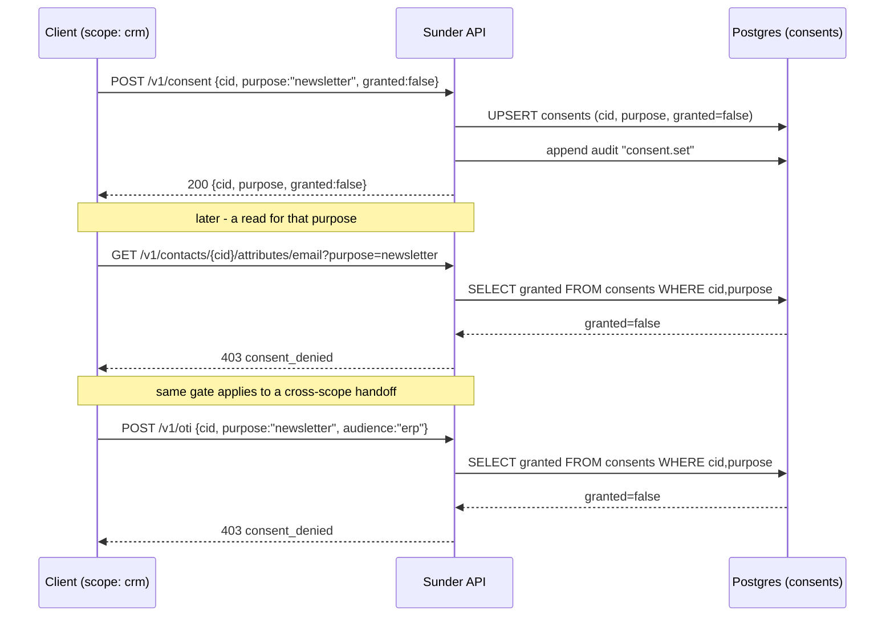

# Rights and Consent

A privacy officer needs to grant or withdraw consent for one purpose on one pseudonym, have that decision actually block reads and cross-scope handoffs for that purpose, and be able to answer "what does the org hold on this person, and who looked at it" and "what does my scope hold on this person" without touching any other scope's data.

## Mechanism

Consent is a per-`(cid, purpose)` row. Absence of a row means the purpose is not consent-governed (contract or legitimate-interest bases still apply); an explicit `granted:false` is what blocks. The same check gates both an attribute read and an OTI handoff, because a handoff is just a read the receiving scope performs later.



## Steps

### 1. Record a consent decision

```bash
curl -X POST https://sunder.internal/v1/consent \
  -H "Authorization: Bearer crm_client_1.<secret>" \
  -H "Content-Type: application/json" \
  -d '{"cid": "CID-9F2A7VXTNP01", "purpose": "newsletter", "granted": false}'
```

SDK: none of the six SDKs wrap `/v1/consent` yet - call the REST endpoint directly with the same bearer credential you already use for reads.

### 2. List recorded decisions for a CID

```bash
curl https://sunder.internal/v1/consent/CID-9F2A7VXTNP01 \
  -H "Authorization: Bearer crm_client_1.<secret>"
```

Returns `{"consents": [{"purpose": "newsletter", "granted": false, "updated_at": "..."}]}` - empty list when nothing was ever set.

### 3. Right of access, org-wide (privacy officer only)

`dsr.access` is a high-privilege, linkage-capable action: it returns every scope's decrypted attributes for the person, not just the caller's own scope.

```bash
curl "https://sunder.internal/v1/dsr/access?cid=CID-9F2A7VXTNP01" \
  -H "Authorization: Bearer privacy_officer.<secret>"
```

The response bundles `scopes` (each scope's attributes and consents) and `audit_trail`. Under the default `SUNDER_AUDIT_READS=bucketed` mode, the trail mixes two shapes: plain chained rows (`count` absent) for mutations, and bucketed read rows (`count`, `ts` = first access in the hour, `last_ts` = last) for attribute reads and lookups - the Article 15 answer must include those or "who accessed my data" silently loses every read made under the default mode.

### 4. Data portability export (caller scope only)

```bash
curl "https://sunder.internal/v1/dsr/export?cid=CID-9F2A7VXTNP01" \
  -H "Authorization: Bearer crm_client_1.<secret>"
```

Returns `{scope, cid, attributes, consents}` for the caller's scope only - a machine-readable Article 20 dump, audited as `dsr.export`.

### 5. Retention TTLs

```bash
sunder retention set -scope crm -days 365
sunder retention run   # cron
```

Wipes caller-scope blobs whose `updated_at` is older than the TTL (an actively maintained contact is never wiped just because it was first seen long ago), and prunes OTI rows expired more than 30 days. Search tokens survive a retention wipe - it is not an erasure.

## Security notes

- **Absence of a consent row is not denial.** Only an explicit `granted:false` blocks. This is deliberate: most reads happen under a contract or legitimate-interest basis that consent withdrawal must not silently break.
- **`dsr.access` is restricted to the privacy-officer client's action grant**, not any authenticated client, because it is linkage-capable - it hands the caller every scope's pseudonym and data for one person in a single call.
- **`dsr.export` does not apply per-attribute consent or purpose gating.** Portability is its own legal basis (Art. 20); a withdrawn marketing consent must not block the subject's right to their own data. This is why the action is granted like `scopes.issue` - privacy-officer and subject-request tooling only, never a general-purpose client.
- **Consent decisions survive erasure**; attribute data does not. The `granted:false` accountability record stays for audit purposes even after the person is tombstoned.
- **Bucketed read audit gives hour-granularity tamper evidence, not per-event.** The open bucket for the current hour can be altered by a DBA-level attacker without breaking a digest, until it seals; mutations (register, erase, consent, OTI) are always chained per event in both modes, never bucketed.
- **Retention wipes the blob, not the search tokens or the person.** It is a data-minimization sweep, not an erasure - a later read finds an empty attribute, not a tombstoned person.
