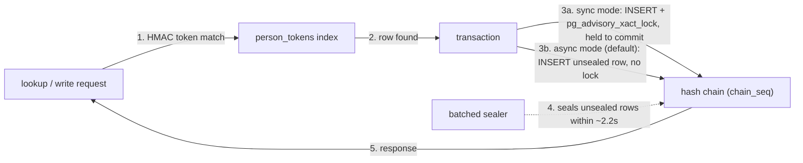

# Performance

You want to know whether Sunder's per-request overhead - a hash-chained
audit record, keyed-HMAC search tokens, purpose and consent checks - costs
you throughput you cannot afford, and where the real ceiling is once the
dataset and the concurrency get large.

## The mechanism



In sync mode every request queues behind one serialized critical section
(the advisory lock that keeps the chain linear). In async mode the lock
is off the request path entirely, and a background sealer catches the
chain up a couple of seconds later - this is the change that removed the
throughput ceiling described below.

## What the numbers say

**The plateau, found on a 12-core server.** At 26.8M contacts, lookup
throughput flattened at ~420 rps from concurrency 8 upward, while p50
doubled with every doubling of concurrency - added clients bought queueing
delay, not throughput. `pg_stat_activity` sampling during a c=32 run
showed 117 of 124 active backends sitting in `Lock/advisory`. Isolating
the mechanism with `pgbench` against a clone of the audit table: removing
the advisory lock alone was **13.8x** faster at c=32 (298 -> 4,114
tps), on the same hardware and durability settings. It was not storage:
the same disk sustains 4,914 commits/sec once the lock is gone.

**Async sealing removed it.** With `SUNDER_AUDIT_SEALING=async` (the
default) on the same 26.8M-contact dataset:

| concurrency | before (sync) | after (async) |
|------------:|--------------:|---------------:|
| 8  | 423.6 rps | 1,183.0 rps |
| 32 | 449.2 rps | 1,773.0 rps |
| 64 | (plateaued) | 1,959.4 rps |

That is **4.3x at c=32**, still climbing at c=64, with p50 at c=8
*improving* (15.32 -> 5.74 ms) because requests now queue on the
connection pool instead of on one lock. Chain integrity was measured, not
assumed: 374,504 audit rows written, a 1,303-row unsealed backlog drained
to zero within 4s of load stopping, `chain_seq` dense end to end, and
`sunder verify-audit` reported the chain intact with 0 pending. The one
honest regression: single-client latency rose (~3ms, 160.4 -> 110.6 rps)
because the lookup's audit INSERT is now a second statement instead of
riding an already-held lock's shadow - it disappears into the queueing
gains from c=4 up.

**Head-to-head vs Databunker**, same laptop, same PostgreSQL 16, same
harness, both systems interleaved, five rounds plus a clean 5,000-request
pass, zero errors on both sides:

| Operation | Sunder | Databunker | Advantage |
|---|---|---|---|
| write | 2,729 rps, p99 9.77 ms | 1,295 rps, p99 26.29 ms | **+111%**, p99 2.7x lower |
| lookup | 3,439 rps, p99 6.25 ms | 2,032 rps, p99 20.02 ms | **+69%**, p99 3.2x lower |
| read | 3,443 rps, p99 5.64 ms | 2,139 rps, p99 19.33 ms | **+61%**, p99 3.4x lower |

Sunder does strictly more work per request throughout: a hash-chained
audit record in the same transaction, keyed-HMAC search tokens per
identifier, purpose and consent checks. Databunker's read returns the
full record; Sunder's returns one purpose-checked attribute.

## Reproduce it

```sh
docker compose -f deploy/docker-compose.yml up --build -d
CRED=$(docker compose -f deploy/docker-compose.yml exec sunder /sunder client create \
  -id bench -name Bench -scope crm \
  -actions contacts.register,lookup,attributes.read -purposes benchmark -rate 10000000 | tail -1)

go run ./benchmark -target sunder -base http://localhost:8080 \
  -cred "$CRED" -op lookup -n 5000 -c 16 -seed round1
```

The full Databunker side of the harness (its own Postgres container, init
and start) is in `benchmark/README.md` under "Reproduce" - same script,
same flags, run against both targets to get a head-to-head on your own
hardware.

## Honest conditions

- These are measured numbers on specific hardware (a laptop for the
  head-to-head table, a 12-core/47GB server for the scale test) - quote
  the ratios, not the absolute rps, on different hardware.
- An earlier write-up blamed the plateau on `fdatasync` latency
  ("bounded by storage commit latency"). The 26.8M scale test disproved
  that: group commit lets the same storage sustain 4,914 commits/sec once
  the lock is removed. The correction is left in `benchmark/README.md`
  rather than silently edited out.
- One reported 1,959 rps figure drew from a keyspace with holes left by
  an interrupted bulk load (~8% misses); a later dense-keyspace rerun is
  the number to trust for that comparison.
- Two Databunker measurements that failed mid-run were discarded rather
  than averaged into the results, and that exclusion is stated in the
  source rather than left implicit.
- Neither system was tuned beyond its defaults for the head-to-head
  table; the scale test did retune Postgres off its 128MB
  `shared_buffers` default (see `deploy/docker-compose.yml` for the dev
  compose sizing, and `docs/CONFIG.md` for the production sizing table).

## Security notes

- Async sealing deliberately does **not** guarantee a fresh row is
  hash-chained the instant it's written - there is a window (~2.2s
  measured) where a row is trigger-protected but not yet linked into the
  chain. This is a stated, documented trade-off
  (`docs/THREAT-MODEL.md`, "Audit sealing window"), not a hidden gap.
- Sync sealing exists precisely for deployments that will not accept that
  window - zero gap, at the cost of the serialized throughput ceiling
  described above. Sunder does not pick one for you silently; both are
  configured, documented behaviors.
- Removing the advisory lock is not "less audit" - it is the same
  linear, tamper-evident hash chain, sealed slightly later. No response
  the API returns depends on unsealed rows being trustworthy; sealing is
  a background durability step, not a gate on data returned to a caller.
