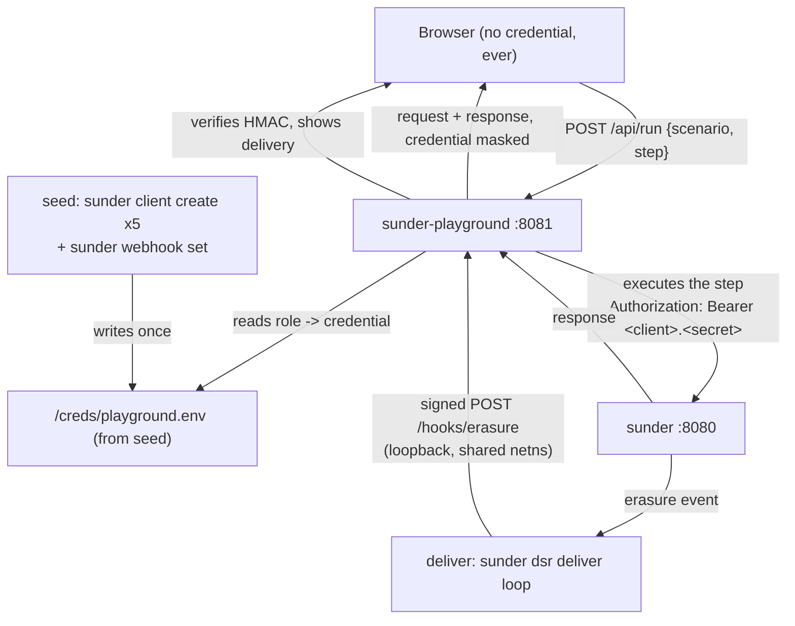

# Playground

You want to see what Sunder actually does - the pseudonyms, the refusals,
the consent gate, the erasure webhook, the audit chain - without writing a
client first. The playground is the guide scenarios turned into clickable
walkthroughs against a real instance, with the HTTP request and response
shown under every step.

## The mechanism



Two properties are worth stating plainly, because they are what makes this
safe to run and honest to watch:

- **The browser never holds a credential.** Steps execute server-side; the
  `Authorization` header the UI renders is masked down to the client id. A
  screen-shared demo cannot leak a working secret.
- **Only declared steps can run.** The playground holds real credentials,
  so there is no "send any request" surface: the scenario files are the
  allowlist, and `/api/run` takes a scenario id and a step index, never a
  method and a path.

## Run it

```sh
docker compose -f deploy/docker-compose.yml \
               -f deploy/docker-compose.playground.yml up --build -d
open http://localhost:8081
```

The overlay adds three services: `seed` creates the five demo clients once
and writes their credentials to a shared volume (the same pattern as
`sunder bootstrap -credential-file` - no secret through an environment
variable, none in a log stream), `playground` serves the walkthroughs, and
`deliver` drains the erasure webhook queue every couple of seconds so the
inbox panel fills without anyone running a CLI by hand.

Tear it down with `docker compose ... down -v`.

!!! note "If you recreate the playground container alone"
    `deliver` shares the playground's network namespace, so the stored
    loopback webhook URL resolves to the playground's listener. Recreating
    `playground` on its own leaves `deliver` attached to a namespace that no
    longer exists - `docker compose ... up -d --force-recreate deliver`
    after any playground rebuild.

## What is in it

| Walkthrough | What it shows | Guide |
|---|---|---|
| Lookup and one-time handoff | Registration, a phone lookup, a field read with a purpose, the refusals (name-only lookup, miss, OTI replay), and two unlinkable pseudonyms for one person | [OTI handoff](../concepts/oti-handoff.md) |
| Consent enforced on reads | A withdrawal turning the next read and the next handoff into 403s, and re-granting restoring both | [Rights and consent](../gdpr/rights-and-consent.md) |
| Erasure, and the webhook that proves it | Org-wide erasure, the field and the search token both gone, and the signed callback landing in a verified inbox | [Erasure webhooks](../gdpr/erasure-webhooks.md) |
| The audit chain, and how you check it | `GET /v1/admin/audit/verify` and the chain tail, with the hash links drawn | [Audit chain](../admin/audit-chain.md) |

The **API reference** tab renders the instance's own `/openapi.yaml`
(RapiDoc, bundled offline). Browser-side "try it" is deliberately off:
executing calls belongs in the walkthroughs, where the credential stays on
the server.

Each step asserts the status code it expects, including the refusals - a
403 or a 409 renders green when it is the point of the step. Two steps also
assert a property rather than a status: that a lookup returns the same
pseudonym as the registration, and that the ERP's pseudonym differs from
the CRM's. Those are checked in the runner, so "the databases would not
correlate" is a test result on your screen, not a claim in a slide.

## Operating it

| Setting | Default | Why |
|---|---|---|
| `SUNDER_URL` | `http://localhost:8080` | Base URL of the Sunder instance the playground drives (`-sunder`). |
| `PLAYGROUND_SCENARIOS` | - | Directory of scenario JSON files (`-scenarios`); unset uses the ones built into the binary. |
| `PLAYGROUND_LISTEN` | `127.0.0.1:8081` | Loopback. A non-loopback bind is **refused** unless `PLAYGROUND_PUBLIC=1` (or `-public`) is set: the process holds working credentials for the instance it demonstrates. |
| `PLAYGROUND_RATE` | `120` req/min per IP | A reachable demo is also a way to spend someone else's database. |
| `PLAYGROUND_CREDENTIAL_FILE` | - | `role=<client_id>.<secret>` lines, plus `webhook_secret=`. `PLAYGROUND_CRED_<ROLE>` overrides a single role. |
| `PLAYGROUND_COOKIE_SECURE` | off | Set it when serving over TLS. |
| `PLAYGROUND_CLIENT_IP_HEADER` | - | Behind a proxy, name the header explicitly; a blindly trusted `X-Forwarded-For` is a rate-limit bypass. |
| `PLAYGROUND_TRUSTED_PROXY_HOPS` | `0` | How many entries to skip from the RIGHT of that header. `0` takes the right-most, which is what the adjacent proxy appended - the left-most is whatever the caller sent, and reading it hands every requester a fresh rate-limit bucket. |

Each visitor gets their own session: their own fake person (a unique
e-mail and phone, so two visitors never dedup onto one record), their own
captured variables, and a webhook inbox filtered to their own pseudonyms.
"Start over" mints a fresh identity rather than reusing the erased one.

## Security notes

- **Never point it at production.** It is a demo tool: it registers,
  reads, erases, and holds credentials that can do all three. The
  distroless image ships as a separate binary precisely so nothing here
  ends up in the service image.
- The demo stack leaves records behind (each session registers a new
  person). Schedule `sunder retention run`, or `down -v` between demos.
- The walkthrough UI runs under a strict CSP with no `unsafe-inline`; the
  API-reference document is separate because the RapiDoc web component
  needs inline styles, and that exception should not extend to the app.
- Erasure webhook deliveries are verified here, not trusted: the inbox
  badge is the result of checking `X-Sunder-Signature` against the
  registered secret, and a bad signature is answered with a 401 and shown
  as such.

## Adding a walkthrough

Scenarios are JSON files in `internal/playground/scenarios/`, compiled into
the binary (`-scenarios <dir>` loads from disk while authoring). A file
declares its roles, then steps with `method`, `path`, `body`, the `expect`ed
status, optional `capture` of response fields into `{{variables}}`, and
optional `assert` blocks comparing two variables. Broken files fail at
load, and `go test ./internal/playground/` runs every shipped walkthrough
against a fake instance, so a scenario cannot rot quietly.
