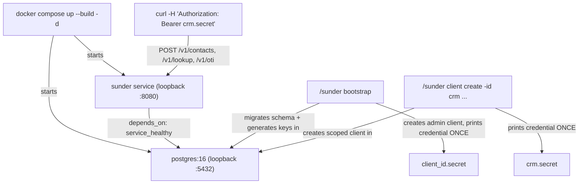

# Quickstart

You want a running Sunder instance, an API credential, and proof that
register, lookup and cross-scope handoff (OTI) all work - in the next few
minutes, on your own machine.

## The mechanism



Bootstrap and client creation only ever touch the database directly (via
the CLI, run inside the container); every application request after that
goes through the HTTP API with a bearer credential.

## Steps

**1. Start the stack.** This is exactly the compose file at
`deploy/docker-compose.yml`: Postgres with dev-only tuning and a
loopback-only port, and the Sunder service depending on its healthcheck,
also loopback-only.

```sh
git clone https://github.com/fvisic/sunder && cd sunder/deploy
docker compose up --build -d
```

**2. Bootstrap.** One idempotent command runs the schema migrations,
generates the key material, and creates a first admin client - printing
its credential exactly once. Interactive mode prints to stdout:

```sh
docker compose exec sunder /sunder bootstrap
```

Non-interactive deployments (CI, provisioning scripts) use `-unattended`
with `-credential-file` instead, since nothing safe to log should ever
hit stdout:

```sh
docker compose exec sunder /sunder bootstrap \
  -unattended -credential-file /keystore/admin.cred
```

Rerunning `bootstrap` against an already-initialized instance is a
no-op success - safe to call unconditionally from a compose or Helm hook.

**3. Create a scoped client.** The admin credential can administer the
instance, but registering contacts needs a client scoped to a system -
here, a CRM that can register contacts, look them up, read attributes and
issue OTI handoffs:

```sh
docker compose exec sunder /sunder client create \
  -id crm -name "Demo CRM" -scope crm \
  -actions contacts.register,lookup,attributes.read,oti.issue \
  -purposes support,create_order
```

This prints a credential of the form `crm.<secret>` - copy it, it is not
retrievable again. Export it:

```sh
export SUNDER_CRED_CRM='crm.<secret>'
```

**4. Register a contact.**

```sh
curl -sS -X POST http://localhost:8080/v1/contacts \
  -H "Authorization: Bearer $SUNDER_CRED_CRM" \
  -H "Content-Type: application/json" \
  -d '{
    "email": "Ana.Horvat@Example.com",
    "phone": "+385 91 234 5678",
    "name": "Ana Horvat",
    "attributes": {"loyalty_tier": "gold"}
  }'
# -> 201, {"cid": "..."}
```

SDK equivalent: `client.RegisterContact(ctx, contact)` in the Go SDK
(same call shape across all six SDKs).

**5. Look the contact up by phone.**

```sh
curl -sS -X POST http://localhost:8080/v1/lookup \
  -H "Authorization: Bearer $SUNDER_CRED_CRM" \
  -H "Content-Type: application/json" \
  -d '{"phone": "+385912345678"}'
# -> 200, {"cid": "..."} - same CID as step 4
```

SDK equivalent: `client.LookupByPhone(ctx, phone)`.

**6. Issue an OTI to hand the contact to another system.** A second
scoped client (`erp`, action `oti.verify`) redeems it and gets its own,
different CID:

```sh
curl -sS -X POST http://localhost:8080/v1/oti \
  -H "Authorization: Bearer $SUNDER_CRED_CRM" \
  -H "Content-Type: application/json" \
  -d '{"cid": "<cid-from-step-4>", "purpose": "create_order", "audience": "erp"}'
# -> 201, {"token": "..."} - 5-minute, single-use, audience-bound
```

SDK equivalent: `client.IssueOTI(ctx, cid, "create_order", "erp", nil)`.

For the full narrated version of this flow, including the rejected
name-only lookup and the enumeration-detector miss, run the packaged
demo instead of typing these by hand:

```sh
../demo/quickstart.sh
```

## Security notes

- Bootstrap and `client create` deliberately print the credential
  **exactly once** and never store the plaintext secret - only its hash.
  There is no "recover my client secret" call; losing it means rotating
  it (`client rotate-secret`), not retrieving it.
- `-unattended` deliberately refuses to write the credential to `/dev/*`
  or `/proc/*` paths - a stream target would land in container logs,
  where any log shipper forwards it, so the CLI rejects that path
  outright rather than trusting the caller to avoid it.
- The dev compose file deliberately binds both Postgres and the Sunder
  API to `127.0.0.1` only - the dev database and dev API are not meant
  to be reachable from any other interface on the machine.
- A rejected bootstrap flag combination deliberately creates no client:
  validation runs before any database write, so a typo in `-ttl` or a
  conflicting flag never leaves a half-provisioned admin behind.
