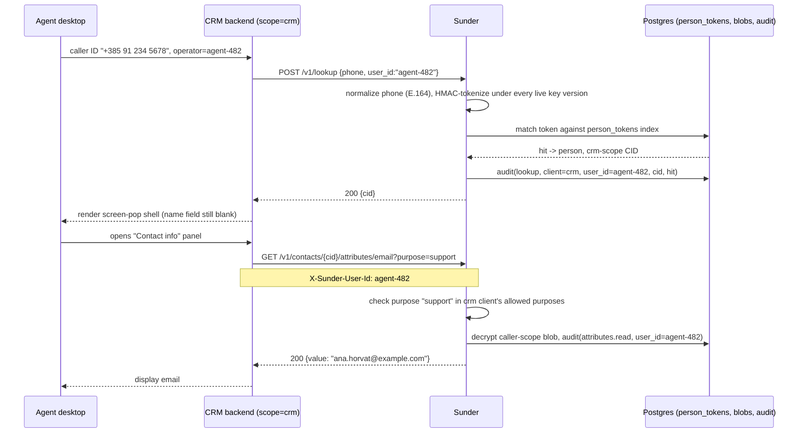

# CRM Lookup Integration

A support agent's screen-pop needs to find the caller by phone or email,
pull just the fields the agent is looking at, and leave a record of which
operator touched what - without ever storing a searchable PII key in the
CRM's own database.

## Mechanism



Two calls, two different audit rows, one operator identity threaded
through both - `lookup` never returns PII itself, and `attributes.read`
never runs without a declared reason.

## Steps

1. **Look the caller up by a normalized identifier**, attributing the call
   to the operator handling it:

   ```bash
   curl -sX POST https://sunder.internal/v1/lookup \
     -H "Authorization: Bearer $CRM_CLIENT_TOKEN" \
     -H "Content-Type: application/json" \
     -d '{"phone": "+385 91 234 5678", "user_id": "agent-482"}'
   ```

   `200 {"cid": "CID-01J8ZK3V4WXYZ"}` on a hit, `404 {"error":"not_found"}`
   on a miss - both are audited, and misses feed the enumeration detector.

   SDK equivalent: `crm.LookupByPhone(ctx, "+385 91 234 5678")` (the Go SDK
   does not yet expose `user_id` as a typed option - pass it via the raw
   request body shape your SDK exposes, or the header form below).

2. **Add a name only to narrow an existing identifier**, never alone - a
   bare `{"name": "..."}` is a 400, because a name is not an identifier:

   ```bash
   curl -sX POST https://sunder.internal/v1/lookup \
     -H "Authorization: Bearer $CRM_CLIENT_TOKEN" \
     -H "Content-Type: application/json" \
     -d '{"name": "Ana Horvat", "phone": "+385 91 234 5678"}'
   ```

3. **Fetch exactly the field the agent opened**, with a purpose and the
   operator attribution on GET routes carried as a header (body wins on
   `POST /v1/lookup`; GET has no body, so it is header-only here):

   ```bash
   curl -sX GET "https://sunder.internal/v1/contacts/CID-01J8ZK3V4WXYZ/attributes/email?purpose=support" \
     -H "Authorization: Bearer $CRM_CLIENT_TOKEN" \
     -H "X-Sunder-User-Id: agent-482"
   ```

   `200 {"value": "ana.horvat@example.com"}`

   SDK equivalent: `crm.GetAttribute(ctx, cid, "email", "support")` (Go),
   or the analogous call in any of the six SDKs - the shape is identical.

4. **Register new-caller data through the same client**, so first-contact
   and repeat-contact both land in one audit trail:

   ```bash
   curl -sX POST https://sunder.internal/v1/contacts \
     -H "Authorization: Bearer $CRM_CLIENT_TOKEN" \
     -H "Content-Type: application/json" \
     -d '{"email": "ana.horvat@example.com", "phone": "+385 91 234 5678",
          "name": "Ana Horvat", "attributes": {"loyalty_tier": "gold"}}'
   ```

   `201 {"cid": "CID-01J8ZK3V4WXYZ"}` - re-running with the same
   identifiers returns the same CID (dedup by email/phone token) rather
   than creating a duplicate person.

## Security notes

- **`user_id` is client-asserted, not authenticated.** Sunder validates
  its shape (`[A-Za-z0-9._@:-]`, max 64 chars, never a name) and stores it
  as a queryable column and bucket key, but it does not verify the CRM is
  telling the truth about which operator made the call - the same trust
  model as any `who` field in an audit log. What it buys over having
  nothing is a tamper-evident record that never carries raw values, and an
  Article 15 answer that says which operator instead of only which system.
- **`user_id` is never the data subject.** The person being looked up is
  always identified by CID; `user_id` identifies the CRM operator, and the
  two are never interchangeable in the audit trail.
- **Lookup never returns PII, only a pseudonym.** Getting a CID back does
  not disclose the caller's email or phone - a second, purpose-checked
  call is required for that, and it is a separate audited event.
- **A lookup hit is not proof of identity.** LOOKUP != AUTHENTICATION - a
  hit means the given phone or email matches a record, not that the agent
  is actually speaking with that person. Do not gate an authentication
  decision on this endpoint alone.
- **Name-alone lookups are rejected by design.** Allowing them would let a
  breached or malicious CRM client enumerate "every Ana Horvat" - names
  only narrow an existing email/phone match.
- **Misses and rate limits are enforced per client, not per operator.**
  The `user_id` attribution does not raise or lower the client's own
  per-minute lookup limit or its enumeration-detector threshold.
