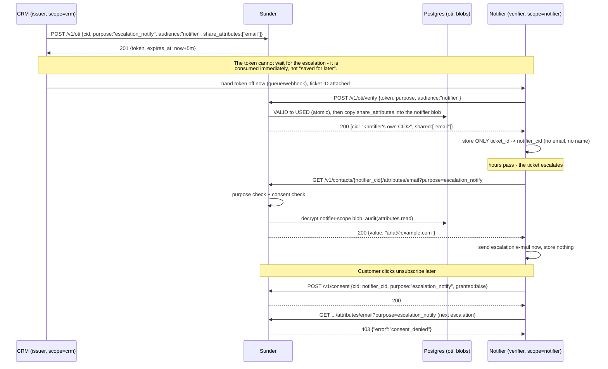

# Delayed Flows

A ticket escalates hours after it was opened and a notifier service has
to email the customer at that later moment - but a handoff token (OTI)
lives five minutes, so "save the token for later" is not an option, and
the notifier should never hold the customer's email at rest.

## Mechanism



The email crosses the scope boundary exactly once, at verification time,
because the issuer explicitly listed it in `share_attributes`. Everything
after that is a just-in-time fetch against the notifier's own CID.

## Steps

1. **Register the contact from the issuing system** (the ticket source):

   ```bash
   curl -sX POST https://sunder.internal/v1/contacts \
     -H "Authorization: Bearer $CRM_CLIENT_TOKEN" \
     -H "Content-Type: application/json" \
     -d '{"email": "ana@example.com", "name": "Ana Anic",
          "attributes": {"ticket": "T-4821"}}'
   ```

   `201 {"cid": "CID-CRM-SIDE"}`

2. **Issue an OTI that shares the email, not just the pseudonym**, when
   the ticket is handed to the notifier - not when it later escalates:

   ```bash
   curl -sX POST https://sunder.internal/v1/oti \
     -H "Authorization: Bearer $CRM_CLIENT_TOKEN" \
     -H "Content-Type: application/json" \
     -d '{"cid": "CID-CRM-SIDE", "purpose": "escalation_notify",
          "audience": "notifier", "share_attributes": ["email"]}'
   ```

   `201 {"token": "v4.public...", "expires_at": "..."}`

   SDK equivalent: `crm.IssueOTI(ctx, cid, "escalation_notify", "notifier", &sunder.IssueOptions{ShareAttributes: []string{"email"}})`.

3. **Verify immediately from the notifier**, well before the escalation
   moment - this is the step that actually copies `email` into the
   notifier's own scope:

   ```bash
   curl -sX POST https://sunder.internal/v1/oti/verify \
     -H "Authorization: Bearer $NOTIFIER_CLIENT_TOKEN" \
     -H "Content-Type: application/json" \
     -d '{"token": "v4.public...", "purpose": "escalation_notify", "audience": "notifier"}'
   ```

   `200 {"cid": "CID-NOTIFIER-SIDE", "shared": ["email"]}` - store only
   `ticket_id -> CID-NOTIFIER-SIDE`, nothing else.

4. **Fetch the shared attribute just-in-time, hours later, when the
   escalation actually fires**:

   ```bash
   curl -sX GET "https://sunder.internal/v1/contacts/CID-NOTIFIER-SIDE/attributes/email?purpose=escalation_notify" \
     -H "Authorization: Bearer $NOTIFIER_CLIENT_TOKEN"
   ```

   `200 {"value": "ana@example.com"}` - send the email now; keep nothing.

5. **Handle consent withdrawal at the source, not in application code**:

   ```bash
   curl -sX POST https://sunder.internal/v1/consent \
     -H "Authorization: Bearer $NOTIFIER_CLIENT_TOKEN" \
     -H "Content-Type: application/json" \
     -d '{"cid": "CID-NOTIFIER-SIDE", "purpose": "escalation_notify", "granted": false}'
   ```

   The next attribute fetch for that purpose returns `403 consent_denied`
   with no code change and no list to scrub.

Run the full scripted version: `demo/escalation.sh` (needs
`SUNDER_CRED_CRM` with `contacts.register,oti.issue` and
`SUNDER_CRED_NOTIFIER` with `oti.verify,attributes.read,consent.manage`,
both scoped to purpose `escalation_notify`).

## Security notes

- **An OTI can never be "saved for the escalation moment".** It expires in
  five minutes by design - the pattern above always consumes it right
  away and defers only the *attribute fetch*, never the token.
- **Nothing crosses the scope boundary except what the issuer named.**
  `share_attributes` defaults to empty; the notifier gets exactly `email`
  here, not `name`, not `ticket`, not the issuer's own CID - a fetch for
  an attribute the issuer did not share simply returns `404`.
- **A notifier database leak discloses ticket IDs and pseudonyms, not
  PII.** Between steps 3 and 4 the notifier's own storage holds no email
  address at all - the email exists only inside Sunder until the
  just-in-time fetch.
- **Consent withdrawal blocks at the source, not in the caller.** Once
  `granted:false` is recorded, every future purpose-scoped read and OTI
  issuance for that purpose returns `403 consent_denied` - there is no
  list for the notifier to maintain or forget to check.
- **Every fetch is purpose-checked and audited**, so a notifier client
  cannot silently repurpose a shared `email` for a different campaign
  without failing the purpose check on that call.
