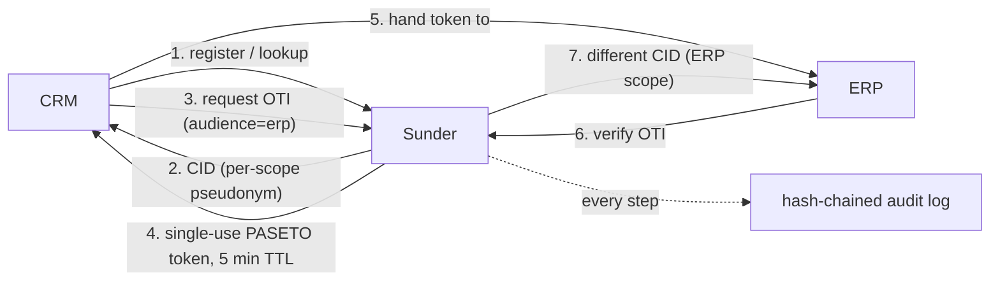

# Sunder

You need to stop keying internal systems on email, phone or national ID -
but every system still needs to find, hand off and reference the same
person without becoming a join key for the rest of your data.

Sunder is a self-hosted, per-organization identity decoupling layer. Each
internal system - CRM, billing, analytics, ticketing - gets its own random
pseudonym for the same person. Only the Sunder instance can map between
them, and every mapping is recorded in a tamper-evident hash chain.

## The mechanism



The CRM and the ERP end up with two different, unrelated pseudonyms for
the same person. Neither can join its records against the other's, even
if both databases leak - there is nothing to join on.

## The CID / OTI / lookup trio

- **CID** - a random per-scope pseudonym. CRM, billing and analytics each
  see a different one for the same person. It is not derived from any
  PII and cannot be reversed to it.
- **OTI** - a PASETO v4 signed, single-use, 5-minute handoff token bound
  to one purpose and one audience, atomically consumed on verification.
  It is the only identity currency systems exchange with each other -
  never a shared CID, never raw PII.
- **Lookup** - find a contact by email or phone via keyed HMAC search
  tokens; the database stores no searchable plaintext. Critically,
  `LOOKUP != AUTHENTICATION` - a lookup hit tells an agent "this record
  exists," it never proves the person on the phone is who they claim.

## Why not a shared IdP

A shared identity provider (or a shared token, or a single "customer ID"
column) recreates the exact problem Sunder exists to remove: one
identifier that every system stores, indexes and eventually leaks. Leak
that identifier once and every system that ever stored it becomes
retroactively joinable against every other one - and nobody can rotate
their email address or national ID the way they can rotate a password.

Sunder's alternative is architectural, not procedural: pseudonyms are
scoped per system by construction, so there is no shared secret for a
breach to expose in the first place. The comparison table in the
[README](https://github.com/fvisic/sunder) lays out how this differs
from Databunker, HashiCorp Vault and DIY encryption in detail; the
[Performance](get-started/performance.md) page has the measured cost of
running it this way.

## Try it

The whole flow above runs on one machine in a few minutes:

```sh
git clone https://github.com/fvisic/sunder && cd sunder/deploy
docker compose up --build -d
docker compose exec sunder /sunder bootstrap
```

Then follow the [Quickstart](get-started/quickstart.md) to create a scoped
client and walk register -> lookup -> OTI handoff end to end.

## Security notes

- Sunder deliberately does **not** let one system read another system's
  pseudonym for the same person. There is no "give me the CRM's CID"
  call for the ERP to make - only a purpose- and audience-bound OTI
  handoff, and the issuer never learns the receiving scope's CID either.
- Sunder deliberately does **not** treat a lookup hit as proof of
  identity. Lookup answers "does a record exist," never "is this person
  who they say they are" - authentication is a separate concern the
  calling system must still implement.
- Sunder deliberately does **not** allow lookup by name alone. A name is
  a narrowing key, not an identifier - unrestricted name search is the
  same enumeration risk a breached PII-keyed database already has today.
