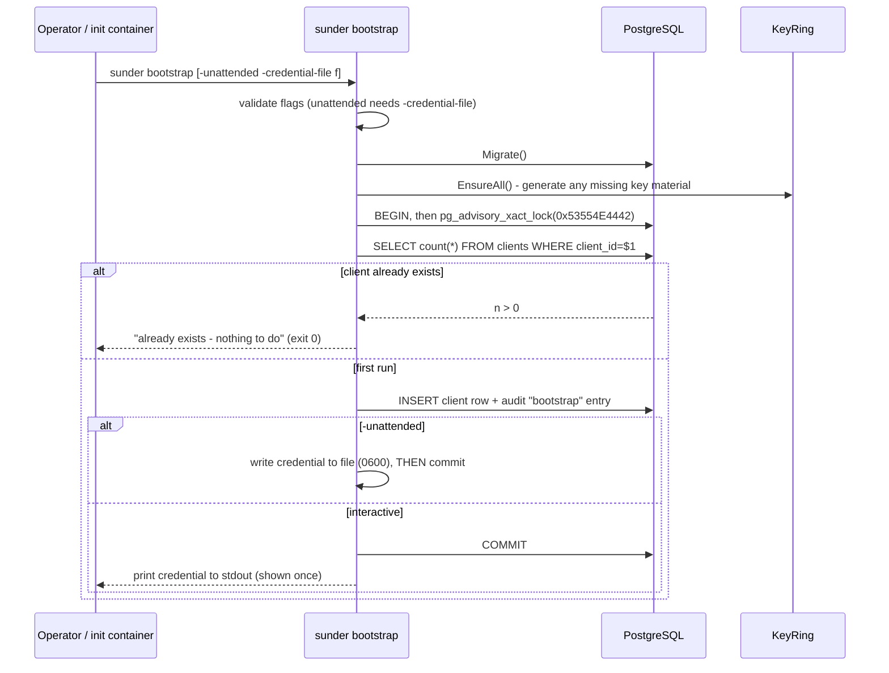

# `sunder bootstrap`

You want the first admin client created exactly once - migrations applied,
keys generated, credential handed to you (or dropped in a file for
automation) - without a second run against an already-initialized instance
doing anything harmful.



## Steps

1. Interactive (local/dev) - credential printed once to stdout:

```bash
sunder bootstrap
```

2. Unattended (CI, init container, provisioning script) - credential
   written to a file instead of stdout, so nothing lands in captured logs:

```bash
sunder bootstrap -unattended -credential-file /run/secrets/sunder-admin-cred
```

Equivalent via environment variables (useful when flags aren't
convenient, e.g. a Helm post-install hook):

```bash
SUNDER_BOOTSTRAP_CREDENTIAL_FILE=/run/secrets/sunder-admin-cred \
SUNDER_BOOTSTRAP_PURPOSES=marketing,support \
sunder bootstrap -unattended
```

3. Custom admin identity and a bounded credential lifetime instead of a
   non-expiring one:

```bash
sunder bootstrap -id ops-admin -scope ops -purposes admin -ttl 90d
```

4. Move the credential into your real secret store immediately, then
   delete the local file:

```bash
vault kv put secret/sunder/admin-cred value=@/run/secrets/sunder-admin-cred
rm /run/secrets/sunder-admin-cred
```

There is no SDK call for this - `bootstrap` is a one-time CLI operation
against the database, run once per environment (or safely rerun; see
below).

## Flags and env vars

| Flag | Env var | Default | Notes |
|---|---|---|---|
| `-unattended` | - | `false` | Requires `-credential-file` or `SUNDER_BOOTSTRAP_CREDENTIAL_FILE` |
| `-id` | `SUNDER_BOOTSTRAP_CLIENT_ID` | `admin` | Admin client id |
| `-scope` | `SUNDER_BOOTSTRAP_SCOPE` | `admin` | Admin client scope |
| `-purposes` | `SUNDER_BOOTSTRAP_PURPOSES` | `admin` | Comma-separated; an admin with no purposes cannot read an attribute or issue an OTI |
| `-credential-file` | `SUNDER_BOOTSTRAP_CREDENTIAL_FILE` | - | Created `0600`; must be a real file |
| `-ttl` | `SUNDER_BOOTSTRAP_TTL` | - (non-expiring) | e.g. `90d` |

## Credential-file rules

- **Must be a real file, not a stream.** A path starting with `/dev/` or
  `/proc/` is rejected before anything is created: such a target cannot be
  chmod'd `0600`, and writing a credential to a stream routes it straight
  into whatever log shipper is watching that stream.
- **Written before commit.** The credential file is written and `chmod
  0600`'d first; the database transaction (client row + audit entry) only
  commits after that succeeds. If the commit then fails, the file is
  removed - so a credential is never left on disk for a client that was
  never actually created.
- **`O_CREATE` does not tighten an existing file's mode** - if the target
  path pre-exists with looser permissions, bootstrap explicitly `chmod`s it
  to `0600` after writing rather than trusting the open call.
- **Move it, don't leave it.** The file is a one-time drop point, not a
  secret store. Load it into Vault/your secret manager and delete the
  local copy immediately (see step 4 above).

## Idempotency

Bootstrap is safe to call unconditionally from a Compose healthcheck,
Helm post-install hook, or provisioning script: the existence check and
insert happen inside one transaction, guarded by a Postgres advisory lock
(`pg_advisory_xact_lock(0x53554E4442)`) so two concurrent bootstrap
invocations cannot both pass the "does this client exist" check and race
to insert. If the admin client already exists, bootstrap prints a message
and exits `0` - it does not rotate or reprint the credential.

## Security notes

- Bootstrap deliberately does **not** support reprinting or rotating the
  credential for an existing client. The credential is shown/written
  exactly once, by design (`docs/RUNBOOK-ALG-MIGRATION.md`-style
  once-only handling for anything credential-shaped) - if you lose it, use
  `sunder client` to create a new client rather than expecting bootstrap to
  recover the old secret.
- Validation happens **before** any row is created: an invalid flag
  combination (e.g. `-unattended` without `-credential-file`, or a bad
  `-ttl`) fails before migrations even run, so a rejected invocation can
  never leave a half-provisioned admin behind.
- The bootstrap admin gets a real, usable purpose list by default
  (`SUNDER_BOOTSTRAP_PURPOSES` defaults to `admin`, not empty) precisely
  because an admin with no purposes is a credential that can authenticate
  but cannot read an attribute or issue an OTI - a footgun the default
  exists to avoid, not a security boundary. Narrow `-purposes` for
  anything beyond initial setup.
