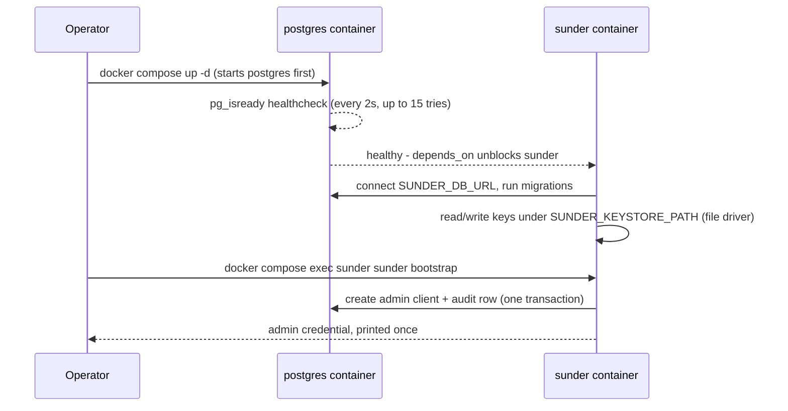

# Docker Compose install

You want a single-host Sunder instance up in one command, with Postgres
already tuned off its 128 MB stock defaults so you are not benchmarking the
default instead of the system.



## Steps

1. From the repo root, build and start the stack:

```bash
docker compose -f deploy/docker-compose.yml up -d --build
```

This starts `postgres:16` with the tuned flags already baked into the
compose command (`shared_buffers=512MB`, `effective_cache_size=1536MB`,
`max_wal_size=4GB`, `random_page_cost=1.1` - sized for a 2-4 GB host, see
[Postgres sizing](postgres-sizing.md)), waits for `pg_isready`, then starts
`sunder` bound to it via `SUNDER_DB_URL`. Both ports are published on
`127.0.0.1` only - the dev database and API never listen on every
interface of your machine.

2. Confirm the API is up:

```bash
curl http://127.0.0.1:8080/healthz
```

3. Run first-run setup - creates the schema and your first admin client
   (see [Bootstrap](bootstrap.md) for every flag):

```bash
docker compose -f deploy/docker-compose.yml exec sunder sunder bootstrap
```

The credential is printed exactly once. Store it before you scroll.

4. Use it - register a contact with the printed credential as a bearer
   token:

```bash
curl -X POST http://127.0.0.1:8080/v1/contacts \
  -H "Authorization: Bearer admin.<secret-from-step-3>" \
  -H "Content-Type: application/json" \
  -d '{
    "email": "ana.horvat@example.hr",
    "phone": "+385911234567",
    "name": "Ana Horvat",
    "attributes": {"loyalty_tier": "gold"}
  }'
```

SDK equivalent: `client.Contacts.Register(ctx, sunder.RegisterInput{Email: "...", ...})`.

## What persists across `docker compose down`

Two named volumes, and they must move together: `pgdata` holds the
database (clients, contacts, audit chain) and `keystore` holds the file
keystore's key material. Recreating the stack without recreating the
volumes must not invalidate issued credentials or orphan registered
contacts - losing one volume but not the other splits that state, so
back them up and restore them as a pair.

```bash
docker compose -f deploy/docker-compose.yml down      # keeps volumes
docker compose -f deploy/docker-compose.yml down -v    # destroys them - confirm first
```

## Security notes

- This compose file is a development/single-host setup, not a production
  topology: it deliberately does **not** enable TLS, mTLS, Vault-backed
  keys, or the signer split - those are what the [Helm chart](helm.md) is
  for. Running it as-is on a routable interface exposes an unauthenticated
  Postgres and an HTTP (not HTTPS) API the moment you change the port
  binding off `127.0.0.1`.
- `POSTGRES_PASSWORD: sunder-dev-only` is exactly that - a fixed
  development password committed to the repo. It does NOT get rotated for
  you; replacing it is your job before this ever leaves localhost.
- The `file` keystore driver keeps key material as plain files under a
  Docker volume on the host running the daemon. It deliberately does not
  support multi-replica deployments (no locking across writers) - that
  constraint is enforced explicitly in the Helm chart, which refuses
  `keystore.type` other than `vault`.
