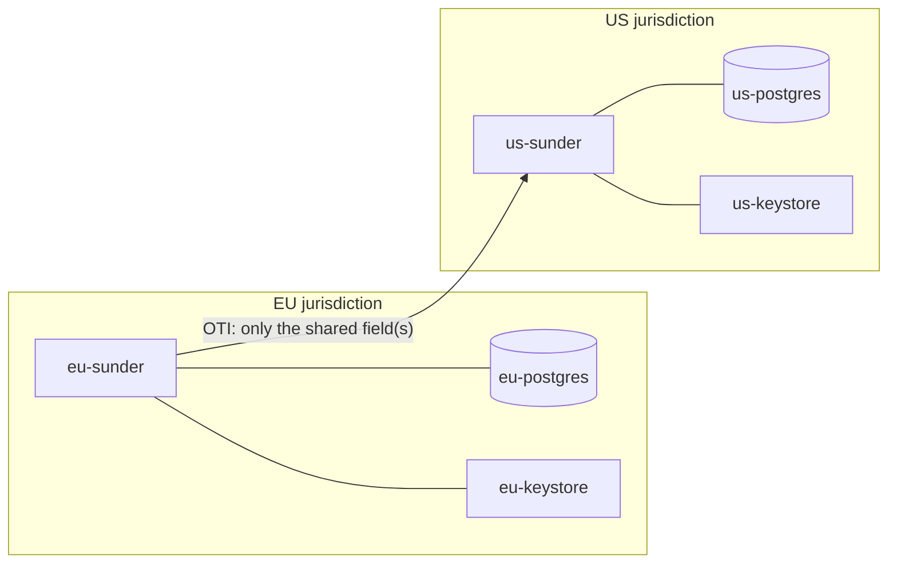

# Multi-Jurisdiction Deployment

When a regulation requires that residents' data stay in a jurisdiction,
Sunder satisfies it by *placement*, not by a replication protocol. F11 is a
deployment pattern, not a product feature: one independent instance per
jurisdiction, and a border that only a one-time identifier can cross. There
is deliberately **no in-product data-plane federation**.

## The pattern



Each instance has its own database, its own keystore, and its own audit
chain. Neither can read the other's key material, data, or audit trail -
losing the EU host cannot expose a single US record, and there is no shared
component whose compromise breaks both. Scopes carry a jurisdiction prefix
by convention (`eu-crm`, `us-crm`); the product does not parse it, but it
makes cross-border data obvious in every audit line and credential.

## The handoff

An EU resident's data stays in the EU. To involve a US system, the EU side
issues an OTI that authorizes sharing only non-identifying fields, unpacks
it at home, and hands the US instance only those fields:

1. **EU registers** the resident with full PII (email, name) plus, say, a
   loyalty tier. Email and name live only in the EU database.
2. **EU issues an OTI** whose `share_attributes` name exactly the shareable
   field(s) - `tier`, never the identifiers.
3. **EU verifies the OTI at home** to recover the authorized field - an
   intra-EU operation that proves the share was deliberate and scoped.
4. **US registers a fresh, US-scoped person** from that field plus a
   US-generated partner reference. No EU email, name, or pseudonym ever
   reaches the US instance.

```bash
docker compose -f examples/multi-jurisdiction/docker-compose.yml up --build -d
examples/multi-jurisdiction/handoff.sh    # walks the EU -> US handoff end to end
```

The runnable two-instance example lives in
[`examples/multi-jurisdiction/`](https://github.com/fvisic/sunder/tree/main/examples/multi-jurisdiction)
in the repository.

## Why not cross-instance OTI verification

!!! note "Deliberate absence"
    Because each instance holds its own keys, a US instance *cannot*
    cryptographically verify an EU-issued token - and that is the point. A
    verifier that trusted a foreign instance's signature would be a
    data-plane federation with all the cross-border coupling this design
    refuses. The OTI is verified at home, and only its authorized output
    (never the subject's identifiers) is handed across. The border stays a
    human/API decision about specific fields, provable in each side's own
    [audit chain](../admin/audit-chain.md).

## DSR is local

Because there is no shared state, a data-subject request on either side is a
local operation on local data. Erasing the EU resident erases the EU record
and its history; it does not, and need not, reach the US instance - which
never held an identifier for that person. See
[rights and consent](../gdpr/rights-and-consent.md) and the
[OTI handoff concept](../concepts/oti-handoff.md) for the mechanism the
border reuses.
