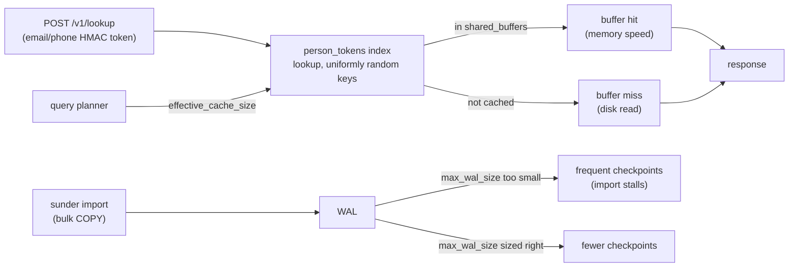

# PostgreSQL sizing

You want to know which Postgres settings actually matter for Sunder and
why - stock defaults (128 MB `shared_buffers`) measure the defaults, not
the system, and Sunder holds no state of its own, so every sizing decision
is a Postgres decision.



## Why this table exists

Keyed-HMAC search tokens (the tokens behind email/phone/name lookup) are
uniformly random by construction - that is what makes them safe to index
without leaking the underlying value. It also means index access has zero
locality: there is no "hot" range of the index that stays warm while the
rest goes cold, unlike a typical CRUD schema with time-ordered or
sequential keys. Cache residency of the index is therefore the whole
performance story, which is why `shared_buffers` matters more here than it
would for most schemas.

The 26.8M-contact scale test in `benchmark/README.md` measured this
directly: stock defaults were replaced with `shared_buffers=12GB`,
`effective_cache_size=32GB`, `max_wal_size=16GB`, `random_page_cost=1.1`
on a 48 GB host before any of the throughput numbers in that report were
taken. The `docker-compose.yml` shipped in this repo bakes in the small-host
column below directly into the Postgres `command:` block.

## The table

| Setting | Small (4 GB host) | Large (48 GB host) | Why |
|---|---|---|---|
| `shared_buffers` | `512MB` | `12GB` | ~25% of the RAM given to Postgres; the token indexes live here |
| `effective_cache_size` | `1536MB` | `32GB` | ~75%; planner hint, allocates nothing |
| `max_wal_size` | `4GB` | `16GB` | bulk ingest (`sunder import`) checkpoints less often |
| `random_page_cost` | `1.1` | `1.1` | NVMe/SSD assumption; keep `4.0` only on spinning disks |
| `maintenance_work_mem` | default | `2GB` | index builds during migrations at scale |

## Applying it

Docker Compose already has the small-host column set in
`deploy/docker-compose.yml`'s `command:` block - nothing to do there.

For a self-managed Postgres instance (Helm points at an external
database, it does not ship one), apply the large-host column with
`ALTER SYSTEM` or your config-management tool:

```sql
ALTER SYSTEM SET shared_buffers = '12GB';
ALTER SYSTEM SET effective_cache_size = '32GB';
ALTER SYSTEM SET max_wal_size = '16GB';
ALTER SYSTEM SET random_page_cost = 1.1;
ALTER SYSTEM SET maintenance_work_mem = '2GB';
```

`shared_buffers` and `maintenance_work_mem` require a restart:

```bash
sudo systemctl restart postgresql
```

`effective_cache_size`, `max_wal_size`, and `random_page_cost` take effect
on reload:

```sql
SELECT pg_reload_conf();
```

SDK/CLI equivalent: none - these are server-side Postgres settings, not a
Sunder flag or environment variable. Sunder never sets them for you beyond
what ships in `deploy/docker-compose.yml`.

## What the numbers actually show

From the same scale test, dataset size alone barely moves lookup
throughput while the buffer cache still holds the index:

| contacts | DB size | `person_tokens` index | buffer hit | lookup c=16 |
|---------:|--------:|-----------------------:|-----------:|------------:|
| 1M | 1.6 GB | 858 MB | 100.00% | 423.6 rps |
| 5M | 8.0 GB | 4289 MB | 100.00% | 398.9 rps |
| 10M | 16 GB | 8581 MB | 99.52% | 269.7 rps |
| 20M | 31 GB | 17 GB | 98.77% | 366.2 rps |

The moment the index stops fitting in `shared_buffers` (10M+ contacts on
this host), buffer hit rate drops below 100% and throughput becomes
noisier - which is the concrete argument for sizing `shared_buffers` to
your actual index size, not to a round fraction chosen without measuring
it.

## Security notes

- None of these settings change what data Postgres holds or who can read
  it - they are pure performance tuning. `random_page_cost` and
  `effective_cache_size` are planner hints; they allocate no memory and
  grant no access.
- Sizing `shared_buffers` too large for the host starves the OS page cache
  and other processes; this table's ratios (~25%/~75% of RAM *given to
  Postgres*) assume Postgres is not sharing the host with another
  memory-hungry service. On a shared host, budget from Postgres's actual
  allocation, not total host RAM.
- `maintenance_work_mem` is only bumped on the large-host column because
  migrations and index builds at that scale are memory-bound; it is not a
  runtime query setting and does not widen any query's working memory.
