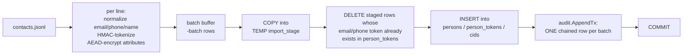

# Bulk Import

You have a large batch of contacts to load into Sunder - a data migration, a nightly feed, a one-off backfill - and calling `POST /v1/contacts` once per record would take hours.

`sunder import` reads a JSON Lines file, computes the same keyed-HMAC search tokens and AEAD-encrypted attribute blobs the API computes, and lands each batch through `COPY` into a staging table before merging it into `persons` / `person_tokens` / `cids` in one transaction - so an imported contact is indistinguishable from one registered through the API, at COPY speed instead of per-request speed.



## Why there is deliberately no bulk HTTP API

There is no `POST /v1/contacts/bulk` and there will not be one. Two reasons, both from the threat model:

- **Bulk-deny**: keeping mass operations off API credentials means a leaked or over-scoped client secret can register or read contacts one at a time, at the rate limit, never exfiltrate or inject a database's worth of records in one call.
- **Cost**: the per-request path (HMAC tokenization, AEAD encryption, a hash-chained audit row, all inside one HTTP round trip) makes a large migration a multi-hour job over the API. `COPY`-based ingest finishes the same work in minutes - 28,319 rows/s measured at the 1M-contact mark of the 26.8M-contact scale test in `benchmark/README.md`.

`sunder import` gets its speed by trading the API credential model for **operator-level access**: it talks to the database and keystore directly, using the server's own crypto engine, key ring and tokenizer - the same code path, just not the same privilege level.

## Steps

**1. Write the input file** - one JSON object per line, at least one of `email` or `phone` required:

```json
{"email": "filip@example.com", "phone": "+385911234567", "name": "Filip Visic", "attributes": {"loyalty_tier": "gold"}}
{"email": "ivana@example.com", "attributes": {"loyalty_tier": "silver"}}
```

`attributes` cannot use the reserved names the importer writes itself (`email`, `phone`, `name`, or `email_2`/`phone_2`-style suffixes) and cannot contain `@` in a key (reserved for external-claim provenance) - both are rejected with the offending line number rather than silently dropped.

**2. Run the import**, from stdin or a file:

```sh
sunder import -file contacts.jsonl -scope crm -batch 5000
```

```sh
cat contacts.jsonl | sunder import -file - -scope crm
```

There is no HTTP/SDK equivalent by design - this is a CLI-only, operator-run path (see above). It needs `SUNDER_DB_URL` and keystore access, same as `sunder serve`.

**3. Read the progress and summary lines:**

```
  line 5000: 4998 imported, 2 skipped as existing, 0 in-file duplicates (5120 rows/s)
import done: 4998 imported, 2 skipped as existing, 0 in-file duplicates, 5000 lines, 976ms
```

A malformed line fails the whole run immediately, with the line number - a silently skipped line in a migration is a lost customer record, so this is fail-closed rather than best-effort.

**4. At scale, size Postgres first.** The 26.8M-contact scale test in `benchmark/README.md` used `shared_buffers=12GB`, `effective_cache_size=32GB`, `max_wal_size=16GB` on a 48 GB host - see `docs/CONFIG.md` ("PostgreSQL sizing") for the small-host equivalents. `max_wal_size` in particular matters here: a larger value means bulk ingest checkpoints less often.

## Idempotency

Re-running the same file after an interruption is safe. Import dedups **per identifier**: a line whose email or phone already exists in `person_tokens` is SKIPPED, not merged and not duplicated - the same dedup invariant the API enforces (one email or phone identifies exactly one person). Two lines in the same file sharing an identifier are caught before they reach the database too (`N in-file duplicates`), so a batch never dies on the unique index with an opaque constraint-violation error.

Each batch commits as a unit: a crash mid-run lands whole completed batches and nothing from the batch in flight, and restarting the import naturally skips everything that already landed.

## Security notes

- Import runs at **operator level** (database + keystore access), never at API-client level. There is no bulk HTTP endpoint an application credential could call, so a compromised or over-scoped client secret cannot exfiltrate or mass-inject records - it is still bound by `sunder import` not existing as an HTTP surface at all.
- Every batch writes **one chained audit record**, not one per contact - the import is auditable (who ran it, what scope, how many rows) without putting a per-contact row into a log that is never pruned. Individual imported contacts are then indistinguishable from API-registered ones in every other table.
- Reserved attribute names (`email`, `phone`, `name`, and their `_2`-style siblings) are rejected the same way the API rejects them - an importer cannot smuggle a caller-controlled value into a slot the identifier normalization owns.
- A concurrent writer (another import, or live API registrations) can win the unique-index race after the importer's own existence check; the batch retries once and the retry's check then sees the committed row and skips it correctly, rather than surfacing a raw constraint error.
