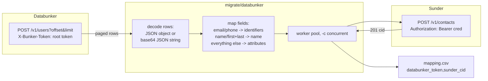

# Migrating from Databunker

You are decommissioning a Databunker instance and need every user record registered in Sunder, with a way to re-key any system that still stores a Databunker token.

The `migrate/databunker` command pages through Databunker's admin listing API, registers each record as a Sunder contact over the normal `POST /v1/contacts` path, and writes a CSV that maps every old token to its new CID.



## Prerequisites

1. Databunker must allow the admin list API: set `list_users: true` under `generic:` in `databunker.yaml` and restart. You need the root token.
2. A Sunder client with the `contacts.register` action and a rate limit generous enough for the run:

```sh
docker compose -f deploy/docker-compose.yml exec sunder /sunder client create \
  -id migrator -name Migrator -scope crm \
  -actions contacts.register -rate 100000
```

## Steps

**1. Dry run first.** Validates every record and reports what would be skipped, without writing anything to Sunder:

```sh
go run ./migrate/databunker \
  -source http://localhost:3000 -source-token <root token> \
  -target http://localhost:8080 -dry-run
```

**2. Run the migration for real**, with a mapping file:

```sh
go run ./migrate/databunker \
  -source http://localhost:3000 -source-token <root token> \
  -target http://localhost:8080 -cred '<client_id>.<secret>' \
  -map-out mapping.csv
```

Flags: `-batch` (Databunker page size, default 100), `-c` (concurrent Sunder registrations, default 8), `-dry-run` (read and validate only, no writes, no `-cred` required), `-keep-source-token=false` (drop the `databunker_token` attribute instead of the default of keeping it).

Each record becomes one `POST /v1/contacts` call, e.g.:

```json
{"email": "filip@example.com", "phone": "+385911234567",
 "name": "Filip Visic",
 "attributes": {"loyalty_tier": "gold", "databunker_token": "abc123..."}}
```

SDK equivalent for a single record: `client.RegisterContact(ctx, sunder.RegisterInput{...})` (Go SDK; same shape in the other SDKs under `sdks/`).

**3. Check the summary line.** The tool prints `migration complete: N migrated, N skipped, N failed (source total N)` and exits non-zero if anything failed - script around that exit code rather than grepping stderr.

**4. Distribute `mapping.csv`** to every system that stored a Databunker token, and re-key those references to the new CIDs (or drop stored handles entirely and resolve via `POST /v1/lookup` at need).

**5. Spot-check.** Look up a few migrated emails/phones and fetch a few attributes through the normal API before trusting the migration:

```sh
curl -s -X POST http://localhost:8080/v1/lookup \
  -H "Authorization: Bearer <client_id>.<secret>" \
  -H "Content-Type: application/json" \
  -d '{"email": "filip@example.com"}'
```

**6. Decommission Databunker only after the mapping is applied everywhere**, then delete every copy of `mapping.csv` - it is linkage material (it lets anyone holding it join old tokens to new CIDs).

## What maps to what

| Databunker | Sunder |
|---|---|
| `email`, `phone` | searchable identifiers (HMAC tokens + attributes) |
| `name`, or `first` + `last` | contact name (narrowing key + attribute) |
| every other profile field | custom attribute (values stringified; a key containing `@` is prefixed `src_` because `@` is reserved for external-claim provenance) |
| user token | `databunker_token` attribute, plus a row in `mapping.csv` |
| agreements / consents | **not migrated** - map them to Sunder consent purposes per your own legal analysis via `POST /v1/consent` |

Records with neither email nor phone have nothing searchable, cannot be registered, and are reported as skipped rather than silently dropped.

## Security notes

- The tool deliberately requires the Databunker **root token**, not a scoped one - `list_users` is an admin-only listing by design on the Databunker side, and this migration is an operator action, not something to wire into an application credential.
- Re-running the migration is safe by construction: Sunder dedups by identifier (`POST /v1/contacts` merges into the existing CID rather than creating a duplicate), so an interrupted run can simply be restarted.
- The tool does **not** migrate consents. Copying a Databunker "agreement" straight into a Sunder consent purpose would let a stale or differently-scoped legal basis silently gate production attribute reads - consent mapping is a legal decision this tool refuses to make for you.
- `mapping.csv` links two identity systems together and must be handled like the PII it can be used to re-derive: distribute it only to the systems that need it, and delete every copy once re-keying is complete.
