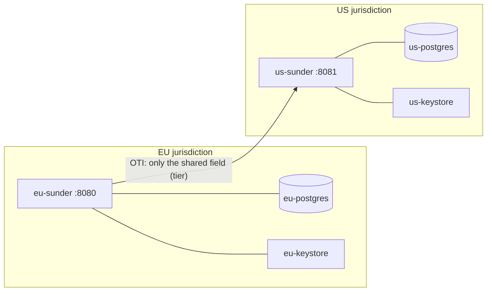

# Multi-jurisdiction deployment (F11)

Sunder has **no in-product data-plane federation** - and that is the point.
Regulations that require data to stay in a jurisdiction are satisfied by
_placement_, not by a clever replication protocol that would itself become
the thing auditors distrust. The pattern is one independent instance per
jurisdiction, and a border that only a one-time identifier (OTI) can cross.

## What this example runs

`docker-compose.yml` brings up two complete, independent Sunder stacks:

| | EU | US |
|---|---|---|
| API | `localhost:8080` | `localhost:8081` |
| Database | `eu-postgres` | `us-postgres` |
| Keystore volume | `eu-keystore` | `us-keystore` |
| Scope convention | `eu-crm` | `us-crm` |
| Audit chain | its own | its own |

Neither instance can read the other's key material, data, or audit chain.
Losing the EU host cannot expose a single US record, and vice versa - that
separation _is_ the compliance story, and there is no shared component whose
compromise breaks both.



## The handoff

`handoff.sh` walks an EU -> US handoff:

1. **EU registers** an EU resident with full PII (email, name) and a loyalty
   tier. The email and name live _only_ in the EU database.
2. **EU issues an OTI** whose `share_attributes` name exactly one shareable
   field: `tier`. The token lives five minutes and identifies nothing on its
   own.
3. **EU unpacks the OTI** (an intra-EU verify) to recover the authorized
   field - proving the share was deliberate and scoped.
4. **US registers a fresh, US-scoped person** from the shared field plus a
   US-generated partner reference. No EU email, no EU name, no EU pseudonym
   ever reaches the US instance.

The value that crosses the border is `tier=gold`. Everything that identifies
the EU resident stays in the EU.

## Why not cross-instance OTI verification?

Because each instance holds its own keys, a US instance _cannot_
cryptographically verify an EU-issued token, and that is deliberate: a
verifier that trusted a foreign instance's signature would be a data-plane
federation with all the cross-border coupling this design refuses. Instead
the OTI is verified _at home_, and only its authorized output - never the
subject's identifiers - is handed across. The border stays a human/API
decision about specific fields, provable in each side's own audit chain.

## Running it

```bash
docker compose -f examples/multi-jurisdiction/docker-compose.yml up --build -d

# create one credential per instance (see handoff.sh for the exact actions)
docker compose -f examples/multi-jurisdiction/docker-compose.yml exec eu-sunder \
  /sunder client create -id partner -scope eu-crm \
  -actions contacts.register,oti.issue,oti.verify,attributes.read -purposes partner_handoff
docker compose -f examples/multi-jurisdiction/docker-compose.yml exec us-sunder \
  /sunder client create -id importer -scope us-crm \
  -actions contacts.register -purposes partner_handoff

export EU_CRED=...   # printed by the first command
export US_CRED=...   # printed by the second
examples/multi-jurisdiction/handoff.sh
```

## Erasure, export, consent - all local

Because there is no shared state, a data-subject request on either side is a
local operation on local data. Erasing the EU resident erases the EU record
and its audit-visible history; it does not, and need not, reach the US
instance, which never held an identifier for that person in the first place.
